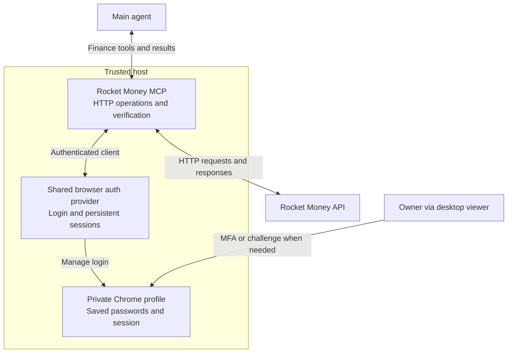

# Plan 031: Rocket Money MCP and shared browser authentication

**Status:** Saved-login correction awaiting release process cleanup repair
**Issue:** [#135](https://github.com/coletaylor788/puddles/issues/135)
**Last updated:** 2026-10-18

## Human section

### Design

#### Goal

Give main scoped Rocket Money tools. Keep login and sessions in a shared browser auth provider on the trusted host. Keep the Rocket Money MCP server focused on HTTP operations.

#### System overview

#### Component ownership

| Component | Owns |
|---|---|
| Main | Request interpretation, private finance rules and authorization. |
| Rocket Money MCP | Tool contracts, Rocket Money HTTP requests, operation limits and result verification. |
| Shared browser auth | Saved-login access, site login configuration, private profiles, session reuse and renewal. |
| Desktop viewer | Owner-assisted login in the auth provider's browser. |

The shared provider can serve other host integrations. Rocket Money remains a small custom MCP server using standard HTTP and MCP libraries.

#### Request flow

1. **Request:** Main calls a scoped tool; MCP validates its inputs and allowed operation.
2. **Authenticate:** MCP obtains a host-only authenticated client from the shared provider.
3. **Execute:** MCP performs any transaction preflight and calls the Rocket Money API.
4. **Return:** MCP verifies the result and returns financial data or a bounded status.

#### Login and session reuse

| Session state | Provider behavior |
|---|---|
| Ready | Reuse the session across calls and conversation turns. |
| Expired | Attempt bounded renewal or login using the host browser's saved login. |
| Needs interaction | Return `needs_user_login`; the owner completes MFA or a challenge through the desktop viewer. |

The provider owns browser-to-HTTP session synchronization. Start with Chrome's password manager in the private host profile; an external password manager is optional. Renewal waits for delayed redirects and autofill, submits an already-filled form at most once on an approved login origin, and returns success only after verifying the pinned account. The browser runs in the owner's desktop login session. MFA and OS prompts still require owner interaction. Authentication is an internal host dependency, not a model-facing tool.

#### Access boundary

| Stays on the trusted host | Available to the model |
|---|---|
| Passwords, cookies, tokens, browser profiles and authenticated HTTP client | Scoped finance tools, financial results, coverage and operation status |

Normal model tools and test sandboxes cannot access the private browser, its debugger or session files. Main's financial rules stay in private runtime skill and memory.

#### MCP tool contract

All parameters are required unless marked `?`. IDs and dates are strings; dates use `YYYY-MM-DD`. Each write uses a stable UUID `requestId`.

| Tool | Parameters | Returns |
|---|---|---|
| `rocket_money_status` | None | Last observed login state and recovery guidance. Does not initiate login. |
| `rocket_money_read` | `query`, `variables?` (JSON object), `operationName?` | Native financial data, page information and any query errors. Read-only; one page/request at a time. |
| `rocket_money_set_category` | `requestId`, `transactionId`, `expectedCategoryId`, `categoryId` | Write outcome and observed category. |
| `rocket_money_set_date` | `requestId`, `transactionId`, `expectedDate`, `date` | Write outcome and observed date. |
| `rocket_money_operation_status` | `requestId` | Outcome of an earlier write, checked through its record and a read-back if needed. Never repeats the write. |

**Write outcomes:** `verified`, `unchanged`, `conflict`, `blocked` or `unknown`. Expected values must match before an edit. Reusing a request ID never repeats the mutation; different arguments under that ID are rejected.

**Operation status** answers “Did that edit take effect?” after a timeout or lost response. It can also report `in_progress` or `not_found`; neither permits a blind retry. Login status is separate: it answers whether the account session is ready.

Calls use a host-configured account. Credentials, URLs and headers are never parameters. Invalid or unsupported requests return a bounded error. Read queries must match the reviewed catalog; `operationName` is required for a document with multiple operations.

#### Financial safeguards

MCP controls API destinations and accepts only reviewed read queries. Writes check identity and expected current values, then read back the result. Category changes never propagate to other transactions. Stable request IDs and a small outcome journal support recovery without blindly repeating a write.

#### Deployment and scope

Both components run on the trusted host. Prefer a shared auth library in the host process, or an existing supported host service. Reuse does not require a new daemon.

Other financial writes, scheduled automation and a general integration framework remain outside this design. The [future-scope appendix](031-rocket-money-deferred.md) retains follow-on work. Approval to ship activates the required synthetic regressions and release checks.

The release command must stop its test processes before recovery can start. Some test runners and fixture gateways create separate process groups. On cancellation, the controller records their process identities before signaling their parents, then stops and joins the retained descendants. The application test runner also retains its process group until every writer stops, even if the group leader exits first. These corrections preserve the existing limits and financial boundaries.

### Status

**Approval:** Production approved.
**Approval reference:** Owner instruction, “this design is approved, implement and ship it, giving me directions to login when ready”; subsequent approval covers publication and retained independent review.
**Scope:** The approved five tools, shared host authentication, private main skill and desktop login shortcut. No live financial mutations during validation.

The shared-session correction is merged. The adapter shares one MCP connection across native plugin instances and module reloads, preventing competing owners of the same browser profile. It serializes dispatch, configuration changes, and shutdown while retaining per-call authorization and content guards.

The committed packaged check exercises two native plugin instances and requires one connection across four synthetic status calls. Deployment identities, operator setup, and account readiness belong in private release records. The saved-login timing correction is in review. It replaces the immediate form check and fixed sleep with bounded renewal and pinned-account verification. No financial operation runs before that verification succeeds.

DEV validation exposed detached test writers surviving a capacity stop. The environment is stopped and the failed attempt is retained. Repairing that release prerequisite is within the approved implementation scope. The release manager installs the independently tested controller correction between tickets. A fresh application attempt still requires updated input bindings, review, and DEV acceptance.

## Agent section

### State

- Canonical repository design; supersedes the earlier combined gateway and browser-worker proposals.
- The implementation uses the shared `browser-auth` Python package, official MCP SDK and a main-only OpenClaw stdio adapter. The adapter retains the host process across turns and applies outbound LeakGuard plus inbound classification and redaction.
- Main's skill and owner-specific finance rules remain private runtime content, managed outside the repository.
- Shared-session correction shipped in [PR #261](https://github.com/coletaylor788/puddles/pull/261), merge `5ef80fdc542227803895e19a42f61ca16be5bc4f`. Native plugin runtime stores are scoped to managed instances. Keep the MCP bridge in one process slot, retain per-call authorization and guards, and serialize dispatch, account changes and shutdown. Regression coverage uses distinct native plugin instances and the packaged MCP subprocess.
- Saved-login DEV validation stopped on its resource bound. The release command lost detached descendants when intermediate parents exited. The test runner separately dropped group ownership and its escalation timer on leader close. Repair the maintained command and runner seams; never replay the consumed attempt or increase limits to hide the failure.

### Scope and acceptance criteria

- Main-only financial exploration and the two permitted transaction edits.
- Shared auth owns login and persistent sessions; Rocket Money MCP owns API operations.
- Credential/session material is inaccessible to normal model tools and test sandboxes. Authorized host administration/debug remains trusted.
- Preserve existing private rules, including clarification for ambiguous or unauthorized changes and title-based date corrections. Do not publish account-specific rules.
- Report incomplete coverage and uncertain outcomes explicitly. Do not replay an uncertain mutation after repairing login.
- Other financial writes, scheduling and a general integration framework are outside scope.

### Architecture and decisions

- Use a standard HTTP client and MCP library. Keep Rocket Money-specific logic limited to API contracts, validation and result verification.
- Prefer the runtime's supported MCP binding and local stdio. Confirm compatibility before choosing an adapter.
- Reuse a supported browser authentication implementation where practical. Select that implementation during design validation; this proposal does not claim an existing provider already satisfies the contract.
- The [tool table above](#mcp-tool-contract) defines the model-facing contract. Query catalog contents and live provider field compatibility still require validation.
- Authenticated clients are host-only and bound to configured accounts and approved destinations. The model cannot select arbitrary credentials, URLs or authentication headers.
- The auth provider owns browser-to-HTTP session synchronization. Login automation and refresh behavior must be validated for Rocket Money; do not assume an OAuth refresh flow exists.
- Provider responses and diagnostics must exclude authentication material. Financial source text remains untrusted input.

### Implementation

1. The shared `browser-auth` package owns the private Chrome session and authenticated HTTP client.
2. The MCP server validates reviewed reads and guarded category/date writes.
3. The adapter shares its host subprocess across native plugin instances. Main uses a private Workshop skill; the operator shortcut opens the login flow.

### Validation

The renewal regression covers delayed redirects, delayed autofill, delayed session completion, silent success, missing credentials, challenges, ambiguous forms, unexpected origins and identity/provider failures. Only an expired-session result permits another verification attempt. The form is never submitted twice during one recovery. Synthetic browser checks retain cookie synchronization and restart coverage.

The [validation appendix](031-rocket-money-deferred.md) retains the validation scope. The shared-session fix passed 15 focused plugin tests, typechecking, packaging, and retained independent review. The committed `openclaw-plugins/rocket-money/scripts/check-shared-session.mjs` exercises the packaged adapter and real MCP subprocess with two native instances, four synthetic calls, and one connection. It uses fresh state and does not access a live account.

The synthetic registry check does not establish authenticated account access. Keep environment acceptance and account readiness in private release records. Financial write validation remains fixture-only.

Release regressions reproduce a synchronous phase launcher and callback followed by a detached test runner and detached writing fixture. Both timeout and external cancellation must stop both detached processes and fixture growth before recovery. Runner regressions cover a leader exiting before its TERM-resistant descendant. Run the full independent release package suite and focused application lifecycle tests, then retain independent review of the source and installation packet. Changed controller and test-runner inputs invalidate their prior packet bindings and affected acceptance proofs.

### Rollout and rollback

Use the installed release controller for deployment and rollback. Verify whether an accepted build already contains the correction before scheduling another release. Preserve the controller-owned recovery backup and private account state. Disable the tools if authentication isolation or result verification fails; never share the authenticated browser with an agent. Keep operator login setup bound to the installed runtime location.

### Review log

- 2026-10-06: Selected trusted-host execution with model-visible tools only.
- 2026-10-07: Recorded the proposal in repository docs; separated shared browser authentication from the Rocket Money-specific MCP client. Organized the review surface around the diagram, component ownership, request flow and boundaries. Consolidated concise MCP contracts into the main design; made an external password manager optional.

### Checklist

- [x] Define the shared auth and Rocket Money responsibilities.
- [x] Preserve credential isolation, private rules and verified writes.
- [x] Keep testing in the deferred appendix.
- [x] Select the auth implementation and validate the synthetic installed integration.
- [x] Merge the shared-session correction with retained independent review.
- [x] Commit packaged coverage for distinct native plugin instances sharing one MCP connection.
- [x] Keep deployment and account readiness in private release coordination.
