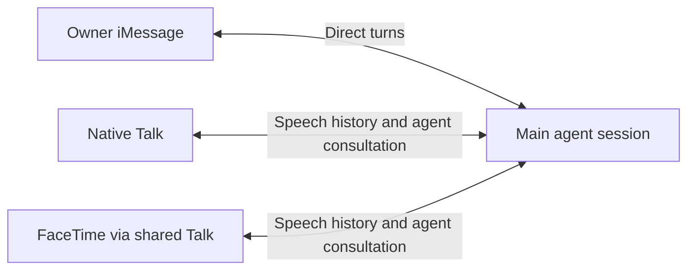

# One main conversation across text and voice

Status: Released; physical acceptance pending
Issue: [#239](https://github.com/coletaylor788/puddles/issues/239)
Last updated: 2026-10-13

## Human section

### Design

Use OpenClaw's native main session for the owner's iMessage, Talk, and FaceTime
interactions. Text a request, continue it by voice, and return to text with the
same conversation history.

#### What is already native

OpenClaw describes the [main session](https://docs.openclaw.ai/concepts/main-session)
as one rolling conversation across channels, including iMessage. Native
[Talk](https://docs.openclaw.ai/nodes/talk/realtime-sessions) saves finalized
user and assistant speech live into the active agent session. Its
[session ownership contract](https://docs.openclaw.ai/nodes/talk/session-ownership)
keeps delegated agent replies in that same session and defaults Talk to main.
A separate audio connection does not require a separate conversation.

Stock [FaceTime](https://docs.openclaw.ai/plugins/facetime) is an exception:
it documents separate per-call consultations. Our existing
[shared Talk integration](../openclaw-setup/patches/facetime-talk-client.md)
already connects FaceTime to native Talk history and agent execution.

#### Routing and context

Route the owner's iMessage binding to `agent:main:main` using the documented
[`bindings[].session.dmScope: "main"`](https://docs.openclaw.ai/channels/channel-routing)
override. Keep the global per-sender isolation for everyone else. FaceTime
already targets main in shared Talk mode; native Talk should open main by default.
This makes the ordinary Home conversation the shared destination instead of
requiring voice clients to select an iMessage-specific session.

Reuse native transcript persistence, delegation, and session queueing. Text
enters the harness directly; voice delegates work to it when needed. Ordinary
spoken discussion also stays in history. Replies use their originating channel.

The persistent text harness needs one adapter fix: before each ordinary turn,
read bounded, ordered context from the same native transcript and supply it as
historical context. Keep the current request and native model session intact.
Exclude hidden consultation inputs and never replay history as new actions.

Preserve existing histories during the routing change and carry the current text
discussion into main through a one-time context handoff using the native `chat.inject` API. This
appends an assistant note without starting an agent turn. Preserve the original
text histories. Prepare and verify the handoff at activation; routing alone does
not transfer old context.

#### Validation boundary

Prove text-to-call-to-text continuity, including speech that never needed an
agent consultation. Also test a text sent during an open call. The documentation
establishes shared history, but does not promise immediate updates to every
already-open realtime provider connection. Fix only a demonstrated gap through
the existing Talk path. Do not prebuild a new synchronization layer.

### Status

**Approval:** Production approved. **Approval reference:** The requester said
“approved, ship the change” on 2026-10-08. Scope includes implementation,
validation, landing, production deployment, rollback, and task cleanup.

The installed production runtime passes both conversation checks. Owner iMessage,
Talk, and shared FaceTime use main, while other senders remain isolated. The
release manager confirmed the accepted artifact includes this change. A bounded
historical reference now connects the preserved old text history to main.
Physical text/call/text acceptance remains owner initiated.

## Agent section

### State

Public implementation merged in PR #240 at `baad973`; companion routing merged
in its paired change. The conversation patch and installed scenarios are unchanged
on current main. Production checks passed on October 13 through the adopted
release process. The manager confirmed inclusion in the accepted production
artifact. The one-time native history handoff passed readback without a model
turn or message delivery. No separate application rebuild was needed.

### Scope and acceptance criteria

Owner text and voice share main, including delegated results and ordinary speech.
Other senders remain isolated. Preserve earlier histories, avoid replaying actions,
and keep replies on their originating channel.

### Architecture and decisions

Use native per-binding DM scope and Talk session targeting. The maintained
`shared-conversation-context.patch` refreshes the persistent text harness from
bounded native history before ordinary turns. Audio connections remain separate
from the durable conversation. No custom session broker or transcript database.

### Implementation

Routing, shared history refresh, and cumulative regressions are merged and reviewed.
The final handoff refreshed both histories and the release queue, then appended
one 311-character historical reference through native `chat.inject`. Readback
confirmed one note and an unchanged original transcript. No old action was replayed.

### Validation

On October 13, both maintained scenarios passed against the installed production
runtime using disposable synthetic state and denied network access:

- `main-conversation.mjs` (2.22 seconds): owner isolation, Talk default main,
  text-to-voice, speech without consultation, text during a call, reconnect, and
  transcript deduplication.
- `shared-harness-context.mjs` (1.21 seconds): ordinary and resumed harness context,
  later text corrections, unchanged current request, and replay-safe journal.

Both reported zero model calls and external writes. Native configuration confirmed
one owner iMessage binding to main, global per-channel-peer isolation, and shared
FaceTime Talk targeting main. Original histories remain present, with newer text
activity in main. These checks do not prove an immediate update inside an already
open audio connection. Physical text/call/text acceptance remains outstanding.

### Rollout and rollback

Use the installed release controller and current manager. Do not repeat the old
combined release or change legacy recovery holds. Preserve the accepted runtime
and backup. Coordinate the history note outside an active deployment; never
restore an older backup over newly accepted conversation activity.

### Review log

Retained independent review cleared the complete implementation, routing migration,
patch composition, and cumulative test mapping. October 13 work verifies installed
behavior and updates release documentation; no runtime behavior changes.

### Checklist

- [x] Verify native contracts and approve production scope.
- [x] Implement, review, merge, and pass installed DEV checks.
- [x] Pass installed production conversation checks.
- [x] Confirm accepted artifact and finish the history handoff.
- [ ] Complete source documentation and owned-artifact cleanup.
- [ ] Owner validates physical text/call/text continuity.
