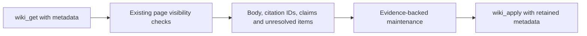

# Preserve wiki metadata during maintenance

**Status:** Implementation
**Issue:** [#242](https://github.com/coletaylor788/puddles/issues/242)
**Last updated:** 2026-10-13

## Human section

### Design

A wiki maintainer must read existing citations and claims before updating a
summary. The current page tool hides those fields, while synthesis updates can
replace them. Expose the existing mutation fields through the authorized page
reader so maintenance can preserve unrelated evidence.

#### Page reader

Successful wiki reads include complete known mutation metadata. Agents opt into
model-visible JSON with `includeMetadata: true`. The JSON includes body pagination;
metadata itself is complete. Ordinary body reads remain unchanged. Memory fallback
has no wiki mutation metadata. This adds no filesystem access or cross-agent read
permission.

#### Maintainer and release

A maintainer reads all body pages and metadata before updating an existing page.
It preserves unrelated citations and evidence, and defers edits if metadata is
unavailable. Runtime support must be installed before a prompt requests it.
Operator schedules and personal configuration remain outside this public change.

### Status

**Approval:** Production approved. **Approval reference:** The requester approved
shipping the two wiki maintenance fixes in this chat on 2026-10-08. This additive
read correction resolves the independent review's citation-preservation finding
within that approved maintainer work. No access boundary or destructive migration
is added. Landing, deployment, rollback and cleanup are authorized.

The metadata reader is merged and installed in accepted production. The dependent
maintainer cutover is using the installed release controller. Its complete
application gate passed, then TEST rejected a target binding mismatch. That
binding is corrected. A subsequent installed check exposed a fixture cleanup
race; the runtime remains unchanged while the test harness is repaired. No live
maintenance run is forced.

## Agent section

### State

Assigned public worktree, branch `codex/wiki-maintenance`. Public PR #243 is merged
and included in the accepted runtime. Companion prompt changes remain private.
The release manager owns promotion, backup, recovery, and tested-head merge. The
wiki owner keeps one source pair and reusable build workspace for remaining work.

### Scope and acceptance criteria

- Complete supported mutation metadata is visible to an agent on request.
- Ordinary body output, page visibility and filesystem access remain unchanged.
- Existing citations and claim evidence survive a summary refresh.
- Install runtime support before a dependent maintenance prompt.

### Architecture and decisions

Return known mutation fields after the existing reader selects an authorized page.
Render them in tool text because model harnesses may omit the separate details
object. Keep body pagination and leave raw filesystem access unchanged.

### Implementation

Patch `wiki-get-mutation-metadata.patch` against OpenClaw 2026.9.6, commit
`eb377ac59e6c9fd6c7705028034812becf00271b`. `query.ts` returns known mutation fields
after visibility filtering. `tool.ts` renders JSON only when requested. The patch
includes the user-facing contract and tool regressions. Register it last in the
cumulative manifest and deployment list.

### Validation

Retained independent reviewer has cleared the source behavior after finding that
body-only reads could lose citations. Focused coverage includes a rich claim and
citation roundtrip, body pagination, unchanged default text, denied bridge reads,
and existing query/read tests. The runtime is installed. Deployed DEV and a complete application gate passed
for the companion cutover. Final TEST, production read-only acceptance, and owned
cleanup remain pending through the new release manager.

### Rollout and rollback

The installed controller promotes one immutable runtime through DEV, TEST and
PROD. The full application gate precedes TEST, a verified backup, production
read-only acceptance, and tested-head merge. Preserve healthy production on
failure. Runtime support is installed before the operator prompt requests it.
Rollback the dependent prompt before restoring an older runtime. Never force a
production maintenance turn as a deployment test.

### Test fixture cleanup repair

A completed gateway could leave a process group that no longer existed before
the harness sent a final kill signal. On macOS that signal returned a permission
error, and the early failure left provider fixture servers open. The harness now
records the spawned process identity, verifies group members before signaling,
and never escalates against a disappeared or reused group. Permission errors for
a group that still exists remain failures. Every provider cleanup runs even if
process shutdown fails. If the leader has already exited and a surviving group
cannot be proven to belong to the fixture, cleanup refuses to signal it. The
identified owner must recover those processes; provider resources still close.
The final child-close join retains the enclosing test and application command
timeout. These changes affect test orchestration only.

Committed regressions cover group disappearance, permission failures, identity
reuse, surviving owned descendants, foreign owners, and provider cleanup after
failure. A real detached process exercises the host process inspection. The same
reviewer checks this repair before a fresh complete gate and promotion.

### Review log

Retained independent reviewer cleared source and patch packaging. The original
citation-preservation finding is resolved. No new actionable findings remain.

### Checklist

- [x] Diagnose metadata omission and retain independent review.
- [x] Implement additive read contract and committed regression candidates.
- [x] Finish focused tests and packaging review.
- [ ] Land source and complete the accumulated release workflow.
- [ ] Verify production read-only and clean task-owned development artifacts.
