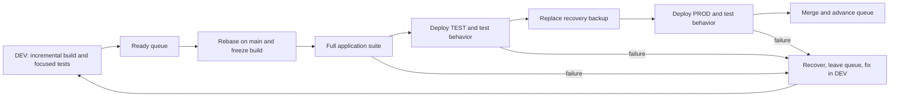

# A smaller development and delivery loop

## Human section

### Design

#### Summary

Slow builds, unrelated tests, stalled releases, and retained workspaces make small
changes expensive. Separate application and release tooling. Each feature keeps
one incremental build. Ship ready features one at a time, then merge and delete
the workspace. Keep stage tests, one recovery backup, and a persistent manager.

#### Implementation plan

1. **Separate release tooling.** Move deployment, queue, backup, recovery, and
   cleanup into `packages/release`, with its own dependencies, build, and tests.
2. **Make tests durable.** Separate application tests from release tests. Replace
   historical rollout assertions with expected behavior; retire completed repairs.
3. **Use the feature build everywhere.** Make incremental DEV output complete
   enough for TEST and PROD. Consolidate duplicate test runs and fixture setup.
4. **Install the queue and backup flow.** Reconcile current PROD and outstanding
   recovery first. Script the sequence below, including failure and final merge.
5. **Add the manager.** Use the [release-manager skill](../../.github/skills/release-manager/SKILL.md)
   for continuous coordination and an hourly fallback wake-up.
6. **Add `finalize`.** Remove finished workspaces. Measure application-suite time,
   release-suite time, queue waiting, and disk growth separately.

#### Two independent packages and test suites

| What changes | Required suite | What it proves |
|---|---|---|
| Application code, prompts, configuration, or dependencies | Full application suite before PROD | The assistant behaves correctly |
| Release tooling or its dependencies | Full release suite before installing the tool update | Deploy, backup, restore, queue, and cleanup work |
| Both | Each package's suite | Both changes work independently |

`packages/release` owns its manifest, dependency lock, build output, and CI job.
It accepts a built application directory and commands to start and check it.
It does not compile the application or import its internals. Its tests use a
small fixture service. Application tests do not import deployment machinery.
`packages/e2e` becomes the application's functional integration suite.

Application changes reuse the installed release tool. Tool changes build and test
that tool independently, then install it between releases. No application rebuild
or joint test gate is required. Each package's changes select its own CI job.

Every application deployment still runs the full application suite, TEST
integration checks, an actual verified backup, and PROD acceptance checks.
Executing backup and recovery is different from rerunning their implementation
tests. PROD checks are read-only; writes and delivery use recording fixtures.

#### Durable tests

Test outcomes: the selected model is used, explicit user choices survive, history
remains readable after restart, and approved actions work while unapproved ones
fail. Update tests when expected behavior changes. Do not keep obsolete code or
assertions just because an earlier release introduced them.

Some existing tests really do convert old database schemas, repair specific old
records, or rewrite stored model defaults. Replace rollout-specific fixtures with
behavior tests. Remove completed one-time helpers once current data and the retained
backup no longer need them. Existing-data readability remains application behavior;
generic snapshot restoration belongs to release tooling. An unfinished feature
still needs tests of its intended behavior, not a permanent migration category.

#### Build and release

Every agent owns one incremental build and shares the package cache. Anyone can
use DEV, with a short lock around shared deployment and checks. There is no separate
release builder or arbitrary build limit.

Reviewed, ready features enter one queue. At the front, rebase on main, rebuild
changed inputs, and freeze the output used through TEST and PROD. Environment
configuration stays separate. Paired public/private PRs form one ticket.

Failures recover and leave the queue; repaired features rejoin at the back. After
successful PROD tests, merge the tested revision. If merge fails, finish merging
or restore before advancing. Keep GitHub calls outside the service-stop transaction.

#### Backup and recovery

Confirm healthy PROD, invalidate the old backup, and capture current runtime,
configuration, and state directly into the same backup location. Verify in place.
There is no second full copy. Failed or interrupted capture leaves current PROD
in place; deployment waits for a successful backup. Losing the older backup during
capture is accepted.

Keep that backup through PROD tests and merge. Restore on deployment or test
failure. Hold intake during acceptance when restoration would discard new data;
later recovery must preserve new live writes.

#### Manager and cleanup

The manager keeps approved work moving and requests owner updates at milestones
and blockers. Owners stay engaged through production and merge. An hourly chat
heartbeat resumes stalled work; scripts recover interrupted operations. Stay quiet
when nothing changes.

Each feature's worktrees, build, logs, and test state live in one workspace.
Deployments, the installed release tool, shared caches, and backup live outside it.
After deployment and merge, `finalize` stops owned processes, verifies deployments
no longer use its files, retires worktrees, and deletes the workspace. Preserve
unpublished source and other owners' files.

Results stay in the conversation. Retain only active queue, deployment, and
recovery state. Retry cleanup independently without holding the queue. Actual disk
errors stop the operation needing that space.

### Status

**Approval:** Proposed. This reflects the requester's queue, independent suites,
durable tests, direct backup replacement, manager, and cleanup requirements.
Research and guidance are complete; runtime implementation is not yet approved.

## Agent section

### State

Current tooling still uses the combined gate. The replacement is not installed.

### Scope and acceptance criteria

Prove application-only and tooling-only changes build and test independently.
Promote one feature output; recover failures; advance the queue; finalize ownership.

### Architecture and decisions

Move release helpers from `packages/e2e/{src,bin,tests}` and companion adapters
into their respective `packages/release` packages. Separate dependency installation
and CI selection. Keep application fixtures and mapped product tests in E2E.

### Implementation

Update the runner, deployment wrapper, and companion imports together. Remove the
private gate's catch-all test discovery. Consolidate mapped targets by project
and reuse prepared inputs. Adapt existing backup and storage helpers: backup
refresh currently preserves the old copy, and task completion refuses worktrees.
Use app archival for managed worktrees after removing generated ignored output.

### Validation

The measured combined suite took 26m52s. Its 4m55s predecessor recovery test belongs
to release tooling. Removing that command alone projects 21m58s for the old
application path, not a measured new runtime. Benchmark further consolidation,
fixture simplification, and worker counts. Update test guidance in the development
skill; test executable behavior, never document wording.

### Rollout and rollback

Until adoption, follow the current [runner](../../packages/e2e/README.md),
[coordination](../../packages/e2e/DEPLOYMENT_COORDINATION.md), and
[storage](../../packages/e2e/DEVELOPMENT_STORAGE.md) guides. Install one controller;
keep its version fixed during each ticket. Reconcile legacy recovery references
before removing completed migration helpers or old deployment paths.

### Review log

Author consistency review complete. Earlier independent review returned no result.
Implementation requires normal code review and package validation.

### Checklist

- [x] Audit process, test costs, package boundaries, and migration fixtures.
- [x] Publish proposal and requested agent guidance.
- [ ] Approve and implement the replacement; benchmark and verify adoption.
