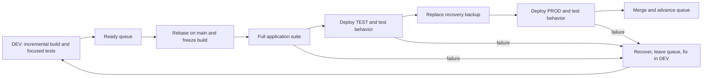

# A smaller development and delivery loop

## Human section

### Design

#### Summary

Slow builds, unrelated tests, stalled releases, and retained workspaces make small
changes expensive. Separate application and release tooling. Each feature keeps
one incremental build. Ship ready features one at a time, then merge and delete
the workspace. Keep stage tests, one recovery backup, and a persistent manager.

#### Implementation plan

1. **Separate release tooling.** Move deployment, queue, backup, recovery, and
   cleanup into `packages/release`, with its own dependencies, build, and tests.
2. **Make tests durable.** Separate application tests from release tests. Replace
   historical rollout assertions with expected behavior; retire completed repairs.
3. **Use the feature build everywhere.** Make incremental DEV output complete
   enough for TEST and PROD. Consolidate duplicate test runs and fixture setup.
4. **Install the queue and backup flow.** Reconcile current PROD and outstanding
   recovery first. Script the sequence below, including failure and final merge.
5. **Add the manager.** Use the [release-manager skill](../../.github/skills/release-manager/SKILL.md)
   for continuous coordination and an hourly fallback wake-up.
6. **Add `finalize`.** Remove finished workspaces. Measure application-suite time,
   release-suite time, queue waiting, and disk growth separately.

#### Two independent packages and test suites

| What changes | Required suite | What it proves |
|---|---|---|
| Application code, prompts, configuration, or dependencies | Full application suite before PROD | The assistant behaves correctly |
| Release tooling or its dependencies | Full release suite before installing the tool update | Deploy, backup, restore, queue, and cleanup work |
| Both | Each package's suite | Both changes work independently |

`packages/release` owns its manifest, dependency lock, build output, and CI job.
It accepts a built application directory and commands to start and check it.
It does not compile the application or import its internals. Its tests use a
small fixture service. Application tests do not import deployment machinery.
`packages/e2e` becomes the application's functional integration suite.

Application changes reuse the installed release tool. Tool changes build and test
that tool independently, then install it between releases. No application rebuild
or joint test gate is required. Each package's changes select its own CI job.

Every application deployment still runs the full application suite, TEST
integration checks, an actual verified backup, and PROD acceptance checks.
Executing backup and recovery is different from rerunning their implementation
tests. PROD checks are read-only; writes and delivery use recording fixtures.

#### Durable tests

Test outcomes: the selected model is used, explicit user choices survive, history
remains readable after restart, and approved actions work while unapproved ones
fail. Update tests when expected behavior changes. Do not keep obsolete code or
assertions just because an earlier release introduced them.

Some existing tests really do convert old database schemas, repair specific old
records, or rewrite stored model defaults. Replace rollout-specific fixtures with
behavior tests. Remove completed one-time helpers once current data and the retained
backup no longer need them. Existing-data readability remains application behavior;
generic snapshot restoration belongs to release tooling. An unfinished feature
still needs tests of its intended behavior, not a permanent migration category.

#### Build and release

Every agent owns one incremental build and shares the package cache. Anyone can
use DEV, with a short lock around shared deployment and checks. There is no separate
release builder or arbitrary build limit.

Reviewed, ready features enter one queue. At the front, rebase on main, rebuild
changed inputs, and freeze the output used through TEST and PROD. Environment
configuration stays separate. Paired public/private PRs form one ticket.

Failures recover and leave the queue; repaired features rejoin at the back. After
successful PROD tests, merge the tested revision. If merge fails, finish merging
or restore before advancing. Keep GitHub calls outside the service-stop transaction.

#### Backup and recovery

Confirm healthy PROD, invalidate the old backup, and capture current runtime,
configuration, and state directly into the same backup location. Verify in place.
There is no second full copy. Failed or interrupted capture leaves current PROD
in place; deployment waits for a successful backup. Losing the older backup during
capture is accepted.

Keep that backup through PROD tests and merge. Restore on deployment or test
failure. Hold intake during acceptance when restoration would discard new data;
later recovery must preserve new live writes.

#### Manager and cleanup

The manager keeps approved work moving and requests owner updates at milestones
and blockers. Owners stay engaged through production and merge. An hourly chat
heartbeat resumes stalled work; scripts recover interrupted operations. Stay quiet
when nothing changes.

Each feature's worktrees, build, logs, and test state live in one workspace.
Deployments, the installed release tool, shared caches, and backup live outside it.
After deployment and merge, `finalize` stops owned processes, verifies deployments
no longer use its files, retires worktrees, and deletes the workspace. Preserve
unpublished source and other owners' files.

Results stay in the conversation. Retain only active queue, deployment, and
recovery state. Retry cleanup independently without holding the queue. Actual disk
errors stop the operation needing that space.

### Status

**Approval:** Production approved. **Approval reference:** requester, October 12,
2026: "approved, implement all the fixes" and act as release manager for validation.
Implementation, review, deployment, rollback, merge, and cleanup are authorized.
The requester supplied a replacement reader owner for the trial. Coordinate with
that owner and leave the failed reader chats untouched.

## Agent section

### State

Implementation is in progress on `codex/independent-release-package`. Both release
packages build independently. The replacement is not installed. The new reader
owner is preparing the trial feature and has accepted release coordination.
The manager's hourly chat heartbeat is active.

### Implementation

The standalone controller implements FIFO ownership, rebase and merge guards,
one directly replaced backup, recovery, DEV locking, and workspace finalization.
It supervises deployments and standalone backup capture through worker crashes.
Recovery records when intake can reopen so a retry cannot restore over new writes.
Finalization reserves the workspace before stopping processes and resumes partial
deletion from its external journal.

The application builder reuses prepared source, the package store, UI output,
Python payloads, and bundled plugin output. It produces one deployable directory.
The application gate groups mapped public/private tests by project and keeps
separate test modes. Release tests live outside the application workspace and CI.
Installed behavior checks are being connected to the new complete output; none
may silently skip because their prepared runtime was omitted.

Guidance now specifies durable behavior tests, the queue order, one backup,
scripted cleanup, and trusted configured model providers. Source and development
context may go to those providers; secrets and credentials may not.

### Validation

The old combined run took 26m52s. The new release package passes 422 tests in about
1m59s, including killed workers and recovery after intake reopens. The first
application run passed mapped regressions but rejected escaping dependency links
in its output. The builder now preserves relative links; its warm rebuild and
installed behavior checks are under validation.
One measured upstream infrastructure group takes 3m12s; report that cost separately
from build, installed checks, and queue time. Do not present a partial run as the
new full-suite duration.

### Review

The independent reviewer found four material gaps: recovery could restore again
after intake reopened, standalone backup lacked crash supervision, partial cleanup
could lose its marker, and installed application coverage was not connected.
The first three have passing regressions. Complete the application coverage and
resume the same reviewer against the complete current diff before adoption.

### Adoption and rollback

PROD is healthy. Shared slots were free at the read-only inventory. Current
runtime, state, helper services, and legacy recovery still need a complete adoption
mapping. Stop the old backup/controller jobs only as part of that coordinated
switch. Preserve existing reader recovery until its owner confirms its consumers
are retired. Do not run both controller versions against the same services.

Install tested release tooling between tickets. Use the reader feature to exercise
TEST and its tests, backup, PROD and its tests, merge, queue advancement, and cleanup.
Keep production intake held until acceptance and merge finish. The replacement is
not considered adopted until this path passes on the real target.

### Checklist

- [x] Audit process, costs, package boundaries, and historical tests.
- [x] Obtain implementation and production approval.
- [x] Implement independent packages, incremental output, controller, and finalize.
- [x] Start the manager heartbeat and coordinate the replacement reader owner.
- [ ] Complete all application coverage, benchmark, and retained review.
- [ ] Publish implementation and install the tested tooling.
- [ ] Run the reader trial through production, merge, and cleanup.
