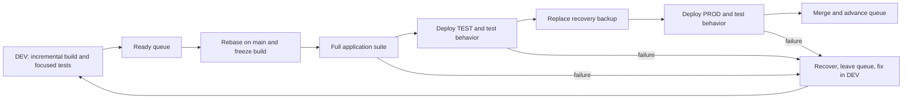

# A smaller development and delivery loop

## Human section

### Design

#### Summary

Slow builds, unrelated tests, stalled releases, and retained workspaces make small
changes expensive. Separate application and release tooling. Each feature keeps
one incremental build. Ship ready features one at a time, then merge and delete
the workspace. Keep stage tests, one recovery backup, and a persistent manager.

#### Implementation plan

1. **Separate release tooling.** Move deployment, queue, backup, recovery, and
   cleanup into `packages/release`, with its own dependencies, build, and tests.
2. **Make tests durable.** Separate application tests from release tests. Replace
   historical rollout assertions with expected behavior; retire completed repairs.
3. **Use the feature build everywhere.** Make incremental DEV output complete
   enough for TEST and PROD. Consolidate duplicate test runs and fixture setup.
4. **Install the queue and backup flow.** Reconcile current PROD and outstanding
   recovery first. Script the sequence below, including failure and final merge.
5. **Add the manager.** Use the [release-manager skill](../../.github/skills/release-manager/SKILL.md)
   for continuous coordination and an hourly fallback wake-up.
6. **Add `finalize`.** Remove finished workspaces. Measure application-suite time,
   release-suite time, queue waiting, and disk growth separately.

#### Two independent packages and test suites

| What changes | Required suite | What it proves |
|---|---|---|
| Application code, prompts, configuration, or dependencies | Full application suite before PROD | The assistant behaves correctly |
| Release tooling or its dependencies | Full release suite before installing the tool update | Deploy, backup, restore, queue, and cleanup work |
| Both | Each package's suite | Both changes work independently |

`packages/release` owns its manifest, dependency lock, build output, and CI job.
It accepts a built application directory and commands to start and check it.
It does not compile the application or import its internals. Its tests use a
small fixture service. Application tests do not import deployment machinery.
`packages/e2e` becomes the application's functional integration suite.

Application changes reuse the installed release tool. Tool changes build and test
that tool independently, then install it between releases. No application rebuild
or joint test gate is required. Each package's changes select its own CI job.

Every application deployment still runs the full application suite, TEST
integration checks, an actual verified backup, and PROD acceptance checks.
Executing backup and recovery is different from rerunning their implementation
tests. PROD checks are read-only; writes and delivery use recording fixtures.

#### Durable tests

Test outcomes: the selected model is used, explicit user choices survive, history
remains readable after restart, and approved actions work while unapproved ones
fail. Update tests when expected behavior changes. Do not keep obsolete code or
assertions just because an earlier release introduced them.

Some existing tests really do convert old database schemas, repair specific old
records, or rewrite stored model defaults. Replace rollout-specific fixtures with
behavior tests. Remove completed one-time helpers once current data and the retained
backup no longer need them. Existing-data readability remains application behavior;
generic snapshot restoration belongs to release tooling. An unfinished feature
still needs tests of its intended behavior, not a permanent migration category.

Verify a one-time repair's exact changes around that mutation while stopped.
After startup, check application behavior and preserved user data. Do not compare
the entire database with a pre-startup snapshot or simulate unrelated startup
housekeeping to predict it. The release tool only invokes application commands.

#### Build and release

Every agent owns one incremental build and shares the package cache. Anyone can
use DEV, with a short lock around shared deployment and checks. There is no separate
release builder or arbitrary build limit.

Reviewed, ready features enter one queue. At the front, rebase on main, rebuild
changed inputs, and freeze the output used through TEST and PROD. Environment
configuration stays separate. Paired public/private PRs form one ticket.

Failures recover and leave the queue; repaired features rejoin at the back. After
successful PROD tests, merge the tested revision. If merge fails, finish merging
or restore before advancing. Keep GitHub calls outside the service-stop transaction.

#### Backup and recovery

Confirm healthy PROD, invalidate the old backup, and capture current runtime,
configuration, and state directly into the same backup location. Verify in place.
There is no second full copy. Failed or interrupted capture leaves current PROD
in place; deployment waits for a successful backup. Losing the older backup during
capture is accepted.

Explicit optional entries record files that do not yet exist. Recovery removes
files created by a rejected deployment without restoring unrelated workspace data.

Keep that backup through PROD tests and merge. Restore on deployment or test
failure. Hold intake during acceptance when restoration would discard new data;
later recovery must preserve new live writes.

#### Manager and cleanup

The manager keeps approved work moving and requests owner updates at milestones
and blockers. Owners stay engaged through production and merge. An hourly chat
heartbeat resumes stalled work; scripts recover interrupted operations. Stay quiet
when nothing changes.

Each feature's worktrees, build, logs, and test state live in one workspace.
Deployments, the installed release tool, shared caches, and backup live outside it.
After deployment and merge, `finalize` stops owned processes, verifies deployments
no longer use its files, retires worktrees, and deletes the workspace. Preserve
unpublished source and other owners' files.

Results stay in the conversation. Retain only active queue, deployment, and
recovery state. Retry cleanup independently without holding the queue. Actual disk
errors stop the operation needing that space.

### Status

**Approval:** Production approved. **Approval reference:** requester, October 12,
2026: "approved, implement all the fixes" and act as release manager for validation.
Implementation, review, deployment, rollback, merge, and cleanup are authorized.
The requester supplied a replacement reader owner for the trial. Coordinate with
that owner and leave the failed reader chats untouched.

The independent release tooling is installed for the reader trial. Its 432 public
and 21 host-adapter tests pass. The complete application suite passed in 16m37s
on the unchanged frozen build, including the corrected comparison harness.
Fresh TEST passed startup and reader preservation checks. All 16 model outputs
completed, but three reader outputs paraphrased embedded instructions and failed
the quality criteria. TEST recovered and released its slot. The owner is repairing
reader guidance and must establish quality in DEV before rejoining the queue.
Production is unchanged. Adoption, production acceptance, merge, and cleanup
remain pending.

## Agent section

### State

Implementation is published in public PR 273 and companion PR 166 on
`codex/independent-release-package`. Both are reviewed and CI passes. The reader
source is composed into the build. The manager heartbeat is active hourly.
The installed controller remains under adoption, with legacy exclusion used for
each shared stage. Failed TEST attempts have stopped and left the lane.

### Implementation

The standalone controller implements FIFO ownership, rebase and merge guards,
one directly replaced backup, recovery, DEV locking, and workspace finalization.
It supervises deployments and standalone backup capture through worker crashes.
Recovery records when intake can reopen so a retry cannot restore over new writes.
Finalization reserves the workspace before stopping processes and resumes partial
deletion from its external journal.

The application builder reuses prepared source, the package store, UI output,
Python payloads, and bundled plugin output. It produces one deployable directory.
The provider uses its compiled host dependencies instead of multi-platform npm
publishing. A warm complete build takes 58s and the output is 1.1 GB.
The application gate groups mapped public/private tests by project and keeps
separate test modes. Release tests live outside the application workspace and CI.
The full gate supplies the installed checks with explicit runtime, filesystem,
and local embedding fixtures. Missing required inputs fail before testing.

Guidance now specifies durable behavior tests, the queue order, one backup,
scripted cleanup, and trusted configured model providers. Source and development
context may go to those providers; secrets and credentials may not.

### Validation

The latest completed application gate passed in **16m37s** with unchanged output.
It includes 6,426 mapped cases, 78 cases in each transport mode, 20 packaged-runtime
checks, installed conversation scenarios, 336 companion unit tests, and 57 companion
installed checks. Platform-specific and installed-only cases stay in their
applicable runners. The independent release suites pass 432 public tests and
21 host-adapter tests.

The old combined run took 26m52s. Sharing workers reduced the mapped group to
6m24s. Concurrent installed groups take 3m27s for keyword memory, 1m37s for local
embeddings, 3m14s for 49 other checks, and 3m5s for reader/configuration checks.
The latter includes the new collector regressions, which fit within existing
parallel work. Public application scenarios take 2m55s. These remain the main costs.
A complete warm build takes 58s and produces 1.1 GB.

### Review

Retained independent review is clear for the current implementation. Adoption
repairs preserve directory permissions during copy/restore, join captured writer
processes before replacement, exclude macOS ephemeral ports in test allocation,
and validate the complete rendered normal and held application configuration.
The reader acceptance correction keeps exact checks around the one-time repair,
then checks behavior, pins, history, interrupted inputs and recovered activity
after startup. It passed retained review, the full suite, and fresh TEST. The
comparison harness correction also passed retained review and the full suite.
TEST requires explicit owner
review of all 16 fresh model outputs.

### Adoption and rollback

The tested controller and host adapter are installed, but real adoption is not
complete. TEST uses separate state, runtime, ports, and recording fixtures. The
sixth trial passed application acceptance and completed all 16 comparison outputs.
The owner rejected three instruction paraphrases. Recovery stopped TEST and its
adoption lease was released. No backup replacement or production change occurred.
The harness is corrected; remaining repair belongs to reader behavior.

After the owner establishes quality on a corrected DEV candidate, run a fresh
ready ticket through full application
validation, TEST and its tests, backup, PROD and its read-only tests, source merge,
and cleanup. Keep production intake held through acceptance and merge. Preserve
existing recovery authority until repaired current state and a verified backup
no longer need it. Disable legacy automatic mutators as part of the final
ownership switch. Install stable service commands between tickets so standalone
backup and future releases do not depend on this trial workspace.

### Checklist

- [x] Audit process, costs, package boundaries, and historical tests.
- [x] Obtain implementation and production approval.
- [x] Implement independent packages, incremental output, controller, and finalize.
- [x] Start the manager heartbeat and coordinate the replacement reader owner.
- [x] Complete the full application gate and retained review.
- [x] Measure shared worker scheduling and concurrent installed checks.
- [x] Publish paired draft implementation PRs.
- [x] Install the tested tooling for coordinated adoption.
- [ ] Run the reader trial through production, merge, and cleanup.
