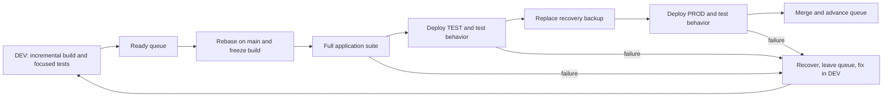

# A smaller development and delivery loop

## Human section

### Design

#### Summary

Slow builds, unrelated tests, stalled releases, and retained workspaces make small
changes expensive. Separate application and release tooling. Each feature keeps
one incremental build. Ship ready features one at a time, then merge and delete
the workspace. Keep stage tests, one recovery backup, and a persistent manager.

#### Implementation plan

1. **Separate release tooling.** Move deployment, queue, backup, recovery, and
   cleanup into `packages/release`, with its own dependencies, build, and tests.
2. **Make tests durable.** Separate application tests from release tests. Replace
   historical rollout assertions with expected behavior; retire completed repairs.
3. **Use the feature build everywhere.** Make incremental DEV output complete
   enough for TEST and PROD. Share deployment, configuration rendering, startup,
   and feature checks between DEV and TEST. Prove changed behavior before queueing.
4. **Install the queue and backup flow.** Reconcile current PROD and outstanding
   recovery first. Script the sequence below, including failure and final merge.
5. **Add the manager.** Use the [release-manager skill](../../.github/skills/release-manager/SKILL.md)
   for continuous coordination and an hourly fallback wake-up.
6. **Add `finalize`.** Remove finished workspaces. Measure application-suite time,
   release-suite time, queue waiting, and disk growth separately.

#### Two independent packages and test suites

| What changes | Required suite | What it proves |
|---|---|---|
| Application code, prompts, configuration, or dependencies | Full application suite before PROD | The assistant behaves correctly |
| Release tooling or its dependencies | Full release suite before installing the tool update | Deploy, backup, restore, queue, and cleanup work |
| Both | Each package's suite | Both changes work independently |

`packages/release` owns its manifest, dependency lock, build output, and CI job.
It accepts a built application directory and commands to start and check it.
It does not compile the application or import its internals. Its tests use a
small fixture service. Application tests do not import deployment machinery.
`packages/e2e` becomes the application's functional integration suite.

Application changes reuse the installed release tool. Tool changes build and test
that tool independently, then install it between releases. No application rebuild
or joint test gate is required. Each package's changes select its own CI job.

Every application deployment still runs the full application suite, TEST
integration checks, an actual verified backup, and PROD acceptance checks.
Executing backup and recovery is different from rerunning their implementation
tests. PROD checks are read-only; writes and delivery use recording fixtures.

#### Durable tests

Test outcomes: the selected model is used, explicit user choices survive, history
remains readable after restart, and approved actions work while unapproved ones
fail. Update tests when expected behavior changes. Do not keep obsolete code or
assertions just because an earlier release introduced them.

Some existing tests really do convert old database schemas, repair specific old
records, or rewrite stored model defaults. Replace rollout-specific fixtures with
behavior tests. Remove completed one-time helpers once current data and the retained
backup no longer need them. Existing-data readability remains application behavior;
generic snapshot restoration belongs to release tooling. An unfinished feature
still needs tests of its intended behavior, not a permanent migration category.

Verify a one-time repair's exact changes around that mutation while stopped.
After startup, check application behavior and preserved user data. Do not compare
the entire database with a pre-startup snapshot or simulate unrelated startup
housekeeping to predict it. The release tool only invokes application commands.

#### Build and release

Every agent owns one incremental build and shares the package cache. Anyone can
use DEV, with a short lock around shared deployment and checks. There is no separate
release builder or arbitrary build limit.

DEV and TEST use the same deployment and application commands. Only bindings for
state, ports, identities, credential references, and recording endpoints differ.
DEV runs complete configuration validation, startup, health, and the feature's
installed use cases, including real model output when relevant. TEST repeats those
checks after rebase with reset state and broader coverage. A late failure prompts
a fix in the shared path or missing DEV coverage before another release attempt.

Reviewed, ready features enter one queue. At the front, rebase on main, rebuild
changed inputs, and freeze the output used through TEST and PROD. Environment
configuration stays separate. Paired public/private PRs form one ticket.

Failures recover and leave the queue; repaired features rejoin at the back. After
successful PROD tests, merge the tested revision. If merge fails, finish merging
or restore before advancing. Keep GitHub calls outside the service-stop transaction.

#### Backup and recovery

Confirm healthy PROD, invalidate the old backup, and capture current runtime,
configuration, and state directly into the same backup location. Verify in place.
There is no second full copy. Failed or interrupted capture leaves current PROD
in place; deployment waits for a successful backup. Losing the older backup during
capture is accepted.

Explicit optional entries record files that do not yet exist. Recovery removes
files created by a rejected deployment without restoring unrelated workspace data.

Keep that backup through PROD tests and merge. Restore on deployment or test
failure. Hold intake during acceptance when restoration would discard new data;
later recovery must preserve new live writes.

#### Manager and cleanup

The manager keeps approved work moving and requests owner updates at milestones
and blockers. Owners stay engaged through production and merge. An hourly chat
heartbeat resumes stalled work; scripts recover interrupted operations. Stay quiet
when nothing changes.

Each feature's worktrees, build, logs, and test state live in one workspace.
Deployments, the installed release tool, shared caches, and backup live outside it.
After deployment and merge, `finalize` stops owned processes, verifies deployments
no longer use its files, retires worktrees, and deletes the workspace. Preserve
unpublished source and other owners' files.

Results stay in the conversation. Retain only active queue, deployment, and
recovery state. Retry cleanup independently without holding the queue. Actual disk
errors stop the operation needing that space.

### Status

**Approval:** Production approved. **Approval reference:** requester, October 12,
2026: "approved, implement all the fixes" and act as release manager for validation.
Implementation, review, deployment, rollback, merge, and cleanup are authorized.
The requester supplied a replacement reader owner for the trial. Coordinate with
that owner and leave the failed reader chats untouched.

The independent release tooling and shared DEV/TEST path are installed. The trial
passed the full application suite, TEST, backup, PROD, source merge, and normal
intake. Stable service commands now own new releases. The accepted healthy state
is in the single backup. Superseded recovery, its scheduled tooling, and finished
build workspaces are removed. The manager retains one published source checkout
until the app's active tool processes release it. This does not hold the queue.

A further copy repair is in progress. On macOS, installing under an owner-only
umask can remove group and other permissions from regular files and symbolic
links. The controller correctly rejects that changed output. The shared copy
helper will preserve those authored modes, alongside directory modes, without
following symbolic links or relaxing the artifact check. It will ship as a
separate release-tool update. Its independent suite and retained review pass;
installation is pending.

## Agent section

### State

Implementation is merged in public PR 273 and its companion change. The trial
completed and the queue is empty. The manager heartbeat remains active hourly.
Legacy recovery, its scheduled tooling, generated builds, and temporary workspaces
are removed after source verification. Only one published source checkout remains
held by active app tools. The manager owns its deferred cleanup in the conversation.

### Implementation

The standalone controller implements FIFO ownership, rebase and merge guards,
one directly replaced backup, recovery, DEV locking, and workspace finalization.
It supervises deployments and standalone backup capture through worker crashes.
Recovery records when intake can reopen so a retry cannot restore over new writes.
Finalization reserves the workspace before stopping processes and resumes partial
deletion from its external journal.

The application builder reuses prepared source, the package store, UI output,
Python payloads, and bundled plugin output. It produces one deployable directory.
The provider uses its compiled host dependencies instead of multi-platform npm
publishing. A warm complete build takes 58s and the output is 1.1 GB.
The application gate groups mapped public/private tests by project and keeps
separate test modes. Release tests live outside the application workspace and CI.
The full gate supplies the installed checks with explicit runtime, filesystem,
and local embedding fixtures. Missing required inputs fail before testing.

Guidance now specifies durable behavior tests, the queue order, one backup,
scripted cleanup, and trusted configured model providers. Source and development
context may go to those providers; secrets and credentials may not.

### Copy permissions repair

The shared `copy` helper restores regular file permissions after the copy and
uses `lchmod` for a symbolic link whose mode differs. Directory permissions are
restored after their children. Platforms unable to restore a differing link mode
fail explicitly. No process umask changes and no digest exceptions are added.
Regressions exercise DEV, TEST, PROD, backup and rollback under umask `077`, with
public files, executables, private files and relative symbolic links. The source
artifact and caller umask must remain unchanged. Installation is pending; failed
application qualification cannot be reused after adopting the repaired tool.

### Validation

The independent release suite passes 455 public tests: 71 Node cases and 384
Vitest cases. Application and host integration results belong to their own
runners. Keep current full-suite timing and slow-check analysis in the manager
conversation; do not add a retained test-report archive.

The original combined suite took about 27 minutes. Grouping mapped tests by
project, sharing workers, and running independent installed groups concurrently
reduces that cost while preserving required coverage. The complete suite also
passed after adding environment parity checks; timings remain in the conversation.

### Review

Retained independent review is clear for the current implementation. Adoption
repairs preserve directory permissions during copy/restore, join captured writer
processes before replacement, exclude macOS ephemeral ports in test allocation,
and validate the complete rendered normal and held application configuration.
The reader acceptance correction keeps exact checks around the one-time repair,
then checks behavior, pins, history, interrupted inputs and recovered activity
after startup. It passed retained review, the full suite, and fresh TEST. The
comparison harness correction also passed retained review and the full suite.
TEST requires explicit owner
review of all 16 fresh model outputs.

### DEV and TEST parity

The October 13 review found a shared deployment function but unequal callback
context: DEV omitted the feature workspace and ID. Both stages now use one context
helper. A regression runs real child callbacks through DEV and TEST and failed on
the old implementation. Independent review is clear and the full release suite
passes (49 Node cases and 384 Vitest cases). Application preparation and quality
checks use the same hooks in DEV and TEST. A parameterized helper supplies their
environment bindings.

Use the full renderer, application preparation, held service, state acceptance,
and model quality checks in deployed DEV. Exercise inherited normal service
settings, including a normal gateway port that differs from the held port. The
held launcher must apply its declared binding after the normal environment loads.
Keep the full application suite at release time; do not run it after every DEV edit.
Use shared parameterized setup instead of per-attempt setup changes.

### Adoption and rollback

The trial completed with one frozen output through DEV, the full application
suite, TEST and PROD. Source merge and normal intake passed. Stable service
commands live outside the trial workspace. The legacy backup scheduler and its
tooling are removed. The manager conversation holds current ownership and recovery
state.

Replace the single backup with accepted healthy state before retiring old recovery.
Use the guarded retirement script to close exact obsolete references and resources.
Do not rewrite old references to an incompatible backup format. Preserve live
consumers, then finalize owned workspaces. Cleanup never holds the ready queue.

### Checklist

- [x] Audit process, costs, package boundaries, and historical tests.
- [x] Obtain implementation and production approval.
- [x] Implement independent packages, incremental output, controller, and finalize.
- [x] Start the manager heartbeat and coordinate the replacement reader owner.
- [x] Complete the full application gate and retained review.
- [x] Measure shared worker scheduling and concurrent installed checks.
- [x] Publish paired draft implementation PRs.
- [x] Install the tested tooling for coordinated adoption.
- [x] Run the trial through production, merge, and normal intake.
- [x] Install stable service commands and disable legacy automatic retention.
- [x] Retire obsolete recovery, its scheduled tooling, and finished build workspaces.
- [ ] Retire the published source checkout after active app tools release it.
