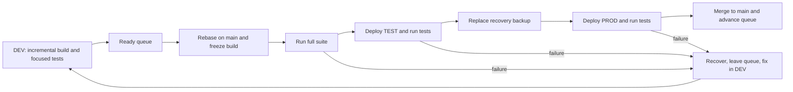

# A smaller development and delivery loop

## Human section

### Summary

Each feature agent builds once and develops in its own workspace. Ready features
ship one at a time: rebase, test, deploy, then merge. Keep the full suite, one
recovery backup, and a persistent release manager. Delete finished workspaces.

### Implementation plan

1. **Reconcile today's state.** Identify PROD, main, unreleased features, and
   active recovery needs before replacing the current process.
2. **Use the feature build everywhere.** Make incremental DEV output complete
   enough for TEST and PROD. Remove separate release builds and handoff paths.
3. **Consolidate tests.** Combine duplicate runs and setup. Keep every required
   test before PROD, plus TEST integration and PROD acceptance checks.
4. **Install the release queue.** Rebase at the front, follow the sequence below,
   and send failed features back to DEV. Script backup replacement and recovery.
5. **Add the manager.** Use the [release-manager skill](../../.github/skills/release-manager/SKILL.md)
   to coordinate owners continuously, with an hourly wake-up as a fallback.
6. **Add `finalize`.** After deployment and merge, one command removes the
   feature's worktrees and generated files. Measure test time and disk growth.

### Design

#### Build and release

Every agent owns one incremental build. There is no separate release builder or
arbitrary two-agent limit. Share the package cache. Rebase and rebuild changed
inputs when the queue turn starts, then promote that same output through TEST and
PROD. Environment configuration stays separate.

Anyone can use DEV, with a short lock around shared deployment and checks.
Reviewed, ready features enter one queue. One controller owns a ticket through
final merge; paired public/private PRs are one ticket. Main records the last
completed PROD release. Failures recover, leave, and rejoin at the back after
repair. If PROD succeeds but merge fails, finish merging or restore before
advancing. Keep GitHub calls outside the service-stop transaction.

Run the full accumulated suite before PROD. TEST runs integration tests; PROD runs
read-only acceptance tests. Write/delivery scenarios use recording fixtures.
Combine public/private targets by test project, run each required test once on
the composed candidate, and reuse build output and fixture setup. Keep all
assertions, including real recovery. Measure test-worker parallelism on this host.
Report slow tests in the conversation.

#### Backup and recovery

Before changing PROD, confirm it is healthy. A script invalidates the old backup
and captures current runtime, configuration, and state directly into the same
backup location. Verify it in place, without another full copy. Only a successful
backup permits deployment. If capture fails or is interrupted, leave current PROD
in place and retry. Losing the older backup during capture is accepted.

Keep the pre-deployment backup through PROD tests and merge. Restore it if
deployment or tests fail. Hold intake during acceptance when restoration would
otherwise discard new data; later recovery must preserve new live writes.

#### Manager and workspace cleanup

The manager keeps approved work moving and asks owners for updates at milestones
and blockers. Owners stay engaged through deployment and merge. An hourly chat
heartbeat resumes stalled work. Scripts handle locks and recovery if the agent
stops. Stay quiet when nothing changes.

Each feature's worktrees, build output, logs, and test state live in one owned
workspace. Deployments and the backup live outside it. After deployment and merge,
`finalize` stops its processes, checks that deployments no longer use its files,
removes its worktrees, and deletes the workspace. Preserve unpublished source.
Never delete shared caches or another feature's files.

Test results stay in the conversation. Retain only operational state needed for
the active queue, deployment, and recovery. Retry cleanup independently without
holding the queue. An actual disk error stops the operation needing that space.

### Status

**Approval:** Proposed. The requester specified the release order, full suite,
stage tests, single backup, manager skill, and workspace finalization. The skill
is requested; implementation of the redesigned controller is not yet approved.

## Agent section

### Implementation and validation

- Adapt existing slot, pipeline, activation, and storage helpers. Follow the
  [runner](../../packages/e2e/README.md), [coordination](../../packages/e2e/DEPLOYMENT_COORDINATION.md),
  and [storage](../../packages/e2e/DEVELOPMENT_STORAGE.md) guides until adoption.
- Replace merged-source admission with reviewed, pushed, pinned feature revisions.
  Preserve required checks; verify final merged runtime inputs match.
- Reuse `openclaw-backup-retention.mjs refresh TARGET_JSON POLICY_JSON WORK_DIR`
  as the entrypoint, changing its current preserve-old behavior to direct
  replacement. Mark the backup invalid during capture and valid only after
  verification. Gate deployment on that result, reuse it for activation recovery,
  and reconcile legacy recovery references before adoption.
- Build `finalize` around `openclaw-storage.mjs task-complete` and producer cleanup.
  It currently refuses Git worktrees, so add worktree retirement. Use app archival
  for managed worktrees, removing generated ignored output first. Run cleanup from
  outside its target directory and make interruption resumable.
- Test full-suite enforcement, unchanged coverage after consolidation, packaging,
  stage failures, interrupted backup/restore, failed final merge, queue fairness,
  agent loss, and cleanup boundaries. Never test real message sends.
- The measured suite took 26m52s, including a 4m55s recovery test. Benchmark grouped
  discovery, deduplication, shared setup, and worker counts on identical inputs.
  Claim improvements only after measurement.
- Adopt one controller at a time. Independent review of the original proposal
  returned no result; implementation still needs normal review and validation.
