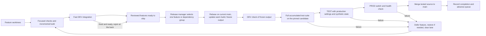

# A smaller development and delivery loop

## Human section

### Summary

Keep development parallel and make releases a single, continuous queue. Any
feature agent can use DEV, with a short lock for shared deploy/check operations.
When its release turn starts, it rebases on main, runs the full test suite,
deploys to TEST, deploys to PROD, then merges to main. A failed feature returns
to DEV and rejoins at the back after repair.

Use one complete incremental build and package path across environments. Keep
rollback and full pre-production testing, report slow tests, and bound disk use
by retaining a small number of builds and recovery copies. This remains a
proposal; implementation has not started.

### Implementation plan

1. **Establish the starting point.** Reconcile the actual PROD runtime and
   configuration with main and the release record. Identify the ready features,
   dependencies, and active recovery needs. Preserve existing recovery material
   until its owner and replacement are clear.
2. **Unify builds and packaging.** Make the fast local loop produce the complete
   runtime used by DEV, TEST, and PROD. Reuse unchanged compiled output and the
   package store, freeze candidates once, and separate configuration from runtime
   identity. Remove the separate draft composition path after parity is proven.
3. **Keep the full suite and measure its cost.** Run every accumulated regression
   against the prepared candidate without forcing a clean rebuild. Record setup,
   command, file, and available test timings. Report slow tests and optimization
   options. Prove that failed or incomplete suites cannot reach PROD.
4. **Install the release queue.** Adapt the existing controller to own one ticket
   from rebase through full tests, TEST, PROD, and final merge. Allow independent
   DEV work through a short shared lock. Update the source gate for reviewed,
   pinned feature branches. Return failed features to DEV with a new queue
   position on resubmission. Retire the old global failure-hold protocol.
5. **Prove interruption and recovery behavior.** Exercise failed tests, failed
   startup, agent/controller interruption, and a successful PROD deployment whose
   merge fails. Show that the next feature proceeds only after the prior attempt
   is either deployed and merged or safely restored, without losing new data.
6. **Bound storage and retire duplicate machinery.** Cap heavyweight builders,
   retain current/previous runtime and one candidate, reset TEST, and finalize
   consumed staging on every outcome. Keep compact evidence. Remove obsolete
   handoff paths and consolidate the guides as their replacements become usable.
7. **Adopt and measure.** Move ready features into the queue under one owner,
   finish a representative small release, then measure ten releases for queue
   time, full-suite time, other work, recovery, and disk growth. Optimize measured
   bottlenecks without dropping test coverage or restoring parallel release owners.

### Design

Routine changes spend too much time becoming releases. The local incremental
build and release build use different composition paths. Independent features
become coupled in release batches. Failed batches can block unrelated promotion,
and every attempt can leave another collection of large directories.

Replace this with one build and package path, a durable queue, and one release
at a time. Keep parallel feature development. Treat an ordinary deployment as a
short, reversible maintenance operation on a trusted personal server. Spend
extra validation on changes that can lose data, change permissions, send things,
or change the runtime platform. Keep focused checks in the inner development
loop and require the full accumulated test suite before every PROD deployment.

#### One build and package path

Keep a persistent local build workspace and the shared dependency store. Make
the same component selection and runtime materialization serve DEV, TEST, and
PROD. A draft may use mutable output while the agent edits. Before TEST, freeze
the complete runtime output and its dependency closure into a release directory.
Deploy that directory unchanged through the final DEV check, TEST, and PROD.
CI is a place to run checks. It is no longer the required birthplace of a release.

The current fast runtime build is not automatically a production package. Its
profile omits some release output, and the draft composer has different plugin
selection. First unify composition and define the required output: runtime code,
required SDK assets, configured plugins, UI, native helpers, and production
dependencies. Reuse unchanged outputs; rebuild affected outputs. A dependency,
upstream, compiler, or platform change gets a full refresh.

A feature's existing local output can become the release when its relevant
source trees and toolchain match the integrated source. If another change alters
those inputs, update the warm integration workspace and produce a new candidate.
Never rename stale branch output as the merged release. Source-only metadata
changes need not recompile identical runtime inputs.

Store one compact manifest containing source trees and revision references,
toolchain and dependency identity, component/output digests, and the checks that
ran. Verify output integrity at handoff and installation. The manifest does not
contain live database snapshots, credentials, or target-specific state.

#### One release queue and one responsible manager

Use a small host controller, launched by the operating system, to execute a
durable queue. Adapt the existing progression and activation code. Replace the
multi-owner release-batch protocol; do not layer another scheduler over it.
A deployment-manager agent monitors this controller, handles diagnosis and
source reverts, and reports meaningful failures. It is not the lock or the
mechanism that restores service after a crash.

Feature agents submit a ready ticket with reviewed PRs, owner/contact, design
authority, dependencies, relevant tests, and the expected user-visible result.
They remain responsible until their ticket is deployed and merged, explicitly
deferred, or handed to another owner who accepts it.
Owners follow durable ticket state, with notifications as a convenience. They
do not need to negotiate the next stage with each other in chat.

Any feature owner can use DEV without entering the release queue. Entry into
the queue is required before TEST. Use oldest-ready-first order. A missing
approval, failed feature, unavailable
dependency, or unresolved review makes that ticket unready; later independent
tickets proceed. There is one active release and at most one prepared next
candidate. Default to one feature, or a small explicitly declared dependency
group. Do not sweep every new main commit into a growing batch.

When a ticket reaches the front, rebase its reviewed branch on current main,
refresh affected build output, and pin the candidate. Rebasing at submission is
not sufficient because other tickets may finish while it waits. Resolve conflicts
or substantive review changes back in DEV, then rejoin at the back. The owner
drives that ticket through the controller; no second queue or owner handoff is
needed between TEST and PROD.

Run the full suite and TEST against that candidate, deploy the same output to
PROD, and verify health. Only then merge the tested change into main, verify
matching runtime inputs, record completion, and advance the queue. Main's runtime
source represents the last completed production release. Other runtime merges
wait; feature editing, DEV, review, focused tests, and human-facing documentation
merges continue. Documentation merges must not alter runtime inputs.

This deliberately replaces the current requirement to merge source before
activation. The replacement source gate accepts a reviewed, pushed, pinned
feature revision with required checks complete. It records that revision before
activation and verifies the final main result. No uncommitted output is released.

On a build, suite, TEST, or PROD failure, restore any affected environment and
retire the failed candidate. Main remains unchanged. Release the lane, preserve
compact evidence and the feature branch, and let the next independent ticket
proceed. The owner fixes the issue in DEV and submits a fresh position at the
back of the ready queue. Do not retain a place while coding or waiting for a
decision. Dependents wait with the failed feature, without blocking others.

After PROD succeeds, the queue remains occupied until source landing completes.
If GitHub is unavailable or the merge fails, retry finalization with a bound;
otherwise restore the previous compatible runtime/configuration before releasing
the lane. Do not silently advance with main and PROD disagreeing. Paired public
and companion PRs are one ticket: complete both, or restore the baseline and undo
only any partial landing. An uncertain merge result is read back before retrying.
The activation transaction ends after health checks; GitHub calls do not run
inside the service-stop or rollback transaction. Existing preservation rules for
new live data still apply to recovery. A source conflict or unsafe recovery needs
specific diagnosis rather than a blind revert.

There is no global promotion hold for a failed build or isolated TEST case.
Only a real shared problem, such as uncertain production recovery, broken
deployment machinery, or insufficient host capacity, pauses the relevant lane.

#### Fast DEV and a stable TEST

DEV remains a place any feature agent can try a change with a real installed
gateway. A short FIFO lock covers shared DEV deploy/check/reset so another agent
cannot replace the runtime during an installed check. Prepare before acquiring
it and release it after that operation. This lock is separate from admission to
the TEST-to-PROD release queue. DEV is not reserved while an agent codes, reviews,
or builds.
Where feasible, lightweight per-feature local instances handle early tests;
shared DEV is for host integration. The release candidate's final DEV check
uses the exact frozen output and can reuse an existing check only if its inputs
and installed output are identical.

TEST is one persistent service definition, isolated state root, and port on the
target host. Reset a small synthetic baseline, use the production behavioral
configuration with explicit path/port/identity and recording substitutions, then
exercise the feature and a small cross-cutting smoke suite. Keep the fixture
shape stable. Create a special predecessor fixture only for a migration that
actually needs one. Do not copy the complete production history into every test.

The release controller owns the release lane from rebase through PROD and merge,
including TEST, so another
release cannot change the baseline between those stages. It holds the PROD
transaction lock only for preflight, switching, checks, and recovery. Host-wide
work such as Docker restarts enters this same controller as maintenance; it
cannot restart shared services underneath DEV or TEST. Ordinary DEV work can
continue when it has no such shared dependency and sufficient capacity.

#### Focused development checks, full tests before production

Every behavior change adds a meaningful regression. During development, run
focused unit/type checks and installed feature checks for fast feedback. Before
every PROD deployment, including a configuration-only change, the pinned
candidate must pass the full accumulated suite: repository tests, all registered
upstream patch and candidate regressions, and the companion suite when present.
The installed DEV, TEST, and applicable recovery checks remain required too.
Human-facing documentation changes that do not deploy runtime use document/link
review and do not start this release path.

Run the full suite against the prepared candidate without forcing a fresh build.
Retain its result across promotion only while source, test, toolchain,
configuration, and artifact inputs still match. Changed suite inputs require a
new complete run. Do not substitute selected tests or a later background sweep
for the pre-production gate. A failed or incomplete suite blocks that candidate;
later independent candidates still have to pass their own complete gate.
Keep GitHub's required repository checks unless their replacements are explicitly
adopted with the workflow change.

Security and migration work also gets its distinguishing checks early. Existing
migration regressions always remain in the full suite; target-specific predecessor
and recovery rehearsal is additional when a deployment changes persisted state.
Platform, dependency, compiler, or packaging changes get a cold refresh where
their inputs require it. None of these distinctions reduces release test coverage.

Record total suite wall time and durations by command and test file, with individual
test timing where supported. Separate setup, compilation, fixture startup, and
execution. Report the slowest tests, repeated setup, and material timing regressions
to the requester, with measured cost and a concrete optimization proposal. Compare
the same source, host, toolchain, and cold/warm conditions. Optimize reuse and safe
parallel execution; do not silently skip or weaken slow tests to meet a time target.

Model or prompt work runs its distinguishing quality check early, using the
native request path and a bounded fixture/evaluation budget. Discovering a
quality mismatch should not require first paying for the full release chain.
The final installed check confirms the same behavior and configuration.

Product access controls and recording of external writes remain unchanged.
Automated tests must not send real messages.

#### Configuration and migration are deployment inputs

Keep reviewed application settings separate from runtime bytes. A configuration
revision selects a runtime release; it is not a reason to compile that runtime.
A deployment record joins the runtime ID, configuration revision, target,
previous release, and any migration specification.

Freshness-check the affected production baseline before activation. If only
target state changed, recapture and repeat the affected TEST migration against
the same runtime. A change to runtime source still creates a new runtime. This
replaces the current binding of target snapshot identity into the build itself.
It does not waive stale-state or migration-precondition checks.

Do not run a general upgrade/migration routine on every prompt or plugin edit.
Ordinary application changes preserve state. Migration is an explicit release
property, with old/new configuration and a bounded recovery path.

#### Short downtime and simple recovery

Keep the existing tested stop, snapshot, activation, and rollback primitives.
Stage and verify before stopping PROD. Switch to prepared code and configuration,
start it, and run bounded read-only health checks. If startup fails, restore the
previous compatible runtime/configuration automatically. No builds or dependency
downloads happen while the assistant is stopped.

Propose an ordinary restart target of under one minute and an automatic recovery
budget of five minutes. These are targets to measure, not current guarantees or
permission to kill an in-flight external action. Drain active work with a bound;
if its outcome is uncertain, defer the switch instead of replaying it. A data
migration declares a separate measured allowance.

Keep current and previous runtime plus one verified state-recovery checkpoint.
An ordinary code rollback preserves newer conversation data. If a migration
needs snapshot restoration, test it before resuming external intake. Once new
live writes have occurred, recovery must preserve them or request the specific
data-loss decision. Tolerating downtime does not imply permission to discard
new messages, memories, or action outcomes.

#### Bound disk use by design

Use one warm integration builder and at most two active heavyweight feature
build workspaces on the development host. Light source worktrees and focused
tests can remain parallel. Share the package store, not writable compiler output.
On the target, retain current/previous runtime, one candidate, one DEV runtime,
one resettable TEST instance, and the verified state checkpoint. Avoid another
archive/import/extraction chain when both producers and consumers are local.

Freeze output with filesystem cloning where supported, otherwise copy it once.
Transfer changed content into an unpublished candidate directory, verify its
manifest, then publish it. Do not hardlink mutable compiler outputs to deployed
files. Keep immutable runtime dependencies separate from the evictable package
download cache.

The controller owns all generated roots from creation. On success, failure,
cancel, and restart, it joins children, retains compact results, and removes
disposable staging and TEST snapshots. Cleanup of stopped scratch need not hold
the deployment lane. A cleanup failure becomes a cleanup ticket; only a real
capacity or recovery problem blocks new work.

Retain one failed reproduction per active incident, with an owner and a review
date, rather than a copy per attempt. A small fixed diagnostic quota and an LRU
download cache are tunable limits. Measure required staging before admission
and preserve a modest host free-space floor. Existing unknown directories and
production recovery holds require a one-time ownership review; this proposal
does not authorize deleting them by age.

#### Remove machinery and duplicate status

Keep low-level activation and recovery. Replace manual per-environment ticket
passing, recursive failed-batch ancestry, per-commit owner maps, separate draft
composition, mandatory CI-origin release rebuilds, and target snapshots embedded
in build identity. One compact queue record supplies authoritative feature and
release status. Archive terminal records rather than copying their ancestry into
every successor. Record durable events without requiring every agent to ack
every historical notification.

Keep one brief development guide and one operations guide. Plans explain design;
their mutable prose is not the controller's authorization parser. An explicit
approval reference and scope live in the ticket. Reuse the existing recorded
human approval and keep the source of that authority visible. Update plans and
issues at milestones from actual execution state.

### Status

**Approval:** Proposed
**Approval reference:** The requester asked on 2026-10-12 for an inventory and a
bold simplification proposal, including less release overhead, local incremental
build promotion, effective queues, and bounded disk use. Implementation approval
has not been requested or inferred. In the follow-up, the requester explicitly
required a full test suite before PROD and reporting of slow tests. This design
revision adopts that constraint. The requester also proposed open DEV access and
a queue that rebases on main, validates TEST, deploys PROD, then merges to main;
failed features return to DEV and rejoin at the back. This revision adopts that
ordering. Neither follow-up is treated as approval to implement the whole design.

The audit and proposed design are ready for review. The consequential choices
are a release queue with source landing after successful PROD validation,
incremental build reuse, and accepting a short recoverable outage. Full-suite
passage remains mandatory before PROD. Existing runtime, queues, recovery holds,
and required checks remain unchanged.

## Agent section

### State

Proposal only. The original design landed in PR 267. This revision is on
`codex/full-suite-before-production`, based on `e43d85a`.
Private evidence and machine-specific inventories stay outside this public plan.

### Scope and acceptance criteria

- A small runtime edit completes warm local build, DEV deploy, and installed
  feedback within five minutes on the measured host, excluding queue wait.
- Every PROD candidate has a passing complete suite with matching inputs.
- Target no more than fifteen minutes of ordinary release work beyond the full
  suite's duration, excluding coding and queue wait. Measure ten representative
  releases and report total elapsed time, suite time, other work, overlap, median,
  p95, cold time and retries. Set the end-to-end target from those measurements.
- Each full-suite run reports its slowest tests and preparation costs. Material
  bottlenecks are brought to the requester rather than bypassed.
- An integration failure defers only the feature and its dependencies after
  verified recovery. A later independent ticket demonstrably proceeds, and the
  repaired feature rejoins at the back.
- A ticket rebases on current main when its turn starts and merges only after
  PROD validation. A failed attempt leaves main unchanged. Interrupted or failed
  post-PROD merges cannot advance the queue with an inconsistent baseline.
- DEV, TEST, and PROD consume one final frozen runtime ID. No mandatory rebuild
  follows a successful DEV draft solely because release certification began.
- Configuration-only work recompiles zero runtime components when compatible.
- Killing the controlling agent does not strand the queue or leave PROD stopped.
- Disk usage remains bounded across twenty synthetic success/failure/cancel runs.
  Report allocated and free-space deltas; do not promise a fixed reclaimable size.
- No production message send, unsafe data restore, approval bypass, or secret
  publication is introduced.

### Architecture and decisions

Current source anchors: `packages/e2e/src/native-pipeline.mjs` owns full builds and
accumulated regression stages; `native-package.mjs` materializes runtime output;
`deploy-coordination.mjs` owns FIFO slots and global failure holds;
`deployment-progress.mjs` progresses caller-supplied stage descriptors;
`native-activation.mjs` owns activation/recovery; `native-task-storage.mjs` and
the storage/retention modules own terminal cleanup.

Retain the useful low-level operations and regressions. Give the normal path a
single maintained descriptor generated by the controller, rather than requiring
each feature owner to author a deployment program. A local file with atomic
updates is sufficient for this single host. Do not introduce a distributed
broker, Kubernetes, another artifact service, or a custom agent conversation
system. Existing app notifications can surface queue events.

### Implementation

After design approval, deliver in three vertical slices:

1. **Unify output.** Use one composer/packager for drafts and releases. Define
   component inputs and complete output. Adopt warm builds, immutable freezing,
   and independent configuration records. Prove a plugin/prompt edit reaches all
   environments from the same locally prepared runtime.
2. **Own the queue.** Install the single controller and manager protocol. Admit
   one feature/dependency group, rebase on its turn, run the full suite and TEST,
   deploy PROD, then complete source landing before advancing the queue. Update
   the source gate to accept the reviewed pinned branch during activation. Also
   defer failures, recover after interruption, and retire the old hold/ancestry
   protocol after its active consumers finish. Prove failure of A does not block B.
3. **Reduce repeated work and copies.** Run the complete release suite against
   reused output, add timing reports, and adopt fixed build workspace counts and
   terminal cleanup. Remove replaced paths and redundant guidance in the same
   change set. Measure real ordinary releases without reducing test coverage.

Do not first build a general scheduler framework. Use existing #174 and #180 as
historical evidence and fold their remaining scope into the approved design
instead of opening parallel optimization projects.

### Validation

This proposal is documentation only. Check links and consistency; do not build
or deploy the unchanged runtime. Later implementation needs regressions for
packaging completeness, incremental invalidation, queue fairness/dependencies,
safe reversion, interruption recovery, post-PROD merge recovery, requeue fairness,
full-suite enforcement, configuration-only
reuse, external-effect recording, and bounded scratch cleanup. Test real failures
and state transitions, not guidance wording.

Benchmark the same source, machine and toolchain for cold and warm paths. Record
compile, test, package, transfer, startup, verification, queue, rollback and cleanup
separately. The fifteen-minute non-suite target is provisional. Existing timing
evidence does not support promising a fifteen-minute complete release.

### Rollout and rollback

Before taking over, reconcile actual installed runtime/configuration, the latest
activation journal, last certified release, live processes, and recovery holds.
The recorded healthy release can lag actual activation. Do not delete holds to
manufacture a clean baseline or redeploy an unaccepted candidate.

Adopt a known recoverable baseline and migrate ready work into the new queue.
Preserve already-merged but unreleased changes on feature branches/tickets while
reconciling main with that baseline. Use reviewed source changes; do not rewrite
shared history or discard those features to make the baseline appear current.
Keep the old activation commands available until the new controller proves its
normal and interrupted paths. Never run both controllers as deployment owners.
New policy takes effect only after approval and executable migration. If the
controller fails, restore the previous version against its known queue schema and
use the existing recorded recovery transaction. Preserve source and active data.

### Review log

The audit distinguishes present source behavior, observed live metadata,
historical results, proposed changes, and unmeasured performance targets.
Author review moved final source landing after DEV and TEST so an ordinary test
failure can leave the queue without reverting main. Independent review was
attempted three times but returned no findings because the review service
disconnected. That review is unverified; no clean review is claimed.
The requester then required full-suite passage before PROD and slow-test reporting.
Both sections now preserve that gate and revise the timing target accordingly.
The later queue proposal moves final source landing after successful PROD checks,
with rebasing at service time and repaired features returning to the back. The
design includes recovery for the interval between activation and completed merge.

### Checklist

- [x] Inspect current instructions, source, feature history, CI metadata and storage.
- [x] Explain the actual collision and duplication mechanisms.
- [x] Prepare a replacement design and explicit tradeoffs.
- [x] Review design consistency and document links.
- [ ] Independent design review, unavailable during this audit.
- [ ] Obtain approval of the consequential policy changes.
- [ ] Implement and measure the three slices.
- [ ] Retire replaced machinery and close verified cleanup.
