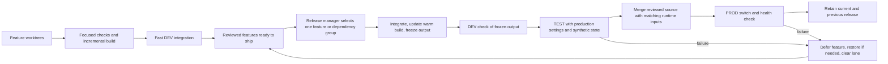

# A smaller development and delivery loop

Status: Proposed. No runtime or workflow changes are authorized by this document.
Issue: Not opened. Design prepared for requester review.
Last updated: 2026-10-12

## Human section

### Design

Routine changes spend too much time becoming releases. The local incremental
build and release build use different composition paths. Independent features
become coupled in release batches. Failed batches can block unrelated promotion,
and every attempt can leave another collection of large directories.

Replace this with one build and package path, a durable queue, and one release
at a time. Keep parallel feature development. Treat an ordinary deployment as a
short, reversible maintenance operation on a trusted personal server. Spend
extra validation on changes that can lose data, change permissions, send things,
or change the runtime platform.

#### One build and package path

Keep a persistent local build workspace and the shared dependency store. Make
the same component selection and runtime materialization serve DEV, TEST, and
PROD. A draft may use mutable output while the agent edits. Before TEST, freeze
the complete runtime output and its dependency closure into a release directory.
Deploy that directory unchanged through the final DEV check, TEST, and PROD.
CI is a place to run checks. It is no longer the required birthplace of a release.

The current fast runtime build is not automatically a production package. Its
profile omits some release output, and the draft composer has different plugin
selection. First unify composition and define the required output: runtime code,
required SDK assets, configured plugins, UI, native helpers, and production
dependencies. Reuse unchanged outputs; rebuild affected outputs. A dependency,
upstream, compiler, or platform change gets a full refresh.

A feature's existing local output can become the release when its relevant
source trees and toolchain match the integrated source. If another change alters
those inputs, update the warm integration workspace and produce a new candidate.
Never rename stale branch output as the merged release. Source-only metadata
changes need not recompile identical runtime inputs.

Store one compact manifest containing source trees and revision references,
toolchain and dependency identity, component/output digests, and the checks that
ran. Verify output integrity at handoff and installation. The manifest does not
contain live database snapshots, credentials, or target-specific state.

#### One release queue and one responsible manager

Use a small host controller, launched by the operating system, to execute a
durable queue. Adapt the existing progression and activation code. Replace the
multi-owner release-batch protocol; do not layer another scheduler over it.
A deployment-manager agent monitors this controller, handles diagnosis and
source reverts, and reports meaningful failures. It is not the lock or the
mechanism that restores service after a crash.

Feature agents submit a ready ticket with reviewed PRs, owner/contact, design
authority, dependencies, relevant tests, and the expected user-visible result.
They remain responsible until their ticket is deployed, explicitly deferred, or
handed to another owner who accepts it. A merged PR alone is not completion.
Owners follow durable ticket state, with notifications as a convenience. They
do not need to negotiate the next stage with each other in chat.

Use oldest-ready-first order. A missing approval, failed feature, unavailable
dependency, or unresolved review makes that ticket unready; later independent
tickets proceed. There is one active release and at most one prepared next
candidate. Default to one feature, or a small explicitly declared dependency
group. Do not sweep every new main commit into a growing batch.

For runtime changes, the manager owns final integration at the front of the
queue. It prepares the selected reviewed change against main in its integration
workspace, satisfies required repository checks, and pins the candidate. After
DEV and TEST pass, it merges the reviewed source, verifies that the complete
runtime inputs still match the candidate, and activates PROD. A paired public
and companion change is one ticket; partial source landing never permits
activation. The next runtime integration waits until that attempt is deployed
or returned to a clean baseline. Feature editing,
review, focused tests, and documentation merges continue in parallel. This is an
intentional change from unlimited runtime merges during release: a short queue
before integration is simpler than disentangling an unbounded merged batch.

If a selected feature fails before landing, restore the environment if necessary
and discard its integration candidate. Main stays ready for the next independent
feature. If it fails after landing, restore service and revert only that ticket's
runtime changes before taking the next feature. Preserve the feature branch and
evidence for repair. A reviewed fix may replace the
candidate if it is immediately available; do not hold the lane while an agent
codes or waits for a decision. Reverts must preserve unrelated source and pass
affected checks. A conflict or uncertain failure attribution requires diagnosis;
it is not permission for an automated broad revert. The controller can execute
a prevalidated exact revert when there is no intervening runtime change. An
unexpected source conflict becomes a specific integration blocker, with service
restored, rather than a global failure hold. Dependents wait with the
failed ticket. Unrelated tickets do not inherit its failure history.

There is no global promotion hold for a failed build or isolated TEST case.
Only a real shared problem, such as uncertain production recovery, broken
deployment machinery, or insufficient host capacity, pauses the relevant lane.

#### Fast DEV and a stable TEST

DEV remains a place to try a change with a real installed gateway. Prepare before
entering its FIFO. The controller runs one bounded deploy/check/reset operation
and releases it. DEV is not reserved while an agent codes, reviews, or builds.
Where feasible, lightweight per-feature local instances handle early tests;
shared DEV is for host integration. The release candidate's final DEV check
uses the exact frozen output and can reuse an existing check only if its inputs
and installed output are identical.

TEST is one persistent service definition, isolated state root, and port on the
target host. Reset a small synthetic baseline, use the production behavioral
configuration with explicit path/port/identity and recording substitutions, then
exercise the feature and a small cross-cutting smoke suite. Keep the fixture
shape stable. Create a special predecessor fixture only for a migration that
actually needs one. Do not copy the complete production history into every test.

The release controller owns TEST through the production decision, so another
release cannot change the baseline between those stages. It holds the PROD
transaction lock only for preflight, switching, checks, and recovery. Host-wide
work such as Docker restarts enters this same controller as maintenance; it
cannot restart shared services underneath DEV or TEST. Ordinary DEV work can
continue when it has no such shared dependency and sufficient capacity.

#### Checks proportional to the change

Every behavior change still adds a meaningful regression. Test selection is a
small explicit component map, reviewed alongside the code. Missing or ambiguous
classification widens the required checks. Do not build a predictive test system.

| Change | Required before release | Wider validation |
|---|---|---|
| Human-facing docs | Relevant document/link review | No runtime build |
| Prompt, model setting, plugin, or small application fix | Focused unit/type checks, affected dependency tests, package completeness, installed feature check, fixed smoke suite | Accumulated suite in the next local sweep |
| Authentication, permissions, approvals, untrusted-input handling, external writes | Above plus the complete relevant security/recording regressions | Cross-cutting changes widen to full gate |
| Persisted-state or configuration migration | Above plus representative predecessor, migration, rollback, and volume checks where needed | Full relevant migration suite |
| OpenClaw upgrade, lockfile/toolchain, native dependency, shared SDK, package/deployer change, or uncertain impact | Complete accumulated gate and affected installed/recovery rehearsal | Cold build where invalidation requires it |

Run the full accumulated suite once daily when runtime source changed, on a
pinned snapshot and outside the release critical path for ordinary features.
Coalesce pending sweeps and bound their storage. A sweep failure immediately
creates a responsible ticket: a credible data/security problem pauses affected
releases; a demonstrated ordinary regression is repaired or reverted. Unrelated
releases continue after attribution. Keep GitHub's required repository checks
unless their replacements are explicitly adopted with the workflow change.

Model or prompt work runs its distinguishing quality check early, using the
native request path and a bounded fixture/evaluation budget. Discovering a
quality mismatch should not require first paying for the full release chain.
The final installed check confirms the same behavior and configuration.

This explicitly accepts the possibility that a broad regression finds a
reversible ordinary defect after deployment. It does not permit skipping a
known failure in changed behavior, weakening product access controls, or sending
real messages from automated tests.

#### Configuration and migration are deployment inputs

Keep reviewed application settings separate from runtime bytes. A configuration
revision selects a runtime release; it is not a reason to compile that runtime.
A deployment record joins the runtime ID, configuration revision, target,
previous release, and any migration specification.

Freshness-check the affected production baseline before activation. If only
target state changed, recapture and repeat the affected TEST migration against
the same runtime. A change to runtime source still creates a new runtime. This
replaces the current binding of target snapshot identity into the build itself.
It does not waive stale-state or migration-precondition checks.

Do not run a general upgrade/migration routine on every prompt or plugin edit.
Ordinary application changes preserve state. Migration is an explicit release
property, with old/new configuration and a bounded recovery path.

#### Short downtime and simple recovery

Keep the existing tested stop, snapshot, activation, and rollback primitives.
Stage and verify before stopping PROD. Switch to prepared code and configuration,
start it, and run bounded read-only health checks. If startup fails, restore the
previous compatible runtime/configuration automatically. No builds or dependency
downloads happen while the assistant is stopped.

Propose an ordinary restart target of under one minute and an automatic recovery
budget of five minutes. These are targets to measure, not current guarantees or
permission to kill an in-flight external action. Drain active work with a bound;
if its outcome is uncertain, defer the switch instead of replaying it. A data
migration declares a separate measured allowance.

Keep current and previous runtime plus one verified state-recovery checkpoint.
An ordinary code rollback preserves newer conversation data. If a migration
needs snapshot restoration, test it before resuming external intake. Once new
live writes have occurred, recovery must preserve them or request the specific
data-loss decision. Tolerating downtime does not imply permission to discard
new messages, memories, or action outcomes.

#### Bound disk use by design

Use one warm integration builder and at most two active heavyweight feature
build workspaces on the development host. Light source worktrees and focused
tests can remain parallel. Share the package store, not writable compiler output.
On the target, retain current/previous runtime, one candidate, one DEV runtime,
one resettable TEST instance, and the verified state checkpoint. Avoid another
archive/import/extraction chain when both producers and consumers are local.

Freeze output with filesystem cloning where supported, otherwise copy it once.
Transfer changed content into an unpublished candidate directory, verify its
manifest, then publish it. Do not hardlink mutable compiler outputs to deployed
files. Keep immutable runtime dependencies separate from the evictable package
download cache.

The controller owns all generated roots from creation. On success, failure,
cancel, and restart, it joins children, retains compact results, and removes
disposable staging and TEST snapshots. Cleanup of stopped scratch need not hold
the deployment lane. A cleanup failure becomes a cleanup ticket; only a real
capacity or recovery problem blocks new work.

Retain one failed reproduction per active incident, with an owner and a review
date, rather than a copy per attempt. A small fixed diagnostic quota and an LRU
download cache are tunable limits. Measure required staging before admission
and preserve a modest host free-space floor. Existing unknown directories and
production recovery holds require a one-time ownership review; this proposal
does not authorize deleting them by age.

#### Remove machinery and duplicate status

Keep low-level activation and recovery. Replace manual per-environment ticket
passing, recursive failed-batch ancestry, per-commit owner maps, separate draft
composition, mandatory CI-origin release rebuilds, and target snapshots embedded
in build identity. One compact queue record supplies authoritative feature and
release status. Archive terminal records rather than copying their ancestry into
every successor. Record durable events without requiring every agent to ack
every historical notification.

Keep one brief development guide and one operations guide. Plans explain design;
their mutable prose is not the controller's authorization parser. An explicit
approval reference and scope live in the ticket. Reuse the existing recorded
human approval and keep the source of that authority visible. Update plans and
issues at milestones from actual execution state.

### Status

**Approval:** Proposed
**Approval reference:** The requester asked on 2026-10-12 for an inventory and a
bold simplification proposal, including less release overhead, local incremental
build promotion, effective queues, and bounded disk use. Implementation approval
has not been requested or inferred.

The audit and proposed design are ready for review. The consequential choices
are selective routine release checks with a deferred broad sweep, a manager-owned
runtime merge queue, and accepting a short recoverable outage. Existing runtime,
queues, recovery holds, and required checks remain unchanged.

## Agent section

### State

Proposal only, on `codex/simpler-development-proposal`, based on `d27f6d2`.
Private evidence and machine-specific inventories stay outside this public plan.

### Scope and acceptance criteria

- A small runtime edit completes warm local build, DEV deploy, and installed
  feedback within five minutes on the measured host, excluding queue wait.
- A ready ordinary feature targets production within fifteen minutes of service
  by the manager, excluding feature coding and unrelated queue wait. Measure ten
  consecutive representative releases; report median, p95, cold time and retries.
- An integration failure defers only the feature and its dependencies after
  verified recovery. A later independent ticket demonstrably proceeds.
- DEV, TEST, and PROD consume one final frozen runtime ID. No mandatory rebuild
  follows a successful DEV draft solely because release certification began.
- Configuration-only work recompiles zero runtime components when compatible.
- Killing the controlling agent does not strand the queue or leave PROD stopped.
- Disk usage remains bounded across twenty synthetic success/failure/cancel runs.
  Report allocated and free-space deltas; do not promise a fixed reclaimable size.
- No production message send, unsafe data restore, approval bypass, or secret
  publication is introduced.

### Architecture and decisions

Current source anchors: `packages/e2e/src/native-pipeline.mjs` owns full builds and
accumulated regression stages; `native-package.mjs` materializes runtime output;
`deploy-coordination.mjs` owns FIFO slots and global failure holds;
`deployment-progress.mjs` progresses caller-supplied stage descriptors;
`native-activation.mjs` owns activation/recovery; `native-task-storage.mjs` and
the storage/retention modules own terminal cleanup.

Retain the useful low-level operations and regressions. Give the normal path a
single maintained descriptor generated by the controller, rather than requiring
each feature owner to author a deployment program. A local file with atomic
updates is sufficient for this single host. Do not introduce a distributed
broker, Kubernetes, another artifact service, or a custom agent conversation
system. Existing app notifications can surface queue events.

### Implementation

After design approval, deliver in three vertical slices:

1. **Unify output.** Use one composer/packager for drafts and releases. Define
   component inputs and complete output. Adopt warm builds, immutable freezing,
   and independent configuration records. Prove a plugin/prompt edit reaches all
   environments from the same locally prepared runtime.
2. **Own the queue.** Install the single controller and manager protocol. Admit
   one feature/dependency group, prepare and test integration before final source
   landing, drive it through production,
   defer failures, recover after interruption, and retire the old hold/ancestry
   protocol after its active consumers finish. Prove failure of A does not block B.
3. **Reduce gates and copies.** Adopt the explicit test matrix, deferred sweep,
   fixed build workspace count, and terminal cleanup. Remove the replaced paths
   and redundant guidance in the same change set. Measure real ordinary releases.

Do not first build a general scheduler framework. Use existing #174 and #180 as
historical evidence and fold their remaining scope into the approved design
instead of opening parallel optimization projects.

### Validation

This proposal is documentation only. Check links and consistency; do not build
or deploy the unchanged runtime. Later implementation needs regressions for
packaging completeness, incremental invalidation, queue fairness/dependencies,
safe reversion, interruption recovery, correct test selection, configuration-only
reuse, external-effect recording, and bounded scratch cleanup. Test real failures
and state transitions, not guidance wording.

Benchmark the same source, machine and toolchain for cold and warm paths. Record
compile, test, package, transfer, startup, verification, queue, rollback and cleanup
separately. The fifteen-minute goal is provisional until those measurements exist.

### Rollout and rollback

Before taking over, reconcile actual installed runtime/configuration, the latest
activation journal, last certified release, live processes, and recovery holds.
The recorded healthy release can lag actual activation. Do not delete holds to
manufacture a clean baseline or redeploy an unaccepted candidate.

Adopt a known recoverable baseline and migrate ready work into the new queue.
Keep the old activation commands available until the new controller proves its
normal and interrupted paths. Never run both controllers as deployment owners.
New policy takes effect only after approval and executable migration. If the
controller fails, restore the previous version against its known queue schema and
use the existing recorded recovery transaction. Preserve source and active data.

### Review log

The audit distinguishes present source behavior, observed live metadata,
historical results, proposed changes, and unmeasured performance targets.
Author review moved final source landing after DEV and TEST so an ordinary test
failure can leave the queue without reverting main. Independent review was
attempted three times but returned no findings because the review service
disconnected. That review is unverified; no clean review is claimed.

### Checklist

- [x] Inspect current instructions, source, feature history, CI metadata and storage.
- [x] Explain the actual collision and duplication mechanisms.
- [x] Prepare a replacement design and explicit tradeoffs.
- [x] Review design consistency and document links.
- [ ] Independent design review, unavailable during this audit.
- [ ] Obtain approval of the consequential policy changes.
- [ ] Implement and measure the three slices.
- [ ] Retire replaced machinery and close verified cleanup.
