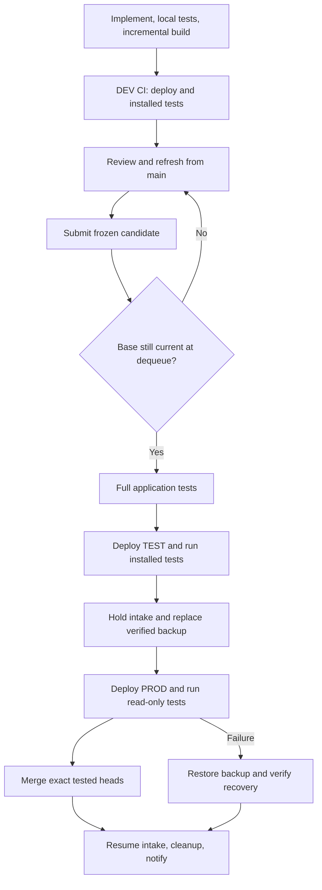

# Triggered development and production CI

Status: Production approved
Issue: https://github.com/coletaylor788/puddles/issues/324
Last updated: 2026-10-21
Owner: Triggered CI implementation

## Human section

### Design

Release work currently depends on an agent joining commands, allocations, recovery
checks, and cleanup into a complete operation. Replace that coordination with
GitHub Actions and maintained deterministic scripts. Agents implement, test,
review, and repair features. They call build, DEV CI, and production CI and receive
start and terminal results in their owning task.

#### Build and DEV

Keep one incremental compiler workspace on the development host. Publish immutable
application snapshots identified by digest; later edits cannot alter a submitted
candidate. DEV CI holds its slot for deployment, installed tests, and teardown.
It does not run the broad source suite. The implementer runs focused local tests;
production CI runs the full application suite before target deployment.

#### Queue and production

GitHub owns the ready queue, with separate DEV and production concurrency groups,
multiple pending runs, and no cancellation of an active deployment by a newer run.
Submission and dequeue both validate recorded main bases and exact feature heads.
A stale candidate leaves the queue, wakes its owner, and must be refreshed before
rejoining. CI never rebases or repairs source. All production releases use the
same lane. Main writes must follow this policy, including updates outside CI.

Production CI consumes the same build used in DEV. It tests the application,
deploys TEST and checks it, holds production intake, replaces and verifies the
single backup, deploys PROD, and runs read-only acceptance tests. Only then does
it merge the exact tested heads and reopen intake. Merge uncertainty is resolved
by querying actual state. A partial paired merge blocks further releases until
reconciled. Recovery never restores a snapshot over newly accepted live writes.

#### Recovery, cleanup, and results

A local service supervises the transaction independently of the agent, Actions
worker, and SSH connection. Durable state supports restart recovery before new
work. Every generated resource has an owner. Terminal cleanup and periodic
reconciliation remove run scratch, failed transfers, test processes, and expired
unreferenced artifacts. Byte budgets prevent indefinite growth. Preserve authored
source, active consumers, deployed output, shared bounded caches, and the backup.

Start and completion events enter a durable local outbox. Delivery to the owning
task is retried independently of deployment and deduplicated. GitHub status is
reconciled after disconnects. Agent unavailability cannot prevent rollback or
cleanup. Logs and credential values are never interpreted as instructions.

The configured application account is trusted to run target CI. Production
credentials stay local and never enter GitHub logs or artifacts. Public tooling
remains provider-neutral; host bindings and composition live in a private overlay.

### Status

The requester approved this design and explicitly authorized implementation,
shipping, pausing existing workers, retiring the release-manager automation, and
testing a dummy change through the replacement on 2026-10-21. The approved
corrections are fast installed-only DEV CI, full tests in production CI, merge
after PROD success, freshness checks before queueing and at dequeue, and use of
the trusted application account on the target host.

Implementation is in isolated paired worktrees and under retained independent
review. Existing implementers are paused. The release manager confirmed its
automation was removed and relinquished the role. The new pipeline is not
activated; a live dummy promotion and actual task wake remain unqualified.

## Agent section

### State

- Public base: c2293925046120f612da362d18b7e0e125753b2e.
- Private base and machine bindings remain in the private companion plan.
- Existing controller is preserved until its active/recovery state is reconciled.
- This plan supersedes Plan 057's agent-manager orchestration after cutover.

### Scope and acceptance criteria

- Three entrypoints: `puddles build`, `puddles ci-dev BUILD`, `puddles ci-prod BUILD`.
- Real GitHub dispatch, queueing, exact artifact transfer, and terminal status.
- DEV teardown holds the slot until no owned test process remains.
- Stale base, altered artifact, missing checks, and changed PR head refuse release.
- Full source/application tests run without rebuilding the frozen runtime.
- Verified backup, TEST/PROD checks, exact merge, restart recovery, and rollback.
- Dummy change completes the live path and merges; owned generated data is removed.
- Failure, cancellation, duplicate event, worker death, and storage limits tested.
- Task wake-up is verified on the actual supported task transport.

### Architecture and decisions

- Extend `packages/release` rather than create another deployment engine.
- GitHub schedules; local durable transaction state protects recovery.
- Keep legacy ticket support for outstanding recovery only.
- Frozen submissions carry source heads/bases, artifact digest, DEV evidence,
  review binding, and owning task reference. Inputs cannot inject commands.
- Stable installed callbacks supply application and environment operations.
- Feature refresh belongs outside the queue. No agent waits while holding a slot.
- Bounded terminal records replace conversation-only operational state.
- Main integration follows PROD success; partial merge must not advance the lane.

### Implementation

- Add immutable build registry, submission validation, and CI entrypoints.
- Add durable DEV and production execution, restart reconciliation, and cleanup.
- Add private workflows and host setup using existing service adapters.
- Add result delivery adapter and reconcile missed GitHub events.
- Update safe-development, coordination, storage, and security guidance together.

### Validation

Run the complete independent release suite and private adapter suite. Exercise
actual subprocess interruption and durable recovery with fixture services. Verify
workflow queueing and task delivery before production. Run a dummy application
change through build, DEV, full suite, TEST, backup, PROD, merge, and cleanup.
Record actual results here; fixture success is not production acceptance.

The public release suite passed 87 Node tests and 384 Vitest tests. Subsequent
focused source-gate and cancellation tests passed 18 tests. The private adapter
suite passed 101 tests before later review fixes, with focused suites covering
those fixes. A target-host run passed 15 isolated recovery tests, including
process death and rollback. A real SSH outbox bridge probe delivered to a
recording receiver and acknowledged the remote event. Its temporary directories
were removed on both hosts. This proves transport and daemon delivery, not an
actual task wake or application deployment.

### Rollout and rollback

Confirm worker pauses, no active old transaction, healthy production, and usable
recovery before installation. Install tested tooling between transactions. Keep
the old recovery executable until no transaction needs it. Never run two active
deployment authorities. Validate the dummy feature, then announce readiness for
the requester to restart implementers. On failure, recover through the durable
transaction and retain only necessary diagnostic/recovery data.

### Review log

One retained independent reviewer has assessed recovery, source integrity,
cleanup, workflow cancellation, and event delivery. Public implementation review
cleared on 2026-10-21; its final focused suite passed all 18 tests and the runtime
bundle built successfully. Private integration review and live acceptance remain
pending.

### Checklist

- [x] Design approved with final corrections.
- [x] Isolated public/private branches created.
- [x] Other workers safely paused and release-manager automation removed.
- [ ] Implementation and retained independent review complete.
- [ ] Fixture and real GitHub workflow validation complete.
- [ ] Dummy feature deployed, merged, and cleaned up.
- [ ] Owning task wakes with result; restart instructions delivered.
