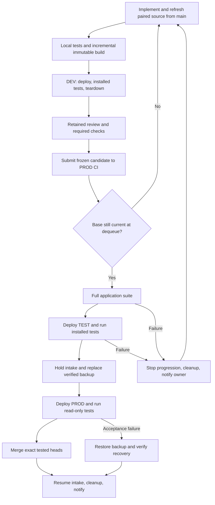

# Triggered development and production CI

Status: Dummy release passed and closed; final readiness verified
Issue: https://github.com/coletaylor788/puddles/issues/324
Last updated: 2026-10-24
Owner: Triggered CI implementation

## Human section

### Design

The former release process depended on an agent joining commands, allocations,
recovery checks and cleanup into a complete operation. GitHub Actions and
maintained deterministic scripts now own that coordination. Agents implement,
test, review, and repair features. They call build, DEV CI, and production CI
and receive start and terminal results in their owning task.

Changes to candidate source or control inputs after review return through build
and affected review/DEV before production submission. Earlier-stage failure
leaves production unchanged or restores its prior running state through the
relevant recovery phase. A backup capture failure restarts unchanged production;
rollback of application bytes is reserved for a deployment that changed
production. Merge uncertainty remains held for reconciliation and is not
ordinary rollback.

#### Build and DEV

Keep one incremental compiler workspace on the development host. Publish immutable
application snapshots identified by digest; later edits cannot alter a submitted
candidate. DEV CI holds its slot for deployment, installed tests, and teardown.
It does not run the broad source suite. The implementer runs focused local tests;
production CI runs the full application suite before target deployment.

#### Queue and production

GitHub owns the ready queue, with separate DEV and production concurrency
groups, multiple pending runs, and no cancellation of an active deployment by a
newer run. Submission and dequeue both validate recorded main bases and exact
feature heads. A stale candidate leaves the queue, wakes its owner, and must be
refreshed before rejoining. Changed inputs require a new immutable build,
affected review and DEV validation before another production submission. CI
never rebases or repairs source. All production releases use the same lane. Main
writes must follow this policy, including updates outside CI.

The repository owner can authorize their own releases. Retained agent review
and user approval remain in the task; a GitHub approving review, second account,
or branch protection is not required. Candidate inputs name the expected CI
checks explicitly, and production verifies their success on the exact head.
The release lane is the sole main writer. The normal PR merge API binds the head
but cannot atomically bind the base. CI checks the base before merge and the
merge SHA, tree, and ordered parents afterward and on recovery. Unexpected
outside changes hold reconciliation even if they produce the same file tree.

Production CI consumes the same build used in DEV. It tests the application,
deploys TEST and checks it, holds production intake, replaces and verifies the
single backup, deploys PROD, and runs read-only acceptance tests. Only then does
it merge the exact tested heads and reopen intake. Merge uncertainty is resolved
by querying actual state. A partial paired merge blocks further releases until
reconciled. Recovery never restores a snapshot over newly accepted live writes.

Readiness checks return as soon as the application is ready. Configure an
explicit bounded readiness interval for each environment and a longer owned
command limit; a longer interval does not turn failure into acceptance.
Maintenance must yield to transfer closure. A resource-budget deferral is
reported as held, not passed, and its retry interval must prevent continuous
contention with foreground work.

#### Recovery, cleanup, and results

A local service supervises the transaction independently of the agent, Actions
worker, and SSH connection. Durable state supports restart recovery before new
work. Every generated resource has an owner. Terminal cleanup and periodic
reconciliation remove run scratch, failed transfers, test processes, and expired
unreferenced artifacts. Byte budgets prevent indefinite growth. Preserve authored
source, active consumers, deployed output, shared bounded caches, and the backup.

Start and completion events enter a durable local outbox. Delivery to the owning
task is retried independently of deployment and deduplicated. GitHub status is
reconciled after disconnects. Agent unavailability cannot prevent rollback or
cleanup. Logs and credential values are never interpreted as instructions.

The configured application account is trusted to run target CI. Production
credentials stay local and never enter GitHub logs or artifacts. Public tooling
remains provider-neutral; host bindings and composition live in a private overlay.

### Status

**Approval:** Production approved. **Approval reference:** The requester
approved implementation, shipping and a dummy trial on 2026-10-21, including
pausing feature workers and retiring the release-manager automation. Approved
corrections are fast installed-only DEV CI, full tests in production CI, merge
after PROD success, source freshness before queueing and at dequeue, and the
trusted application account on the target. This single-owner process requires
neither branch protection nor a second GitHub account.

The neutral dummy passed DEV, the full application suite, TEST, backup
replacement, PROD acceptance including the installed sandbox gate, exact source
merge, intake reopening and run cleanup. Actual lifecycle events resumed the
idle owner. A separate cleanup-tool correction is installed and verified on both
hosts; predecessor retirement passed on both hosts. The final disk, maintenance
and retained-resource audit passed. Feature owners stay paused until the
requester receives the final handoff and restarts them.

## Agent section

### State

- The implementation and current repairs cleared retained review and tooling checks.
  Target image preparation and acceptance now use the managed importer.
- Final live result: The dummy passed all application and deployment gates, merged,
  reopened intake and closed source/target cleanup. The cleanup-tool correction
  is installed and predecessor retirement passed. All four remaining repair checkouts were removed; Fresh target maintenance and final readiness verification passed.
- Machine bindings, companion source identities and operational receipts remain
  in the private companion plan.
- This replaces Plan 057's agent-manager orchestration. Its automation is retired.
- Feature owners remain paused until the requester restarts them.
- Refresh source outside the lane; merge only the exact heads accepted in PROD.

### Scope and acceptance criteria

- Three application-adapter entrypoints: `build`, `ci-dev` and `ci-prod`.
- Real GitHub dispatch, queueing, exact artifact transfer, and terminal status.
- DEV teardown holds the slot until no owned test process remains.
- Stale base, altered artifact, missing checks, and changed PR head refuse release.
- Full source/application tests run without rebuilding the frozen runtime.
- Verified backup, TEST/PROD checks, exact merge, restart recovery, and rollback.
- Dummy change completes the live path and merges; owned generated data is removed.
- Failure, cancellation, duplicate event, worker death, and storage limits tested.
- Task wake-up is verified on the actual supported task transport.

### Architecture and decisions

- Extend `packages/release` rather than create another deployment engine.
- GitHub schedules; local durable transaction state protects recovery.
- Keep legacy ticket support for outstanding recovery only.
- Frozen submissions carry source heads/bases, expected repository check names,
  artifact digest, DEV evidence, and owning task reference. Retained agent review
  and user authorization stay in the task. Inputs cannot inject commands.
- Stable installed callbacks supply application and environment operations.
- Feature refresh belongs outside the queue. No agent waits while holding a slot.
- Bounded terminal records replace conversation-only operational state.
- Main integration follows PROD success; partial merge must not advance the lane.

### Implementation

- Add immutable build registry, submission validation, and CI entrypoints.
- Add durable DEV and production execution, restart reconciliation, and cleanup.
- Add private workflows and host setup using existing service adapters.
- Add result delivery adapter and reconcile missed GitHub events.
- Update safe-development, coordination, storage, and security guidance together.

### Validation

The neutral dummy completed the normal build, DEV and production path. Its
target preparation imported the candidate-bound sandbox image, and installed
acceptance required that image to exist before running the owned smoke
container. The full application suite passed 74 installed checks and both final
scenarios. TEST and PROD receipts, exact merge verification, intake reopening
and source/target acknowledgements establish completion; GitHub success alone is
not that proof.

The incremental build reused the application core. Workflow completion and
durable source/target cleanup are separate intervals; the latter includes
submission and preflight work before the workflow starts.

| Interval | Measured wall clock |
| --- | --- |
| Incremental build through immutable publication | 129.629s |
| Assembly within that build | 65.340s |
| DEV workflow, creation through final update | 909s |
| DEV submission through source/target closure | 936.563s |
| Full application suite workflow step | 2349s |
| Underlying application suite command | 2276.530s |
| Installed application hook within that command | 1323.215s |
| PROD workflow, creation through final update | 4782s |
| PROD submission through source/target closure | 4900.544s |
| Queue wait isolated from scheduling | Not separately measured |

Actual start and terminal events entered the owner's durable queue and resumed
its task after yielding. This proves the supported idle wake path, not that
every queued event was visibly rendered. Agents record submission/run IDs,
yield, and inspect the exact receipt on continuation. They need no polling
coordinator.

Separate fixtures cover interruption, cancellation, source freshness, duplicate
delivery, recovery and rollback. Fixture success does not establish a forced
live rollback. An earlier live trial recovered unchanged production after
readiness failed before deployment. Its later successful release exposed the
missing target sandbox check; the current trial qualifies that repair. Earlier
bootstrap counts and release timings are historical and are not substituted for
this result.

DEV holds its slot through teardown. Broader tests run in production CI before
TEST. Per-command hashing, copying and deletion costs were not measured
separately. Run scratch, test processes and owned containers closed. Predecessor
retirement passed. Four completed repair checkouts were removed. Fresh target maintenance and final readiness verification passed.

### Rollout and rollback

Confirm worker pauses, no active old transaction, healthy production, and usable
recovery before installation. Install tested tooling between transactions. Keep
the old recovery executable until no transaction needs it. Never run two active
deployment authorities. Validate the dummy feature, then announce readiness for
the requester to restart implementers. On failure, recover through the durable
transaction and retain only necessary diagnostic/recovery data.

### Review log

The retained independent reviewer assessed the complete implementation and its
meaningful repairs, including source identity, recovery, cancellation, queues,
notification delivery and cleanup. Final tooling changes cleared that reviewer
and applicable checks. Final cleanup dispositions were reviewed against exact
ownership and preservation proofs. The repaired target gate completed fresh
qualification. The final cleanup-tool correction is installed and live
predecessor retirement passed. The final disk and retained-resource audit
passed. Documentation records these separate evidence states; earlier receipts
remain historical.

### Checklist

- [x] Approved design, implementation and retained review.
- [x] Successor immutable build and repaired target gate installed.
- [x] Successor DEV and full application suite.
- [x] Successor TEST, backup, PROD acceptance, exact merge and intake reopen.
- [x] Earlier terminal cleanup and eligible task-resource retirement recorded.
- [x] Successor terminal run cleanup.
- [x] Cleanup tool installed and predecessor retirement passed.
- [x] Four remaining repair checkouts removed through normal Git lifecycle.
- [x] Fresh target maintenance and final readiness verification.
- [x] Queue, stale-source, failure/recovery and notification qualification.
- [x] Complete repaired-target qualification.
- [x] Final restart guidance prepared; requester controls owner restart.

Documentation-only closeout follows the documented docs-only exception: check
prose and links, without rebuilding or redeploying unchanged runtime artifacts.
The rebuild and affected-review/DEV requirement applies to changed candidate
source or control inputs.