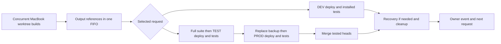

# Release queue for feature build outputs

Status: Implementing approved design
Issue: https://github.com/coletaylor788/puddles/issues/338
Last updated: 2026-10-25

## Human section

### Problem and outcome

Shared build admission and copied waiting payloads made independent features
block each other. Failed deployment payloads also filled capacity needed by their
replacements. Keep concurrent builds local and serialize only release work.

### Flow

Any failure stops promotion. PROD failure uses the existing rollback path.
Cleanup and source callback closure finish before the queue admits another request.

### Build ownership

Each implementer builds incrementally in its own workspace on the development machine. Releases queue small references to those outputs instead of copying every waiting build into a second registry. The implementer leaves a submitted output alone until CI completes.

### Release and cleanup

One durable queue admits DEV or production work at a time. The selected request checks source freshness and available space, transfers its output to the test machine, and runs the existing deployment process. DEV runs installed checks and tears down. Production runs the full application suite, TEST, backup, PROD checks, merge and cleanup. Failure recovery and diagnostic receipts finish before the next request starts. The machines and feature owners are trusted; the existing production isolation and backup remain operational safeguards.

### Status

Production approved by the requester on 2026-10-25 after reviewing concurrent builds, one release lane, and output-path ownership without additional immutable copies. Implementation and independent review are in progress. Feature owners remain paused until the requester restarts them.

## Agent section

### State

- Public and private feature branches: codex/ci-output-queue.
- Prior single-dummy pipeline passed. Multi-feature tests exposed publication capacity, shared-builder contention, failed-DEV retirement and missing diagnostics.

### Scope and acceptance criteria

- Concurrent per-feature incremental builds; no whole-build shared lock.
- Durable FIFO release submissions with output references and owner events.
- One DEV/PROD workflow admitted until previous transaction and cleanup close.
- Mini payload removal after terminal closure; preserve small DEV gate receipts.
- Full application test capacity preflight and retained bounded failure diagnostics.
- Four queued features, restart/cancel, failed replacement, transfer cleanup and output preservation tested.

### Architecture and decisions

Retain the installed deployment, backup, source-authority and recovery engines. Add reference storage to source candidate metadata. Target payloads remain ordinary directories and are released independently from metadata and DEV receipts. Source admission is supervised by existing maintenance, so no release agent or heartbeat is introduced. User authorization supersedes prior requirements for duplicated immutable source output.

### Implementation

Public candidate registration retains external output paths without copying. Target
payload release preserves manifest and gate records, with rehydration before use.
The adapter owns FIFO admission and cancellation, preflight, terminal transfer and
callback barriers, Docker cleanup and bounded failure diagnostics. Output-mode
build maintenance preserves warm feature output. Both workflows share one group.

### Validation

Pending complete independent release and adapter suites, retained review and installed acceptance.

### Rollout and rollback

Install only between transactions. Preserve old tools and existing recovery state until their references close. Convert legacy retained candidate payloads through the maintained cleanup path after validating terminal state. Do not remove feature sources or warm output.

### Review log

Existing retained reviewer resumed for the complete change.

### Checklist

- [x] Approved design and isolated paired worktrees.
- [ ] Implementation and regressions.
- [ ] Full tooling suites and retained review.
- [ ] Merge, install and multi-feature acceptance.
- [ ] Cleanup and implementer guidance.
