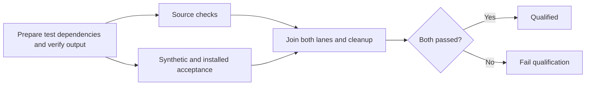

# Parallel application qualification

Status: Production approved; implementation in progress
Issue: https://github.com/coletaylor788/puddles/issues/368
Last updated: 2026-11-17

## Human section

### Design

Application qualification currently serializes source checks and installed acceptance. Run these as two bounded lanes against the same frozen build, after shared prerequisites and output verification. This reduces elapsed time without removing checks or changing fixture behavior.

The source lane retains lint, package and Python tests, prompt snapshots, typechecks, mapped native regressions and candidate checks. The installed lane retains synthetic scenarios and installed acceptance in their existing order. Each lane keeps its existing worker limits. Test-owned state and processes remain separate from deployment state.

Both lanes settle before qualification returns, including when either fails. Existing process ownership and interrupted-run cleanup remain responsible for descendants and scratch. Common prerequisites fail before either lane starts. Companion checks explicitly select preflight, source or installed execution; undeclared checks retain their original ordering after scenarios. Lane durations are printed at completion. Shared fixtures, test selection changes, queue changes and runtime patches are outside scope.

### Status

**Approval:** Production approved. **Approval reference:** “Approved the parallel two lane. Park the shared fixtures agree it’s not proven. Ship the two lane.” Implementation, typechecking and all 322 application harness tests pass, including concurrent cancellation. Independent review cleared the integrated bounded native-test batching correction. Exact-candidate qualification and landing remain outstanding.

## Agent section

### State

- Isolated branch: `ci/two-lane-application`.
- Public base: `7b6861c2`.
- Paired companion details remain in private records.

### Scope and acceptance criteria

- Overlap source and installed lanes without dropping existing checks.
- Verify common preparation precedes both; preserve serial ordering within lanes.
- Await both lanes and process cleanup on pass, failure and interruption.
- Preserve explicit deadlines, worker limits and owned scratch lifecycle.
- Print measured lane timings; do not claim a speedup until measured.

### Architecture and decisions

Use `Promise.allSettled` in `packages/e2e/src/application-suite.mjs` and existing `runCommand` descendant ownership. Add companion `lane` declarations with a backward-compatible installed default. No upstream OpenClaw changes or dependency upgrade is needed for this harness scheduling change.

### Implementation

Update application orchestration, focused application-suite regressions and component documentation. Companion verification runs as preflight; companion lint/package tests join the source lane and installed acceptance joins the installed lane.

### Validation

The complete e2e package passes: 35 files, 322 tests, 34.68 seconds. Typechecking passes after building package declarations. Tests cover overlap, prerequisite ordering, both failure directions, aggregate failures, separated caches, exact batching coverage and real two-child SIGTERM cleanup. Exact-candidate qualification and resource measurements remain pending.

### Rollout and rollback

Use the normal reviewed source and CI lifecycle. Preserve active candidates and other feature owners. If qualification fails, repair this branch; do not skip gates. Revert the orchestration and companion declarations together if rollback is required.

### Review log

Retained independent review cleared the complete public/private diff, including the integrated batching correction, with no actionable findings.

### Checklist

- [x] Design approved.
- [x] Separate worktrees created.
- [ ] Focused and cumulative validation passed.
- [ ] Retained review cleared.
- [ ] Source landed and execution verified.
- [ ] Eligible task artifacts cleaned.
