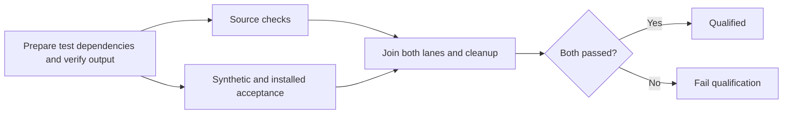

# Parallel application qualification

Status: Production approved; integrated for upgrade qualification
Issue: Pending
Last updated: 2026-11-17

## Human section

### Design

Application qualification currently serializes source checks and installed acceptance. Run these as two bounded lanes against the same frozen build, after shared prerequisites and output verification. This reduces elapsed time without removing checks or changing fixture behavior.

The source lane retains lint, package and Python tests, prompt snapshots, typechecks, mapped native regressions and candidate checks. The installed lane retains synthetic scenarios and installed acceptance in their existing order. Each lane keeps its existing worker limits. Test-owned state and processes remain separate from deployment state.

Both lanes settle before qualification returns, including when either fails. Existing process ownership and interrupted-run cleanup remain responsible for descendants and scratch. Common prerequisites fail before either lane starts. Companion checks explicitly select preflight, source or installed execution; undeclared checks retain their original ordering after scenarios. Lane durations are printed at completion. Shared fixtures, test selection changes, queue changes and runtime patches are outside scope.

### Status

**Approval:** Production approved. **Approval reference:** “Approved the parallel two lane. Park the shared fixtures agree it’s not proven. Ship the two lane.” Implementation and focused regressions pass. The upgrade candidate integrates both lanes while preserving the newer upstream native per-project runner. Retained review cleared the resolved integration. Exact-candidate qualification and landing remain outstanding.

## Agent section

### State

- Original isolated branch: `ci/two-lane-application`. Integrated into the approved upgrade branch `codex/native-voice-delegation`.
- Public base: `7b6861c2`.
- Paired companion details remain in private records.

### Scope and acceptance criteria

- Overlap source and installed lanes without dropping existing checks.
- Verify common preparation precedes both; preserve serial ordering within lanes.
- Await both lanes and process cleanup on pass, failure and interruption.
- Preserve explicit deadlines, worker limits and owned scratch lifecycle.
- Print measured lane timings; do not claim a speedup until measured.

### Architecture and decisions

Use `Promise.allSettled` in `packages/e2e/src/application-suite.mjs` and existing `runCommand` descendant ownership. Add companion `lane` declarations with a backward-compatible installed default. No upstream OpenClaw changes are needed for this harness scheduling change. On v2026.11.4, retain the native per-project subprocesses, nested project discovery, serial phases and transport-specific e2e entrypoint. The older flat-project batching helper is not applicable and is not included.

### Implementation

Update application orchestration, focused application-suite regressions and component documentation. Companion verification runs as preflight; companion lint/package tests join the source lane and installed acceptance joins the installed lane.

### Validation

The integrated harness run passed 324 checks and exposed one stale shared-cache expectation. Restoring the reviewed separate-cache assertion passes all 16 application-suite tests. The real two-child SIGTERM test and typecheck pass. Exact-candidate qualification and measured timing remain required.

### Rollout and rollback

Use the normal reviewed source and CI lifecycle. Preserve active candidates and other feature owners. If qualification fails, repair this branch; do not skip gates. Revert the orchestration and companion declarations together if rollback is required.

### Review log

The retained independent reviewer cleared the resolved upgrade integration at `a201c51e`, including native per-project execution, lane failure joins and signal cleanup. Exact-candidate timing remains an execution gate.

### Checklist

- [x] Design approved.
- [x] Separate worktrees created.
- [ ] Focused and cumulative validation passed.
- [x] Retained review cleared.
- [ ] Source landed and execution verified.
- [ ] Eligible task artifacts cleaned.
