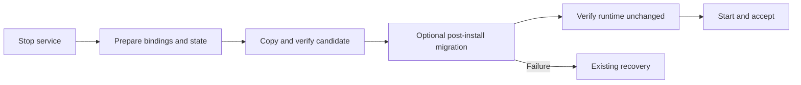

# Migrate state with the installed runtime

Status: Production approved; validation in progress
Issue: https://github.com/coletaylor788/puddles/issues/370
Last updated: 2026-11-17

## Human section

### Design

A runtime upgrade can refuse a database migration when preparation invokes its new CLI while the registered service still points to older installed bytes. Preserve the native compatibility guard and run version-sensitive migration after installing and verifying the candidate, before starting its service.

The optional command applies equally to DEV, TEST and PROD. A failed production migration uses the existing verified backup to restore runtime and state; recovery never reruns migration. Old control bundles retain their six existing boundaries. New bundles can declare a post-install boundary for each environment, and acceptance requires its successful witness from the same candidate and run. Repeating preparation or migration invalidates downstream success before doing more work.

### Status

**Approval:** Production approved. **Approval reference:** The requester authorized required CI repairs and instructed the upgrade owner, “No, fix CI to work with the new version if required. Not the other way around.” The upgrade owner assigned the generic CI repair to this task. Scope is deployment ordering and corresponding CI controls; application migration details remain with the upgrade owner. No upstream patch or migration-guard bypass is included.

Implementation, independent release validation and retained review are complete. Source landing, guarded installation and actual candidate qualification remain outstanding.

## Agent section

### State

- Branch: `ci/post-install-hook`, based on public `7b6861c2`.
- Private adapter companion and host bindings are tracked privately.

### Scope and acceptance criteria

- Optional `target.postInstall` runs after verified copy and before startup.
- Validate hooks before stopping services; verify immutable runtime after hook.
- Failure and interruption use existing stage recovery, never a migration retry during restore.
- Preserve old configurations and six-boundary bundles.
- Require same-run prepare and declared post-install witnesses for acceptance.

### Architecture and decisions

`controller.mjs` owns copy, verification, optional hook and startup. Its durable operation records the hook inside the existing TEST/PROD stage. DEV uses the same deployment helper. Recovery invokes backup restoration and service health directly. Hook commands receive the existing phase environment; application adapters supply installed runtime bindings.

### Implementation

Controller and CI configuration validation plus companion control assembly/dispatch. The installed target configuration must bind DEV, TEST and PROD `postInstall` to the application dispatcher. Deployment tooling is a separate product from the application and installs between tickets.

### Validation

Focused controller tests: 46 passed, including installed bytes, ordering, failed migration restoration and runtime mutation rejection. Focused companion tests: 25 passed, including optional phases, legacy compatibility, stale witness invalidation and frozen closure. The complete public suite exercised 168 Node tests and 384 Vitest cases. Two unchanged backup cases hit their five-second deadline under concurrent host load; each passed at its normal deadline on focused recheck (the final isolated case took 2.85 seconds). All 381 companion release tests passed. The upgrade owner separately validates native Doctor against the actual installed runtime.

### Rollout and rollback

Publish and review both tooling repositories, pass full release suites, merge, stage exact immutable tool versions, then update CI bindings while all queue and service guards prove idle. Add the three target hook commands. Verify installed hashes and config validation before the upgrade owner submits a new candidate. Retain the previous tool version for rollback; never change tooling during an active transaction.

### Review log

The retained independent reviewer found no actionable defects in the complete paired code diff. Explicit host hook wiring and actual Doctor qualification are remaining rollout checks.

### Checklist

- [x] Repair scope authorized and ownership coordinated.
- [x] Focused tests and retained review passed.
- [x] Full release coverage passed, including focused rechecks of two unchanged timeout cases.
- [ ] Reviewed source merged.
- [ ] Both hosts use verified installed tooling and target hooks.
- [ ] Actual candidate qualification and cleanup complete.
