# Early qualification and shared deployment

## Human

Late upgrade failures exposed gaps between focused local checks, green DEV and
production qualification. A DEV pass must include the same nondeployment suite
that would otherwise fail before TEST. DEV, TEST and PROD must use the same
configuration and deployment implementation.

```mermaid
flowchart LR
  Edit[Incremental build and maintained focused tests] --> DEV[Shared CI: full qualification or exact reuse]
  DEV --> Installed[DEV deployment and acceptance]
  Installed --> Review[Review and source freshness]
  Review --> PROD[Same CI: qualification reuse or refresh]
  PROD --> Test[TEST with fresh production copy]
  Test --> Backup[Verified backup]
  Backup --> Live[PROD and read-only acceptance]
  Live --> Merge[Exact merge and cleanup]
```

Full qualification runs on the MacBook, outside the Mini deployment slot. The
existing source and installed lanes remain parallel. A passed result is reusable
only for unchanged candidate/source/artifact/test/tool/host inputs and completed
process and scratch cleanup. Focused tests select cases within the maintained
runner and cannot produce a qualifying receipt.

One reusable workflow implements qualification, transfer, target admission,
waiting and notification for both entrypoints. One controller deploy function
prepares, installs, migrates, starts and checks DEV, TEST and PROD. DEV/TEST share
copied-production rehearsal and TEST refreshes the copy. PROD alone performs
live intake, backup/rollback, exact merge and read-only checks. Synthetic writes
remain on isolated state. No new OpenClaw patch is proposed or authorized.

This moves full-suite time before DEV success. Ordinary edits still use focused
checks; unchanged production promotion avoids repeating the expensive suite.
Fresh production state, host capacity and live integration behavior remain
point-of-use checks and cannot be guaranteed by an earlier pass.

Approval: the requester approved earlier DEV qualification and coordination with
the upgrade owner, then explicitly required the same CI across environments on
2026-11-24. Shared fixtures remain parked; existing fixtures are reused through
the maintained runners, not redesigned.

## Agent

Work is isolated from the upgrade owner's paired PRs. Publish narrow tooling
prerequisite PRs from main, public first and private checks pinned to that public
revision, as required by the existing bootstrap process. Exclude the upgrade's
migration and application commits. Preserve the active immutable run and installed
adapter until terminal target and source cleanup close. Install matched tooling
and workflows together between tickets, retaining main as the workflow ref. The
upgrade owner then rebases its application work and validates a fresh candidate. Feature owners still own their feature and use deterministic CI.

Validation covers controller rejection before unqualified DEV deployment,
qualification reuse/invalidation/cleanup, full versus focused receipts, shared
workflow routing, transfer of DEV and PROD receipts, selected fixture variants,
worker/environment parity, interruption cleanup and complete release-tool suites.
Application acceptance of the integrated candidate remains the upgrade owner's
normal DEV/TEST/PROD lifecycle; tooling unit results are not live acceptance.
