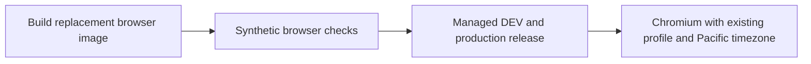

# Refresh Chromium and use the configured local timezone

Status: Production approved for browser refresh and Pacific timezone correction
Issue: https://github.com/coletaylor788/puddles/issues/364
Last updated: 2026-11-16

## Human section

### Design

The personal browser uses an old Chromium image and reports UTC. The host's
separate Chrome installation and timezone do not control that container.
Refresh the existing browser image from its supported Debian security packages
and configure the browser for `America/Los_Angeles`, including daylight saving.

Keep the current Vercel controller, Docker boundary, host vault and browser
profile. Use Docker's native `TZ` environment setting through the trusted launch
specification. Stop the old browser before applying new settings. Preserve the
previous image and configuration through the normal backup and rollback path.
No OpenClaw patch or upgrade is required.

For ongoing updates, use trusted maintenance to rebuild, validate and deploy a
new image digest through the same release path. Do not grant the browsing agent
Docker access or make the live container self-modifying. A recurring schedule or
new update-request tool is a separate choice, not part of this repair.

### Status

**Approval:** Production approved.

**Approval reference:** The requester asked to update the outdated browser and
correct UTC to Pacific Time on 2026-11-16. This authorizes bounded maintenance of
the existing architecture. No recurring automation or new agent update permission
is included.

The replacement image contains Chromium 156.0.8078.79 and Pacific timezone data.
All 13 browser and plugin regressions and six migration checks pass. Managed
DEV and production validation remain pending. Production has not changed.

## Agent section

### State

The running browser is Chromium 152.0.7977.82 on Debian 12 and UTC. The existing
image includes timezone data. The separate macOS Chrome is version 157 and the
host is already on Pacific Time. Private paths and exact image identities stay
in the companion configuration and local release records.

### Scope and acceptance criteria

- Refresh Chromium to the current supported Debian package in a replacement image.
- Verify the timezone in browser JavaScript and across container recreation.
- Check Pacific winter and summer offsets, not just the current clock display.
- Keep synthetic login, persistent profile, CDP authentication and vault isolation passing.
- Preserve real profile/vault data and existing agent permissions.
- Deploy through the existing managed lifecycle, without an OpenClaw patch.

### Architecture and decisions

Installed OpenClaw is 2026.9.6. Checked the later stable release v2026.11.4 and
current official sandbox image documentation. Image builds remain a separate
maintenance operation; updating OpenClaw or host Chrome does not refresh an
explicitly pinned browser image. The installed Vercel 0.43.0 CLI has no native
browser-update or timezone option in its help. Set the container's native `TZ`
in the existing launcher rather than adding a second controller or patching core.

Sources: [OpenClaw image maintenance](https://docs.openclaw.ai/gateway/sandboxing/images-and-setup),
[latest stable checked](https://github.com/openclaw/openclaw/releases/tag/v2026.11.4),
and [Debian arm64 Chromium](https://packages.debian.org/bookworm/arm64/chromium).
The Debian package page reports 156.0.8078.79-1~deb12u1. Record the actual built
version; do not assume macOS Chrome and Debian Chromium publish together.

### Implementation

Add optional validated IANA timezone configuration to the trusted browser launch
specification. Use `--env TZ=...` and include it in existing container ownership
checks. Keep omitted timezone behavior unchanged. Update the private image pin
and timezone, with explicit predecessor checks for the installed control file.

### Validation

Focused launcher tests cover timezone handling and malformed values. Installed
synthetic qualification checks JavaScript timezone and daylight saving offsets
before and after recreation, alongside existing login and isolation checks.
The replacement image reports Chromium 156.0.8078.79 and PST with offset -0800.
Its browser entrypoint is unchanged. The frozen paired dependency install is
restored. All 13 browser and plugin checks pass with the supported Node toolchain,
as do six migration checks including production preservation and whole-profile rollback.
Retained review, DEV, the full application suite and TEST/PROD remain required.

### Rollout and rollback

The existing lifecycle stops browser writers, backs up state, replaces the image
and configuration, validates production read-only, merges exact source and closes
cleanup. Require whole-profile backup coverage before production. Consolidate the existing
child entries into one profile-root entry during a reviewed idle controller
configuration cutover. Keep the existing backup untouched until normal CI replaces
it. A regression verifies rollback removes new root files and directories.
Preserve the old image/profile for rollback. Never mutate the running
container's package installation or inspect real authentication data.

### Review log

The retained browser reviewer found that individual profile-child backup entries
miss files introduced by a newer browser. Whole-root coverage is now required by
the maintenance control. The cutover must exclude concurrent CI admission, retain
the old configuration and restore services on failure. Installed proof remains
required.

The application output built in 234 seconds. Registration stopped at the host
storage reserve. Preserve the warm output and reclaim only eligible owned data
before retrying; no deployment submission exists yet.

### Checklist

- [x] Diagnose the running browser and timezone.
- [x] Check later stable OpenClaw and supported image maintenance.
- [x] Prepare and verify the replacement image.
- [ ] Review and test the configuration change.
- [ ] Pass DEV and production lifecycle.
- [ ] Verify exact merges, terminal receipts and eligible cleanup.
