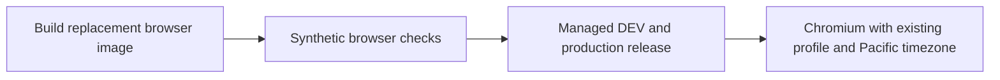

# Refresh Chromium and use the configured local timezone

Status: Production approved for browser refresh and Pacific timezone correction
Issue: https://github.com/coletaylor788/puddles/issues/364
Last updated: 2026-11-17

## Human section

### Design

The personal browser uses an old Chromium image and reports UTC. The host's
separate Chrome installation and timezone do not control that container.
Refresh the existing browser image from its supported Debian security packages
and configure the browser for `America/Los_Angeles`, including daylight saving.

Keep the current Vercel controller, Docker boundary, host vault and browser
profile. Use Docker's native `TZ` environment setting through the trusted launch
specification. Stop the old browser before applying new settings. Preserve the
previous image and configuration through the normal backup and rollback path.
No OpenClaw patch or upgrade is required.

Docker Desktop can retain stale paths when CI recreates a populated browser
state tree. Use its native `--volume` syntax for the same two absolute bind mounts.
Prepare and verify canonical host directories first, then verify the exact bind
sources and destinations before exposing CDP. Reject colons in bind paths because
they delimit volume arguments. Keep fail-fast errors and container ownership
checks. No Docker restart, broader mount or custom retry is needed.

For ongoing updates, use trusted maintenance to rebuild, validate and deploy a
new image digest through the same release path. Do not grant the browsing agent
Docker access or make the live container self-modifying. A recurring schedule or
new update-request tool is a separate choice, not part of this repair.

### Status

**Approval:** Production approved.

**Approval reference:** The requester asked to update the outdated browser and
correct UTC to Pacific Time on 2026-11-16. This authorizes bounded maintenance of
the existing architecture. No recurring automation or new agent update permission
is included.

The replacement image contains Chromium 156.0.8078.79 and Pacific timezone data.
The archive fixture repair, provider qualification repair and earlier browser
checks passed focused validation and retained review. Production has not changed.

The latest DEV run stopped before provider checks because Docker could not mount
recreated CI state. Disposable probes reproduced the stale path with the original
bind syntax. Native volume syntax read the correct host data and passed six
populated browser recreation cycles on the first attempt. The correction retains
the existing two-bind boundary and adds an installed host-marker regression.
Fresh DEV and production validation remain required.

## Agent section

### State

The running browser is Chromium 152.0.7977.82 on Debian 12 and UTC. The existing
image includes timezone data. The separate macOS Chrome is version 157 and the
host is already on Pacific Time. Private paths and exact image identities stay
in the companion configuration and local release records.

### Scope and acceptance criteria

- Refresh Chromium to the current supported Debian package in a replacement image.
- Verify the timezone in browser JavaScript and across container recreation.
- Check Pacific winter and summer offsets, not just the current clock display.
- Keep synthetic login, persistent profile, CDP authentication and vault isolation passing.
- Preserve real profile/vault data and existing agent permissions.
- Deploy through the existing managed lifecycle, without an OpenClaw patch.

### Architecture and decisions

Installed OpenClaw is 2026.9.6. Checked the later stable release v2026.11.4 and
current official sandbox image documentation. Image builds remain a separate
maintenance operation; updating OpenClaw or host Chrome does not refresh an
explicitly pinned browser image. The installed Vercel 0.43.0 CLI has no native
browser-update or timezone option in its help. Set the container's native `TZ`
in the existing launcher rather than adding a second controller or patching core.

Sources: [OpenClaw image maintenance](https://docs.openclaw.ai/gateway/sandboxing/images-and-setup),
[latest stable checked](https://github.com/openclaw/openclaw/releases/tag/v2026.11.4),
and [Debian arm64 Chromium](https://packages.debian.org/bookworm/arm64/chromium).
The Debian package page reports 156.0.8078.79-1~deb12u1. Record the actual built
version; do not assume macOS Chrome and Debian Chromium publish together.

### Implementation

Add optional validated IANA timezone configuration to the trusted browser launch
specification. Use `--env TZ=...` and include it in existing container ownership
checks. Keep omitted timezone behavior unchanged. Update the private image pin
and timezone, with explicit predecessor checks for the installed control file.

Use `--volume ABSOLUTE_SOURCE:/profile:rw` and the corresponding downloads bind.
The launcher creates canonical host directories before invoking Docker and checks
that inspection reports exactly those two bind mounts. Docker's
[volume syntax](https://docs.docker.com/engine/storage/bind-mounts/) can create
missing sources, so host preparation remains mandatory. Reject colon-delimited
source ambiguity. Remove the unsuccessful transient retry and preserve the
original concurrent-start and ownership behavior.

### Validation

Focused launcher tests cover timezone handling and malformed values. Installed
synthetic qualification checks JavaScript timezone and daylight saving offsets
before and after recreation, alongside existing login and isolation checks.
The replacement image reports Chromium 156.0.8078.79 and PST with offset -0800.
Its browser entrypoint is unchanged. The frozen paired dependency install is
restored. All 13 browser and plugin checks pass with the supported Node toolchain,
as do six migration checks including production preservation and whole-profile rollback.
Retained review and installed DEV passed, including timezone, synthetic login and
profile recreation. All 19 focused checks also pass on the current CI Node
toolchain. The refreshed candidate passed DEV and cleanup. Production qualification
stopped before transfer on archive fixture creation. The repaired fixture keeps
7,500 real archive members, the oversized listing, real extraction and content
checks, while reading its two input files once. Timeouts are unchanged. The
focused regression passed in 5.7 seconds and all 312 package tests passed with
the complete host PATH and required process inspection access. The repaired
candidate still requires DEV and the full production lifecycle.

Docker Desktop 4.70.0 with Engine 29.4.0 reproduced the missing-bind error after
removing and recreating an ancestor of a populated browser profile. Five native
attempts ran in the failed DEV check; a disposable reproduction still failed
80 times over 38.1 seconds with both host directories present and no container
residue. Increasing retry duration would not address the demonstrated failure.

A comparison passed normal restart, profile-only replacement and clearing profile
contents. Replacing the whole state tree failed, including fresh leaf names under
the replaced ancestor. A fresh state path passed. On the exact stale path, native
`--volume` immediately read the current host marker; the original `--mount` then
worked too. Six populated browser recreation cycles with volume syntax passed
on their first attempts. All probes used disposable directories and containers,
never real profiles or credentials, and completed cleanup.

The installed regression recreates the whole synthetic state tree and checks new
host markers through both mounts on each generation. Existing login, timezone,
profile persistence, vault isolation and unauthenticated-CDP checks remain.
The regression failed with the original launcher and passed with native volume
syntax, including current host markers and cleanup. All 18 browser and plugin
checks passed in 2.6 seconds. The retained reviewer cleared the final diff and
independently passed all nine launcher tests.

Qualification accepts an explicit model refusal as behavioral adherence only.
It also requires deterministic native Read enforcement using the maintained
scripted inference fixture, the pinned CLI and the installed browser profile.
The positive control must return a synthetic workspace marker. The protected
Read must return a correlated permission error and disclose no canary in model
requests or either transcript. Generic errors and missing files cannot pass.
The real subscription navigation, eval, Bash and authentication-refusal checks
remain required. Both fixture processes share the existing verified cleanup path.

### Rollout and rollback

The existing lifecycle stops browser writers, backs up state, replaces the image
and configuration, validates production read-only, merges exact source and closes
cleanup. Require whole-profile backup coverage before production. Consolidate the existing
child entries into one profile-root entry during a reviewed idle controller
configuration cutover. Keep the existing backup untouched until normal CI replaces
it. A regression verifies rollback removes new root files and directories.
Preserve the old image/profile for rollback. Never mutate the running
container's package installation or inspect real authentication data.

### Review log

The retained browser reviewer found that individual profile-child backup entries
miss files introduced by a newer browser. Whole-root coverage is now required by
the maintenance control. The cutover must exclude concurrent CI admission, retain
the old configuration and restore services on failure. Installed proof remains
required.

Eligible cleanup restored the host reserve. The warm candidate registered and
passed DEV with complete cleanup. The locked backup configuration cutover now
covers the whole profile and preserves the existing backup until normal CI
replacement. Both controller services restarted successfully.

The first production submission stopped before the full suite or transfer because
its registered Node version differed from the current CI toolchain. No target
transaction or production deployment occurred, and source cleanup closed. Rebuild
with the configured toolchain and repeat affected DEV validation.

A narrow build-qualification prerequisite aligns the exact Node pin with current
CI while retaining the existing pnpm pin. Fourteen packaging and overlay tests
pass. This does not migrate the production Gateway interpreter. Historical
delivery commands are recovery-only; preserved recovery continues to use its
original immutable source, toolchain and artifacts. The current application
suite uses its maintained CI entrypoints, not the retired delivery route.

### Checklist

- [x] Diagnose the running browser and timezone.
- [x] Check later stable OpenClaw and supported image maintenance.
- [x] Prepare and verify the replacement image.
- [x] Review and test the configuration change.
- [ ] Pass DEV and production lifecycle.
- [ ] Verify exact merges, terminal receipts and eligible cleanup.
