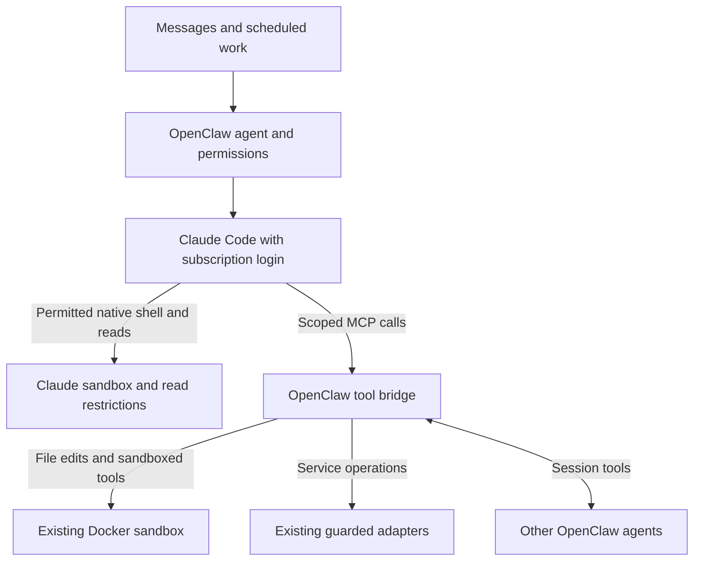

# Claude Code harness with subscription authentication

Status: Native sandbox investigation complete; revised integration proposed for review
Issue: https://github.com/coletaylor788/puddles/issues/303
Last updated: 2026-10-15

## Human section

### Design

Use official Claude Code with subscription authentication for eligible OpenClaw
agents. Claude owns reasoning, the model/tool loop and native compaction.
OpenClaw retains agent identity, permissions, conversations, delegation and
delivery. Keep native tools where their execution can preserve the existing
boundaries, and use existing OpenClaw tools for the remaining operations.

#### Subscription and agents

Use the dedicated native login under the gateway's OS user. Claude manages its
credentials and refresh; no API key, extracted token or metered Anthropic backup
is introduced. Login is verified in the gateway login domain, and the owner has
confirmed Extra usage is disabled. The deployed gateway still needs qualification.

Use Opus for high-tier reasoning and Haiku for Reader and active-memory recall.
Keep Reader's instructions, independently delivered policy improvements and
permissions. Delegation remains OpenClaw session tools. Heartbeats, other job
overrides, classifiers and embeddings do not silently change with this migration.

#### Two execution paths

An uncapped turn may use the permitted native tools plus OpenClaw MCP tools.
A turn with an explicit non-wildcard runtime tool allowance keeps OpenClaw's existing exact
restriction: native action tools are disabled, and only allowed OpenClaw tools
are exposed. Scheduling or delegation alone does not determine the path.

| Work | Intended execution |
|---|---|
| Ordinary or resumed conversation | Native profile, constrained by the actual agent's permissions |
| Reader through spawn or send | Reader's own permissions; never inherit Main's native tool set |
| Active-memory recall | Existing restricted path; its explicit allowance is confirmed in source |
| Scheduled or delegated run | Restricted when an explicit cap exists; otherwise qualify the native profile |
| Browser and service operations | Existing scoped adapters and browser isolation |

Keep Docker configured. Restricted filesystem/shell tools still need it, as do
the existing browser and other harness paths. Active memory normally uses memory
service tools; the restricted path does not imply that every call runs in Docker.

#### Native capabilities and the write boundary

Claude's shell sandbox and working-directory read restriction passed disposable
tests on the host. They blocked sibling-directory reads, symlink reads, shell
writes outside the fixture workspace, direct loopback access, and inheritance
of a synthetic secret. This is useful evidence, not full gateway qualification.

Native file writes are different. A gateway-like approval callback allowed a
native Write outside the workspace despite the shell sandbox's deny-write rule.
A user hook blocked it on explicit denial, but an ordinary hook error let the
write proceed. A path-checking hook is therefore not the proposed containment
boundary.

The recommended profile permits native shell and read tools only where the
agent's effective policy allows them. Native Write, Edit and other file-mutation
tools stay unavailable; permitted file edits use OpenClaw's Docker-backed tools.
An agent allowed shell execution can still modify its granted workspace through
sandboxed Bash. Read-only roles do not receive shell access merely to compensate
for unavailable tools.

#### Small integration change, not configuration-only delivery

The pinned backend does not expose arbitrary per-agent Claude launch settings.
Its native permission callback also does not itself reproduce the complete
OpenClaw role tool policy. Stock settings alone are therefore insufficient to
claim that this migration preserves every agent's authority.

Propose one opt-in change at the existing CLI preparation/backend boundary.
It derives the native tool subset and scoped MCP catalog from effective agent
permissions, restores permitted OpenClaw file-edit tools, and supplies the
required native restrictions. Keep explicit caller caps on their existing path.
Reuse the current launcher, MCP grants, tool implementations and permission flow.
Do not add a harness, proxy, shell wrapper, history converter or hook-based
security layer. The change's exact scope is a review decision before implementation.

#### Points requiring particular review

| Point | Required outcome |
|---|---|
| Authority projection | Agent, sandbox, caller and plugin restrictions can narrow access; none can accidentally widen it |
| Two filesystem views | Native host paths and Docker tool paths address the same granted workspace without exposing other roots |
| Credentials and local services | Shell restrictions cover files, inherited environment and IPC; native web/browser/plugin tools cannot bypass adapters |
| Warm sessions and resume | Changed policy replaces an incompatible process; old permissions never survive into a new role or restricted turn |
| AI quality | Claude reliably mixes native reads/shell with OpenClaw edits, including images, attachments and delegated results |
| Context continuity | Switching harnesses retains usable prior facts, not merely the same conversation ID |

### Status

**Approval:** Original design Production approved; native-profile revision proposed
for review. **Approval reference:** The requester approved implementation and
shipping on 2026-10-15, then asked to investigate native sandboxing and update the
proposal for review. That original authorization remains recorded; the proposed
policy integration and changed execution boundary are not yet implemented.

Source investigation and two bounded native CLI experiments are complete. They
support the mixed architecture and rule out a hook-only write boundary. Installed
OpenClaw acceptance, model routing and conversation continuity remain release
gates. Production routing is unchanged.

## Agent section

### State

Work in the existing paired `codex/claude-harness-shipping` feature worktrees.
Source baseline: OpenClaw `eb377ac59e6c9fd6c7705028034812becf00271b`; inspected
Claude Code 2.1.301. Native claude.ai authentication works in the gateway login
domain, not plain SSH. Owner confirmed Extra usage off. Direct experiments used
the subscription route and returned `claude-haiku-5-5`; Opus is not yet qualified.
No executable/configuration deployment or production restart occurred.

### Scope and acceptance criteria

- Preserve subscription-only authentication, agent scope, approvals and delivery.
- Explicitly route Reader and active-memory recall to Haiku; preserve other overrides.
- Native shell/read capability must be a subset of effective OpenClaw authority.
- Disable native file-mutation tools; restore only permitted OpenClaw equivalents.
- Preserve existing capped-run behavior, including an empty allowance and absent tools.
- Keep Docker and service boundaries. Never resolve a failure by turning sandboxing off.
- Do not change account-history provenance, session identity or reader result framing.

### Architecture and decisions

`cli-runner/prepare.ts:652` translates an explicit non-wildcard `toolsAllow`
into exact availability with no native tools. The agent's ordinary `tools.allow`
is not this parameter. Catalog construction at 1274 precedes prompt-hook filtering
at 1300, so a late hook cannot restore omitted file tools.

`extensions/active-memory/recall-run.ts:283` supplies its allowance and uses
`cliBackendDispatch: "subscription-auth"`. Cron's `run-executor.ts:576` passes
the optional payload allowance. Ordinary replies and command/delegated execution
forward caller caps. Neither `sessions_spawn` nor `sessions_send` inherently
establishes an exact cap for every target run. Test the final target context.

`cli-runner/execute-plugin.ts:91-216` projects native file operands, calls policy
hooks and applies exec approval. It does not independently establish a workspace
write boundary or full role-tool projection. `cli-backends.ts:283-305` resolves
plugin-owned launch configuration; arbitrary per-agent argv is not supported.

Reuse `cliToolAvailability` and `mcp-http.runtime.ts`'s mediated coding-tool
selection before catalog construction. Explicit caps retain priority. Native
name mapping must cover each selected tool and fail on unsupported capabilities.
Supply only trusted settings; do not depend on editable project/user additions.
The existing restricted-argument translator strips supplied settings, so its
native-profile branch must explicitly preserve the required restrictions.

### Implementation

After review approval, add one opt-in policy selection for eligible Claude-backed
agents. Keep default and other-backend behavior unchanged. Build the effective
tool set once, split it into permitted native shell/read tools and mediated
OpenClaw tools, and enforce that exact set in launch arguments and MCP grants.
Keep native mutators, native delegation, web/browser tools and ambient executable
customizations unavailable unless separately qualified and approved.

Enable strict native sandboxing with no excluded commands or unsandboxed retries;
require startup failure when unavailable. Bind filesystem access to the trusted
workspace and necessary runtime paths, constrain network/IPC, and prevent
credential inheritance. Block native reads outside granted working directories.
Do not treat the default broad read policy or protected-path list as sufficient.

Fingerprint the effective native policy/settings with the warm process and
revalidate on resume. Preserve OpenClaw hooks and approvals. Correctly translate
host/container paths or retain the affected operation on the mediated path.
Update security architecture only after approval of this boundary change.

### Validation

The first synthetic CLI experiment passed shell and native workspace reads/writes,
sibling/symlink read denials, shell sibling-write and loopback denials, and removal
of a synthetic environment secret. Native outside Write was denied for lack of
permission, which was not a sufficient containment proof.

The second used Claude's real stdio protocol with an OpenClaw-shaped PreToolUse
approval callback. Outside Write succeeded despite sandbox denyWrite; native Read
remained blocked by the working-directory restriction. A command hook exiting 2
blocked Write; the same hook exiting 1 allowed it. Filesystem outcomes confirmed
each result. These are direct executable experiments, not full gateway tests.

Before release, register composed regressions for native availability, unchanged
capped execution, empty caps, policy intersections, missing sandbox support,
path translation, symlinks/concurrent changes, protected state, environment/IPC,
native capability absence, settings tampering, and warm-process policy changes.
Exercise main, Reader via both session tools, recall, capped/uncapped cron,
resume, restart and the companion fallback round trip. Use synthetic content and
recording adapters; no live external writes or delivery. Run real installed DEV
and cumulative TEST/PROD checks through the maintained lifecycle.

Sources: [pinned CLI contract](https://github.com/openclaw/openclaw/blob/eb377ac59e6c9fd6c7705028034812becf00271b/docs/gateway/cli-backends.md),
[native sandbox scope](https://code.claude.com/docs/en/sandboxing),
[native permission evaluation](https://code.claude.com/docs/en/agent-sdk/permissions),
[native settings](https://code.claude.com/docs/en/settings-reference).

### Rollout and rollback

Keep the current route until an opted-in role passes its installed tests. Start
at an idle boundary and retain conversation records. Release through the existing
pipeline with reviewed artifacts and rollback. Rollback restores routing and
policy without deleting sessions. Failing native qualification keeps that role
on its existing route; it does not authorize broader host access.

### Review log

The replacement independent reviewer confirmed the cap-selection, native-write
approval and missing per-agent launch-setting findings against the exact source.
The initial hook recommendation was superseded by the executable failure test.
Independent review of the revised proposal found no material issues. The opt-in
feature spans existing CLI preparation, MCP catalog selection, trusted settings
and process reuse; it is not a one-file change. Review approval remains pending.
Source review and direct CLI probes do not count as gateway or production acceptance.

### Checklist

- [x] Record original delivery approval and prepare dedicated native login.
- [x] Confirm Extra usage disabled and complete a bounded native subscription turn.
- [x] Trace capped execution and test native restrictions plus callback/hook behavior.
- [ ] Approve the revised boundary and opt-in integration scope.
- [ ] Implement and independently review the policy integration and regressions.
- [ ] Qualify gateway authentication, Opus, Reader/recall Haiku and every tool path.
- [ ] Pass context-continuity, quality, lifecycle and fallback acceptance.
- [ ] Release, verify, merge and clean up through the existing lifecycle.
