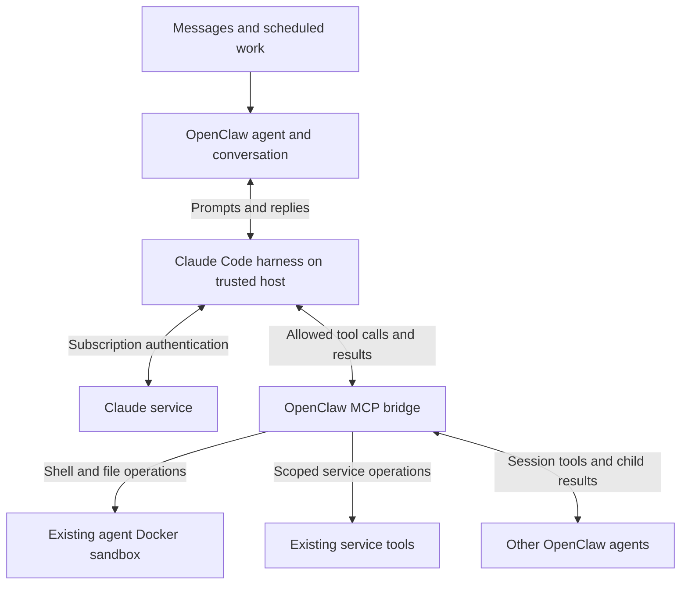

# Claude Code harness with subscription authentication

Status: Production approved; native tool contingency awaiting decision
Issue: https://github.com/coletaylor788/puddles/issues/303
Last updated: 2026-10-15

## Human section

### Design

Use the official Claude Code harness for eligible OpenClaw agents, authenticated
with a Claude subscription. Claude owns reasoning, its model/tool loop and native
compaction. OpenClaw keeps agent identity, conversations, tools, scheduling,
delegation and delivery. Use the existing integration and defer Claude's native
action tools so the migration preserves the current execution boundaries.



#### Subscription authentication

The gateway launches official Claude Code using its programmatic interface.
This remains the Claude Code harness even though no interactive terminal is
shown. Authentication must select the signed-in Claude subscription, rather
than a Console account, API key or separately metered credit balance. Claude
owns login and credential refresh. Credentials stay outside agent workspaces.

Use a dedicated Claude configuration for the gateway. Disable extra usage and
remove conflicting authentication overrides from that runtime. Verify the
effective account and subscription route with the installed executable before
activation. This proposal includes no automatic Anthropic API backup.

#### Setup blocker: subscription sign-in

**Owner sign-in is verified in the gateway login domain.** Full service/model
qualification and confirmation that extra usage is disabled remain pending. A browser login on another
computer does not authenticate the gateway. The CLI login must belong to the
same host OS user and dedicated Claude configuration directory the gateway uses.
This blocks live subscription validation and activation; approved preparation
and fixture-based implementation can proceed without the login.

The implementation agent first installs or verifies official Claude Code,
prepares an unused dedicated configuration directory and provides the owner
with the exact terminal login command. It checks the selected runtime for
conflicting API, Console, cloud or gateway credentials without modifying other
Claude installations. The owner then completes these steps:

1. **Activate a Claude Pro or Max subscription** on the claude.ai account intended
   for the gateway, if that account does not already have an eligible plan.
   A free account or Console/API credit balance does not satisfy this proposal.
2. **Disable extra usage / usage credits** in
   [Claude Settings > Usage](https://claude.ai/settings/usage). Leave automatic
   credit purchases disabled. No API key or Console funding is needed.
3. **Run the prepared login command in the gateway user's terminal on the
   gateway host.** Choose the Claude subscription account, not Anthropic Console
   or a third-party platform. Complete the browser sign-in yourself. Over SSH,
   open the displayed authorization URL in your browser and, if prompted, paste
   the returned code into that same terminal, not into chat or a repository.
4. **Verify the login in the same terminal and configuration directory.** The
   prepared status command should identify the claude.ai authentication route.
   Tell the implementation agent that sign-in is complete and extra usage is
   off. Do not send tokens, authorization codes or credential files.

The implementation agent owns the final check: the real gateway service must
see the same login, use subscription authentication, and complete a bounded
qualification turn without switching to separately metered credentials.
Production deployment is separately approved below. Exact commands and completion criteria
are recorded in the Agent section below.

#### Tools and sandboxing

Use OpenClaw's existing restricted-tool integration. It disables Claude's native
action tools and ambient customizations, then exposes the current agent's
authorized OpenClaw tools through MCP. Apply that restriction to ordinary and
resumed messages as well as scheduled and delegated turns. Merely approving
an MCP tool list does not establish that native tools are unavailable.

Claude Code runs on the trusted host. Shell and file operations still execute
through OpenClaw's configured Docker sandbox. Browser, mail and other service
tools retain their existing service boundaries; MCP does not place those
services inside Docker. Existing host-authorized roles are outside the initial
migration. No new host authority or native-tool replacement is proposed.

#### Ordinary-turn qualification finding

The pinned integration has the required restricted executor, but normal agent
configuration does not select it for every turn. A caller-supplied `toolsAllow`
list selects mediated OpenClaw tools and removes Claude's native tools. The
agent's normal `tools.allow` policy is a different input. Ordinary messages do
not automatically convert it into that caller cap.

A prompt hook is not yet a sufficient replacement. In the pinned preparation
order it filters an MCP catalog that has already omitted native coding tools.
It can remove Claude tools without restoring OpenClaw file, process and shell
operations. Setting Claude CLI arguments alone has the same missing-tool risk.
An independent review is checking these findings before a mechanism is selected.

The proposed contingency is a small, opt-in OpenClaw patch for the selected
Claude-backed agents. It would select the existing mediated tool catalog before
CLI preparation, intersect any caller restriction with existing agent policy,
and reuse native-tool disabling, customization isolation and MCP enforcement.
It would not replace either harness, introduce a transport, change sandbox
permissions or change authentication. This contingency is **not covered by the
configuration-only approval** and needs a decision if stock configuration cannot
satisfy the installed checks.

#### Agents and conversations

Keep existing OpenClaw agents, instructions, workspaces and session tools.
Delegation stays between OpenClaw agents, including waiting for child results.
It does not become Claude-native subagent delegation. Preserve independently
delivered reader improvements; this migration does not change reader policy or
reimplement result framing.

Use **Opus for high-tier reasoning** and **Haiku for Reader and active memory's
recall sub-agent**. Configure both Haiku selections explicitly; changing Reader
alone does not change active memory. Keep Reader's existing instructions and
permissions, including improvements delivered separately.

These choices cover the agent roles in this migration, not every model call in
the system. Heartbeats and scheduled jobs can select their own models. Security
classifiers use separate provider settings, and memory embeddings are a different
kind of model. Check those routes during implementation; this proposal does not
silently migrate them or assume they use the Claude subscription.

Switch harnesses between tasks, without deleting or resetting the conversation.
Check that the agent remembers earlier facts after the switch. The same chat
remaining visible in OpenClaw is not enough if the new harness did not receive
its history.

#### Quality and failure behavior

OpenClaw tools have different names and behavior from Claude's native tools.
Validate tool selection, image interpretation, delegation and completion claims.
Restricted customization loading also means OpenClaw must supply the role
instructions and skills the agent needs. Check recall after compaction and
restart, including authorization details and unfinished work.

A subscription limit may interrupt a turn. Preserve the conversation and report
the interruption using existing behavior. A later message can continue work
once an eligible route is available. This proposal does not require automatic
replay of unfinished actions or uninterrupted execution.

### Status

**Approval:** Production approved. **Approval reference:** On 2026-10-15 the
requester said, "Logged in, approved to implement and ship both of these designs
to production." This covers implementation, qualification, release, rollback,
source integration and cleanup within the designs. Reader policy remains with
its existing owner; Haiku scope remains Reader and active-memory recall.

Native subscription login is verified in the gateway login domain. Ordinary-turn
tool selection requires a decision on the scoped patch described in the public
harness plan; the configuration-only approval does not cover that contingency.
History continuation and all installed checks remain unproven. Production
routing has not changed.

## Agent section

### State

The approved implementation uses isolated paired feature branches named
`codex/claude-harness-shipping`. The pinned OpenClaw revision remains
`eb377ac59e6c9fd6c7705028034812becf00271b`. Claude Code 2.1.301 is installed.
A bounded launchd probe in the gateway login domain reports native claude.ai
subscription authentication. A plain SSH process cannot see that keychain login.
No credentials were copied or extracted, and production was not restarted.
The complete service environment and model/tool behavior remain to be qualified.

### Scope and acceptance criteria

- Official Claude Code, native subscription login and stock OpenClaw integration.
- Opus for high-tier agents; Haiku explicitly selected for Reader and active-memory recall.
- Same OpenClaw agent identity and conversation, with useful retained context.
- Exact allowed tools, sandbox execution and service permissions across all turn types.
- No harness patches, custom transport, native action tools or API-account backup.
- Account details, personal usage, capacity estimates and cost analysis remain outside this repository.

### Architecture and decisions

Use canonical `anthropic/<model>` references with model-scoped
`agentRuntime.id: "claude-cli"`. Keep executable and OpenClaw versions explicit
in the eventual release inputs. Do not use a global runtime override that
unintentionally changes other providers or auxiliary workloads. Set Reader's
agent model and `plugins.entries.active-memory.config.model` separately to the
qualified Haiku model, with its `claude-cli` runtime selection. The pinned
[active-memory contract](https://github.com/openclaw/openclaw/blob/eb377ac59e6c9fd6c7705028034812becf00271b/extensions/active-memory/openclaw.plugin.json)
identifies this as the blocking recall sub-agent's model. It does not select
embedding models or every memory-maintenance job. Confirm both effective model
requests and subscription routes; inventory separate heartbeat, scheduled-job
and classifier selections without changing their scope.

The repository pins OpenClaw to `eb377ac59e6c9fd6c7705028034812becf00271b`.
Its [CLI backend contract](https://github.com/openclaw/openclaw/blob/eb377ac59e6c9fd6c7705028034812becf00271b/docs/gateway/cli-backends.md)
documents native login, restricted MCP tools, compaction and bounded history
recovery. Use its existing restriction mechanism; qualification must establish
how it applies to every migrated agent turn, not just cron examples.

Current [Claude authentication](https://code.claude.com/docs/en/authentication)
and [programmatic usage](https://code.claude.com/docs/en/headless) documentation
were checked on 2026-10-08. `claude -p` selects a programmatic interface, not a
billing route. `--bare` ignores subscription credentials and is ineligible for
this design. Recheck this contract on executable upgrades. Do not substitute
API authentication if subscription operation becomes unsupported.

Follow the existing [security architecture](../openclaw-setup/security-architecture.md)
and [agent sandbox guide](../openclaw-setup/03-openclaw-and-agent-sandboxing.md).

### Implementation

#### Prepare the owner login

The implementation agent verifies the installed CLI version and gateway OS user,
then chooses a dedicated, user-owned `CLAUDE_CONFIG_DIR` outside agent workspaces.
Confirm the directory is unused or belongs to this integration before touching
it. Prepare the login shell and gateway environment without API keys, auth-token
or endpoint overrides, API-key helpers, Console profiles, cloud-provider flags
or managed gateway settings that supersede subscription authentication. Do not
print credential values or change an unrelated installation.

Provide the owner with concrete values privately. The command shape is:

```sh
# Run as the gateway OS user on the gateway host.
# Replace the placeholder with the prepared dedicated directory.
export CLAUDE_CONFIG_DIR="/absolute/path/to/prepared-claude-directory"
claude --version
claude auth login
claude auth status --text
```

Do not add `--console`, use `setup-token`, copy a laptop's credentials, or use
`--bare`. Native browser login is the chosen route. If the installed CLI needs
the interactive flow, run `claude` in that same prepared environment and follow
its login prompt. SSH callback handling is documented in
[Claude authentication](https://code.claude.com/docs/en/authentication).

#### Clear the blocker

Require owner confirmation of an eligible subscription and disabled extra usage,
then inspect `claude auth status` locally under the actual gateway environment.
The current [CLI reference](https://code.claude.com/docs/en/cli-reference)
documents `authMethod: "claude.ai"`; inspect available account/plan information
and `/status` as well. A zero exit code alone proves login, not the required
billing route. Newer versions report `configDirectory`, which should match the
prepared directory. Keep identifying output private.

Confirm daemon access to Claude-managed credential storage, including after a
service restart; an interactive shell success is not enough. Run one bounded,
tool-free subscription qualification turn only after implementation approval,
with account-level extra usage disabled and conflicting routes excluded.
Retain only sanitized pass/fail evidence. Do not clear the blocker on a user
confirmation alone or infer billing from the CLI's API-equivalent cost estimate.
The [official usage-credit controls](https://code.claude.com/docs/en/costs#add-usage-credits-to-your-subscription)
place the Pro/Max toggle in Settings > Usage. Login and usage-setting documentation
was checked on 2026-10-12; recheck on executable upgrades.

#### Contingency patch scope, pending decision

- Add one opt-in configuration control for using OpenClaw tools on selected
  Claude-backed agent turns. Do not change unrelated providers or roles.
- Apply the selection in shared CLI preparation before the initial tool catalog
  and grant are built. Reuse the existing canonical tool factories, layered
  permissions, exact grant and backend argument translation.
- Preserve caller caps as additional restrictions, including an empty cap.
  Keep denied tools denied and native tools/customizations unavailable on fresh
  and resumed runs. Reject unsupported enforcement instead of falling back to
  host-native execution.
- Cover ordinary messages, delegated turns, scheduled turns and active-memory
  recall with composed regressions. Verify allowed file/exec/process operations
  use their configured OpenClaw implementations and Docker boundaries.
- Do not modify history-account provenance, credential ownership, model fallback
  orchestration, session delivery or the independently shipped reader policy.

Source inspected at the pinned revision: `src/agents/cli-runner/prepare.ts`
(caller-cap translation at 652, catalog construction at 1274 and hook filtering
at 1300), `src/gateway/mcp-http.runtime.ts` (mediated coding selection at 80),
and `src/auto-reply/reply/agent-runner-cli-candidate.ts` (caller cap at 469).
These are source findings, not executed runtime acceptance.

#### Configure and qualify

After approval, qualify one restricted role first. Configure the supported
runtime, native login and exact tool selection. Preserve independent agent
changes and existing patches. Keep roles that fail qualification on their
current route; report a stock-integration gap before proposing custom code.

### Validation

Check effective subscription authentication, fresh/resumed turns, restart and
compaction; verify Reader and active-memory recall request Haiku through the
intended runtime; prove native tools are absent and permitted shell/file calls use
Docker. Exercise reads, images, process handles, delegation, yield and one
recorded external action. Check denied calls and source-result protections.
Use synthetic content and recording adapters for external writes. Rehearse a
limit without repeatedly consuming real quota. No installed runtime qualification has passed yet. Source inspection is not
a substitute for the model, tool and conversation acceptance cases.

### Rollout and rollback

Use the existing reviewed configuration and release lifecycle after approval.
Qualify one role before broader rollout. Preserve predecessor settings and
conversation state. Rollback restores routing and compatible runtime state
without deleting conversations. Follow the maintained release process for any
runtime artifact change. Do not activate roles whose required proof is missing.

### Review log

The design separates supported upstream capability from installed proof, keeps
tool execution within existing boundaries and excludes account-specific analysis.
The retained independent reviewer is checking ordinary-turn tool enforcement
and history eligibility against the exact pinned source before implementation
chooses a mechanism.

### Checklist

- [x] Write the proposal and verify upstream contracts.
- [x] Approve implementation scope.
- [x] Prepare the gateway-user CLI, isolated Claude configuration and exact login command.
- [ ] Owner confirms an eligible subscription, disables extra usage and completes native login.
- [ ] Verify subscription authentication in the gateway service and clear the setup blocker.
- [ ] Verify explicit Haiku routing for Reader and active-memory recall.
- [ ] Qualify every migrated tool path.
- [ ] Validate conversation continuity, quality and recovery.
- [ ] Release eligible roles through the existing lifecycle.
