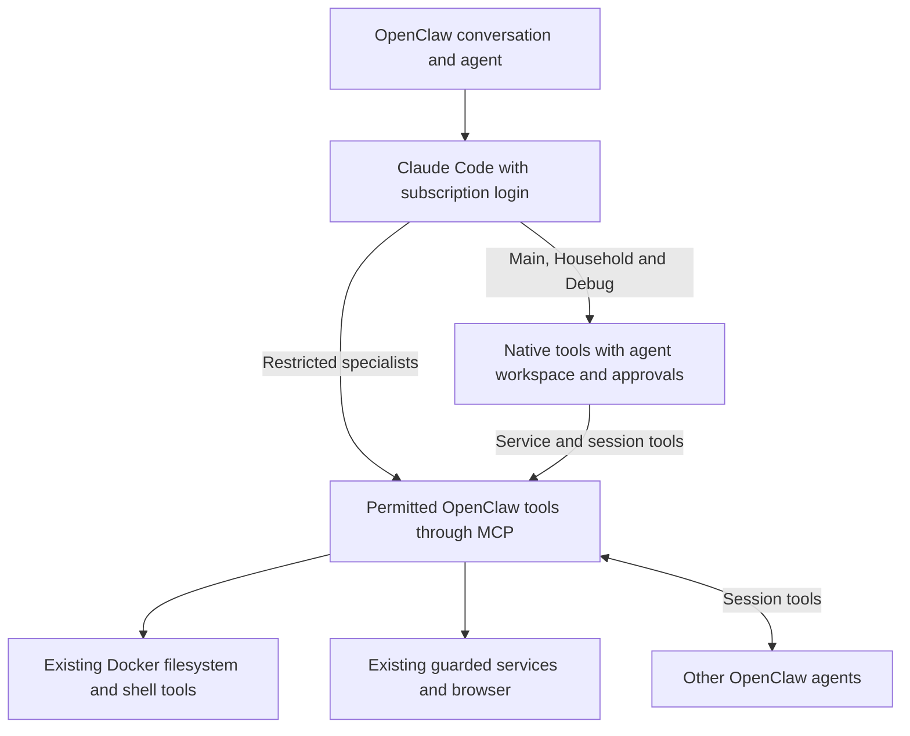

# Claude Code harness with subscription authentication

Status: Approved implementation in progress; production unchanged
Issue: https://github.com/coletaylor788/puddles/issues/303
Last updated: 2026-10-16

## Human section

### Design

Use official Claude Code with subscription authentication. Claude owns reasoning,
the model/tool loop and native compaction. OpenClaw retains agent identity,
conversations, delegation, approvals, service permissions and delivery. Keep the
integration close to its supported behavior rather than introducing another
harness or a custom file-editing layer.

#### Authentication and models

Use the dedicated native login under the gateway's OS user. Claude manages its
credentials and refresh. Do not introduce an API key, extracted token or metered
Anthropic backup. Native login is verified in the gateway login domain, and the
owner confirmed Extra usage is disabled. Gateway execution still needs qualification.

Use Opus for high-tier reasoning and Haiku for Reader and active-memory recall.
Preserve other model overrides. Delegation remains ordinary OpenClaw session tools.
Reader instructions and its independently delivered policy changes remain intact.

#### Which agents use which tools

| Agent or run | Execution path |
|---|---|
| Main | Native Claude tools plus permitted OpenClaw tools |
| Household | Native Claude tools plus its own permitted OpenClaw tools |
| Debug | Native Claude tools; retain its existing diagnostic permissions and exclusions |
| Reader and Household Reader | Restricted OpenClaw tools |
| Browser Agent and Household Browser Agent | Restricted OpenClaw tools and existing browser isolation |
| Wiki Maintainer | Restricted OpenClaw tools, including controlled wiki mutation tools |
| Active-memory recall | Existing explicitly restricted memory-tool path |

Native means Claude may use its own Read, Write, Edit and Bash tools. Restricted
means Claude still runs the agent loop, but its native action tools are disabled
and it uses only permitted OpenClaw tools through MCP. Restricted does not mean
read-only: Reader retains its permitted workspace writes, for example.

OpenClaw already filters its MCP tools by agent permissions. An explicit per-run
tool allowance also selects the restricted path. An ordinary agent tool list does
not automatically translate into a matching list of Claude-native tools. Wire
specialists onto the existing restricted path explicitly; do not add a custom
translation merely to give each specialist a partial native toolbox.

Scheduled, resumed and delegated runs retain their owning agent's path and any
tighter per-run restriction. Neither spawn nor send alone makes a run restricted.
Active-memory recall already supplies an explicit allowance in source.

#### Workspace boundaries and approved exceptions

Native execution must preserve the intended workspace boundary. Main and Household
use their own workspaces and access policies. Household does not inherit Main's
filesystem access, personal-data tools or conversation permissions. Changing the
harness must not silently grant access to sibling workspaces, credentials or host
state. Keep Debug's existing diagnostic exception separate from ordinary agents.

This is an acceptance requirement, not an assumption that Claude's sandbox is
identical to Docker. Configure and test native shell sandboxing and file-read
restrictions against the actual agent workspace. Include symlinks, native file
tools and resumed sessions, not only shell commands.

An outside-workspace write may proceed when the owner explicitly approves that
operation through OpenClaw's existing approval system. It must not proceed through
silent approval or reuse of a broader grant. A denied, expired or unavailable
approval must leave the operation unexecuted. Hard-denied paths remain denied.

Claude Code already supports the desired experience: workspace edits can run
without prompts, while outside writes request permission. Its native permission
system should own that distinction. This is separate from its shell sandbox.

The mismatch is in OpenClaw's approval bridge. It calls the same host authorization
handler both before Claude checks permissions and when Claude asks for permission.
A fresh comparison used the installed callback functions with the real Claude CLI:

| Configuration | Workspace write | Outside write |
|---|---|---|
| Native Claude workspace permissions | Runs without asking | Requests permission |
| OpenClaw full/off | Runs without asking | Automatically allowed |
| OpenClaw full/off plus explicit Claude outside ask rule | Runs without asking | Claude asks; OpenClaw automatically answers allow |
| OpenClaw always-ask | Requests approval | Requests approval |

The earlier protected-path probe showed that explicit native deny rules still apply;
no protected file was created in this comparison either. The problem is automatic
approval of an operation that should require the owner, not removal of all native restrictions.
Always-ask avoids that automatic approval but loses prompt-free workspace edits.
The tested native ask rule does not repair the bridge. OpenClaw also forces Claude's
default permission mode, so passing acceptEdits alone cannot restore standalone behavior.

#### Resolved approval flow

Keep native Write and Edit. Make one narrow adjustment to the existing approval
bridge so it distinguishes the early policy check from a request for human permission.

1. **Before a native tool call:** OpenClaw checks the active run, tool restrictions,
   policy vetoes and any argument changes. Passing this stage means continue to
   Claude's checks, not grant permission to execute.
2. **Claude evaluates permissions:** trusted workspace rules allow normal file
   work inside that agent's workspace. Hard-denied locations remain blocked.
   Operations needing an exception reach Claude's permission callback.
3. **OpenClaw asks the owner:** route that callback through the existing tool
   approval system with allow once or deny. Do not apply automatic full-access
   shortcuts or remembered tool-wide grants. Denial, expiry or unavailable approval
   prevents execution. An approval authorizes that operation only.

A real Claude CLI prototype demonstrated this flow: workspace Write and Edit ran
without approval requests; outside writes and symlink escapes requested approval;
only the explicitly approved outside file was created. A later turn in the same
process still requested approval for another outside path. A fresh process behaved
the same way. Withholding a response left the file absent, and a host veto blocked
an otherwise permitted workspace write.

The adjustment restores Claude's native permission boundary at the integration
point. It belongs in the permission bridge, not in a new file tool or filesystem
checker. Claude retains workspace/path classification and native file execution. OpenClaw retains policy
checks and human approval delivery. Trusted settings must exclude ambient grants
or hooks that could skip the approval callback, and changed settings must invalidate
an incompatible warm process. Actual gateway delivery remains an implementation
acceptance test, not an undecided design choice.

Keep Docker configured for restricted agents and other harness paths. Their MCP
execution and approvals are unchanged. Browser and service operations retain their
existing guarded adapters. Main and Household retain separate workspace roots;
Debug retains its explicitly configured diagnostic access.

#### Review and quality concerns

| Concern | Required outcome |
|---|---|
| Workspace isolation | Main and Household stay within their own granted roots; outside writes need an explicit exception |
| Approvals | No silent native write escalation, standing-grant bypass or permission widening on resume |
| Specialist restrictions | Both session tools, scheduled work and recall select the intended restricted tools |
| Credentials and services | Native tools cannot bypass protected state, credential handling or guarded service access |
| AI quality | Check Haiku summary fidelity, delegated results, images and attachments; measure extra approval interruptions |
| Conversation continuity | Resume and harness transitions retain usable prior context, not merely a conversation ID |

### Status

**Approval:** Production approved.
**Approval reference:** On 2026-10-16 the requester said “Okay approved, implement
and ship” after reviewing the phase-aware native approval design. Native Main,
Household and Debug and restricted specialists are included. Haiku remains scoped
to Reader and active-memory recall.

The maintained patch and private routing configuration are under implementation
and independent review. Focused approval and profile checks pass. Installed
sandbox boundaries, actual approval delivery, model quality and harness continuity
remain release gates. Production is unchanged.

## Agent section

### State

Use the paired `codex/claude-harness-shipping` feature worktrees. Audited OpenClaw
baseline: `eb377ac59e6c9fd6c7705028034812becf00271b`; Claude Code 2.1.301.
Native claude.ai authentication works in the gateway login domain, not plain SSH.
The owner confirmed Extra usage off. A bounded direct subscription turn returned
`claude-haiku-5-5`; Opus and deployed gateway execution remain unqualified.
The isolated source now contains the implementation. Coordinate public/private main merges and installed slots with the release manager.

### Scope and acceptance criteria

- Native Main, Household and Debug, each with its own access policy and scoped MCP tools.
- Restricted Reader, Browser, Wiki Maintainer, Household Reader, Household Browser
  and active-memory recall. Preserve Debug's existing diagnostic exception.
- Haiku only for Reader and active-memory recall; preserve other overrides.
- No unapproved outside-workspace native writes. Preserve denials and service guards.
- Preserve empty/per-run tool caps, delegation, reader framing and history provenance.
- Keep Docker available; add no custom write tool, harness, proxy or history converter.

### Architecture and decisions

`cli-runner/prepare.ts` translates an explicit non-wildcard `toolsAllow` into exact
availability with native tools disabled. Scoped MCP construction already applies
agent policy. Ordinary `tools.allow` is not an automatic native-tool projection.
`active-memory/recall-run.ts` supplies its cap and subscription-auth dispatch.
Reader session calls need explicit restricted-path qualification at the target.

`anthropic/cli.runtime.ts` registers PreToolUse authorization for native tools,
including calls Claude settings would otherwise permit. `execute-plugin.ts`
checks exact availability, hooks and effective exec policy. Full/off allows
without a prompt. Standing grants are keyed by tool name and live process.
Effective ask-always ignores them. `cli-native-tool-approval.ts` then requests
normal plugin approval with allow-once/deny and rejects missing or invalid decisions.
Both native phases in the pinned upstream share this handler without a phase marker, so stock
configuration cannot defer the early decision while forcing the later escalation.

`exec-defaults.ts` gives session permission policy precedence over ordinary
configuration. Full sessions can bypass host approval floors; sandbox routing
omits those floors. Per-run ask-always can tighten session modes, but cannot
relax security deny. The proposed native-escalation branch must retain deny but
request one-time human approval regardless of full/off or standing grants.

Ordinary Claude runs load user settings; restricted argument translation strips
custom settings and ambient features. Supply a trusted native profile in default
permission mode, with workspace-scoped Edit rules and no ambient permission grants,
plugins or hooks that bypass escalation. Bind its exact content and workspace to
process reuse. Preserve separate restricted settings and MCP catalogs.

### Implementation

The maintained `claude-native-agent-profiles.patch` changes the existing native permission contract, host handler,
Claude bridge and trusted launch settings:

- Carry an internal phase distinguishing PreToolUse policy checks from native
  permission escalation. Keep behavior unchanged for other backends and capped runs.
- At PreToolUse, enforce current-run authority, exact tool restrictions, security
  denials and host policy hooks. Preserve rewritten input. Continue native permission
  evaluation rather than returning a blanket permissionDecision allow.
- At can_use_tool, revalidate the same call/run and use existing plugin approval
  with allow-once/deny. Ignore full/off shortcuts and standing grants. Do not run
  approval-producing host hooks twice or lose their vetoes. Preserve AskUserQuestion
  handling and MCP tools' existing separate authorization.
- Generate trusted settings per native role. Use default permission mode and an
  absolute workspace-scoped Edit allow rule, which Claude applies to both Write
  and Edit. Retain shell/read restrictions and protected paths. Exclude ambient
  settings that widen permissions; fingerprint the profile for process reuse.

Select the existing exact-cap path for specialists; keep their OpenClaw tools,
Docker execution and service grants unchanged. No custom native tool-list mapping,
file writer, path checker or new approval transport is required. Native Main,
Household and Debug retain their respective workspace/diagnostic policies.

Add executable regressions and qualify the installed gateway, including approval
rendering, rewrites, cancellation and retained sessions. Follow the existing
release lifecycle and coordinate main merges with the release manager.

### Validation

Current candidate evidence: all seven affected source test files pass (403 tests)
against the composed public/private source. The complete application build passes.
The packaged application validates normal and held configuration and renders all
8 agents through its real Claude backend (2 installed configuration tests).
Environment rendering passes 14 tests; public/private manifest checks pass 9/24.
Extension type checking passes. Core type checking still reports pre-existing
public-baseline array-index errors in `src/test-utils/ports.ts`.

The retained reviewer has no unresolved source or packaging findings. The patch
matches the composed source byte for byte and applies cleanly to its staged
baseline. Actual Mini subscription execution, native sandbox boundaries, approval
UI delivery, exact model quality and fallback continuity remain unqualified.
The shared release lane is under a merge/slot hold; no deployment was attempted.

Two direct CLI experiments tested disposable workspaces. Shell sibling writes,
sibling/symlink reads and direct loopback access were blocked; a synthetic secret
was excluded from the environment. A synthetic approval callback allowed native
Write outside the workspace. This demonstrated an approval exception, not bypass
of a required human decision. No production files were affected.

A follow-up ran the pinned permission handler and approval helper with recorded
responses. Nine scenarios passed: full/off auto-allow; a different Write path on
a later warm turn reusing a grant; always-ask requesting both decisions despite a
prior grant; rejection of unexpected allow-always; user denial; expiry; transport
failure; security deny; and unavailable tool. Policy resolution and UI transport
were dependency seams, so this is not installed approval acceptance.

A fresh comparison then executed the installed, unchanged Claude callback functions
and host permission handler against the real CLI. Resolved policy, passing host hooks,
active-run authority and approval delivery were controlled test inputs. Four cases
passed: native acceptEdits; stock full/off; full/off with an explicit outside Edit
ask rule; and stock always-ask. Stock cases used the adapter's default permission
mode; all four had an explicit workspace allow rule. The earlier default-mode
prototype separately confirmed prompt-free workspace writes without an early allow. The native case created only the workspace
file after a recorded outside denial. Both full/off cases created the outside file
without requesting host approval. The explicit ask rule reached can_use_tool, where
the host handler returned allow automatically. Always-ask requested approval for both
paths before native workspace classification. A third, explicitly denied file was
absent in all four cases, although this probe did not retain its attempted tool
invocation. No file existed at its permission callback. These are
installed-function integration probes, not a claim about the current production
session policy or acceptance of real owner-facing delivery. Fixtures were removed.

The proposed-flow native CLI prototype used default mode, a trusted absolute workspace
Edit allow rule, a PreToolUse continuation and recorded approval replies. Workspace
Write/Edit completed with zero permission requests. Denied and unavailable outside
writes, a symlink into a sibling directory and a hard-denied write left no files.
Only the allow-once outside write succeeded, with the file absent before the decision.
A second warm turn and a fresh process repeated the inside/outside distinction.
A withheld callback response left its file absent until cancellation; a host veto
also blocked a workspace write. Filesystem assertions passed and all test jobs and
fixtures were removed. This proves Claude's native classification with the proposed
bridge protocol, not the unimplemented OpenClaw adapter or actual owner-facing UI.

The earlier command-hook error probe used default failure behavior. Claude supports
`onFailure: "block"`; that option was not tested and is not the selected solution.

Register executable regressions during implementation. Exercise all three native roles,
all restricted roles, both session tools, recall, cron, resume and restart. Require
no write before approval and no write after deny, timeout or offline delivery.
Test full-mode overrides, standing grants, settings changes, sibling roots,
symlinks, protected state and different host/Docker paths. Include exact models,
summary quality and context continuity. Use synthetic content and recording
adapters, then the maintained DEV/TEST/PROD lifecycle. Do not send live test messages.

Sources: [pinned CLI contract](https://github.com/openclaw/openclaw/blob/eb377ac59e6c9fd6c7705028034812becf00271b/docs/gateway/cli-backends.md),
[pinned native approvals](https://github.com/openclaw/openclaw/blob/eb377ac59e6c9fd6c7705028034812becf00271b/src/agents/cli-runner/cli-native-tool-approval.ts),
[Claude sandboxing](https://code.claude.com/docs/en/sandboxing),
[Claude permissions](https://code.claude.com/docs/en/permissions),
[hook failure behavior](https://code.claude.com/docs/en/hooks#block-the-action-when-a-hook-fails).

### Rollout and rollback

Qualify Main first, then Household, Debug and specialists, before enabling their routes.
Start at idle boundaries and retain conversation records. Release through the
existing pipeline with tested artifacts and rollback. Rollback restores routing
and policy without deleting sessions. A failed native boundary test leaves the
role on its existing route; it does not authorize broader access.

### Review log

Independent source review confirmed automatic approval paths, always-ask handling,
policy precedence and the absence of ordinary agent-list to native-list translation.
Follow-up independent review challenged explicit ask-rule precedence. The installed-function
probe confirmed that the rule reaches the same automatic host handler. This supports the
phase-aware bridge as the appropriate narrow change. Preserve rewritten inputs,
avoid duplicate host approvals, retain user-question handling and bind trusted
settings to process reuse.
The requester clarified that individually approved writes are acceptable. Remove
the native-file ban and mandatory mixed editing path. Current review attention is
workspace isolation, effective approvals and correct specialist path selection.
Implementation review accepted and resolved three findings: temporary MCP credential
file access, environment-preservation overrides defeating clearing, and exact MCP
grants remaining broader than the agent cap. A follow-up removed agent-wide exec
overrides so fallback policy stays unchanged, and made shell network denial strict.
The retained reviewer rechecked the complete source and authored packaging with no
remaining material findings. Source review is not gateway or production acceptance.
A reused transport regression also exposed stale callback authority. Native deferred
callbacks now restore the admitted request and caller contexts, explicitly clearing
foreign caller context. The retained reviewer cleared the fix. Sixty-eight focused
tests cover native policy, concurrent callbacks, absent identity, revoked approvals
and user-question delivery. Installed qualification remains pending.

### Checklist

- [x] Record delivery approval, native login and disabled Extra usage.
- [x] Investigate native restrictions, automatic approvals and standing grants.
- [x] Agree native Main/Household/Debug and restricted specialist split.
- [ ] Qualify actual workspace bounds, approval delivery and role selection.
- [ ] Qualify Opus, Reader/recall Haiku, quality and context continuity.
- [x] Resolve prompt-free workspace writes and one-time outside-write approval.
- [x] Implement the scoped approval-bridge adjustment with regression coverage.
- [ ] Release, verify, merge and clean up through the existing lifecycle.
