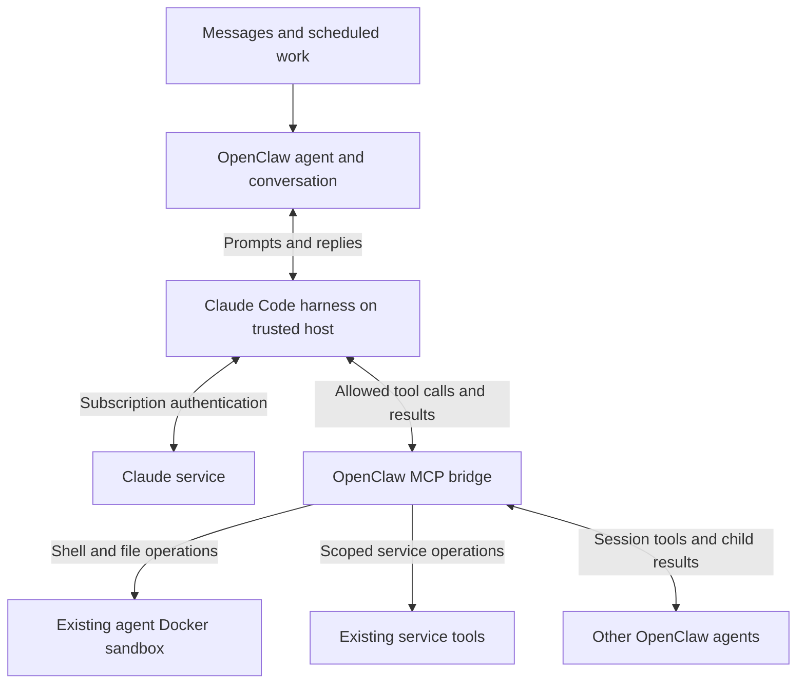

# Claude Code harness with subscription authentication

Status: Proposed; subscription setup pending
Issue: Not created
Last updated: 2026-10-12

## Human section

### Design

Use the official Claude Code harness for eligible OpenClaw agents, authenticated
with a Claude subscription. Claude owns reasoning, its model/tool loop and native
compaction. OpenClaw keeps agent identity, conversations, tools, scheduling,
delegation and delivery. Use the existing integration and defer Claude's native
action tools so the migration preserves the current execution boundaries.



#### Subscription authentication

The gateway launches official Claude Code using its programmatic interface.
This remains the Claude Code harness even though no interactive terminal is
shown. Authentication must select the signed-in Claude subscription, rather
than a Console account, API key or separately metered credit balance. Claude
owns login and credential refresh. Credentials stay outside agent workspaces.

Use a dedicated Claude configuration for the gateway. Disable extra usage and
remove conflicting authentication overrides from that runtime. Verify the
effective account and subscription route with the installed executable before
activation. This proposal includes no automatic Anthropic API backup.

#### Setup blocker: subscription sign-in

**Blocked until the owner completes subscription sign-in and the implementation
agent verifies it in the gateway environment.** A browser login on another
computer does not authenticate the gateway. The CLI login must belong to the
same host OS user and dedicated Claude configuration directory the gateway uses.
This blocks live subscription validation and activation; approved preparation
and fixture-based implementation can proceed without the login.

The implementation agent first installs or verifies official Claude Code,
prepares an unused dedicated configuration directory and provides the owner
with the exact terminal login command. It checks the selected runtime for
conflicting API, Console, cloud or gateway credentials without modifying other
Claude installations. The owner then completes these steps:

1. **Activate a Claude Pro or Max subscription** on the claude.ai account intended
   for the gateway, if that account does not already have an eligible plan.
   A free account or Console/API credit balance does not satisfy this proposal.
2. **Disable extra usage / usage credits** in
   [Claude Settings > Usage](https://claude.ai/settings/usage). Leave automatic
   credit purchases disabled. No API key or Console funding is needed.
3. **Run the prepared login command in the gateway user's terminal on the
   gateway host.** Choose the Claude subscription account, not Anthropic Console
   or a third-party platform. Complete the browser sign-in yourself. Over SSH,
   open the displayed authorization URL in your browser and, if prompted, paste
   the returned code into that same terminal, not into chat or a repository.
4. **Verify the login in the same terminal and configuration directory.** The
   prepared status command should identify the claude.ai authentication route.
   Tell the implementation agent that sign-in is complete and extra usage is
   off. Do not send tokens, authorization codes or credential files.

The implementation agent owns the final check: the real gateway service must
see the same login, use subscription authentication, and complete a bounded
qualification turn without switching to separately metered credentials.
Signing in does not approve deployment. Exact commands and completion criteria
are recorded in the Agent section below.

#### Tools and sandboxing

Use OpenClaw's existing restricted-tool integration. It disables Claude's native
action tools and ambient customizations, then exposes the current agent's
authorized OpenClaw tools through MCP. Apply that restriction to ordinary and
resumed messages as well as scheduled and delegated turns. Merely approving
an MCP tool list does not establish that native tools are unavailable.

Claude Code runs on the trusted host. Shell and file operations still execute
through OpenClaw's configured Docker sandbox. Browser, mail and other service
tools retain their existing service boundaries; MCP does not place those
services inside Docker. Existing host-authorized roles are outside the initial
migration. No new host authority or native-tool replacement is proposed.

#### Agents and conversations

Keep existing OpenClaw agents, instructions, workspaces and session tools.
Delegation stays between OpenClaw agents, including waiting for child results.
It does not become Claude-native subagent delegation. Preserve independently
delivered reader improvements; this migration does not change reader policy or
reimplement result framing.

Select an explicit supported Claude model for each migrated role. Use Opus for
high-tier reasoning and preserve the reader's independently selected model.
Move sessions at idle boundaries and retain their conversation records. Native
session reuse and history recovery must be verified; keeping a conversation ID
alone does not prove that the model received its prior context.

#### Quality and failure behavior

OpenClaw tools have different names and behavior from Claude's native tools.
Validate tool selection, image interpretation, delegation and completion claims.
Restricted customization loading also means OpenClaw must supply the role
instructions and skills the agent needs. Check recall after compaction and
restart, including authorization details and unfinished work.

A subscription limit may interrupt a turn. Preserve the conversation and report
the interruption using existing behavior. A later message can continue work
once an eligible route is available. This proposal does not require automatic
replay of unfinished actions or uninterrupted execution.

### Status

**Approval:** Proposed. **Approval reference:** The requester asked for this
repository proposal on 2026-10-08. Scope is design documentation; implementation
and activation are not part of this change.

The upstream integration supports the proposed architecture. **Setup blocker:**
subscription entitlement and gateway-user sign-in are not yet verified. The owner
must complete the setup steps above before live subscription validation or
activation. The exact installed combination still needs tool-boundary and
conversation tests. No account, runtime configuration or service has been changed.

## Agent section

### State

The proposal is published. This documentation-only follow-up adds the requested
subscription setup blocker on `codex/claude-subscription-setup-blocker`, based on
`a8e12a911a3c72f184877db9731ca680175d4175`. Account entitlement and native login
have not been inspected. No implementation or runtime validation is claimed.

### Scope and acceptance criteria

- Official Claude Code, native subscription login and stock OpenClaw integration.
- Same OpenClaw agent identity and conversation, with useful retained context.
- Exact allowed tools, sandbox execution and service permissions across all turn types.
- No harness patches, custom transport, native action tools or API-account backup.
- Account details, personal usage, capacity estimates and cost analysis remain outside this repository.

### Architecture and decisions

Use canonical `anthropic/<model>` references with model-scoped
`agentRuntime.id: "claude-cli"`. Keep executable and OpenClaw versions explicit
in the eventual release inputs. Do not use a global runtime override that
unintentionally changes other providers or auxiliary workloads.

The repository pins OpenClaw to `eb377ac59e6c9fd6c7705028034812becf00271b`.
Its [CLI backend contract](https://github.com/openclaw/openclaw/blob/eb377ac59e6c9fd6c7705028034812becf00271b/docs/gateway/cli-backends.md)
documents native login, restricted MCP tools, compaction and bounded history
recovery. Use its existing restriction mechanism; qualification must establish
how it applies to every migrated agent turn, not just cron examples.

Current [Claude authentication](https://code.claude.com/docs/en/authentication)
and [programmatic usage](https://code.claude.com/docs/en/headless) documentation
were checked on 2026-10-08. `claude -p` selects a programmatic interface, not a
billing route. `--bare` ignores subscription credentials and is ineligible for
this design. Recheck this contract on executable upgrades. Do not substitute
API authentication if subscription operation becomes unsupported.

Follow the existing [security architecture](../openclaw-setup/security-architecture.md)
and [agent sandbox guide](../openclaw-setup/03-openclaw-and-agent-sandboxing.md).

### Implementation

#### Prepare the owner login

The implementation agent verifies the installed CLI version and gateway OS user,
then chooses a dedicated, user-owned `CLAUDE_CONFIG_DIR` outside agent workspaces.
Confirm the directory is unused or belongs to this integration before touching
it. Prepare the login shell and gateway environment without API keys, auth-token
or endpoint overrides, API-key helpers, Console profiles, cloud-provider flags
or managed gateway settings that supersede subscription authentication. Do not
print credential values or change an unrelated installation.

Provide the owner with concrete values privately. The command shape is:

```sh
# Run as the gateway OS user on the gateway host.
# Replace the placeholder with the prepared dedicated directory.
export CLAUDE_CONFIG_DIR="/absolute/path/to/prepared-claude-directory"
claude --version
claude auth login
claude auth status --text
```

Do not add `--console`, use `setup-token`, copy a laptop's credentials, or use
`--bare`. Native browser login is the chosen route. If the installed CLI needs
the interactive flow, run `claude` in that same prepared environment and follow
its login prompt. SSH callback handling is documented in
[Claude authentication](https://code.claude.com/docs/en/authentication).

#### Clear the blocker

Require owner confirmation of an eligible subscription and disabled extra usage,
then inspect `claude auth status` locally under the actual gateway environment.
The current [CLI reference](https://code.claude.com/docs/en/cli-reference)
documents `authMethod: "claude.ai"`; inspect available account/plan information
and `/status` as well. A zero exit code alone proves login, not the required
billing route. Newer versions report `configDirectory`, which should match the
prepared directory. Keep identifying output private.

Confirm daemon access to Claude-managed credential storage, including after a
service restart; an interactive shell success is not enough. Run one bounded,
tool-free subscription qualification turn only after implementation approval,
with account-level extra usage disabled and conflicting routes excluded.
Retain only sanitized pass/fail evidence. Do not clear the blocker on a user
confirmation alone or infer billing from the CLI's API-equivalent cost estimate.
The [official usage-credit controls](https://code.claude.com/docs/en/costs#add-usage-credits-to-your-subscription)
place the Pro/Max toggle in Settings > Usage. Login and usage-setting documentation
was checked on 2026-10-12; recheck on executable upgrades.

#### Configure and qualify

After approval, qualify one restricted role first. Configure the supported
runtime, native login and exact tool selection. Preserve independent agent
changes and existing patches. Keep roles that fail qualification on their
current route; report a stock-integration gap before proposing custom code.

### Validation

Check effective subscription authentication, fresh/resumed turns, restart and
compaction; prove native tools are absent and permitted shell/file calls use
Docker. Exercise reads, images, process handles, delegation, yield and one
recorded external action. Check denied calls and source-result protections.
Use synthetic content and recording adapters for external writes. Rehearse a
limit without repeatedly consuming real quota. The current change requires
only document, source-reference and diagram review.

### Rollout and rollback

Use the existing reviewed configuration and release lifecycle after approval.
Qualify one role before broader rollout. Preserve predecessor settings and
conversation state. Rollback restores routing and compatible runtime state
without deleting conversations. Follow the maintained release process for any
runtime artifact change; this documentation change starts no environments.

### Review log

The design separates supported upstream capability from installed proof, keeps
tool execution within existing boundaries and excludes account-specific analysis.
The setup follow-up distinguishes owner-only login from agent-owned preparation
and verification. It does not install software, purchase a plan or change auth.

### Checklist

- [x] Write the proposal and verify upstream contracts.
- [ ] Approve implementation scope.
- [ ] Prepare the gateway-user CLI, isolated Claude configuration and exact login command.
- [ ] Owner confirms an eligible subscription, disables extra usage and completes native login.
- [ ] Verify subscription authentication in the gateway service and clear the setup blocker.
- [ ] Qualify every migrated tool path.
- [ ] Validate conversation continuity, quality and recovery.
- [ ] Release eligible roles through the existing lifecycle.
