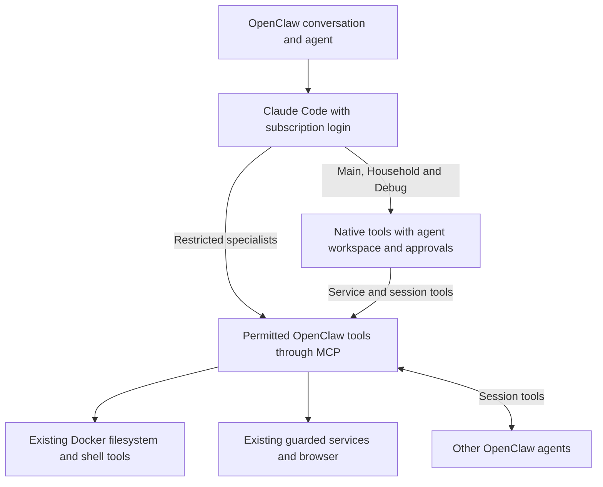

# Claude Code harness with subscription authentication

Status: Agreed native and restricted agent split; implementation qualification pending
Issue: https://github.com/coletaylor788/puddles/issues/303
Last updated: 2026-10-15

## Human section

### Design

Use official Claude Code with subscription authentication. Claude owns reasoning,
the model/tool loop and native compaction. OpenClaw retains agent identity,
conversations, delegation, approvals, service permissions and delivery. Keep the
integration close to its supported behavior rather than introducing another
harness or a custom file-editing layer.

#### Authentication and models

Use the dedicated native login under the gateway's OS user. Claude manages its
credentials and refresh. Do not introduce an API key, extracted token or metered
Anthropic backup. Native login is verified in the gateway login domain, and the
owner confirmed Extra usage is disabled. Gateway execution still needs qualification.

Use Opus for high-tier reasoning and Haiku for Reader and active-memory recall.
Preserve other model overrides. Delegation remains ordinary OpenClaw session tools.
Reader instructions and its independently delivered policy changes remain intact.

#### Which agents use which tools

| Agent or run | Execution path |
|---|---|
| Main | Native Claude tools plus permitted OpenClaw tools |
| Household | Native Claude tools plus its own permitted OpenClaw tools |
| Debug | Native Claude tools; retain its existing diagnostic permissions and exclusions |
| Reader and Household Reader | Restricted OpenClaw tools |
| Browser Agent and Household Browser Agent | Restricted OpenClaw tools and existing browser isolation |
| Wiki Maintainer | Restricted OpenClaw tools, including controlled wiki mutation tools |
| Active-memory recall | Existing explicitly restricted memory-tool path |

Native means Claude may use its own Read, Write, Edit and Bash tools. Restricted
means Claude still runs the agent loop, but its native action tools are disabled
and it uses only permitted OpenClaw tools through MCP. Restricted does not mean
read-only: Reader retains its permitted workspace writes, for example.

OpenClaw already filters its MCP tools by agent permissions. An explicit per-run
tool allowance also selects the restricted path. An ordinary agent tool list does
not automatically translate into a matching list of Claude-native tools. Wire
specialists onto the existing restricted path explicitly; do not add a custom
translation merely to give each specialist a partial native toolbox.

Scheduled, resumed and delegated runs retain their owning agent's path and any
tighter per-run restriction. Neither spawn nor send alone makes a run restricted.
Active-memory recall already supplies an explicit allowance in source.

#### Workspace boundaries and approved exceptions

Native execution must preserve the intended workspace boundary. Main and Household
use their own workspaces and access policies. Household does not inherit Main's
filesystem access, personal-data tools or conversation permissions. Changing the
harness must not silently grant access to sibling workspaces, credentials or host
state. Keep Debug's existing diagnostic exception separate from ordinary agents.

This is an acceptance requirement, not an assumption that Claude's sandbox is
identical to Docker. Configure and test native shell sandboxing and file-read
restrictions against the actual agent workspace. Include symlinks, native file
tools and resumed sessions, not only shell commands.

An outside-workspace write may proceed when the owner explicitly approves that
operation through OpenClaw's existing approval system. It must not proceed through
silent approval or reuse of a broader grant. A denied, expired or unavailable
approval must leave the operation unexecuted. Hard-denied paths remain denied.

The inspected native approval handler supports asking every time. That mode
ignores remembered tool grants and offers only allow once or deny. Other modes
can allow silently, and an allow-always grant for Write can cover a different
path on a later turn in the same process. Qualify the effective approval policy,
including session overrides, rather than assuming every callback asks a human.
Asking every time applies broadly to native tools; it does not provide selective,
prompt-free workspace writes by itself. Record that usability cost during qualification.

Keep Docker configured for restricted agents and other harness paths. Browser
and service operations retain their existing guarded adapters. Native approval
permits Claude to execute its tool; it does not move that execution into Docker.

#### Keep custom work minimal

Use the existing Claude integration, native tools, OpenClaw approvals and restricted
MCP execution. The earlier mandatory native-read/OpenClaw-write split and custom
native tool-list translation are removed from the proposal.

If qualification reveals a missing connection for restricted-role selection,
trusted sandbox settings or effective approval policy, identify and address that
specific gap through existing extension or backend mechanisms. Do not assume a
broad backend patch is required. Do not weaken workspace or role boundaries to
avoid a small necessary integration change.

#### Review and quality concerns

| Concern | Required outcome |
|---|---|
| Workspace isolation | Main and Household stay within their own granted roots; outside writes need an explicit exception |
| Approvals | No silent native write escalation, standing-grant bypass or permission widening on resume |
| Specialist restrictions | Both session tools, scheduled work and recall select the intended restricted tools |
| Credentials and services | Native tools cannot bypass protected state, credential handling or guarded service access |
| AI quality | Check Haiku summary fidelity, delegated results, images and attachments; measure extra approval interruptions |
| Conversation continuity | Resume and harness transitions retain usable prior context, not merely a conversation ID |

### Status

**Approval:** Production approved within the recorded design scope.
**Approval reference:** The requester approved implementation and shipping on
2026-10-15, then agreed to native Main and Household, restricted specialists and
explicitly approved write exceptions, and requested this proposal update.
Debug is included in the native migration with its existing diagnostic access.
Haiku remains scoped to Reader and
active-memory recall. The current request updates documentation, not production.

Source investigation and bounded probes support the approval behavior and the
two execution paths. Installed workspace isolation, actual approval delivery,
model routing and context continuity remain release gates. No runtime or
configuration change has been deployed by this investigation.

## Agent section

### State

Use the paired `codex/claude-harness-shipping` feature worktrees. Audited OpenClaw
baseline: `eb377ac59e6c9fd6c7705028034812becf00271b`; Claude Code 2.1.301.
Native claude.ai authentication works in the gateway login domain, not plain SSH.
The owner confirmed Extra usage off. A bounded direct subscription turn returned
`claude-haiku-5-5`; Opus and deployed gateway execution remain unqualified.
Refresh exact source/runtime compatibility before implementation. Coordinate any public or private main merge with the release manager.

### Scope and acceptance criteria

- Native Main, Household and Debug, each with its own access policy and scoped MCP tools.
- Restricted Reader, Browser, Wiki Maintainer, Household Reader, Household Browser
  and active-memory recall. Preserve Debug's existing diagnostic exception.
- Haiku only for Reader and active-memory recall; preserve other overrides.
- No unapproved outside-workspace native writes. Preserve denials and service guards.
- Preserve empty/per-run tool caps, delegation, reader framing and history provenance.
- Keep Docker available; add no custom write tool, harness, proxy or history converter.

### Architecture and decisions

`cli-runner/prepare.ts` translates an explicit non-wildcard `toolsAllow` into exact
availability with native tools disabled. Scoped MCP construction already applies
agent policy. Ordinary `tools.allow` is not an automatic native-tool projection.
`active-memory/recall-run.ts` supplies its cap and subscription-auth dispatch.
Reader session calls need explicit restricted-path qualification at the target.

`anthropic/cli.runtime.ts` registers PreToolUse authorization for native tools,
including calls Claude settings would otherwise permit. `execute-plugin.ts`
checks exact availability, hooks and effective exec policy. Full/off allows
without a prompt. Standing grants are keyed by tool name and live process.
Effective ask-always ignores them. `cli-native-tool-approval.ts` then requests
normal plugin approval with allow-once/deny and rejects missing or invalid decisions.

`exec-defaults.ts` gives session permission policy precedence over ordinary
configuration. Full sessions can bypass host approval floors; sandbox routing
omits those floors. Per-run ask-always can tighten session modes, but cannot
relax security deny. Verify the final policy for every enabled native run.

Ordinary Claude runs load user settings; restricted argument translation strips
custom settings and ambient features. Qualify trusted settings and existing
process fingerprints before proposing any adapter change. Keep separate tool
catalogs and execution environments explicit in installed checks.

### Implementation

Qualify native Main, Household and Debug using the existing launcher, approval flow and
trusted sandbox settings. Select the existing exact-cap path for specialists;
keep their OpenClaw tools, Docker execution and service grants unchanged.

Verify native shell and read bounds, write approvals, process environment and
local-service access. An incompatible workspace, role or permission change must
replace or safely reconfigure the warm process. No stale grants may authorize a
new role or outside write. Check that approval displays the target and operation
clearly, including long inputs.

Use configuration and supported extension points first. If one cannot express a
required connection, document the precise missing capability and smallest change.
Do not implement the withdrawn custom file-edit split or general native mapping.
Follow the existing release lifecycle for executable changes; coordinate main merges with the release manager.

### Validation

Two direct CLI experiments tested disposable workspaces. Shell sibling writes,
sibling/symlink reads and direct loopback access were blocked; a synthetic secret
was excluded from the environment. A synthetic approval callback allowed native
Write outside the workspace. This demonstrated an approval exception, not bypass
of a required human decision. No production files were affected.

A follow-up ran the pinned permission handler and approval helper with recorded
responses. Nine scenarios passed: full/off auto-allow; a different Write path on
a later warm turn reusing a grant; always-ask requesting both decisions despite a
prior grant; rejection of unexpected allow-always; user denial; expiry; transport
failure; security deny; and unavailable tool. Policy resolution and UI transport
were dependency seams, so this is not installed approval acceptance.

The earlier command-hook error probe used default failure behavior. Current
Claude docs provide `onFailure: "block"` from 2.1.295; that option was not tested.
Withdraw the claim that the probe rules out all hooks. No path-checking hook is
required merely to use OpenClaw's existing human approval flow.

Register executable regressions during implementation. Exercise all three native roles,
all restricted roles, both session tools, recall, cron, resume and restart. Require
no write before approval and no write after deny, timeout or offline delivery.
Test full-mode overrides, standing grants, settings changes, sibling roots,
symlinks, protected state and different host/Docker paths. Include exact models,
summary quality and context continuity. Use synthetic content and recording
adapters, then the maintained DEV/TEST/PROD lifecycle. Do not send live test messages.

Sources: [pinned CLI contract](https://github.com/openclaw/openclaw/blob/eb377ac59e6c9fd6c7705028034812becf00271b/docs/gateway/cli-backends.md),
[pinned native approvals](https://github.com/openclaw/openclaw/blob/eb377ac59e6c9fd6c7705028034812becf00271b/src/agents/cli-runner/cli-native-tool-approval.ts),
[Claude sandboxing](https://code.claude.com/docs/en/sandboxing),
[Claude permissions](https://code.claude.com/docs/en/permissions),
[hook failure behavior](https://code.claude.com/docs/en/hooks#block-the-action-when-a-hook-fails).

### Rollout and rollback

Qualify Main first, then Household, Debug and specialists, before enabling their routes.
Start at idle boundaries and retain conversation records. Release through the
existing pipeline with tested artifacts and rollback. Rollback restores routing
and policy without deleting sessions. A failed native boundary test leaves the
role on its existing route; it does not authorize broader access.

### Review log

Independent source review confirmed automatic approval paths, always-ask handling,
policy precedence and the absence of ordinary agent-list to native-list translation.
The requester clarified that individually approved writes are acceptable. Remove
the native-file ban and mandatory mixed editing path. Current review attention is
workspace isolation, effective approvals and correct specialist path selection.
Source probes and design review do not count as gateway or production acceptance.

### Checklist

- [x] Record delivery approval, native login and disabled Extra usage.
- [x] Investigate native restrictions, automatic approvals and standing grants.
- [x] Agree native Main/Household/Debug and restricted specialist split.
- [ ] Qualify actual workspace bounds, approval delivery and role selection.
- [ ] Qualify Opus, Reader/recall Haiku, quality and context continuity.
- [ ] Implement only demonstrated missing connections with regression coverage.
- [ ] Release, verify, merge and clean up through the existing lifecycle.
