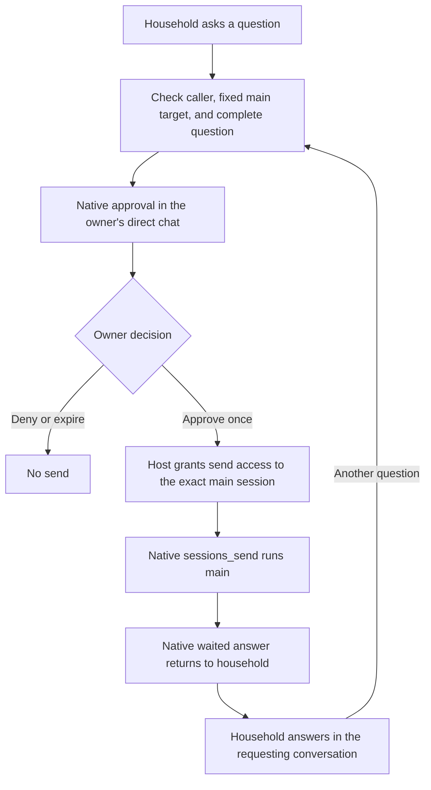

# Native approval for household questions to main

**Status:** Deployed; household identity and physical phone acceptance pending
**Issue:** [#259](https://github.com/coletaylor788/puddles/issues/259)
**Last updated:** 2026-10-13

## Human section

### Design

Household currently depends on a manual owner relay to ask main for information.
Replace that relay with an owner-approved call to native `sessions_send`. Approve
one question and permission to return its answer. Every later question needs a
new approval, including clarification. Keep agent-to-agent communication native.

#### Approve the question

A small policy plugin uses `before_tool_call.requireApproval`, the same native
pre-call approval hook used for Gmail sending. Accept only interactive household
requests to the configured canonical main session. Require a bounded question
and a fixed positive reply timeout. Reject alternate targets, labels, caller
supplied session identities, watches, other modes, and unknown parameters.
Caller and originating conversation identity come from the runtime.

The fixed owner's direct iMessage approval shows the complete question, its
origin, and that main's answer will return to that household conversation. Offer
approve-once and deny with a ten-minute window. Reject questions that cannot fit
in the native approval summary. OpenClaw owns the approval, authenticated owner
decision, argument snapshot, and continuation. Denial, expiry, or cancellation
before dispatch sends nothing. After dispatch, cancellation cannot retract it.

Approval does not turn household into the owner or authorize external actions.
Main keeps its own tool permissions and approvals. Household gets no main history,
files, memory, session discovery, or service tools. Reader and browser workers
retain their current restrictions.

#### Grant a narrow native route

Use the documented `openclaw/plugin-sdk/session-visibility` API. A host-owned
provider matches the send operation, the authorized household session, and the
fixed main destination, then returns main's exact current session identity.
Resolve that identity from authoritative host state; never accept it from the
question or tool arguments. Native admission checks replacement and archive state.

The grant supplies target access, not human consent. The native pre-call hook
must approve every send. The provider grants no other operation or target.
Keep ordinary household cross-agent access denied so a missing or failed provider
cannot fall back to unrestricted peer sending. Bind registration cleanup to the
plugin runtime lifecycle. No approval cache, response executor, or broker is needed.

#### Return one answer

For an exact-session scoped grant, native `sessions_send` preserves the waited
tool result and suppresses its detached reply loop, announcement, and ongoing
watch. Household uses that result to answer the original conversation. A new
question requires another tool call and approval. Other session sends keep their
existing behavior.

The positive timeout bounds household's wait. It does not stop main. If the wait
expires, report the native timeout or uncertain outcome; do not resend blindly,
read main's history, or promise automatic late delivery. This scoped route does
not start the ordinary deferred answer flow. Main's explicit tools remain subject
to their own policy; suppression of automatic replies is not an outbound filter.

There is still no native approval gate on the automatically returned answer.
The approved scope accepts that answer without a second approval. An explicit
reply tool could request approval, but redirecting every answer through it would
introduce the custom response handling the requester excluded.

#### Why the removed setting is not restored

Upstream removed `session.agentToAgent.maxPingPongTurns` in a broad configuration
cleanup. Ordinary peer sends now use a fixed five-turn limit. No replacement
configuration switch was introduced. The earlier zero-setting proposal relied
on stale source, and restoring it with a core patch is withdrawn.

The scoped SDK route is a separate supported capability, not a renamed setting.
Control UI and native child sessions also have one-way completion behavior, but
household must not impersonate either. `REPLY_SKIP` depends on model cooperation;
`mode: "notify"` queues context without running main or returning an answer.
Neither meets the required enforced question-and-answer boundary.

### Status

**Approval:** Production approved for the original bounded question, automatic
answer, and no-follow-up scope. **Approval reference:** On 2026-10-13 the requester
instructed this owner to ramp up on the new release manager and continue deployment
to production. The requester then explicitly said: "We should not patch agent to
agent communication." That limit is binding; the earlier patch decision is retired.

The scoped native route is implemented in `approved-session-send`, with paired
configuration and application packaging. Forty-three focused tests pass. A recording
test loads the plugin through the real OpenClaw registry and composes native
approval, session storage, access admission, and the send executor. Five synthetic
questions pass, including concurrent approval and matching replies, with zero
external writes. A real gateway/channel recording also passes: the fixed owner
approves the first question, household receives its answer, and denying a fresh
follow-up leaves main at one run.

Retained independent review, CI, complete DEV acceptance, the frozen application
gate, and installed TEST checks passed. The release manager deployed the same
artifact to production, verified the active plugin with read-only checks, merged
[PR #287](https://github.com/coletaylor788/puddles/pull/287), and resumed intake.
The normal production gateway is healthy. There is no agent-to-agent patch.
The existing household identity remains a placeholder. A real household sender
and physical question, owner approval, and answer acceptance are still pending.

## Agent section

### State and source evidence

The original proposal landed in PR #260; PR #281 recorded the retired-setting
blocker. PR #284 withdrew the core patch proposal. Implementation uses paired
isolated `codex/household-scoped-approvals` branches, coordinated with the release
manager under the original production authorization. That implementation is merged
and deployed. The tested public head was `893fce05f81867a609ae219b36c635bb2f960d7c`;
the source merge was `937a5fde87e97efc964f7d0cd33715528896e1a6`.

The installed artifact digest is
`a8046a47e90c09980e18f54ee3f0658aa179d89726e85aeccfc3a8dd74435376`.
The complete frozen gate passed in 13 minutes 5 seconds, and installed TEST
passed in 3 minutes 12 seconds. The household recording proved two fresh
approvals, one main run, one denied follow-up, and zero external writes. The
controller verified the recovery backup before deployment and checked the exact
source merge before resuming production intake. Normal production health and
the installed artifact digest were independently checked after resumption.

The selected OpenClaw 2026.9.6 commit is
`eb377ac59e6c9fd6c7705028034812becf00271b`, tree
`fd9aae01e042ed8747ecbd0f45bb4791eb3379b9`. The local primary OpenClaw checkouts
were stale. Exact upstream source was retrieved through GitHub and checked
against relevant installed modules. Reconstruct owned source from the selected
pin and maintained patches, never from a stale primary checkout.

| Evidence | Finding |
|---|---|
| [Removal PR #111382](https://github.com/openclaw/openclaw/pull/111382) | Removed 209 tuning paths to reduce schema and compatibility costs. Explicit tuning reverts to built-in defaults; doctor removes retired keys. |
| [Scoped SDK contract](https://github.com/openclaw/openclaw/blob/eb377ac59e6c9fd6c7705028034812becf00271b/docs/plugins/sdk-runtime/agent.md#L122-L154) | `registerScopedAccessProvider` matches action and requester/target keys and returns host-authorized `expectedSessionId`. |
| [Native send](https://github.com/openclaw/openclaw/blob/eb377ac59e6c9fd6c7705028034812becf00271b/src/agents/tools/sessions-send-tool.ts#L989-L1025) | Exact-session grants skip the detached reply flow. Positive waits still use the completed run's terminal reply. |
| [Native regression](https://github.com/openclaw/openclaw/blob/eb377ac59e6c9fd6c7705028034812becf00271b/src/agents/openclaw-tools.sessions.test.ts#L1345-L1439) | Scoped sends create no post-return work or durable watch even with ordinary cross-agent access denied. This inspected upstream test is not a locally executed household proof. |
| [Bundled plugin](https://github.com/openclaw/openclaw/blob/eb377ac59e6c9fd6c7705028034812becf00271b/extensions/clickclack/src/discussions/register.ts#L26-L51) | ClickClack uses the same SDK registration alongside a pre-call target policy and lifecycle cleanup. |
| [Session documentation](https://github.com/openclaw/openclaw/blob/eb377ac59e6c9fd6c7705028034812becf00271b/docs/concepts/session-tool.md#L234-L240) | Peer loops, one-way UI/child behavior, and notify/steer semantics remain distinct. |

On 2026-10-13 a recording probe extracted the installed ordinary peer-flow
function and supplied synthetic callers and adapters. Configured zero still
produced five automatic steps, including two further main turns, with zero
external writes. This proves the old control mismatch, not the scoped design.
The previous conclusion that a core patch was necessary was premature.

### Implementation and acceptance

Use a registered policy hook around built-in `sessions_send`, following the
[Gmail hook](../../openclaw-plugins/secure-gmail/src/plugin.ts) and
[plugin conventions](../../openclaw-plugins/README.md). Do not replace its executor,
dispatch from approval resolution, or patch A2A code. Use the public SDK grant to
keep permissions narrow. It has no tool-call arguments or approval ID: do not
mistake its session access decision for approval of a particular message.

Before enabling the route, prove the complete composition:

- Native approval gates final bounded parameters on every household send. Denial,
  expiry, cancellation, restart, or unavailable approval delivery sends nothing.
- The provider accepts only `send` and the intended canonical requester/target.
  Host-resolved session identity cannot be substituted by a caller. Replaced,
  archived, missing, incognito, or unauthorized targets fail closed.
- Ordinary visibility cannot admit an unscoped household peer send if the provider
  is absent, rejected, unloaded, or changed. No broad A2A allowlist is introduced.
- Concurrent questions and new human messages cannot alter approved arguments.
  Every later question and clarification needs another owner approval.
- The positive wait returns the matching run's terminal answer. Scoped success,
  timeout, and error create no detached reply, announcement, or durable watch.
  A timeout never causes replay or custom history lookup.
- Household retains its identity. Its workers gain no route. Other callers,
  Gmail approvals, and ordinary explicit sends preserve their current behavior.
- Plugin lifecycle, configuration refresh, and restart keep approval enforcement
  and route access consistent. No persisted or cached approval becomes authority.

The composed regression is
`packages/e2e/scenarios/household-approval.mjs`, registered in the cumulative
candidate suite. It loads the actual packaged plugin by default. An explicit
development flag permits a freshly built plugin against the prepared runtime.
Native registry loading caught and corrected metadata lookup against a configured
session-store path. The plugin now resolves that path through the native runtime.
Recorded checks cover argument mutation, fresh follow-up approval, concurrent
questions and matching answers, denial, abort, spoofed caller, timeout, target
failure, replacement and archive after a scoped grant, pending configuration
disable, runtime stop, and denial when the provider is absent.

The real channel regression exposed two plugin registration requirements. Startup
activation alone does not select policy for the prepared run, and `discovery`
registration can carry executable run hooks. The manifest declares Copilot harness
activation, and registration includes full, discovery, and tool-discovery modes.
Before reading runtime metadata, the global grant checks the native request
registry for its own loaded plugin and approval hook. Missing scope, an omitted
hook, or unrelated hooks grant nothing. This uses the exported runtime-scope SDK
for the validated native Copilot flow; it is not a universal generation API.

The private installed regression drives the real native owner `/approve` command
through recorded iMessage ingress. It verifies distinct question approvals, no
main execution before consent, one returned answer, denial of the later question,
correct owner and household destinations, and no extra shutdown delivery. It is
registered in the maintained installed application runner. CLI approval listing
cannot substitute for this check because request visibility is reviewer-scoped.

The host resolves the current main incarnation when granting access after
approval. Native lifecycle admission prevents that grant from reaching a later
replacement. Approval names the fixed conversation, not a historic incarnation.
No custom session lock or per-question grant cache is introduced.

### Delivery and verification

Implementation and the companion configuration have isolated worktrees and one
reusable application output. Follow the
[security architecture](../openclaw-setup/security-architecture.md), the
[runner guide](../../packages/e2e/README.md), and
[deployment coordination](../../packages/e2e/DEPLOYMENT_COORDINATION.md).

The plugin replaces relay guidance only for configured interactive conversations.
Private configuration permits the native tool, adds household to fixed-target
plugin approval forwarding, and removes household from ordinary cross-agent
access. Existing child-agent permissions remain unchanged. Complete DEV checks and
retained independent review before manager intake. The manager owns the FIFO
TEST/PROD lane, full application suite on frozen output, backup replacement,
production read-only acceptance, and source merge. Do not enqueue an unvalidated
proposal. Physical owner phone acceptance remains distinct.

Rollback restores predecessor permissions, plugins, configuration, and relay
instructions with its runtime. Never leave household's grant active without the
approval hook. Finalize only owned artifacts through the
[storage workflow](../../packages/e2e/DEVELOPMENT_STORAGE.md); preserve production,
recovery state, and other owners.
