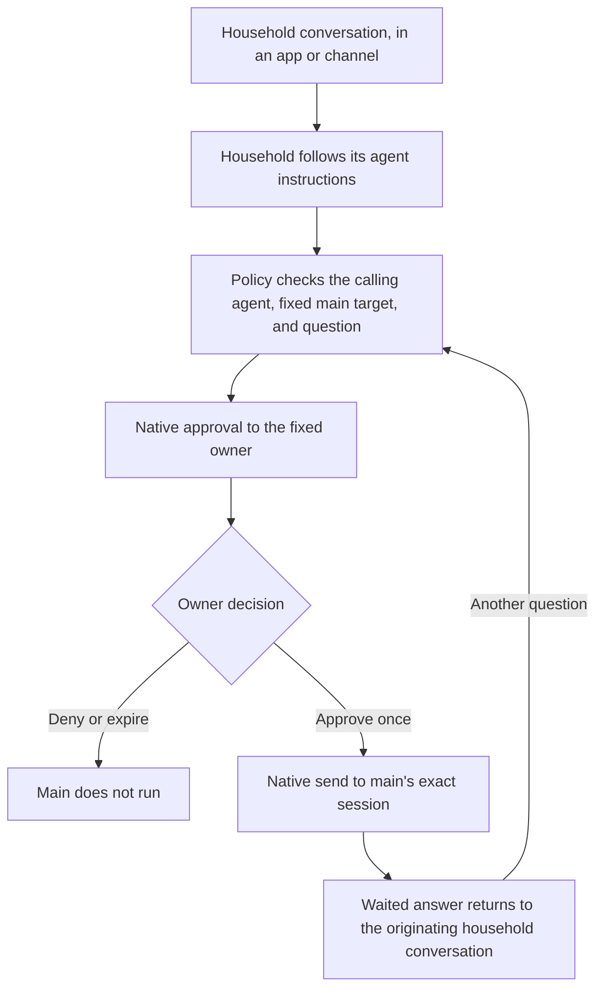

# Native approval for household questions to main

**Status:** Answer guidance implemented; user acceptance open
**Issue:** [#259](https://github.com/coletaylor788/puddles/issues/259)
**Last updated:** 2026-10-15

## Human section

### Design

Household asks main for information through native `sessions_send`. Each question
requires the owner's approval. Main's answer returns to the household conversation
that asked. The calling agent determines whether this policy applies, not the
channel, sender, or a configured list of conversations.

#### Agent-level policy and instructions

OpenClaw already identifies the agent executing each tool call. The plugin checks
that identity and the current calling session before requesting approval. It does
not introduce a caller identity system or require channel sender metadata. The
configuration contains only the requesting agent and the fixed main session.
Child, cron, and hook sessions retain their restrictions; household reader and
browser agents gain no access.

Household's `AGENTS.md` tells it to call `sessions_send` for information it needs
from main. The same instructions apply to native app and channel conversations.
Remove the old manual owner-message relay and the per-conversation prompt override.
For decisions or actions outside its scope, household asks the person to contact
the owner directly. Information requests never fall back to the old relay.

#### Approve one question

The small policy plugin uses OpenClaw's `before_tool_call.requireApproval` hook.
That hook pauses the tool before dispatch. The approval shows the requesting
agent, originating conversation, fixed destination, and complete quoted question.
The fixed authenticated owner can approve once or deny within ten minutes.
Every later question, including clarification, needs a new approval.

OpenClaw owns approval delivery, decisions, cancellation, and frozen arguments.
The plugin accepts only the fixed target, a bounded question, and a positive
60-second reply timeout. Approval permits returning main's answer to the asking
conversation. It does not make household the owner or authorize unrelated actions.
There is no native gate on the automatically returned answer, and no custom
answer-approval system is proposed.

#### Return one answer through native scoped access

The supported `openclaw/plugin-sdk/session-visibility` API grants `send` access
to main's exact current session. The provider resolves that session from host
state. It grants no history, discovery, search, alternate target, or main files.
Ordinary household cross-agent access remains denied, so a missing or stopped
provider cannot fall back to unrestricted peer communication.

Native exact-session sends return the waited answer without starting detached
peer reply turns, announcements, or watches. A timeout can return an uncertain
outcome; household must not resend automatically, read history, or promise later
delivery. Native admission rejects a target replaced or archived after the grant.
The plugin never replaces the tool executor or patches agent-to-agent code.

#### Main recognizes the approved disclosure

Main's agent instructions permit answering the specific question delivered by
OpenClaw with native inter-session provenance from household's `sessions_send`
route. That route already requires owner approval before main runs. Provenance
identifies the source; the enforced route supplies the approval guarantee.
Remove the conflicting household manual-relay guidance and blanket disclosure
prohibition. Main returns the answer normally and retains its reader policy.

This does not turn household into the owner. Message text claiming approval,
forged headers, quoted requests, and worker output cannot establish the native
source. The exception permits only the facts needed for this approved answer,
not unrelated private information, external actions, or future questions.

### Status

**Approval:** Production approved. **Approval reference:** On 2026-10-14 the
requester approved the agent-level policy, agent-level instructions, fixed-owner
approval for every question, and native exact-session sends: "okay, approved this
new solution". No core agent-to-agent patch is permitted. This approval covers
implementation, review, validation, release, and cleanup within that scope.

The phone retest delivered an approval and the approved request reached main.
Main's refusal returned to household: its old instructions still prohibited the
approved disclosure. The requester asked to investigate and fix this on
2026-10-15. The repair updates main's agent-level policy within the approved
question-and-answer scope. The guidance repair is implemented and its regression
checks pass. Physical answer acceptance remains open.

## Agent section

### State

The 2026-10-15 physical retest confirmed an allowed approval, an `ok` native
`sessions_send` result, and a returned refusal from main. Main retained the old
private-data prohibition and manual reply-marker instructions. The repair changes
main guidance and tests the native main harness with synthetic private facts.
The earlier scripted target proved transport only; it did not test main's
interpretation of the approved scope. No agent-to-agent runtime patch was added.

The repair aligns main's guidance with the existing approved native route.
Installed regressions cover returned answers, missing approval, denied follow-ups,
and forged source claims. User acceptance remains open.

The earlier approval release removed the conversation-specific manual relay and
applied the policy and instructions to household across app and channel
conversations. The phone retest now confirms approval delivery. Its historical
validation below does not substitute for the answer repair's new evidence.

The selected upstream revision remains OpenClaw 2026.9.6,
`eb377ac59e6c9fd6c7705028034812becf00271b`. Upstream removed
`session.agentToAgent.maxPingPongTurns` in
[PR #111382](https://github.com/openclaw/openclaw/pull/111382). Ordinary peer sends
use five turns. This design uses the separate supported exact-session capability,
not a restored setting, `REPLY_SKIP`, or a custom executor.

### Scope and acceptance criteria

- Native app and iMessage household conversations can request fixed-owner approval.
- Every question freezes its own arguments and requires a fresh decision.
- Main never runs before approval or after denial, expiry, or pre-dispatch abort.
- The answer returns to the originating conversation without automatic peer turns.
- Worker sessions, other destinations, missing caller context, stale sessions,
  and absent approval hooks do not receive the scoped grant.
- Household gets no main history, memory, files, or broad agent-to-agent access.
- Agent instructions replace the manual relay across channels.
- Automated checks record external delivery and never send live messages.

### Architecture and decisions

[`src/plugin.ts`](../../openclaw-plugins/approved-session-send/src/plugin.ts)
checks the native tool-call context's `agentId`, `sessionKey`, `sessionId`, and
`runId`. It verifies that the session belongs to the configured agent and matches
host state. Sender, channel, and account are not admission criteria. The scoped
provider receives OpenClaw's requester session key and resolves its agent and
current metadata through the native session API.

The provider is process-wide, while hooks belong to run registries. Before
granting access it requires its own loaded plugin and `before_tool_call` hook in
the current native registry. Startup and Copilot harness activation, including
`discovery` registration, remain required. Registration cleanup revokes access;
configuration changes disable the old registration until reload.

The prior `requesters` list and per-conversation prompt hook are removed. Agent
instructions belong in the configured household workspace, supplied by the
application's reviewed guidance. Environment bindings no longer alter approval
requester identity. Fixed-owner forwarding remains independently configured.

### Implementation

The public plugin, manifest, package tests, and composed native regression change
together. The composed test uses a native app session without requester channel
metadata. Environment configuration tests reject attempts to change the policy's
agent or target through bindings.

Companion changes remove obsolete requester bindings, package household guidance,
and apply it with the same environment preparation used in DEV, TEST, and PROD.
Preparation binds the exact configured guidance path and predecessor hash or
explicit absence, rejects drift and symlinks, and installs the candidate bytes.
Acceptance compares installed guidance and plugin configuration with the candidate.
The release backup must include the individual production household guidance file.

### Validation

The answer repair passed four fresh installed cases using both native agents.
Bounded real-model qualification returned the approved synthetic fact, required a
new approval for the denied follow-up, and rejected copied household provenance
from another native source. The test compares the returned tool reply with the
exact real-model answer. All delivery was recorded, with zero external writes.
The rebuilt application digest remained unchanged after qualification.
The complete application checks and installed regression suites pass. The tests
exercise both native agents and compare the actual returned tool reply with
main's answer. Bounded real-model checks cover approved disclosure and rejection
of forged source text. Delivery uses recording fixtures, and follow-up questions
require fresh approval. Operational release evidence is retained separately.

The following results describe the earlier approval release, not this repair.

Local policy tests pass: 47 tests. Environment configuration tests pass: 20 tests.
Focused companion configuration and guidance installation tests pass: 9 tests.
The composed native SDK regression passed five recorded questions. Three fresh
installed cases passed: iMessage, native app chat, and a native app connection
without approval permission. Each successful conversation required two fresh
approvals, ran main once, and denied its follow-up. The unprivileged connection
created no approval record and never ran main. All external delivery was recorded.

The app fixture retains a native gateway connection throughout each conversation
and uses normal operator approval scopes. It seeds a named empty conversation to
avoid an unrelated title-generation model call. Every household model request
contains the exact packaged guidance. These tests exercise the native chat RPC
contract; physical app pairing and delivery remain separate acceptance.

Retained implementation and validation review is clear. DEV passed all 67
installed checks. A bounded real-model DEV check selected `sessions_send` and
created a native approval from household after one model request. It stopped
before main ran and recorded all delivery, with zero external writes.

The full application gate passed in 810,137 ms. The final controller attempt
reused that result only after exact source, artifact, prepared output, runner,
environment, toolchain, and dependency inputs matched. TEST passed all 67 checks
with no failures or skips in 209,502 ms. Read-only production acceptance passed in
925 ms and verified health, plugin activation, configuration, and installed
guidance. The installed guidance SHA-256 is
`a53eff7b51c3812f252f1d36fe571f89e5ec7d35e55521c31994fca8fac3cb04`.
No production model requests or message sends were used for acceptance.

### Rollout and rollback

Follow the [application runner](../../packages/e2e/README.md),
[deployment coordination](../../packages/e2e/DEPLOYMENT_COORDINATION.md), and
[storage workflow](../../packages/e2e/DEVELOPMENT_STORAGE.md). Reuse one owned
workspace and one incremental application output. The manager owns the FIFO lane.

After review and DEV readiness, freeze the candidate, run the complete application
suite, and install those bytes in TEST. Replace the verified backup before PROD.
Keep intake held through read-only production checks and source merge. Restore
runtime, configuration, and both main and household instructions together on
failure. Never leave scoped access active without the approval hook. Physical
acceptance remains separate from automated recording and read-only production checks.

### Review log

The retained independent reviewer cleared the complete public and companion
behavior diff and the corrected installed test driver. Permission-denial behavior
and connection lifetime are covered by the installed regression. The same reviewer
also cleared the fixture-only browser wait compatibility correction, which keeps
profile and stale-lock assertions intact without changing the shipped browser
entrypoint. For the answer repair, retained review also cleared the real-model
fixture, exact returned-answer assertion, bounded diagnostics, atomic TEST guidance
initialization and recovery, and final release runner bindings. Later behavior
changes require review by that same reviewer.

### Checklist

- [x] Record approval and the agent-level design.
- [x] Implement the policy and focused configuration regressions.
- [x] Pass native app and channel installed regressions and DEV behavior checks.
- [x] Complete retained review and required repository checks.
- [x] Pass the frozen application gate, TEST, and read-only PROD acceptance.
- [x] Merge tested source and finalize owned development output.
- [x] Validate main guidance with approved, denied, and forged-source synthetic requests.
- [x] Complete retained repair review and required regression checks.
- [x] Publish the repair and its validation guidance.
- [ ] Complete physical question, owner approval, and answer acceptance.
