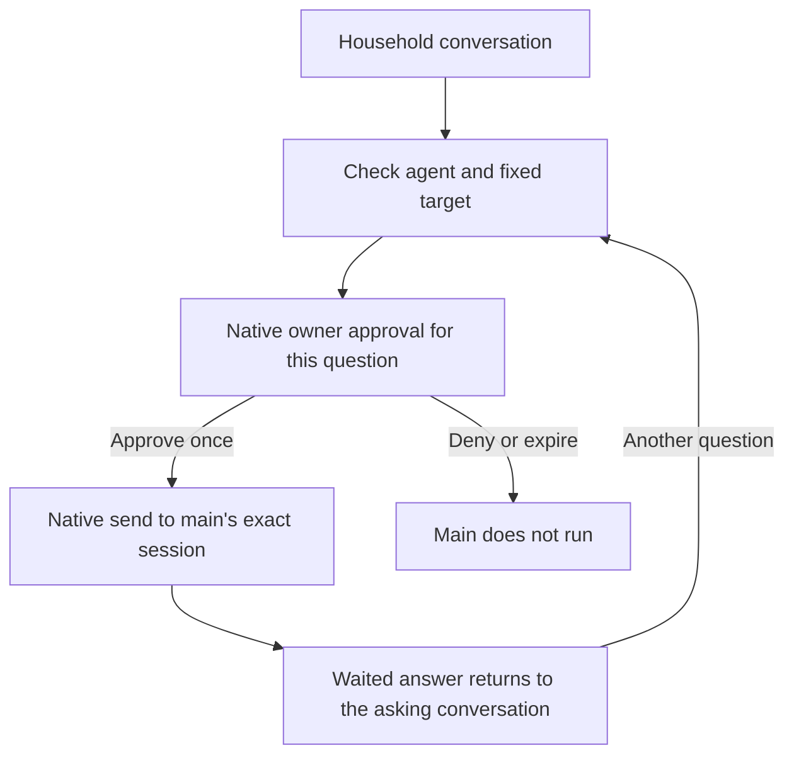

# Native approval for household questions to main

**Status:** Longer native wait implemented; validation incomplete
**Issue:** [#259](https://github.com/coletaylor788/puddles/issues/259)

## Human section

### Design

Household asks main for information through native `sessions_send`. Each question
requires the owner's approval. Main's answer returns to the conversation that
asked. The calling agent determines whether this policy applies, independently
of the app, channel, sender, or a configured list of conversations.

#### Agent-level policy and instructions

OpenClaw identifies the agent executing each tool call. The plugin checks that
identity and the current session before requesting approval. Configuration names
only the requesting agent and fixed target session. Child, cron, and hook sessions
retain their restrictions; household workers gain no access.

Household's agent instructions describe how to request information from main.
They apply to both native app and channel conversations. Information requests do
not use manual owner-message relays. Decisions or actions outside household's
scope still require contacting the owner directly.

#### Approve one question

The policy plugin uses OpenClaw's `before_tool_call.requireApproval` hook, which
pauses the tool before dispatch. The approval shows the requesting agent, source
conversation, fixed destination, and complete quoted question. The fixed owner
can approve once or deny. Each later question needs another approval.

OpenClaw owns approval delivery, cancellation, decisions, and frozen arguments.
The plugin accepts only the fixed destination, bounded question, and positive
600-second reply wait. Approval permits returning main's answer to the asking
conversation. It does not make household the owner or authorize unrelated actions.
There is no native gate on the automatically returned answer and no custom
response-approval mechanism in this design.

#### Wait through busy main work

The supported `openclaw/plugin-sdk/session-visibility` API grants only `send` to
main's exact current session. It grants no discovery, history, search, alternate
target, or main files. Ordinary cross-agent access remains denied. A missing
provider cannot fall back to unrestricted communication.

Native exact-session sends return the waited answer without starting detached
peer reply turns, announcements, or watches. The ten-minute wait allows main to
finish ordinary work or history compaction before answering. Compaction summarizes
older conversation when the model's context budget is nearly full.

A synthetic test holds ordinary main work for 65 seconds after approval. With a
one-minute wait, the caller can finish before main answers and receive no later
reply. The longer wait keeps this bounded request open through that delay.

This is still a bounded wait. A timeout guarantees neither target completion nor
later delivery. Household must not resend automatically, read main history, or
promise a later answer. Native admission rejects replaced or archived targets.
The plugin does not replace the executor or patch agent-to-agent communication.

#### Main recognizes approved disclosure

Main's instructions permit answering the specific question delivered with native
inter-session provenance from household's gated `sessions_send` route. Provenance
identifies the source; the enforced route supplies the approval guarantee.
Main returns the needed answer normally and retains its other privacy rules.

Copied headers, approval claims in message text, quoted requests, and worker
output do not establish native provenance. The exception permits only facts
needed for this approved answer, not unrelated information, external actions,
or future questions.

### Status

**Approval:** Production approved for the existing agent-level policy, instructions,
fixed-owner approval per question, and native exact-session sends. **Approval
reference:** The requester approved this solution with "okay, approved this new
solution". The explicit no-agent-to-agent-patch constraint remains binding.

The longer fixed wait is implemented and focused synthetic return tests pass.
Complete acceptance and release readiness remain open. Any further change outside
the approved policy design requires its own review before implementation.

## Agent section

### State and implementation

The public policy changes `WAIT_SECONDS` from 60 to 600. Its argument tests,
composed native scenario, documentation, and companion agent instructions change
together. There is no new production service, executor, or answer broker.

The plugin verifies native `agentId`, `sessionKey`, `sessionId`, and `runId`.
The scoped provider requires its own loaded plugin and approval hook in the
current registry. Startup and supported harness activation, including discovery
registration, remain required. Configuration drift and cleanup revoke the grant.

The selected native revision remains `eb377ac59e6c9fd6c7705028034812becf00271b`.
Upstream removed `session.agentToAgent.maxPingPongTurns` in
[PR #111382](https://github.com/openclaw/openclaw/pull/111382). This design uses
supported exact-session capabilities and does not restore that setting.

### Synthetic regression coverage

The native fixture uses recorded delivery and scripted provider responses. It
never sends real messages or mutates live accounts. Hold main's ordinary work for
65 seconds after approval and require the answer to return through the original
tool call. Compare the exact reply, target session, originating conversation,
terminal result, and pending-input state. A later question must obtain fresh
approval; denial must prevent another main run.

Preserve missing-approval-scope, forged-source, fixed-target, and worker-denial
coverage. Focused public tests pass (48 tests), and the plugin builds. These
results do not certify the complete application or a release.

### Review

Retained independent review found no material scope change in the longer wait.
Native approval, fixed-target access, and the no-agent-to-agent-patch constraint
remain in effect. Full acceptance is incomplete; no readiness claim is made.

### Release and rollback

Follow the [application runner](../../packages/e2e/README.md),
[deployment coordination](../../packages/e2e/DEPLOYMENT_COORDINATION.md), and
[storage workflow](../../packages/e2e/DEVELOPMENT_STORAGE.md). Keep one feature
workspace and incremental output. The manager owns the FIFO TEST/PROD lane.

After design approval, implementation, focused tests, review, and DEV readiness,
freeze the candidate and run the complete application suite. Install those bytes
in TEST, replace the verified backup, then run read-only production checks before
source merge. Restore runtime, configuration, and affected guidance together on
failure. Physical acceptance remains separate from automated recording tests.

### Checklist

- [x] Preserve the approved native route and fixed-wait constraints.
- [x] Implement the longer wait and reproduce ordinary busy-main behavior.
- [ ] Complete all required acceptance and retained review.
- [ ] Pass DEV, full application, TEST, and read-only PROD gates.
- [ ] Merge, finalize owned development output, and complete user acceptance.
