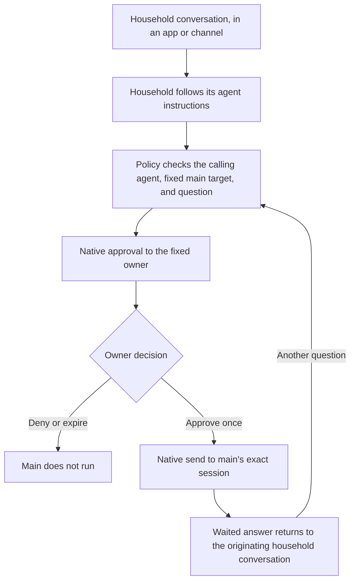

# Native approval for household questions to main

**Status:** Agent-level correction in development; prior native app acceptance failed
**Issue:** [#259](https://github.com/coletaylor788/puddles/issues/259)
**Last updated:** 2026-10-14

## Human section

### Design

Household asks main for information through native `sessions_send`. Each question
requires the owner's approval. Main's answer returns to the household conversation
that asked. The calling agent determines whether this policy applies, not the
channel, sender, or a configured list of conversations.

#### Agent-level policy and instructions

OpenClaw already identifies the agent executing each tool call. The plugin checks
that identity and the current calling session before requesting approval. It does
not introduce a caller identity system or require channel sender metadata. The
configuration contains only the requesting agent and the fixed main session.
Child, cron, and hook sessions retain their restrictions; household reader and
browser agents gain no access.

Household's `AGENTS.md` tells it to call `sessions_send` for information it needs
from main. The same instructions apply to native app and channel conversations.
Remove the old manual owner-message relay and the per-conversation prompt override.
For decisions or actions outside its scope, household asks the person to contact
the owner directly. Information requests never fall back to the old relay.

#### Approve one question

The small policy plugin uses OpenClaw's `before_tool_call.requireApproval` hook.
That hook pauses the tool before dispatch. The approval shows the requesting
agent, originating conversation, fixed destination, and complete quoted question.
The fixed authenticated owner can approve once or deny within ten minutes.
Every later question, including clarification, needs a new approval.

OpenClaw owns approval delivery, decisions, cancellation, and frozen arguments.
The plugin accepts only the fixed target, a bounded question, and a positive
60-second reply timeout. Approval permits returning main's answer to the asking
conversation. It does not make household the owner or authorize unrelated actions.
There is no native gate on the automatically returned answer, and no custom
answer-approval system is proposed.

#### Return one answer through native scoped access

The supported `openclaw/plugin-sdk/session-visibility` API grants `send` access
to main's exact current session. The provider resolves that session from host
state. It grants no history, discovery, search, alternate target, or main files.
Ordinary household cross-agent access remains denied, so a missing or stopped
provider cannot fall back to unrestricted peer communication.

Native exact-session sends return the waited answer without starting detached
peer reply turns, announcements, or watches. A timeout can return an uncertain
outcome; household must not resend automatically, read history, or promise later
delivery. Native admission rejects a target replaced or archived after the grant.
The plugin never replaces the tool executor or patches agent-to-agent code.

### Status

**Approval:** Production approved. **Approval reference:** On 2026-10-14 the
requester approved the agent-level policy, agent-level instructions, fixed-owner
approval for every question, and native exact-session sends: "okay, approved this
new solution". No core agent-to-agent patch is permitted. This approval covers
implementation, review, validation, release, and cleanup within that scope.

The prior artifact remains deployed and healthy, but native app acceptance failed:
its conversation-specific instructions were absent, household tried the old
message relay, and cross-context policy rejected that call before any approval
was created. The correction removes that coupling. Local implementation and
focused checks are underway. Installed native app validation, retained review,
DEV readiness, and a fresh release are still required.

## Agent section

### State

The prior implementation merged in PR #287 and deployed artifact
`a8046a47e90c09980e18f54ee3f0658aa179d89726e85aeccfc3a8dd74435376`.
Its recorded approval flows passed DEV and TEST. Production acceptance was
read-only plugin, configuration, and health verification. It did not prove
physical approval delivery. The failed native app test made no `sessions_send`
call and created no approval. Public records contain no private conversation
content or identifiers.

The selected upstream revision remains OpenClaw 2026.9.6,
`eb377ac59e6c9fd6c7705028034812becf00271b`. Upstream removed
`session.agentToAgent.maxPingPongTurns` in
[PR #111382](https://github.com/openclaw/openclaw/pull/111382). Ordinary peer sends
use five turns. This design uses the separate supported exact-session capability,
not a restored setting, `REPLY_SKIP`, or a custom executor.

### Scope and acceptance criteria

- Native app and iMessage household conversations can request fixed-owner approval.
- Every question freezes its own arguments and requires a fresh decision.
- Main never runs before approval or after denial, expiry, or pre-dispatch abort.
- The answer returns to the originating conversation without automatic peer turns.
- Worker sessions, other destinations, missing caller context, stale sessions,
  and absent approval hooks do not receive the scoped grant.
- Household gets no main history, memory, files, or broad agent-to-agent access.
- Agent instructions replace the manual relay across channels.
- Automated checks record external delivery and never send live messages.

### Architecture and decisions

[`src/plugin.ts`](../../openclaw-plugins/approved-session-send/src/plugin.ts)
checks the native tool-call context's `agentId`, `sessionKey`, `sessionId`, and
`runId`. It verifies that the session belongs to the configured agent and matches
host state. Sender, channel, and account are not admission criteria. The scoped
provider receives OpenClaw's requester session key and resolves its agent and
current metadata through the native session API.

The provider is process-wide, while hooks belong to run registries. Before
granting access it requires its own loaded plugin and `before_tool_call` hook in
the current native registry. Startup and Copilot harness activation, including
`discovery` registration, remain required. Registration cleanup revokes access;
configuration changes disable the old registration until reload.

The prior `requesters` list and per-conversation prompt hook are removed. Agent
instructions belong in the configured household workspace, supplied by the
application's reviewed guidance. Environment bindings no longer alter approval
requester identity. Fixed-owner forwarding remains independently configured.

### Implementation

The public plugin, manifest, package tests, and composed native regression change
together. The composed test uses a native app session without requester channel
metadata. Environment configuration tests reject attempts to change the policy's
agent or target through bindings.

Companion changes remove obsolete requester bindings, package household guidance,
and apply it with the same environment preparation used in DEV, TEST, and PROD.
Preparation binds the exact configured guidance path and predecessor hash or
explicit absence, rejects drift and symlinks, and installs the candidate bytes.
Acceptance compares installed guidance and plugin configuration with the candidate.
The release backup must include the individual production household guidance file.

### Validation

Local policy tests pass: 47 tests. Environment configuration tests pass: 20 tests.
Focused companion configuration and guidance installation tests pass: 9 tests.
The installed regression covers both recorded iMessage ingress and native
`chat.send`, including fixed-owner approval, main's answer, denial of a fresh
follow-up, and no legacy relay fallback. Its new native app mode is not yet run.
Check packaged guidance at the actual provider boundary and evaluate tool choice
with real model output in isolated DEV before claiming model-behavior acceptance.

Retained review and fresh installed, DEV, full application, TEST, and PROD proofs
are pending. Prior evidence does not certify changed packaged behavior.

### Rollout and rollback

Follow the [application runner](../../packages/e2e/README.md),
[deployment coordination](../../packages/e2e/DEPLOYMENT_COORDINATION.md), and
[storage workflow](../../packages/e2e/DEVELOPMENT_STORAGE.md). Reuse one owned
workspace and one incremental application output. The manager owns the FIFO lane.

After review and DEV readiness, freeze the candidate, run the complete application
suite, and install those bytes in TEST. Replace the verified backup before PROD.
Keep intake held through read-only production checks and source merge. Restore
runtime, configuration, and household instructions together on failure. Never
leave scoped access active without the approval hook. Physical acceptance remains
separate from automated recording and read-only production checks.

### Review log

The prior release had a clear independent review. Its retained reviewer will
review the complete current public and companion behavior diff and any remediation.

### Checklist

- [x] Record approval and the agent-level design.
- [x] Implement the policy and focused configuration regressions.
- [ ] Pass native app and channel installed regressions and DEV behavior checks.
- [ ] Complete retained review and required repository checks.
- [ ] Pass the frozen application gate, TEST, and read-only PROD acceptance.
- [ ] Merge tested source and finalize owned development output.
- [ ] Complete physical question, owner approval, and answer acceptance.
