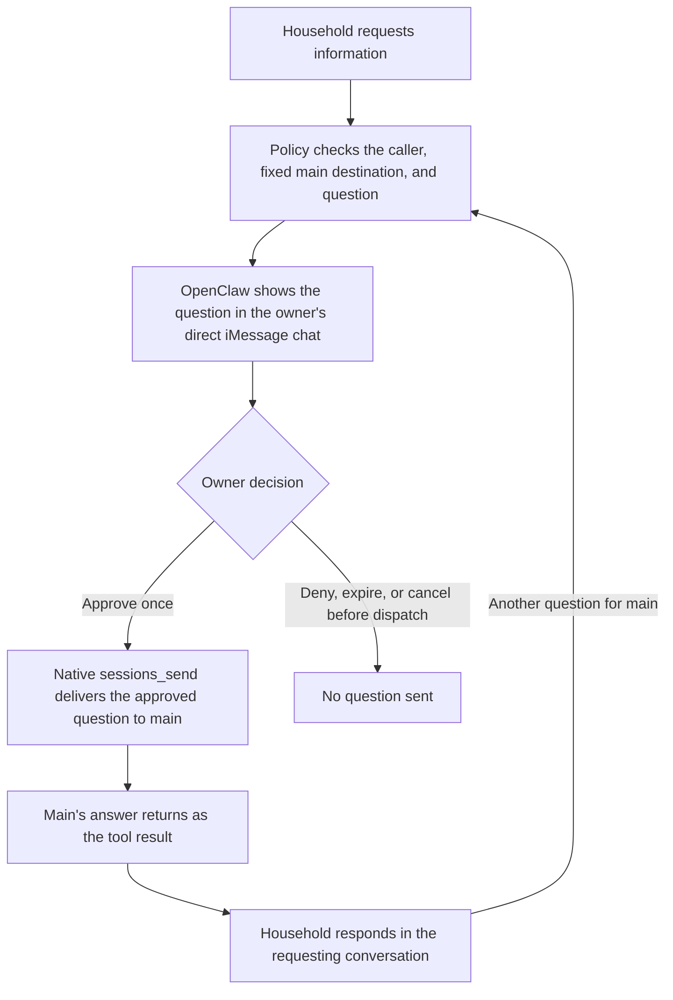

# Native approval for household questions to main

**Status:** Production approved; native follow-up control needs a design decision
**Issue:** [#259](https://github.com/coletaylor788/puddles/issues/259)
**Last updated:** 2026-10-13

## Human section

### Design

Household currently sends an escalation to the owner and depends on a quoted
reply carrying the originating session key. Replace that manual relay with an
owner-approved call to OpenClaw's built-in `sessions_send` tool. The owner
approves a specific question and permits main's answer to return to household.
Every later question needs a new approval.

#### Ask through the existing tool

A small policy plugin uses the same `before_tool_call.requireApproval` hook as
Gmail sending. This hook runs after an agent chooses a tool and before the tool
executes. For household's `sessions_send` calls, it accepts only the configured
main session, a bounded question, and a fixed positive reply timeout. Reject
alternate destinations, labels, session IDs, unknown fields, and unsupported
callers. The caller and originating conversation come from the runtime, not
from identities written in the question.

Expose this route only to the interactive household agent. Its reader and
browser workers retain their existing permissions. Household gets no session
listing or history tools and no direct access to main's files, memory, or
service tools. Native session visibility and agent-to-agent policy must permit
the approved route; the plugin restricts each actual call to its fixed target.
Do not loosen unrelated agents' access to establish this route.

The question is an information request. Main retains its existing tool and
action approvals. Household cannot acquire owner identity by receiving an
approval, and this route does not authorize actions such as sending email.

#### Approve the question in the owner's chat

Use the existing fixed owner iMessage destination, native approval message,
and authorized owner reactions. The summary identifies household, the
requesting conversation, the complete question, and that the answer will return
there. For example: “Household asks: What time is dinner? Approve asking main
and sharing its answer with this household conversation.”

Only approve-once and deny are offered. Request a ten-minute approval window.
OpenClaw owns the approval ID, argument snapshot, authenticated decision, and
continuation. If the complete question and necessary routing context cannot
fit the native summary, reject the call and ask household to shorten it.
Do not approve an unseen tail of the question.

Denial, approval expiry, or cancellation before dispatch sends nothing. A new
attempt requires a new approval. Once main has received a question, cancelling
household's wait cannot retract it.

#### Return the answer without an automatic conversation

The approved design sets `session.agentToAgent.maxPingPongTurns` to `0`.
The exact pinned source and deployed runtime retire that setting and supplies a fixed limit
of five for ordinary peer exchanges. Setting the old key to zero is insufficient.

**Proposed compatibility change, not yet approved:** restore the native
configuration control with a small maintained OpenClaw patch, retaining the
current default for other installations. Configure this deployment to zero and
add a regression proving that an approved household question cannot start
automatic follow-ups. Keep native approval and automatic answer return. Do not
introduce a response executor, broker, or response approval flow. If maintaining
this core change is not acceptable, retain the existing household relay.

Ping-pong is OpenClaw's automatic exchange of ordinary agent replies after a
session send. Those replies do not require another tool call. Disabling it
means household must make a new approved `sessions_send` call to ask main
anything further, including a clarification.

This setting is shared across the gateway. It also removes automatic
back-and-forth from other session sends. Existing explicit sends and spawned
worker completion are separate mechanisms. Before rollout, verify that the
configured workflows do not depend on automatic ping-pong. A demonstrated
dependency that requires a different design comes back for review.

The answer returns through the native tool result, and household responds in
its original conversation. A new human message cannot rewrite the arguments
OpenClaw already approved. If that message leads household to ask main another
question, that new call requires approval. This is approval of a question and
its answer, not a guarantee about the answer's exact content.

Native session sends also have an announcement step that is separate from
ping-pong. Setting the turn limit to zero does not disable that step. Validate
its destination and behavior with the configured main session. An owner-facing
notification may remain, but no announcement may forward new household text
back to main or disclose the answer to another household conversation.

If main does not answer within the bounded native wait, household reports that
the request was accepted or that its outcome is uncertain, as indicated by the
native result. It must not claim an answer, resend automatically, read main's
history, or build a custom deferred return queue. Verify native late-result
behavior before promising any later delivery to household.

#### Response approval stays outside this version

The inspected native session-send flow has no built-in gate that holds its
returned answer for owner approval. The pre-call hook approves arguments;
`after_tool_call` observes completion and does not gate the result.

An explicit outbound reply tool could use native pre-call approval, but
forcing every answer through it would require custom response handling and
closing the automatic return paths. That is outside this proposal. The owner
accepts automatic return of main's answer to the approved question. Do not add
a response broker, payload store, custom approval UI, or core response patch.

### Status

**Approval:** Production approved for the original design. **Approval reference:**
On 2026-10-13, the requester instructed this owner to ramp up on the new release
manager and continue deployment to production. The scope remains one approved
question, automatic answer return, no ping-pong, and no custom response handling.
The proposed core change to restore the removed setting needs a separate decision.

Release coordination is established. Read-only inspection and a recording probe
of the deployed code confirm that the old zero setting cannot prevent automatic
follow-ups. Implementation and deployment of the affected route are blocked on
the compatibility decision. Production and household permissions remain unchanged.

## Agent section

### State

The original proposal landed in PR #260. This owner resumed in the same isolated
worktree on `codex/household-native-approvals`, from public main `4c16bdc`.
Issue #259 tracks the feature. The current release manager has acknowledged the
owner and supplied the installed controller and DEV intake requirements.

The repository still records OpenClaw 2026.9.6 at
`eb377ac59e6c9fd6c7705028034812becf00271b`, but the configured local source
checkouts do not contain that object and differ from the installed application.
The exact upstream commit is available through the GitHub API, with tree
`fd9aae01e042ed8747ecbd0f45bb4791eb3379b9`. Reconstruct owned source from that
commit and the maintained patches; do not build from a stale primary checkout.

Exact pinned source retrieved through the GitHub API agrees with the deployed
module inspection on these contracts:
`sessions_send` uses `waitForAgentRunReply` and the completed run's `terminalReply`,
which removes the previously identified latest-history answer selection path.
However, its peer reply flow supplies `maxPingPongTurns: 5`; the old configuration
key appears in `RETIRED_TUNING_PATHS`. The native documentation describes a built-in
reply limit, not a replacement setting. Existing one-way paths are for internal
UI callers, child sessions, or exact scoped grants, not a configurable replacement
for an interactive household peer. Do not falsify the caller type to use them.

### Scope and acceptance criteria

- One interactive household question reaches the configured main session only
  after an authenticated owner approve-once decision. No owner decision is
  inferred from question text, normal chat replies, or household reactions.
- The complete approved question, caller context, and fixed route match the
  dispatched call. Later human messages or hooks cannot change approved text.
- Only household receives the new route. Other agents, workers, unattended
  jobs, alternate targets, and malformed parameters cannot use it.
- Main's answer can return without response approval. Household cannot read
  main's history or receive unrelated main replies as this request's result.
- Automatic ping-pong is disabled. Every subsequent household-to-main tool
  call, including clarification or a new human question, requests fresh approval.
- Native announcement and timeout behavior are accounted for. Approval timeout
  sends nothing; timeout after dispatch does not imply that nothing happened.
- Existing Gmail approval and unrelated explicit delegation continue working.
- The old quoted-reply escalation is retired only after the approved route
  passes installed validation; ordinary scoped household messaging remains.

### Architecture and decisions

Use a normal registered policy hook around the built-in `sessions_send` tool.
Do not replace its executor or use `onResolution` to dispatch work. Return the
same validated parameters through the hook's `params` field, matching the
[Gmail hook](../../openclaw-plugins/secure-gmail/src/plugin.ts). Block policy and
summary failures explicitly.

Allow only the canonical configured main session key. Resolve the owner target
using the existing main-conversation convention; never use the last active chat
or a household-supplied label. Validate the runtime caller and source session.
Reject `label`, `agentId`, alternate session spellings, timeout zero, and extra
fields rather than introducing additional routing choices. Pin the positive
reply wait in policy using the supported limits of the selected release.

Configure native tool allowlists, sandbox session visibility, agent-to-agent
permissions, plugin forwarding filters, and explicit owner authorization
together. Approval is not a substitute for these permissions. Preserve denials
of `sessions_list`, `sessions_history`, and other routes that expose main data.
Do not copy Gmail's requirement that the original sender be the owner:
household initiates this call, while only the owner may resolve its approval.

Source pointers to inspect in the selected OpenClaw release:

| File | Contract to verify |
|---|---|
| `docs/plugins/plugin-permission-requests.md` | Pre-call approval, summary bounds, allowed decisions, and forwarding filters |
| `src/plugins/hooks.ts` | Approved argument handling, explicit blocking, and observation-only result hook |
| `src/agents/tools/sessions-send-tool.ts` | Tool permissions, positive reply wait, dispatch provenance, and result selection |
| `src/agents/tools/sessions-send-tool.a2a.ts` | Ping-pong loop and separate announcement step |
| `src/agents/tools/sessions-send-helpers.ts` | Shared turn limit and reply/announcement prompts |
| `src/agents/tools/agent-step.ts` and `src/agents/run-wait.ts` | Run completion and selection of the matching answer |
| `docs/concepts/queue.md` | New human input while approval or a reply is pending |

The deployed source reads a completed run's terminal answer. Keep regressions
for concurrent owner traffic and overlapping requests to verify that matching
through the actual installed harness. If the selected native
route cannot satisfy the acceptance criteria without custom response handling,
record the concrete gap and revisit the design rather than silently adding it.

The [security architecture](../openclaw-setup/security-architecture.md) requires
host-enforced human approval for requests into more restricted context. This
proposal supplies that gate and preserves the originating household identity.
Approval covers the question and permission to receive its answer. It does not
grant owner authority, broad session access, or permission for external actions.

### Implementation

The original design is approved through production; the compatibility change
above remains unapproved. The approved policy and test work may proceed
independently, but do not enable the route before resolving that decision:

1. Verify selected source and inspect only relevant live configuration and
   relay instructions. Inventory consumers of the shared ping-pong setting.
2. Add a small policy plugin and focused tests following
   [plugin conventions](../../openclaw-plugins/README.md). Reuse native approval
   and session-send behavior.
3. Prepare deployment-specific changes in an isolated companion worktree:
   household tool permissions, fixed owner approval route, zero ping-pong,
   and revised escalation instructions. Preserve identity and scope guards.
4. Add the household regression scenario to the shared integration pool. Verify
   the exact harness and installed runtime with recording adapters.
5. Retire the quoted-reply escalation instructions after the replacement passes.
   Follow the existing release process for source review, landing, and rollout.

Do not edit a primary checkout or publish private routes, identities, account
configuration, or operational inventories. Companion changes require their own isolated worktree before editing.

### Validation

On 2026-10-13, a recording probe extracted the installed peer-flow function
and supplied synthetic callers, answers, and recording adapters. With configured
limit zero, the actual session-send call supplied five, producing five automatic
reply steps and two additional calls to main. The probe made zero external writes.
This is evidence of the control mismatch, not installed end-to-end acceptance.
No live configuration or runtime code was changed.

Review documentation links, privacy, and consistency for this checkpoint. Do not
build unchanged runtime artifacts to validate these plan edits.

Implementation regressions must cover:

- Approved, denied, expired, cancelled, restarted, and unavailable approval
  routes, with recorded notifications and no real message delivery.
- Full-question display limits, parameter snapshots, post-approval tampering,
  caller identity, destination aliases, and unsupported fields.
- A new human question arriving both during approval and while main answers.
  The approved question stays unchanged and another call prompts again.
- An attempted clarification after the answer. No automatic household reply
  reaches main with the native turn limit set to zero.
- Matching answer selection under concurrent main traffic and overlapping
  household requests, plus correct originating household conversation.
- Announcement destinations, late completion, failures after dispatch, and no
  blind resend or custom history lookup after a timeout.
- Existing scoped household tools, worker restrictions, explicit session sends,
  and Gmail approval remaining intact.

Run focused tests and local DEV checks during iteration. The release owner runs
`node packages/e2e/bin/openclaw-test-env.mjs ci` against the pinned candidate
before promotion, following the [runner guide](../../packages/e2e/README.md).
Register any applicable maintained source regression targets in the cumulative
manifest. Physical iMessage acceptance remains a separate owner check.

### Rollout and rollback

The checkpoint changes no runtime behavior. Use the adopted release controller,
not the legacy wrapper. Complete focused tests, retained independent review,
and deployed DEV checks using the same renderer, preparation, startup, health,
and feature acceptance as TEST. Report readiness to the current manager before
enqueueing. At the front of the FIFO queue, rebase both source branches, refresh
the one incremental build, freeze it, and run the full application suite. Deploy
the same output to TEST and then PROD after replacing and verifying the one
backup. Merge the tested source only after production checks pass. Use separate
configuration and writable state for each environment.
Follow [deployment coordination](../../packages/e2e/DEPLOYMENT_COORDINATION.md)
and the [deployment guide](../openclaw-setup/patches/README.md).

Capture the predecessor's household permissions, approval filters, ping-pong
setting, and relay instructions with its runtime. Rollback restores them as a
unit; never leave household's new tool grant active without the policy plugin.
Production checks remain read-only. Retire task-owned development artifacts
through the [storage workflow](../../packages/e2e/DEVELOPMENT_STORAGE.md).

### Review log

The requester accepted disabling automatic ping-pong. The later response-gate
check found no native gate on automatically returned session-send answers in
the inspected source. An explicit send could be approved, but replacing the
automatic return path would exceed the requested simple integration.

The original design's zero-setting assumption came from a stale local source
checkout and fails against both the exact pin and deployed code.
The current manager has been informed. The exact source call site is
[`sessions-send-tool.ts:1091`](https://github.com/openclaw/openclaw/blob/eb377ac59e6c9fd6c7705028034812becf00271b/src/agents/tools/sessions-send-tool.ts#L1091). The proposed compatibility patch restores
that control rather than adding custom response handling; it remains a design
decision. Independent implementation review has not started.

### Checklist

- [x] Review existing household relay and Gmail approval contracts.
- [x] Record question approval, no response gate, and zero ping-pong.
- [x] Draft both Human and Agent sections with verification limits.
- [x] Obtain production approval for the original design.
- [x] Coordinate with the adopted release manager and inspect deployed behavior.
- [x] Resolve authoritative upstream source availability.
- [ ] Approve the compatibility change for the retired follow-up setting.
- [ ] Verify exact release contracts and current configuration.
- [ ] Implement the policy and committed regressions.
- [ ] Complete independent review, source landing, and release validation.
- [ ] Complete owner phone acceptance and task-owned cleanup.
