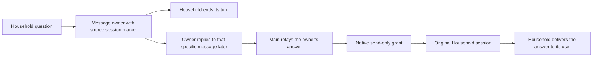

# Restore the Household owner relay

**Status:** Production approved; staging passed, test fixture correction validated
**Issue:** [#259](https://github.com/coletaylor788/puddles/issues/259)
**Last updated:** 2026-10-20

## Human section

### Design

Restore the owner-mediated relay so Household can ask for information and end
its turn. The owner can answer later without an open native approval expiring.
Return that answer to the original Household session using OpenClaw's ordinary
session messaging. Keep email approvals unchanged.

#### Asking the owner

Household sends the configured owner an iMessage ending with
`[sk:<originating session key>]`, then stops. Each question needs its own owner
response. Household and its workers cannot call `sessions_send` or read Main's
private context. Existing message-recipient restrictions still apply.

#### Returning the answer

Main acts only on an authenticated owner reply that uses the native iMessage
Reply gesture and quotes the original request marker. A pasted marker, a plain
owner message, or a message from another sender is not that reply. Main sends
only the owner's answer to the exact Household session from the quoted marker.
It never guesses a recent request or derives an external recipient from the key.
Missing or malformed markers cause an explanation to the owner without delivery.

Household receives that answer in its own session and delivers it to the person
who asked. Native-app conversations keep their source session; external chats
keep their native channel route. Installed tests must establish both paths.
Ordinary cross-agent access remains denied for Household. A small policy plugin
uses OpenClaw's existing scoped-access API to grant only Main's return send to
an existing Household conversation. The grant binds the current target session
incarnation and never permits status, history, list, or reverse access. If the
plugin is absent or fails, native access remains denied. Main's instructions
still establish owner authorization and select the original conversation.
Household reads its own native session status to distinguish the saved external
route from the active internal agent turn. For an external route, it sends only
the answer through the current-source message tool without choosing a channel
or recipient. In a confirmed native conversation with no external route, Main's
incoming relay is already displayed as the answer, so Household stays silent.
A later announcement must not repeat either answer. Failed or ambiguous status
and attempted or uncertain sends do not count as confirmed delivery.

#### Automatic reply turns

An exact-session grant suppresses OpenClaw's separate peer and announcement
turns. The initial target turn still handles delivery. The removed zero-turn
setting is not restored, and no communication patch is added. Main and Household
retain agent-level instructions to stop an unexpected automatic exchange with
`REPLY_SKIP`. Main never treats an automatic reply or tool result as a new
owner authorization, retrieves additional private facts, or expands the answer.
Household treats a new question as a new owner request.

The requester explicitly accepts instructions for the answer-content boundary.
Native turn scheduling does not freeze the exchange's subject: new input can be queued or,
where authority permits, steer a running turn. The policy must hold even if a
new question appears in the conversation during an exchange. Tests return an
extra Household question, require no Main peer reentry, then separately verify a fresh
user turn after delivery. They do not simulate concurrent user steering or claim
deterministic prevention of model mistakes.

#### Staging source

Local test runs may create an empty `.cache` parent whose `vitest` child is
excluded from the prepared-source digest. Staging explicitly prepares that
parent only when the reviewed plan requires an absent directory with mode 0755.
It checks source ownership, consumers, the original digest and the absence
preimage before preparation, then requires the exact final source digest.
Existing directories, files, symlinks and other permissions are rejected.
All non-excluded cache children remain part of the integrity check.

### Status

**Approval:** Production approved. **Approval reference:** "Approved to restore",
then "Yeah the instructions is a fine solution", and "once tested, approved to
ship" on 2026-10-17. This approves source-session return with instructions
limiting automatic exchanges, followed by testing, review, production release,
merge, and cleanup. No agent-to-agent patch or deferred approval service.

The requester renewed approval for the required release operations on
2026-10-19 in the release-manager chat, message
`01a154e7-a796-7793-9861-f961e7ad930b`. This includes removing the obsolete
DEV-only compatibility filter so qualification preserves the programmatic-tool
settings already released for all tool-enabled agents. Existing agent tool
permissions and native approvals stay unchanged.

The current artifact passed all 12 managed DEV scenarios. The iMessage test
correction passed all 99 focused cases and independent review. Its source and
output checks confirmed that the runtime artifact needs no rebuild.

The narrow directory-preparation repair passed staging and independent
verification. The next release stopped in a repository regression before the
OpenClaw pool, TEST or production. That test assumed a file started with mode
0644, but the release process created it with mode 0600. The correction sets
the starting mode explicitly and covers both normal and restrictive umasks.
All five focused cases passed under each launch umask. Retained review is
clear and independent closure verified both test processes. Runtime behavior
and source integrity rules stay unchanged. A fresh release remains required.

## Agent section

### State

Stage R13 passed and is independently closed. Its exact source, output, DEV,
production and backup checks passed. The earlier Stage R12 failure was an empty
`.cache` parent present locally and absent on the target; the maintained repair
resolved that difference without broadening exclusions.

Full R12 is consumed and independently failed-closed. Its original command
joined with exit 1 before TEST or production. Process retirement, an empty
queue and unchanged healthy production and backup are verified. The public
e2e package reported 309 passing cases and one failure:
`prepared-source-cache.test.ts` changed a file to 0600 when the inherited
release umask had already created it with that mode. The correction establishes
0644 explicitly and runs the digest regression under 022 and 077. All content,
mode, symlink and ordinary-source assertions remain. The five focused cases
also passed under both launch masks. Independent validation closure retired
both native owners, and retained review of the correction is clear. Preserve
the failed release evidence and use a fresh release attempt.

`packages/e2e/src/prepared-source-cache.mjs` validates the explicit absent-parent
preimage and prepares only that fixed empty directory. Its committed regression
covers restrictive umask, unexpected entries and unchanged integrity coverage
for cache children and ordinary source. Fresh staging copies these maintained
bytes and retains exact before and after digest checks. No cache exclusion is
broadened. All 13 staging integration cases and four maintained helper cases passed.
The maintained tests used the existing package-local Vitest runner after a
first invocation selected an absent root runner; no maintained test ran in
that failed invocation. Independent closure retired every test owner and
retained the 13 passing integration cases without replay. Retained review of
the complete helper, tests and staging integration is clear. Stage R13 bound
and transferred those exact helper bytes. No new application build is needed
for the directory preparation or the test-only mode correction.

The R10 release is consumed and independently closed. Its full application
run selected 226 files and finished in 1,143.05 seconds with 7,182 passes,
one failure and one skip. The failure was
`monitor.last-route.test.ts`'s standalone URL-preview and image case: the second
dispatch was not observed before `vi.waitFor`'s polling deadline. A single
unchanged focused reproduction passed in 990 ms of test time (36.97 seconds
including transform and import work). A passing reproduction does not establish
a runtime fix. The maintained coalescing patch now changes only this test to
observe dispatch-entry promises and controlled media staging, without sleeps
or longer polling timeouts. Its registered cumulative test remains unchanged.
Focused validation passed all 99 cases across the routing and coalescing files
in 67.60 seconds, including transform and import work. The corrected case took
666 ms. Full patch composition passed, runtime and package outputs were
unchanged, and build and postbuild readiness both reported clean. The same
artifact remains eligible for the prior DEV proof while its actual inputs
match. Retained review is clear. The next release must use a fresh attempt
and refresh source, configuration and capacity at the front of the queue.

Public branch: `codex/restore-household-owner-relay`. The isolated companion
worktree uses the same branch. Both were rebased onto the released programmatic
tool changes. Conflicts preserve the released process runner and cleanup tests.
The companion's sequential installed runner now includes both programmatic-tool
coverage and Household preparation and return-isolation checks.

The old DEV compatibility filter is removed. Preparation validates the candidate
before changing target configuration or guidance and preserves existing
programmatic-tool settings. The refreshed application passed managed DEV. The
fourth full release stopped before TEST after one failure among 7,184 selected
OpenClaw cases (7,182 passed and one skipped). Independent closure confirmed
retired processes, an empty queue, and unchanged production and backup. That
attempt is consumed. Preserve its failure evidence and use a fresh successor.
The earlier correction changes only the malformed-payload bucket test and its
documentation. Its full test file and delayed-admission case passed. Four
failure probes confirmed that errors and missing dispatch remain observable.
Independent closure verified process retirement and unchanged source and
application output. No test or build allocation is held during preparation.
Reuse proofs only where their actual inputs remain unchanged.

The fifth full release passed that corrected iMessage case but stopped on
`waits for configured custom-tool evidence after memory_search fails`. The core
pool reported 7,182 passed, one failed, and one skipped across 226 files. The
original caller and every native owner joined; independent closure verified an
empty lane, closed TEST ports, absent qualification credentials, and unchanged
production, configuration, and backup. That attempt is consumed as well.
An unchanged isolated run passed the case, and an unchanged ordered run passed
it with three neighboring timeout cases. Independent diagnosis identified a
missing recall join in the immediately preceding fixture, without claiming that
it caused this failure. The current correction deterministically holds and joins
that cleanup, preserves its behavior assertions, and adds existing diagnostics
to the success assertion. All four focused cases and all 226 cases in the full
file passed with the correction. The retained reviewer cleared the complete
current behavior diff. No production code or deadline changes.

The sixth full release passed the preceding custom-tool case in 195 ms but
failed `uses configured memory evidence from a rotated embedded transcript
(stale poll: true)` in 1,323 ms. Its core pool again reported 7,182 passed, one
failed, and one skipped across 226 files. The original caller joined with exit
code 1. Independent closure verified retired owners and an empty lane with
production and backup unchanged. No TEST or production deployment occurred.
This attempt is consumed and must not be replayed.

Both unchanged rotated-transcript variants then passed in isolation. The
reviewed correction is applied to the maintained patch and prepared source. It
uses selective fake timers to drive the actual poll after the fixture writes
its transcript, preserves the stale-read ordering and 1,000 ms recall budget,
joins recall cleanup, and removes the fixture-owned rotated file. It changes no
production code. All five focused cases and all 226 tests in the file passed. Removing only the
post-read stopped guard caused the expected grounded-context failure. The native
owner retired before the original watcher bytes were restored. Every command
joined and retired its scope without a resource violation. All maintained patches
compose exactly, and application output bytes remain unchanged. Native readiness
requires a refresh because restored runtime input has a newer modification time
than the build stamp. Existing output equality does not waive that build check.

The seventh full release passed the previously corrected cases but failed
`classifies grounded harness-native recall: successful summary`. The core pool
reported 7,182 passed, one failed, and one skipped in 1,247.59 seconds. The
classification reported `timeout_partial` after 1.4 seconds with its 26-character
summary retained. Independent closure verified all original commands and owners
stopped, an empty queue, unchanged production and backup, normal intake, and
healthy production. No TEST or production deployment occurred. This attempt is
consumed.

The five-row table uses immediate mocked native tool evidence and completion,
but its real 1,000 ms watchdog also races transcript reads and cleanup. This is
a concrete timing dependency in a classification test. The exact scheduling or
I/O cause of the failed run remains unproven. The reviewed correction freezes
only Date, performance, and timeout timers for that table, retains real
filesystem work, and joins the recall owner before shared fixture reset. All
classification and error assertions stay intact. The observed partial result
does not itself prove cleanup contaminated another case. The correction changes
no runtime behavior and does not increase the deadline.

### Scope and acceptance criteria

- An unanswered question ends Household's turn and starts no Main lookup.
- A later authenticated quoted owner answer returns to the exact original
  Household session, including iMessage and native-app sessions.
- Plain owner input, forged provenance, malformed markers, and other senders
  do not authorize an answer relay.
- Household cannot call upward session tools. Workers retain their restrictions.
- Main does not disclose additional facts if the automatic exchange asks for
  more, including after another user message. A new question needs owner input.
- Unknown delivery outcomes are reported without automatic replay.

### Architecture and decisions

Selected upstream revision `eb377ac59e6c9fd6c7705028034812becf00271b` has ordinary
peer reply flow with up to five additional turns. `runAgentStep` creates each
turn in the existing session. The old `maxPingPongTurns` option is absent.
`REPLY_SKIP` stops non-deliverable peer replies. Exact-session grants suppress
the separate reply flow and bind the restored return route to one incarnation.

The current sender grant is removed from Household. The ordinary agent allowlist
excludes Household. The `session-return-grant` plugin grants only native `send`
requests from eligible Main sessions to eligible existing Household sessions.
It checks current configuration, the request's loaded plugin registry, both
session entries, and the target incarnation. Worker, cron, and hook sessions
are excluded. Runtime cleanup retires the grant. Missing or failed registration
leaves native access denied. Household's tool and sandbox denials also prevent
Household from initiating session sends. Main's old
approval-provenance exception is removed; automatic peer replies carry no owner
approval for new disclosure. The legacy handoff skill is updated in the same
managed transaction as both agents' guidance and configuration.

### Implementation

Companion config and packaged guidance own the environment-specific behavior.
Keep the reusable approval plugin packaged but disabled for this route. Package
and activate the separate return-grant plugin in the same transaction. Use
narrow config reconciliation and exact predecessor hashes to preserve unrelated
guidance and DEV experiments. Include the handoff skill in preparation,
acceptance, and rollback coverage. The scoped return-grant plugin supplies only the native send permission described above.

### Validation

Full R12 passed the private toolchain and lint preflights, then stopped in the
public e2e package after 16.14 seconds. Its 34 files contained 309 passing tests
and one failing mode-transition assertion. The OpenClaw pool did not run.
Focused validation passed all five cases under launch umask 022 and all five
under 077. The native commands joined in 804 ms and 586 ms respectively.
Both variants retain the content, permission, link and source-change checks.

The seventh full application run failed the harness-native successful-summary
classification. The corrected table passed all five rows in the focused run.
The complete file passed all 226 cases with no skips in 63.33 seconds; its native
command joined in 66.62 seconds. The successful-summary row passed in 174 ms.
Terminal-error rows still reject summaries, and the independent live deadline,
cold-recall timeout, and near-limit settlement regressions pass unchanged. Both
native validation owners retired with no resource violation.

The sixth full application run failed the rotated embedded-transcript case
with absent context. It ran for 1,267.47 seconds. Isolated unchanged variants
passed in 1,185 ms without a stale read and 173 ms with one; the native command
joined in 32.01 seconds. This does not establish the original failure's cause.
Independent review found a concrete missing cleanup join in the fixture and
cleared the proposed timing and cleanup correction. The corrected five-case selection passed. The negative control temporarily
removed the existing post-read stopped check and failed the grounded-context
assertion as expected. The watcher was restored after native process retirement.
The entire 226-case file passed with no skips in 64.24 seconds; its native command
joined in 67.59 seconds. Production watcher behavior stays unchanged.

The fifth full application run failed the Active Memory custom-tool evidence
case with `expected prependContext` after about five seconds. That duration does
not establish which deadline or cleanup stage was involved. The original case
passed alone in 869 ms and with three neighboring timeout cases in 242 ms. Both
diagnostic processes and their native scopes retired successfully. A retained
independent review identified the preceding fixture's missing recall join as a
real isolation gap. The correction passed all four focused cases, including the
held-cleanup case in 302 ms and the following success case in 226 ms. The native
owner and its scope retired, with no resource violation or source drift. The
retained reviewer cleared the complete current diff. The entire 226-case file
then passed with no skips or failures in 62.38 seconds. Its native command joined
in 65.61 seconds and retired its scope without a resource violation. A fresh
complete application run is still required.

The preceding full application run failed the iMessage test `starts a fresh bucket
after a payload without continuation metadata`. Its first default `vi.waitFor`
expired while the dispatch count was zero. The fixture uses real durable
admission but discards runtime errors, so the failure does not establish a
timing-only cause. The correction waits for the first dispatch and all five
debouncer enqueue completions, after submitting all notifications together.
It preserves the two compositions, exact counts, content checks, and production
behavior. Named deadlines and captured runtime errors expose stalled or failed
processing. Retained review cleared the correction. All 64 cases in the corrected
test file passed, as did the affected case with a deliberate 1.5-second admission
delay. Separate probes produced the expected failures for admission errors,
dispatch errors, and a flush that never dispatches. The original test failed
under the same delay, demonstrating its polling limitation without proving the
historical release failure's cause. Independent closure verified the temporary
test's removal and unchanged source and application output. The validation
wrapper needed one correction to recognize excluded cases as `skipped` in the
installed Vitest report. The two successful results remained valid; only the
four unfinished probes ran in the successor.

Run focused config and guidance transaction tests. Exercise installed native
session messaging with recorded channel delivery and synthetic data. Qualify
Main and Household's changed instructions with actual provider output, including
delayed owner replies, plain/forged input, and an attempted expansion during
peer replies. Full application, installed TEST, and read-only PROD gates remain
required. No real messages or account writes in automated tests.

Current local results on 2026-10-17 for the scoped return-grant repair:

- 23 focused plugin tests and its typecheck passed. Configuration, preparation,
  and application layout checks passed (16 tests).
- All four installed scripted routing cases passed in one clean run (109 seconds).
  Both source routes and deliberate extra-question results produced exactly one
  answer, zero Main peer reentry, and zero announcements.
- Seven installed isolation scenarios passed (106 seconds). Native status,
  model-changing status, history, and send requests to a seeded other-tier
  session are denied with the plugin enabled, absent, disabled, and failing
  registration. The sender's own status remains available. Missing grants also
  deny Main's return send.
- Six invalid-authorization scenarios and guarded preparation passed (154 seconds).
  Together these runs cover all 18 installed scripted/preparation cases.
- All 10 actual-model relay scenarios passed (428 seconds), including both source
  routes, a restart before the owner reply, extra-question tool results, fresh
  user questions, and six invalid authorization cases. All writes and delivery
  use recording fixtures. The temporary credential copy was removed afterward.
- Hosted companion contract checks passed. Public hosted checks
  and the retained review are tracked by the release manager. Neither substitutes
  for deployed DEV, the full application pool, TEST, or read-only PROD acceptance.
- Read-only DEV and TEST snapshot comparisons still match the full rendered
  behavior after the narrow reconciliation and preserve the accepted sandbox
  image. No shared state was changed. Refresh these inputs after allocation.

The initial new isolation probe omitted ingress, and the next used the wrong
fixture result field after its native denial assertions passed. Both harness
errors were corrected. The final seven-case run passes without failures or skips.
Earlier failed logs remain local review evidence, not qualification clearance.

Earlier actual-model failures exposed Household discarding the initial answer
and an incorrect no-tool test assertion. Native prompt capture established that
external replies require current-source delivery. Native app history already
displays Main's forwarded answer. Final qualification covers both paths after
correcting the instructions and assertions. Explicit peer reply
steps still use `REPLY_SKIP`. Announcement suppression requires confirmed
delivery, not an attempted call. A separate harness correction keeps native
session label generation from consuming a Household relay turn. No communication
patch was added.

Managed DEV qualification on 2026-10-18 passed all 12 actual-model cases
in 502 seconds. This includes both source routes and silent Main completion
after sending an answer. The manager independently verified process shutdown,
closed ports, retired temporary credentials, and released the DEV allocation.
The prepared application stayed unchanged. That run belongs to the original
candidate and does not qualify its replacement.

On 2026-10-19 the corrected native build completed in 151 seconds. Native
readiness passed with all nested Git calls disabled, and both previously omitted
compiled entries were present. Fresh transfer checks verified the complete
replacement artifact, source snapshots, control seal, and stopped predecessor.
The replacement then passed all 12 installed actual-model DEV cases in 468
seconds, with no failures or skips. The controller and maintained stop both
joined without a resource-limit abort. Independent closure verified the stopped
runtime and configuration, no remaining writers, closed ports, and retirement
of the temporary credential.

An earlier DEV attempt exposed a fixture error: a text-only Main completion
after a tool result could lose its workspace marker. The fixture now resolves
previously observed tool-call IDs to their original agent, rejects unknown or
mixed histories, and waits for Main completion before a fresh question. Two
recovery cases cover silent completion on both source routes. The focused
checks and all 12 scripted installed cases also pass.

### Rollout and rollback

Use the manager-owned release lane and one reviewed artifact through TEST and
PROD. Restore runtime, config, both agents' instructions, and handoff skill
together if acceptance fails. Preserve current healthy production until then.

### Review log

The retained reviewer cleared the harness-native classification correction.
It confirmed that the table tests outcomes rather than elapsed time, and that
selective fake timers preserve the assertions and real filesystem work. The
focused and full-file checks passed. Review of the final maintained patch and
source consistency remains part of release preparation.

The retained reviewer cleared the rotated-transcript correction, its exact
maintained patch reconstruction, and the three bounded validation runners. The
subsequent focused, negative, and full-file results meet that review's remaining
local validation requirements. The current application release remains unqualified
until a fresh complete run and installed acceptance pass.

The retained independent reviewer completed review through the same-model CLI
route. It found one P2: adding Household to the symmetric agent allowlist also
enabled direct status reads of Main. The repair removes that grant and supplies
only a reverse, exact-session send grant. Installed tests must prove denied
reads and sends with absent, disabled, and failed plugin registration, plus
enabled delivery and no peer reentry. The retained reviewer cleared that product
repair and the qualification cleanup changes. The same reviewer subsequently
cleared the fixture repair, corrected build preparation, replacement DEV controls,
and transfer packet. Fresh managed DEV passed. Full release controls for the
replacement still require their retained review before admission.

Qualification cancellation exposed shared runner failures: a detached fixture
could outlive an unexpectedly exiting worker, and failed joining could still
permit deletion of test state. This branch adopts the reviewed shared repairs
through `0050d267`, without the unrelated feature changes. A launch gate records
process ownership before starting work. Surviving supervisors can then join
registered fixtures after a worker exits. Failed joins retain test state.
Qualification uses the existing asynchronous runner and fixture cleanup hooks.
The shared source passes 451 release tests, 31 focused runner/fixture tests and
the e2e typecheck. Composed qualification passes all five cleanup/credential
cases and the installed gateway isolation scenario. These exact shared source
inputs are reused here. The manager adopted the controller repair before the
passing managed DEV run. These changes affect test execution, not agent
communication or the prepared application.

The installer follow-up isolates intentional failing launch fixtures from their
outer supervisor. Application checks now honor an explicit bounded deadline.
The companion runs its installed test groups sequentially, waits for failed
process cleanup before starting the next group, and stops on interruption.
Household-specific installed checks remain in the inventory. These changes
affect validation only; the application artifact is unchanged.

### Checklist

- [x] Recover the prior relay and verify current upstream behavior.
- [x] Record approval for source-session return with agent instructions.
- [x] Prepare isolated public and companion workspaces.
- [x] Implement config, guidance, and handoff skill restoration.
- [x] Pass focused, installed DEV, actual-model, and independent review checks.
- [x] Rebuild with corrected source discovery and pass fresh DEV tests.
- [x] Complete independent closure of the replacement DEV run.
- [ ] Complete managed TEST, PROD, source merge, and cleanup.

### Eighth full release and nested package-manager repair

The eighth attempt is consumed and independently closed. The core pool passed
7,183 cases with one skip across 226 files. Candidate checks passed 22 cases,
and all 16 application scenarios passed. The subsequent companion lint command
failed with exit127 because its shell invoked a package-manager name that was
not exposed by the pinned toolchain. The installed controller stopped TEST,
retired its processes and cleared the ticket. Production runtime, configuration,
backup and normal intake were verified unchanged and healthy.

The companion's lint and test scripts now use the explicit launcher already
used by its build command. The registered executable toolchain regression runs
both authored scripts with no package-manager shim on PATH, checks both workspace
groups and verifies that a failed workspace test stops the application runner.
It passed under a bounded native process. Exact companion lint under that same
restricted PATH also passed. The successor must perform the same preflight
before the full application pool. Reuse only proofs whose actual inputs still
match; do not replay the consumed release or change runtime output merely to
refresh source metadata.
