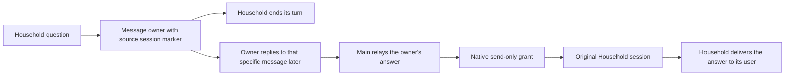

# Restore the Household owner relay

**Status:** Production approved; repair qualification passed; installer integration review and deployment pending
**Issue:** [#259](https://github.com/coletaylor788/puddles/issues/259)
**Last updated:** 2026-10-18

## Human section

### Design

Restore the owner-mediated relay so Household can ask for information and end
its turn. The owner can answer later without an open native approval expiring.
Return that answer to the original Household session using OpenClaw's ordinary
session messaging. Keep email approvals unchanged.

#### Asking the owner

Household sends the configured owner an iMessage ending with
`[sk:<originating session key>]`, then stops. Each question needs its own owner
response. Household and its workers cannot call `sessions_send` or read Main's
private context. Existing message-recipient restrictions still apply.

#### Returning the answer

Main acts only on an authenticated owner reply that uses the native iMessage
Reply gesture and quotes the original request marker. A pasted marker, a plain
owner message, or a message from another sender is not that reply. Main sends
only the owner's answer to the exact Household session from the quoted marker.
It never guesses a recent request or derives an external recipient from the key.
Missing or malformed markers cause an explanation to the owner without delivery.

Household receives that answer in its own session and delivers it to the person
who asked. Native-app conversations keep their source session; external chats
keep their native channel route. Installed tests must establish both paths.
Ordinary cross-agent access remains denied for Household. A small policy plugin
uses OpenClaw's existing scoped-access API to grant only Main's return send to
an existing Household conversation. The grant binds the current target session
incarnation and never permits status, history, list, or reverse access. If the
plugin is absent or fails, native access remains denied. Main's instructions
still establish owner authorization and select the original conversation.
Household reads its own native session status to distinguish the saved external
route from the active internal agent turn. For an external route, it sends only
the answer through the current-source message tool without choosing a channel
or recipient. In a confirmed native conversation with no external route, Main's
incoming relay is already displayed as the answer, so Household stays silent.
A later announcement must not repeat either answer. Failed or ambiguous status
and attempted or uncertain sends do not count as confirmed delivery.

#### Automatic reply turns

An exact-session grant suppresses OpenClaw's separate peer and announcement
turns. The initial target turn still handles delivery. The removed zero-turn
setting is not restored, and no communication patch is added. Main and Household
retain agent-level instructions to stop an unexpected automatic exchange with
`REPLY_SKIP`. Main never treats an automatic reply or tool result as a new
owner authorization, retrieves additional private facts, or expands the answer.
Household treats a new question as a new owner request.

The requester explicitly accepts instructions for the answer-content boundary.
Native turn scheduling does not freeze the exchange's subject: new input can be queued or,
where authority permits, steer a running turn. The policy must hold even if a
new question appears in the conversation during an exchange. Tests return an
extra Household question, require no Main peer reentry, then separately verify a fresh
user turn after delivery. They do not simulate concurrent user steering or claim
deterministic prevention of model mistakes.

### Status

**Approval:** Production approved. **Approval reference:** "Approved to restore",
then "Yeah the instructions is a fine solution", and "once tested, approved to
ship" on 2026-10-17. This approves source-session return with instructions
limiting automatic exchanges, followed by testing, review, production release,
merge, and cleanup. No agent-to-agent patch or deferred approval service.

Independent review found that a symmetric native agent allowlist also allowed
Household to read Main's session status. The repair keeps ordinary access denied
and grants only Main's return send through the existing native scoped-access API.
The repaired grant passes all installed denial and delivery checks plus all ten
actual-model scenarios. The retained reviewer cleared the product repair and draft deployment controls. Shared installer integration is receiving the same reviewer's recheck.
No restoration runtime is deployed; managed DEV and subsequent gates are pending.

## Agent section

### State

Public branch: `codex/restore-household-owner-relay`. A separately isolated
companion worktree uses the same branch. The release manager has received the
candidate and review finding. No release ticket or shared DEV allocation is held. Preserve the unrelated request-context fix and
native Gmail approvals.

### Scope and acceptance criteria

- An unanswered question ends Household's turn and starts no Main lookup.
- A later authenticated quoted owner answer returns to the exact original
  Household session, including iMessage and native-app sessions.
- Plain owner input, forged provenance, malformed markers, and other senders
  do not authorize an answer relay.
- Household cannot call upward session tools. Workers retain their restrictions.
- Main does not disclose additional facts if the automatic exchange asks for
  more, including after another user message. A new question needs owner input.
- Unknown delivery outcomes are reported without automatic replay.

### Architecture and decisions

Selected upstream revision `eb377ac59e6c9fd6c7705028034812becf00271b` has ordinary
peer reply flow with up to five additional turns. `runAgentStep` creates each
turn in the existing session. The old `maxPingPongTurns` option is absent.
`REPLY_SKIP` stops non-deliverable peer replies. Exact-session grants suppress
the separate reply flow and bind the restored return route to one incarnation.

The current sender grant is removed from Household. The ordinary agent allowlist
excludes Household. The `session-return-grant` plugin grants only native `send`
requests from eligible Main sessions to eligible existing Household sessions.
It checks current configuration, the request's loaded plugin registry, both
session entries, and the target incarnation. Worker, cron, and hook sessions
are excluded. Runtime cleanup retires the grant. Missing or failed registration
leaves native access denied. Household's tool and sandbox denials also prevent
Household from initiating session sends. Main's old
approval-provenance exception is removed; automatic peer replies carry no owner
approval for new disclosure. The legacy handoff skill is updated in the same
managed transaction as both agents' guidance and configuration.

### Implementation

Companion config and packaged guidance own the environment-specific behavior.
Keep the reusable approval plugin packaged but disabled for this route. Package
and activate the separate return-grant plugin in the same transaction. Use
narrow config reconciliation and exact predecessor hashes to preserve unrelated
guidance and DEV experiments. Include the handoff skill in preparation,
acceptance, and rollback coverage. Public plugin behavior stays unchanged.

### Validation

Run focused config and guidance transaction tests. Exercise installed native
session messaging with recorded channel delivery and synthetic data. Qualify
Main and Household's changed instructions with actual provider output, including
delayed owner replies, plain/forged input, and an attempted expansion during
peer replies. Full application, installed TEST, and read-only PROD gates remain
required. No real messages or account writes in automated tests.

Current local results on 2026-10-17 for the scoped return-grant repair:

- 23 focused plugin tests and its typecheck passed. Configuration, preparation,
  and application layout checks passed (16 tests).
- All four installed scripted routing cases passed in one clean run (109 seconds).
  Both source routes and deliberate extra-question results produced exactly one
  answer, zero Main peer reentry, and zero announcements.
- Seven installed isolation scenarios passed (106 seconds). Native status,
  model-changing status, history, and send requests to a seeded other-tier
  session are denied with the plugin enabled, absent, disabled, and failing
  registration. The sender's own status remains available. Missing grants also
  deny Main's return send.
- Six invalid-authorization scenarios and guarded preparation passed (154 seconds).
  Together these runs cover all 18 installed scripted/preparation cases.
- All 10 actual-model relay scenarios passed (428 seconds), including both source
  routes, a restart before the owner reply, extra-question tool results, fresh
  user questions, and six invalid authorization cases. All writes and delivery
  use recording fixtures. The temporary credential copy was removed afterward.
- Hosted companion contract checks passed. Public hosted checks
  and the retained review are tracked by the release manager. Neither substitutes
  for deployed DEV, the full application pool, TEST, or read-only PROD acceptance.
- Read-only DEV and TEST snapshot comparisons still match the full rendered
  behavior after the narrow reconciliation and preserve the accepted sandbox
  image. No shared state was changed. Refresh these inputs after allocation.

The initial new isolation probe omitted ingress, and the next used the wrong
fixture result field after its native denial assertions passed. Both harness
errors were corrected. The final seven-case run passes without failures or skips.
Earlier failed logs remain local review evidence, not qualification clearance.

Earlier actual-model failures exposed Household discarding the initial answer
and an incorrect no-tool test assertion. Native prompt capture established that
external replies require current-source delivery. Native app history already
displays Main's forwarded answer. Final qualification covers both paths after
correcting the instructions and assertions. Explicit peer reply
steps still use `REPLY_SKIP`. Announcement suppression requires confirmed
delivery, not an attempted call. A separate harness correction keeps native
session label generation from consuming a Household relay turn. No communication
patch was added.

### Rollout and rollback

Use the manager-owned release lane and one reviewed artifact through TEST and
PROD. Restore runtime, config, both agents' instructions, and handoff skill
together if acceptance fails. Preserve current healthy production until then.

### Review log

The retained independent reviewer completed review through the same-model CLI
route. It found one P2: adding Household to the symmetric agent allowlist also
enabled direct status reads of Main. The repair removes that grant and supplies
only a reverse, exact-session send grant. Installed tests must prove denied
reads and sends with absent, disabled, and failed plugin registration, plus
enabled delivery and no peer reentry. The retained reviewer cleared that product
repair and the qualification cleanup changes, together with draft deployment controls. Final operational bindings and managed DEV acceptance remain outstanding.

Qualification cancellation exposed shared runner failures: a detached fixture
could outlive an unexpectedly exiting worker, and failed joining could still
permit deletion of test state. This branch adopts the reviewed shared repairs
through `0050d267`, without the unrelated feature changes. A launch gate records
process ownership before starting work. Surviving supervisors can then join
registered fixtures after a worker exits. Failed joins retain test state.
Qualification uses the existing asynchronous runner and fixture cleanup hooks.
The shared source passes 451 release tests, 31 focused runner/fixture tests and
the e2e typecheck. Composed qualification passes all five cleanup/credential
cases and the installed gateway isolation scenario. These exact shared source
inputs are reused here; the installer integration recheck and managed deployment
remain pending. This changes test execution, not agent communication or the
prepared application. The manager must install the corresponding controller
repair before a new managed DEV run.

The installer follow-up isolates intentional failing launch fixtures from their
outer supervisor. Application checks now honor an explicit bounded deadline.
The companion runs its installed test groups sequentially, waits for failed
process cleanup before starting the next group, and stops on interruption.
Household-specific installed checks remain in the inventory. These changes
affect validation only; the application artifact is unchanged.

### Checklist

- [x] Recover the prior relay and verify current upstream behavior.
- [x] Record approval for source-session return with agent instructions.
- [x] Prepare isolated public and companion workspaces.
- [x] Implement config, guidance, and handoff skill restoration.
- [ ] Pass focused, installed DEV, actual-model, and independent review checks.
- [ ] Complete managed TEST, PROD, source merge, and cleanup.
