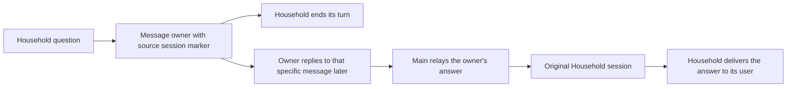

# Restore the Household owner relay

**Status:** Production approved; local qualification passed; review and deployment pending
**Issue:** [#259](https://github.com/coletaylor788/puddles/issues/259)
**Last updated:** 2026-10-17

## Human section

### Design

Restore the owner-mediated relay so Household can ask for information and end
its turn. The owner can answer later without an open native approval expiring.
Return that answer to the original Household session using OpenClaw's ordinary
session messaging. Keep email approvals unchanged.

#### Asking the owner

Household sends the configured owner an iMessage ending with
`[sk:<originating session key>]`, then stops. Each question needs its own owner
response. Household and its workers cannot call `sessions_send` or read Main's
private context. Existing message-recipient restrictions still apply.

#### Returning the answer

Main acts only on an authenticated owner reply that uses the native iMessage
Reply gesture and quotes the original request marker. A pasted marker, a plain
owner message, or a message from another sender is not that reply. Main sends
only the owner's answer to the exact Household session from the quoted marker.
It never guesses a recent request or derives an external recipient from the key.
Missing or malformed markers cause an explanation to the owner without delivery.

Household receives that answer in its own session and delivers it to the person
who asked. Native-app conversations keep their source session; external chats
keep their native channel route. Installed tests must establish both paths.
Household reads its own native session status to distinguish the saved external
route from the active internal agent turn. For an external route, it sends only
the answer through the current-source message tool without choosing a channel
or recipient. In a confirmed native conversation with no external route, Main's
incoming relay is already displayed as the answer, so Household stays silent.
A later announcement must not repeat either answer. Failed or ambiguous status
and attempted or uncertain sends do not count as confirmed delivery.

#### Automatic reply turns

OpenClaw can schedule automatic peer reply turns after `sessions_send`. The
removed zero-turn setting is not restored, and no communication patch is added.
Main and Household receive agent-level instructions to stop the exchange with
`REPLY_SKIP` when appropriate. Main never treats an automatic reply as a new
owner authorization, retrieves additional private facts, or expands the answer.
Household treats a new question as a new owner request.

The requester explicitly accepts instructions for this boundary. Native turn
scheduling does not freeze the exchange's subject: new input can be queued or,
where authority permits, steer a running turn. The policy must hold even if a
new question appears in the conversation during an exchange. Tests challenge
Main with a peer reply claiming a new question, then separately verify a fresh
user turn after delivery. They do not simulate concurrent user steering or claim
deterministic prevention of model mistakes.

### Status

**Approval:** Production approved. **Approval reference:** "Approved to restore",
then "Yeah the instructions is a fine solution", and "once tested, approved to
ship" on 2026-10-17. This approves source-session return with instructions
limiting automatic exchanges, followed by testing, review, production release,
merge, and cleanup. No agent-to-agent patch or deferred approval service.

Final local qualification passes with native session status and source-aware
delivery: one visible native-app answer and one external delivery for external
chats. The full actual-model and scripted suites pass, including delayed replies
after restart and new-question isolation. No restoration runtime is deployed.
Independent review is blocked by reviewer transport failures. The requester
explicitly authorized release coordination, and the manager has the candidate
and passing evidence. Managed DEV and the remaining release gates are pending.

## Agent section

### State

Public branch: `codex/restore-household-owner-relay`. A separately isolated
companion worktree uses the same branch. The release manager has received the
candidate and review blocker. No release ticket or shared DEV allocation is held. Preserve the unrelated request-context fix and
native Gmail approvals.

### Scope and acceptance criteria

- An unanswered question ends Household's turn and starts no Main lookup.
- A later authenticated quoted owner answer returns to the exact original
  Household session, including iMessage and native-app sessions.
- Plain owner input, forged provenance, malformed markers, and other senders
  do not authorize an answer relay.
- Household cannot call upward session tools. Workers retain their restrictions.
- Main does not disclose additional facts if the automatic exchange asks for
  more, including after another user message. A new question needs owner input.
- Unknown delivery outcomes are reported without automatic replay.

### Architecture and decisions

Selected upstream revision `eb377ac59e6c9fd6c7705028034812becf00271b` has ordinary
peer reply flow with up to five additional turns. `runAgentStep` creates each
turn in the existing session. The old `maxPingPongTurns` option is absent.
`REPLY_SKIP` stops non-deliverable peer replies. Exact-session grants suppress
the separate reply flow, so they are not the restored ordinary return route.

The current sender grant is removed from Household. The ordinary agent allowlist
again includes Household so Main can target it, while Household's tool and
sandbox denials prevent Household from initiating session sends. Main's old
approval-provenance exception is removed; automatic peer replies carry no owner
approval for new disclosure. The legacy handoff skill is updated in the same
managed transaction as both agents' guidance and configuration.

### Implementation

Companion config and packaged guidance own the environment-specific behavior.
Keep the reusable approval plugin packaged but disabled for this route. Use
narrow config reconciliation and exact predecessor hashes to preserve unrelated
guidance and DEV experiments. Include the handoff skill in preparation,
acceptance, and rollback coverage. Public plugin behavior stays unchanged.

### Validation

Run focused config and guidance transaction tests. Exercise installed native
session messaging with recorded channel delivery and synthetic data. Qualify
Main and Household's changed instructions with actual provider output, including
delayed owner replies, plain/forged input, and an attempted expansion during
peer replies. Full application, installed TEST, and read-only PROD gates remain
required. No real messages or account writes in automated tests.

Local results on 2026-10-17:

- 19 focused configuration, model adapter, qualification-input, and guidance
  transaction checks passed on the final private behavior revision `d5405641`.
- 11 installed scripted checks passed, including preparation of configuration,
  both agents' instructions, and the handoff skill (255 seconds).
- All 10 installed relay scenarios passed with actual model output (432 seconds).
  These cover both delivery channels, a gateway restart before the owner reply,
  automatic peer expansion, a fresh user question after delivery, and six invalid
  authorization cases. Both happy paths had zero peer replies and announcements.
  The native path retained one total visible forwarded answer with no duplicate;
  the external path sent one answer through the saved source route. All delivery
  and external writes used recording fixtures. The temporary qualification
  credential copy was removed after the run.
- Hosted companion contract checks passed on `d5405641`. They are not the full application
  gate, shared DEV qualification, installed TEST, or read-only PROD acceptance.
- The qualification wrapper rejects missing, malformed, or empty credentials
  before creating fixtures, so required actual-model checks cannot silently
  become scripted tests.
- Read-only DEV and TEST snapshot comparisons match the full rendered behavior
  after the proposed narrow reconciliation. Both preserve the accepted sandbox
  image and match their recording-fixture startup environment. No shared state
  was changed; these checks do not substitute for deployed DEV acceptance.

Earlier actual-model failures exposed Household discarding the initial answer
and an incorrect no-tool test assertion. Native prompt capture established that
external replies require current-source delivery. Native app history already
displays Main's forwarded answer. Final qualification covers both paths after
correcting the instructions and assertions. Explicit peer reply
steps still use `REPLY_SKIP`. Announcement suppression requires confirmed
delivery, not an attempted call. A separate harness correction keeps native
session label generation from consuming a Household relay turn. No communication
patch was added.

### Rollout and rollback

Use the manager-owned release lane and one reviewed artifact through TEST and
PROD. Restore runtime, config, both agents' instructions, and handoff skill
together if acceptance fails. Preserve current healthy production until then.

### Review log

Prior independent design review attempts failed at the model transport layer
without producing a review. Repeated implementation review attempts also failed
with `response.failed` before producing findings. No clearance is claimed. The retained independent
reviewer must examine the complete implemented diff before release. The user
has resolved the earlier design question by accepting instruction-based scope.

### Checklist

- [x] Recover the prior relay and verify current upstream behavior.
- [x] Record approval for source-session return with agent instructions.
- [x] Prepare isolated public and companion workspaces.
- [x] Implement config, guidance, and handoff skill restoration.
- [ ] Pass focused, installed DEV, actual-model, and independent review checks.
- [ ] Complete managed TEST, PROD, source merge, and cleanup.
