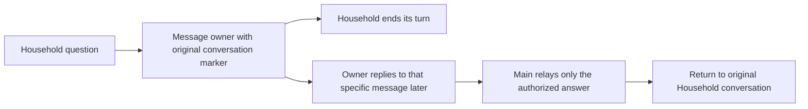

# Restore the Household owner relay

**Status:** Restoration approved; revised return path needs a decision
**Issue:** [#259](https://github.com/coletaylor788/puddles/issues/259)
**Last updated:** 2026-10-17

## Human section

### Design

Restore the owner-mediated message relay so a Household request can wait for a
human reply without holding an agent turn open. The owner may answer much later.
Keep email approvals unchanged. Do not add a deferred approval service or patch
agent-to-agent communication.

#### Existing relay

The previous instructions sent the owner an iMessage ending with
`[sk:<originating session key>]`. Main only relayed an answer when the authenticated
owner used the native Reply gesture on that message. It did not infer a target
from timing or the most recent unanswered question. Household lacked
`sessions_send`; each new question went back to the owner.

#### Compatibility conflict

The retained handoff skill calls `sessions_send` with `maxPingPongTurns: 0`.
The selected OpenClaw tool no longer accepts this setting. Normal peer sends
can initiate automatic reply turns, while exact-session access suppresses the
announcement needed by the old relay. Restoring the instructions and grants
verbatim would not restore the stated one-shot behavior.

#### Proposed compatible return path

For a canonical iMessage Household conversation, Main could send the owner's
specific answer using the native `message` tool to that original chat. This
would avoid starting a Household agent turn and therefore avoid a peer reply
loop. Household would keep both direct and ordinary peer access to Main denied.

This correction changes the old skill's explicit instruction to route through
the Household agent. It needs a precise destination contract: only a valid
original iMessage route may be used, and a missing, malformed, ambiguous, or
non-iMessage marker must not be guessed. A native app session without a channel
destination is not covered by this candidate. The authenticated owner reply
supplies authority; the marker alone never does.

The proposed scope is the original iMessage relay. Household sends the owner a
question and ends its turn. A native quoted owner reply, even much later,
authorizes Main to relay only that answer to the exact original iMessage chat.
It does not authorize Household to ask Main anything further. Do not promise
that direct delivery also updates Household's agent-session transcript until
native routing and transcript behavior have been verified.

This is a user-visible return-path change, so it needs an explicit decision.
Approve this limited direct-chat return, or retain the current implementation
while designing a different supported return path. A verbatim restoration is
not compatible with the no-ping-pong requirement. No agent-to-agent patch is
proposed.

### Status

**Approval:** Production approved for restoring the original owner-mediated
relay. **Approval reference:** The requester said "Approved to restore" on
2026-10-17, after the recommendation to restore the original relay, preserve
per-question owner decisions, and return answers to the originating conversation.

The no-agent-to-agent-patch constraint remains in force. Approval covers the
normal development, review, release, merge, and cleanup lifecycle. The proposed
direct-chat correction needs a decision because it changes the return recipient
from an agent session to an external chat and does not cover native-app sessions.
No runtime changes or deployment have been made. The current synchronous route
is still installed. The earlier deferred-native-approval proposal is not being
implemented.

## Agent section

### State

The public branch is `codex/restore-household-owner-relay`, based on freshly
fetched main. A separately isolated companion worktree uses the same branch
name. No runtime diff, candidate artifact, running development process, shared
DEV allocation, or release ticket exists. The manager has requested isolated
preparation only while verifying lane ownership.

### Scope and acceptance criteria

Restore delayed owner-mediated iMessage answers. Keep email approvals unchanged,
each later question separately owner-mediated, and Household's access to Main
denied. No deferred approval service, agent-to-agent patch, inferred latest
request, or default destination is in scope. The proposed direct-chat return
and its native-app limitation await a decision.

### Architecture and decisions

- [Historical Household design](completed/022-household-and-friends-tiers.md)
  documents the quoted owner reply and absence of Household `sessions_send`.
- The existing private `tier-handoff` skill was read from its configured main
  workspace. It explicitly requires native quoted reply, a `[sk:]` marker,
  `sessions_send(..., maxPingPongTurns: 0)`, and no direct channel message.
- Selected OpenClaw revision `eb377ac59e6c9fd6c7705028034812becf00271b`:
  `src/agents/tools/sessions-send-tool.ts` omits the old parameter and supplies
  five peer reply turns for ordinary interactive requesters. Exact-session
  grants suppress reply flow. `mode=notify` starts no run and has process-only
  durability, so it is not an equivalent delayed answer mechanism.
- Native `message` supports explicit channel, target, and account. The existing
  environment separates direct sessions by channel and peer. Supported target
  parsing and owner-quote handling must be exercised with recording fixtures.

### Implementation

Retain the unrelated native request-context repair and Gmail approval behavior.
Remove Household's native question approval activation and `sessions_send` tool
grant only as part of a coherent tested restoration. Keep workers restricted.
Update packaged Household and Main guidance together with the handoff skill.
Preserve unrelated instructions and use guarded predecessor checks and managed
backup/restore for deployed files.

### Validation

Cover a delayed owner reply after Household's turn ends, no reply/no Main work,
plain owner messages without a quote, malformed and foreign markers, a second
question requiring its own owner decision, and exactly the intended answer sent
to the original chat with no peer turn. Use recorded message delivery and real
model qualification for changed guidance. Production checks stay read-only.

### Rollout and rollback

Use the manager-owned release lane and the same reviewed artifact through TEST
and PROD. Restore runtime, configuration, and deployed guidance together on
failure. Retain the current healthy production deployment until the replacement
passes its gates. Resolve the compatibility conflict before runtime changes.

### Review log

Source inspection confirms the removed return control. Independent design
review attempts failed at the model transport layer without producing a review.
No clearance is claimed. A retained independent reviewer must review the full
implemented behavior before release.

The repository-local safe-feature-development skill requires human review for
major changes to the approved architecture or user-visible requirements. This
applies to the proposed direct-chat substitution and native-app exclusion, not
to routine restoration work or a second production approval.

### Checklist

- [x] Recover the previous relay and record restoration approval.
- [x] Verify the removed setting against the selected OpenClaw source.
- [x] Prepare isolated public and companion workspaces.
- [ ] Resolve the direct-chat return decision.
- [ ] Implement coherent config, guidance, and skill restoration.
- [ ] Pass focused, installed DEV, and independent review checks.
- [ ] Complete managed TEST, PROD, source merge, and cleanup.
