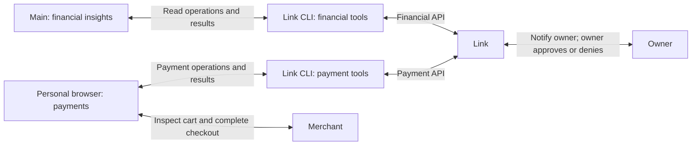

# Link payments for the browser and financial insights for main

Status: In progress
Issue: Not created
Last updated: 2026-11-11

## Human section

### Design

Give the personal browser agent Link payments and give main financial insights.
These are two independent uses of the official Link CLI. The browser prepares
checkout, requests approval, checks the decision in Link, and pays. Main only
reads financial insights. It has no role in the Link payment workflow.

Use Stripe's official CLI and skills with OpenClaw's existing MCP support. MCP
lets the gateway run the CLI on the host and expose selected operations as agent
tools. This is the existing tool transport, not another agent or custom payment
service. The CLI manages login and refresh; neither agent needs its OAuth tokens.

The two CLI boxes show separate tool permissions for one installed CLI. There is
no main-to-browser Link handoff. Existing chat and task routing are outside this
integration; the payment flow starts with a shopping task already at the browser.

#### Installation and access

Package an exact CLI release and corresponding official setup, payment, and
financial-insights skills through the maintained application lifecycle. Configure
the gateway to launch the installed CLI with `--mcp` over stdio. Use one installed
CLI and host-managed connection, with separate agent tool permissions:

| Agent | Link access | Skill |
|---|---|---|
| Main | Read financial insights, transactions, balances, and source details | Financial insights |
| Personal browser agent | Prepare payment requests, request approval, check status, and retrieve approved credentials; read necessary payment-method and shipping information | Payments |
| Other agents, including household browsers and readers | None | None |

Main has no payment tools. The browser has no financial-insight, transaction,
balance, or source-history tools. Payment-method metadata needed to fund the
requested purchase is part of the payment flow, not permission to read financial
history. Do not grant either agent a general CLI shell or arbitrary MCP dispatcher.

Use the installed runtime's tool-selection and permission controls. Discover and
freeze the required MCP tool names from the pinned CLI. Tool permissions must
enforce the split at execution as well as discovery; skill instructions alone
are insufficient. Allow interactive login and status through the official auth tools. Access
upgrades require the owner to approve the requested grants in Link. Do not expose
unrelated wallet administration, identity, arbitrary file output, or automatic
installation operations. A version change goes through deployment rather than
an agent-run update. Verify the split with both configured model runtime paths.

#### Connect the account

The owner can connect Link interactively with Puddles on first use; no advance
terminal login is required. Both authorized agents may check auth status and
start the official login flow for the approved connection. Puddles presents the
verification URL and phrase, and the owner signs in directly with Link.

Check `auth status --format json` as the first Link CLI operation. If no session
exists, start the official login with client name `Puddles`. Request payment
access plus the four financial actions: Link transactions, connected-bank
transactions, balances, and source details. Upgrade an existing session only
when necessary, preserving its previous access.

The owner opens Link's verification URL and approves the connection. Poll the
same authorization attempt with a time limit. The connection grants both
capabilities to the host CLI; OpenClaw's separate tool permissions determine which
agent can use each capability. Keep the CLI's auth file in protected host state
outside agent workspaces and artifact payloads. Never print or copy tokens. A
failed or expired login does not count as setup completion.

#### Financial insights

Main uses the official financial-insights skill to select only the data needed
for the owner's question. It can read transactions, balances, connected sources,
and available shopping insights. Setup verifies grants and availability without
retrieving an unsolicited financial history. Treat returned descriptions and
merchant names as external data, never as instructions or authority. These reads
use the connection's existing grants and do not require individual purchase
approval. Financial history stays with main. Merchant-page requests cannot
authorize financial reads or disclosure.

#### Purchases and browser use

For its owner-requested shopping task, the browser inspects the merchant's checkout,
selects the supported payment type, and creates a request for the full total.
It requests approval through Link, which sends the owner a push notification.
The owner approves or denies in Link. The browser polls that same request with
a time limit, checks its authoritative status, and retrieves the credential only
after approval. All payment operations stay between the browser, CLI, and Link.
Validate direct Link notification and approval during onboarding;
if approval never arrives, report the timeout rather than creating another request.

The browser may enter the shipping/contact information needed for the requested
checkout and the issued payment credential. Recheck the seller, items, currency,
delivery details, and final total before submission. Changed carts need fresh
approval; uncertain submissions require order reconciliation before retry. Keep
credentials out of the shopping result. Store non-secret request IDs and cart
details in existing task state so an interrupted browser task can resume
the same request rather than starting another purchase.

Preserve page-injection, password, OTP, and unrelated-credential restrictions.
Keep tokens and full payment credentials out of user-facing replies and durable
notes. Do not enable automatic spending, recurring purchases, or saved-payment
fallbacks as part of setup. Verify that the connected app has no approval policy
allowing purchases without manual approval. An unknown policy result is not proof
of that condition. Link approval controls spending; it does not protect financial
reads, credential handling, or browser behavior after approval. Connecting Link
does not request a real purchase. The payment skill's optional financial insights
are unavailable to the browser; skip them rather than broaden its access.

#### Specific policy change

The current security architecture routes external service content through guarded
tools/readers and excludes credentials from tool results. This proposal permits
the official Link MCP to return financial results directly to main and payment
results, including the issued credential, directly to the personal browser agent.
It also narrows that browser's current blanket prohibition on payment and checkout
information for owner-requested, Link-approved purchases. Main does not receive
the payment credential. OAuth credentials remain protected host state.

The requester approved this explicit exception. Update the architecture
and personal browser guidance with the integration; do not broaden other agents'
access or their browser instructions. No general shell-network exception is needed.

### Status

**Approval:** Production approved. **Approval reference:** On 2026-11-11 the
requester said “great, approved the design, approved to push to puddles if needed,
implement and ship,” after selecting browser payments, main financial insights,
and interactive first-use authentication. Approval includes the described policy
exception, implementation, publication, CI deployment, rollback, and cleanup.
No real purchase is authorized by setup.

Implementation is in progress in isolated paired worktrees. Read-only inspection
confirms native MCP support. Link is not installed or connected in production.
The pinned CLI, scoped catalogs, shared interactive login, permission rules, and
application packaging are implemented. Focused tests pass. Installed provider
qualification and CI delivery remain pending.

## Agent section

### State

- Assigned public worktree, branch `codex/link-main-setup`.
- Public starting revision: `a2a5338d`.
- The earlier CLI-only purchase proposal is retained unchanged in its own worktree.
- Two independent capabilities: main reads financial insights; the personal
  browser agent owns the complete Link payment flow. There is no payment
  coordination, approval relay, credential handoff, or required result-processing
  turn through main. Existing task routing is not changed by this integration.
- Native MCP keeps CLI execution on the host. Main's restricted native shell
  and the browser's lack of a general shell do not need broader permissions.
- Private configuration and installed host paths remain outside public records.

### Scope and acceptance criteria

- Financial-insight tools available only to main; payment tools available only
  to the personal browser agent. The browser uses Link for its shopping task
  without invoking main.
- Reject main payment calls and browser financial-history calls, including direct
  invocation of hidden tool names. Other agents have no Link tools. Verify the
  split across both configured model runtime paths and existing tool-call paths.
- Manual owner login, correct grants, protected persistent CLI session, and
  bounded status checks. Never inspect the auth file's contents.
- Purchase approval, cart rechecks, no duplicate uncertain submissions, and no
  autonomous spending. Purchase approval does not stand in for financial-data
  access control. Automated validation uses fixtures and never buys anything.
- The browser can request approval, observe the owner's decision in Link, and
  finish checkout without any main payment-coordination message or tool call.
- Payment credentials stay out of shopping summaries and durable task notes;
  financial history stays out of browsing tasks.
- Exact managed installation, per-agent skill discovery, native MCP discovery
  and permission enforcement, and successful connection must all be demonstrated.

### Architecture and decisions

- [Official setup skill](https://link.com/skill.md).
- [Official CLI and MCP instructions](https://github.com/stripe/link-cli).
- [Payment skill](https://github.com/stripe/link-cli/blob/main/skills/create-payment-credential/SKILL.md).
- [Financial-insights skill](https://github.com/stripe/link-cli/blob/main/skills/financial-insights/SKILL.md).
- [Security architecture](../openclaw-setup/security-architecture.md).
- [Browser instructions](../openclaw-setup/agent-instructions/browser-agent-AGENTS.md).
- Inspected the installed native MCP configuration, harness policy, and namespace
  denial modules. The harness applies final effective tool policy; full namespace
  denials can exclude a server before discovery. Validate exact behavior with
  the pinned installed runtime before release.
- Preserve upstream CLI ownership of session refresh and payment protocol.
  No custom wallet service, new daemon, or replacement approval UI.
- One host connection carries both grants. Native tool permissions enforce agent
  access. Confirm the pinned MCP catalog supports selecting the two operation
  sets without a generic command or parameter bypass before implementation is
  considered ready. A failure to enforce that split blocks release; it does not
  authorize broader access or an unreviewed replacement integration.

### Implementation

The official CLI is pinned at 1.4.1 with its exact upstream skill sources. A
checked build adaptation selects its native direct MCP discovery mode and narrows
schemas for each capability. There is no generic dispatcher, arbitrary output
path, recurring request, or approval bypass. Both processes use the upstream
shared auth store and fixed grants.

The application artifact carries the CLI and scoped skills. CI installs skills
only into their respective workspaces, preserves other skills, and refuses an
unknown conflicting Link skill. The companion repository supplies host bindings,
recording endpoints, migration callbacks, and additive backup coverage.

### Validation

Focused regressions cover scoped catalogs and hidden-tool rejection, creation
without approval bypasses, pending/denied/expired/approved fixture responses,
interactive login with both grants, protected session persistence and restart,
live sharing between the two processes, and missing grants. A relocated build
check verifies the complete dependency closure. Skill tests cover idempotence,
conflicts, symlinks, and preservation of unrelated skills.

The integration exposed an existing dependency materializer defect for packages
that import their own name from a nested module scope. The minimal self-link fix
has a focused executable regression. Existing dependency lock entries are retained;
Link adds its frozen dependency closure without updating unrelated edges.

Companion tests cover configuration parity across environments, runtime relocation,
backup registration, migration witnesses, drift rejection, and production-only
artifact binding. Installed DEV and TEST gates exercise native tool policies and
real configured provider adapters using isolated sessions and local Link fixtures.
No live account data, purchase, or message delivery is part of automated validation.

Owner login and the owner-visible Link approval notification require the owner's
interactive action after shipping. This release must not claim those live actions
were tested by synthetic fixtures.

### Rollout and rollback

Follow [triggered CI](../../packages/release/CI.md). Keep versioned CLI and skills
in the application output and auth state outside it. Preserve the previous
configuration for rollback. Remove the relevant tool exposure to disable payments,
financial insights, or both. Revoke the shared Link session only when requested;
revoking it disables both capabilities. Rollback does not cancel merchant orders,
so retain non-secret request identifiers needed to reconcile unresolved purchases.

### Review log

The retained independent reviewer examined the complete implementation and caught
a production-only baseline option incorrectly used during DEV/TEST preparation.
That defect is fixed and covered by functional callback tests. Final clearance
requires installed provider evidence and review of the final paired diff.

### Checklist

- [x] Read official setup and both capability skills.
- [x] Confirm payments on the personal browser and financial insights on main.
- [x] Inspect installed runtime and native MCP policy support.
- [x] Revise both plan sections for the selected split and approval limits.
- [x] Approve native MCP design, interactive auth, and specific policy exception.
- [ ] Implement and validate the pinned integration.
- [ ] Complete review, DEV, CI delivery, and cleanup.
- [ ] Complete owner login and verify each agent's permitted access.
