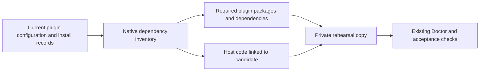

# Bound native rehearsal plugin snapshots

Status: Proposed core patch
Issue: https://github.com/coletaylor788/puddles/issues/380
Last updated: 2026-11-28

## Human section

### Design

OpenClaw rehearses an update by copying current state and the plugin dependencies needed by the candidate. In an npm installation, a custom plugin inside the OpenClaw package can make that inventory expand to the shared `node_modules` directory. The resulting copy includes unrelated installed packages and retained installation trees. Repeated rehearsals can produce substantial unnecessary filesystem activity.

#### Scope of the proposed patch

Add one patch, `plugin-rehearsal-package-scope.patch`, to the native plugin dependency inventory. Derive the source host from the existing source-bundle identity and canonicalize it. Recognize a shared npm module directory only when its `openclaw` entry resolves to that exact host. Preserve the existing link from that host package to the candidate. Within that shared directory, include a package only when a configured locator, declared dependency, or verified dependency link reaches it. Keep a structural mapping for the shared directory, but enumerate only selected package payloads. Do not recursively scan all siblings merely because a selected plugin has this directory as an ancestor. The structural mapping preserves native locator aliases and the host-to-candidate link. Unrecognized layouts retain their existing behavior; installed acceptance must verify that the affected npm layout uses bounded selection.

Keep package-relative paths, scoped package names, nested dependency precedence, and existing pnpm behavior. Use the current file identity checks, dependency-link validation, private copy implementation, process ownership and cleanup. This changes snapshot selection, not agent access controls, cron containment, installed plugin configuration, or production data. Unrelated recovery directories remain untouched on disk.

The patch must cover initial locator expansion, declared dependency discovery and dependency links. Correcting only the first expansion would allow a later discovery pass to add the broad root again. Existing supported dependencies must continue to load from the private rehearsal after the source is unavailable. Unsupported or unresolved dependencies must fail explicitly.

#### Why an input-only repair is insufficient

The current full rehearsal API has no dependency-boundary option. It combines configured plugin paths with canonical plugin install records read from copied SQLite state. Rewriting configuration alone leaves the canonical records pointing into the original global installation. The existing private plugin projection occurs after native snapshot creation, too late to prevent the broad copy.

The supported bundled-plugin redirect applies to actual bundled roots and matching plugin entries. Relabeling custom plugins as bundled would violate that contract. Moving installed plugins is a broader packaging and metadata migration. Creating an additional projected source snapshot would add another state-copy and cleanup lifecycle. The proposed patch fixes the identified native selection rule while retaining the current rehearsal lifecycle.

The pinned release is 2026.11.5. Official stable 2026.11.10 still contains the first-`node_modules` expansion and the caller still omits a boundary, so upgrading alone does not establish a fix.

#### Verification and recovery

Use a small installed fixture with a custom plugin, required local and hoisted dependencies, unrelated sibling packages, and retained installation sentinels. Verify the required dependencies load and unrelated siblings are absent from both inventory and actual copy. Extend the existing full native rehearsal regression to verify canonical install records, cron data and source files remain preserved.

Run focused native checks, retained independent review, full application qualification and normal DEV/TEST/PROD gates on the changed candidate. Reuse the existing rollback mechanism. Measure snapshot entries and bytes, then daemon CPU, memory and file-notification latency. Reduced copying is the fix's acceptance criterion; recovery of already retained daemon memory is a separate observation.

### Status

**Approval:** Proposed for the new core patch. **Approval reference:** The requester approved fixing the excessive snapshot scope on November 28 with “Let’s fix it.” That authorizes preparing this repair; the repository requires specific approval of the new OpenClaw patch before implementation. Existing cron sandbox approval remains valid and unchanged.

The current installed planner and actual copy stage reproduce the unwanted sibling copies in a synthetic fixture. Production and the pending candidate contain identical planner code. No core patch or runtime change has been made. Specific patch approval, implementation, review and release remain outstanding.

## Agent section

### State

Use the existing cron feature worktree and retained reviewer. The application currently targets OpenClaw 2026.11.5. Do not alter installed code directly. Keep target-specific diagnostics and host identifiers in local or private evidence.

### Scope and acceptance criteria

- One maintained patch to native rehearsal plugin dependency selection.
- Shared npm siblings are included only when reached by supported plugin dependency discovery.
- Host code still resolves to the candidate; selected dependencies remain private and loadable.
- Local, hoisted, scoped, nested and symlink dependency cases retain correct resolution.
- Existing pnpm and runtime-retention coverage remains green.
- Unrelated package and retained-install sentinels are neither inventoried nor copied.
- Canonical install records, cron data, source files, copy identity checks and cleanup remain covered.
- No production plugin relocation, daemon privilege change or machine reboot.

### Architecture and decisions

Relevant source is `src/infra/update-candidate-plugins.ts` and `src/infra/update-candidate-plugin-tree.ts`. The native copy implementation in `update-candidate-plugin-file.ts` remains authoritative. Add a candidate-plugin-only source-host/shared-owner boundary from existing source bundle identity. Do not reuse `retainedHostRoot`, which changes host linkage semantics. Preserve the structural shared-owner mapping used by locator aliases and register its host edge. Bound initial promotion, manifest dependency discovery and symlink-owner expansion; leave pnpm and retained-runtime behavior unchanged. Any plumbing change must be limited to supplying or deriving this verified boundary for the existing inventory.

Pinned planner module SHA256: `8220fbe283fc117c29a78017c07de3646edf7ca1ae45e27d82319aeb513ba383`.

Later stable evidence:
- [Release 2026.11.10](https://github.com/openclaw/openclaw/releases/tag/v2026.11.10)
- [Dependency inventory](https://github.com/openclaw/openclaw/blob/v2026.11.10/src/infra/update-candidate-plugin-tree.ts)
- [Plugin planner caller](https://github.com/openclaw/openclaw/blob/v2026.11.10/src/infra/update-candidate-plugins.ts)

### Implementation

Pending specific patch approval. No source prototype or test-only core patch is authorized yet. Package the approved correction through the maintained patch workflow and register executable regressions in the cumulative patch suite.

### Validation

The unmodified installed full planner selected the shared module directory for one synthetic custom plugin. Actual copying included both an unrelated package sentinel and an old installation sentinel. Native recognized backup artifacts were excluded. The fixture was removed. This establishes excessive snapshot scope, not the exact OS memory-retention mechanism.

### Rollout and rollback

Keep closed historical runs closed. Refresh the paired source before a new submission, build changed inputs and follow normal CI. Do not weaken timeouts, skip copied-production acceptance, or modify protected backup state. A daemon-only restart is separately authorized but requires usable root authentication on the host; no reboot is authorized.

### Review log

The retained reviewer confirmed the full factory lacks a narrow config-only escape. The proposed correction uses verified source-host identity, a candidate-plugin-only shared-owner boundary, selected sibling payloads, and a structural owner mapping. It must retain host-to-candidate aliases and prove actual candidate plugin and dependency loading. Reusing retained-host semantics or dropping the structural mapping would be incorrect. These findings are incorporated. Existing pnpm/store behavior remains unchanged. Implementation and full-diff review remain pending.

### Checklist

- [x] Reproduce excessive inventory and actual copy on unmodified installed code.
- [x] Compare pending candidate and installed planner identity.
- [x] Check supported input alternatives and later stable source.
- [ ] Obtain specific core-patch approval.
- [ ] Implement and register durable regression coverage.
- [ ] Complete focused checks and retained full-diff review.
- [ ] Complete fresh CI qualification and deployment.
- [ ] Measure filesystem activity and daemon recovery independently.
