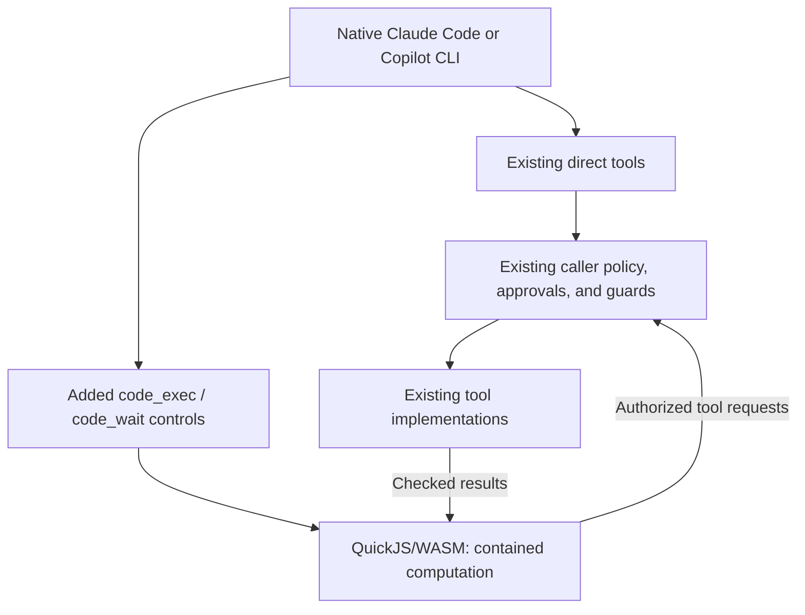

# Programmatic tool calls through OpenClaw

Status: Production approved; implementation in progress
Issue: [#304](https://github.com/coletaylor788/puddles/issues/304)
Last updated: 2026-10-18

## Human section

### Design

Give every tool-enabled agent an optional contained script runner alongside its
existing direct tools. A script can transform data and compose dependent or
parallel calls. Each agent keeps its existing catalog, identity, permissions,
approvals, and guards. There is no separate tool allowlist for scripting.

Keep native Claude Code and GitHub Copilot CLI, including their model loops,
authentication, compaction, and sessions. Use their existing MCP and SDK tool
interfaces with OpenClaw's QuickJS executor.

#### Keep direct calls

Upstream Code Mode normally hides tools behind its `exec` and `wait` controls.
That does not meet this request. Add an additive surface that retains existing
direct tools and introduces `code_exec` and `code_wait`. Keep shell `exec`
unchanged. Scripts cannot call their own controls recursively.

Use one catalog and the same authorized implementations for both paths.
Preserve direct rich output and existing discovery behavior. Keeping direct
tools means we do not claim savings from hiding their schemas; measure savings
from fewer round trips and returning compact results.

#### Contain scripts

QuickJS runs inside WebAssembly in a host worker. The WASM guest provides
isolation; the worker thread does not. Scripts can compute and use the agent's
existing authorized capabilities, but gain no ambient host filesystem, process,
network, module, environment, or credential access. Use the bundled QuickJS
executor explicitly and reject Node VM execution in the additive surface.
OS isolation of the interpreter is not required.

Keep `skills.list()` and `skills.read()` for the agent's authorized skill
catalog. Reading a known skill is a scoped, read-only capability, not arbitrary
host file access. Keep existing catalog, MCP/node, and delegation helpers with
their current caller checks. Bounded output, progress, timers, and caller-scoped
in-memory results are ordinary runtime facilities.

The boundary is no additional authority or unmediated external writes. Existing
authorized reads remain available; actions retain their existing authorization
and approval rules.

The source audit and isolated probes found no demonstrated host-code escape.
They establish the intended capability boundary, not a guarantee against all
engine vulnerabilities. Approvals protect tool calls, not a runtime escape.

#### Connect Claude

The pinned built-in Claude adapter exposes ordinary OpenClaw tools over MCP,
but does not connect the shared Code Mode controls. Copilot already connects
them through its SDK. Both need the additive surface; Claude additionally needs
that missing adapter wiring.

Expose the controls through Claude's existing MCP connection. Keep the original
tool allowlist separate from the added control names, and route nested calls
through the existing execution engine. Retain the shared Code Mode runtime
between execution and wait calls, then use its existing cleanup when the task
ends or authority changes. This is adapter wiring, not a separate approval or
lifecycle system.

#### Preserve behavior

Apply this to all agents and their existing restrictions. Tool-less runs gain
no tools. Roles, models, credentials, routing, and native host-tool restrictions
stay unchanged. Every nested action retains its own approval, content checks,
ordering, cancellation, and audit event. If a tool needs approval, its call waits
under the engine's existing rules. Code Mode already supports approval waits,
timeouts, and cancellation; the adapter reuses that behavior.

Programs are not transactions. Never replay completed or uncertain writes after
interruption. Continuations remain transient and cannot survive Gateway restart.

### Status

**Approval: Production approved.** **Approval reference:** the requester said
“Approved, implement and ship” on 2026-10-16. This approves the two patches,
activation for all tool-enabled agents, validation, deployment, merge, and cleanup.
The contained-runtime boundary, native harnesses, scoped reads, direct tools,
and existing approval engine remain the agreed scope.

Both patches and shared activation are implemented. Managed DEV now passes
startup, configuration, native Claude and Copilot probes, the headless regression,
and the real-provider comparison for main and reader. The corrected benchmark
reads the same complete dataset and records one write in each case. Scripts use
two model requests instead of three and fewer tokens. They were slower in this
small sample, so the result does not establish a latency improvement.

The tested artifact preserves the released Media image and skill. DEV is stopped
cleanly. The corrected release staging and independent review are complete.
Release admission waits for the shared controller cleanup fix and a refreshed
release packet. The reviewed test-runner repair passes local checks. The full application suite, TEST, production
acceptance, paired source merge, and managed cleanup remain.

## Agent section

### State

The replacement owner resumed the existing public and companion branches after
the original chat was archived. The approved implementation and retained build
were recovered without changing runtime behavior. R4 passed on October 18 and
was stopped through the maintained sandbox-aware stop operation. Its consumed
request and the earlier failed requests cannot be replayed.

The first release attempt passed rebase and artifact checks, then stopped before
any application tests because staging omitted the prepared upstream build output.
The corrected staging now includes complete `dist` and `dist-runtime` trees,
including build stamps and embedded runtime dependencies. Their hashes and all
public and companion package outputs match the retained build. Native read-only
checks report no build or postbuild work needed. The controller released the lane;
no TEST or production deployment occurred.

The feature remains outside the queue while the coordinator installs the shared
controller fix for detached test writers. The exact reviewed application runner
from `da8c0cfee7ce06c43d1f2e9a262772b1abf0c380` is adopted, with its timeout,
interruption, exit-race, and process-identity regressions. This changes test
execution and cleanup, not the retained application artifact. All 55 focused
runner, lifecycle, native-loop, and fixture checks pass on Node 26.1.0 with normal
host process access. E2E typechecking and retained integration review pass.
Refresh installed-tool bindings and affected installed proofs in the release
packet before admission. The coordinator owns allocation and the full release lane.

### Scope and acceptance criteria

- Preserve every existing direct tool and its behavior; add optional scripting.
- Preserve existing tool authority and authorized reads, including skill access.
  Add no ambient host access or unmediated external writes. Controls cannot
  appear in their own catalog.
- Support all tool-enabled agent roles and both native harnesses.
- Preserve per-call approvals, guards, sandboxing, audit, and cancellation.
- Preserve rich results and prohibit replay of uncertain writes.
- Demonstrate correct multi-call tasks and measure round trips, latency, and tokens.

### Architecture and decisions

Audited OpenClaw revision: `eb377ac59e6c9fd6c7705028034812becf00271b`, pinned in
`packages/e2e/openclaw-patch-suite.json`. Audited its exact `quickjs-wasi@3.6.0`
package, including the WASM imports, JS embedder, and encoding extension.

| Audited path | Finding and decision |
|---|---|
| [Worker][worker], [executor][executor], [QuickJS package][quickjs] | No module loader; encoding is the only loaded extension. WASI imports supply time, randomness, diagnostics, and descriptor stubs, not file opening, sockets, or processes. Reuse the runtime; no guest-accessible raw output bypass was demonstrated. |
| [Bridge][bridge], [skill reader][skills], [swarm handlers][swarm] | Skill reads select from the run's skill catalog. Delegation helpers retain spawn permissions, caller-scoped waits, and progress reporting. Keep these existing capabilities and checks. |
| [Namespaces][namespaces], [results][results] | MCP and node effects use catalog dispatch; API descriptions are virtual data. Saved results are bounded memory scoped to agent/run/session/catalog. Retain these paths. |
| [Catalog projection][projection], [harness surface][surface] | Current projection hides direct tools and names controls `exec`/`wait`. Add a separate additive projection over the same catalog. |
| [Claude preparation][claude], [MCP dispatcher][dispatcher], [grant store][grants] | Claude lacks the shared controls. MCP dispatch owns hooks and authorization; grant replacement already emits invalidation. Extend those seams. |
| [Copilot bridge][copilot] | Reuse its admitted wrappers, nested executor, and cleanup. Switch to additive projection without duplicating hooks. |

Preserve the [security architecture](../openclaw-setup/security-architecture.md)
and existing capability checks. The patches add an invocation option and Claude
adapter wiring; QuickJS selection is configuration, and approvals stay in the
existing execution engine.

### Implementation

Deliver two maintained upstream patches and companion activation:

1. **Shared additive surface.** Add `tools.codeMode.surface: "additive"` with
   existing compact behavior as the upstream default. Register the caller's
   filtered tools in the existing catalog while retaining the direct surface.
   Add `code_exec`/`code_wait`; fail on name collisions. Update control identity,
   descriptions, prompt-policy handling, and wrapper metadata so controls are
   recognized by their role, not confused with shell `exec`. Keep discovery
   controls direct but exclude orchestration controls from script recursion.
   Use the same projection in core and native harness paths. Require bundled
   QuickJS and reject Node selection. Preserve existing skill and delegation
   helpers, including their restrictions, on fresh and resumed cells.
2. **Claude MCP integration.** Keep `toolsAllow` as the underlying authority;
   advertise controls separately after prompt-policy filtering. Route nested
   calls through the MCP dispatcher's existing prepare/hook/authorize/execute/
   result sequence, extracting a shared helper where needed. Return guarded raw
   results to Code Mode before MCP serialization. Freeze the original tool
   construction choices in host-owned grant context, separately from callable
   names, so node-only execution cannot become gateway execution. Retain the shared runtime
   between execution and wait calls, outside the short schema cache, and connect
   grant replacement and task completion to its existing disposal and abort
   hooks. Reuse approval waits and scheduling without locking the outer control
   against its nested calls. Refresh context for warm Claude turns.
3. **Activation.** In an isolated companion worktree, explicitly enable the
   additive QuickJS surface for all tool-enabled agents. Preserve existing
   restrictions and routing. Do not alter another owner's harness worktree.

### Validation

After the Media rebase, all three native installed tests pass (89.90s total):
Claude direct/script/continuation, Copilot direct/script, and the headless
benchmark regression. Installed Media acceptance also passes. The accepted image
and skill are unchanged, and the core build reused its existing inputs.

Audit evidence: verified npm tarball integrity; enumerated actual engine and
encoding WASM imports; read all 15 bridge handlers and their downstream paths.
Isolated probes used Node 24.2.0 and the exact published QuickJS package. Twelve
ambient host APIs were absent, constructor-created functions stayed in the
guest, Node imports failed, and local computation worked. The original guest
controller, with recording callbacks only, hid host callbacks, rejected virtual
API path traversal, retained console output locally, and emitted helper requests
without executing real tools. No application build or live service call ran.

Implementation regressions must cover retained direct calls, control-name
collisions, allowed/denied nested calls, exact approval arguments, post-approval
guards, authorized skill reads and unknown-skill denial, delegation caller checks,
missing QuickJS, fresh/resumed restrictions,
cross-agent/result-handle isolation, warm grant replacement, cancellation,
resource limits, rich output, and interrupted writes. Run both real native
harnesses with synthetic data and recording adapters. These verify the delivered
implementation; they are not unresolved design questions or proof against every
possible runtime vulnerability.

### Rollout and rollback

Follow the [application lifecycle](../../packages/e2e/README.md) and
[release coordination](../../packages/e2e/DEPLOYMENT_COORDINATION.md) within the approved scope:
DEV, independent review, full application gate, TEST, and managed production
promotion. Production checks remain read-only.

Rollback disables the added controls, restores prior configuration, and retires
continuations without replay. Use managed recovery when needed; never restore
over new live writes. Finalize owned resources after publication and recovery checks.

### Review log

Completed source and dependency audit plus isolated engine/controller probes.
The retained independent review covered the complete implementation. Corrections
preserve single hook execution, finalized script arguments, delivered skill
readers, direct client tools, and scheduling shared by direct and scripted calls.
The scheduling fix also covers the embedded runner's prepared execution path.
A real native Copilot probe exposed stale callback context; script controls now
restore their captured plugin-refresh owner and still reject retired owners.
The retained reviewer cleared the source and both patch exports. Its two test
registration corrections are included in the cumulative suite.

Current local evidence:

- MCP, transport, and CLI preparation/skill regressions: 190 passed.
- Final shared, scheduling, direct/client, and Copilot regressions: 245 passed
  in 96.96s. Earlier scoped-reader and port regressions also passed.
- The native callback correction passed 38 focused regressions and 21 embedded
  refresh integration tests. Adapter fixtures passed another 41 checks.
- Final core source typecheck passed. Optional broad test typechecks have
  unrelated baseline errors; all feature diagnostics were corrected. The existing
  port-range helper needed a tuple narrowing after runtime validation; that
  correction stays in its original maintained patch and changes no behavior.
- Both public patches apply to the clean pinned source, followed by the complete
  companion overlay. Patch order and regression registration: 9 passed.

The rebuilt application passes real native harness probes with local scripted
providers and recording tools. For both main and reader, Copilot uses three model
requests for direct calls and two for one script (8 exact recorded operations).
Claude uses three for direct, two for one script, and three when explicitly
yielding and resuming (12 exact operations). Both preserve restrictions and
expose no ambient host APIs. These deterministic probes do not measure real
provider tokens or establish model quality.

All 31 public patches apply cleanly, followed by the complete companion overlay;
all 432 composed source paths match the rebased prepared source. A bounded real-provider
comparison is prepared in the companion repository. The documented credential
locator is unavailable locally, so that measurement awaits managed DEV access.
No production qualification is claimed from local source or harness checks.

A subsequent review with the Claude profile owner found an execution-scope defect
in the prepared MCP grant. An uncapped catalog can contain node-only `exec`.
Freezing that name into `toolsAllow` causes the existing exact-cap resolver to
construct ordinary mediated `exec` instead. The correction freezes the original
mediation selection separately in host-owned grant context. Preparation-to-grant
regressions verify direct and scripted node execution, rejected gateway overrides,
unavailable nodes, and unchanged explicitly mediated execution. All 212 focused
checks pass (19.07s for 203 gateway checks, 14.39s for nine preparation checks).
The retained reviewer cleared the correction. Core and declaration-portability
type checks pass, as do nine public registration and 21 companion overlay checks.
The corrected artifact passes fresh native Copilot (23.87s) and Claude (23.76s)
probes with the same recorded operations and request counts described above.
The old DEV packet cannot run; staging and qualification identities must be
refreshed before managed DEV.

After rebasing onto the accepted release, all 413 composed regressions pass across
eight targets (383.67s). Core and declaration-portability typechecks, overlay and
environment configuration checks, and required CI also pass. The application was
rebuilt in place. A native Claude fixture exposed a cleanup race: detached CLI
children could still write logs after the gateway exited. Fixture cleanup now
waits for the captured child identities before removing their directory; this
changes test infrastructure, not the application artifact. Fresh native Claude
(28.17s) and Copilot (26.48s) checks pass with the same exact operations and request
counts. The detached-writer regression also verifies bounded failure and process
identity checks.

Managed DEV passed stop, preparation, startup, health, configuration, and installed
Copilot (13.76s) and Claude (16.05s) probes. The first real-provider direct case
returned without tool calls. An offline headless reproduction showed that
`agent exec` defaults to the coding profile, which excluded the fixture tools.
The collector now sets an explicit fixture profile while retaining both exact
tool allowlists. The installed regression reproduces the failure and passes all
four corrected main/reader direct/script cases (34.69s). Five collector checks
pass. Failed attempts retain redacted final output, offered tools, calls, and
recorded effects. The application artifact is unchanged.

The failed DEV candidate was stopped through the maintained stop operation under
the installed DEV lock. Both listeners and all owned writers were absent; the
candidate, configuration, held intake, and consumed request evidence remain.
DEV ownership was released. A fresh real-provider attempt requires a new reviewed
request and allocation.

The second managed DEV attempt again passed startup, configuration, native Copilot
(13.37s), native Claude (16.15s), and the headless regression (18.44s). The live
direct case read once, then stopped without writing because its target invoice
was absent from the returned preview. An installed offline reproduction confirmed
that the native harness spilled the 29,583-byte result to a file and sent only the
first 500 characters. The earlier scripted provider had supplied the expected
answer independently of that output, so it did not catch this benchmark defect.

The benchmark now supplies the same 100-row, 3,300-byte result to both paths.
It preserves the target invoice, expected amount, exact actions, roles, model,
and permissions. No native output limit is changed. The installed regression
reproduces the old spill, requires the complete corrected result, and derives the
answer from actual tool output. It passes in 70.53s; six collector checks pass.
Bounded, redacted model-facing tool results are retained for diagnostics. DEV was
safely stopped and released again, and the consumed request cannot be replayed.
The artifact is unchanged; another live comparison remains required.

R4 completed successfully on October 18 in 202 seconds. Native Copilot, native
Claude, the corrected headless regression, and all four real-provider cases passed.
Each case read the same 100-row, 3,300-byte dataset and recorded exactly one write.

| Role and mode | Model requests | Total tokens | Elapsed |
|---|---:|---:|---:|
| Main direct | 3 | 18,255 | 12.06s |
| Main script | 2 | 11,650 | 18.66s |
| Reader direct | 3 | 18,333 | 11.53s |
| Reader script | 2 | 10,975 | 12.85s |

These are one bounded sample per case, not a latency guarantee. The replacement
retained reviewer cleared the complete current behavior and final qualification
packet. All 33 guard and launcher checks passed. The controlled stop completed;
DEV listeners and owned writers were absent and intake remained held.

### Checklist

- [x] Complete source/dependency audit and bounded capability probes.
- [x] Specify additive projection, retained scoped capabilities, and Claude integration.
- [x] Obtain implementation and production approval.
- [x] Implement both patches and activation; add durable regressions.
- [x] Correct and verify preserved execution scope when freezing MCP grants.
- [x] Verify native harnesses, main/reader behavior, and shared role activation.
- [ ] Complete review, release gates, source merge, and cleanup.

[worker]: https://github.com/openclaw/openclaw/blob/eb377ac59e6c9fd6c7705028034812becf00271b/extensions/code-mode-quickjs/src/code-mode.worker.ts
[executor]: https://github.com/openclaw/openclaw/blob/eb377ac59e6c9fd6c7705028034812becf00271b/extensions/code-mode-quickjs/src/executor.ts
[quickjs]: https://www.npmjs.com/package/quickjs-wasi/v/3.6.0
[bridge]: https://github.com/openclaw/openclaw/blob/eb377ac59e6c9fd6c7705028034812becf00271b/src/agents/code-mode-bridge.ts
[skills]: https://github.com/openclaw/openclaw/blob/eb377ac59e6c9fd6c7705028034812becf00271b/src/agents/code-mode-skills.ts
[swarm]: https://github.com/openclaw/openclaw/blob/eb377ac59e6c9fd6c7705028034812becf00271b/src/agents/code-mode-swarm.runtime.ts
[namespaces]: https://github.com/openclaw/openclaw/blob/eb377ac59e6c9fd6c7705028034812becf00271b/src/agents/code-mode-namespaces.ts
[results]: https://github.com/openclaw/openclaw/blob/eb377ac59e6c9fd6c7705028034812becf00271b/src/agents/code-mode-results.ts
[projection]: https://github.com/openclaw/openclaw/blob/eb377ac59e6c9fd6c7705028034812becf00271b/src/agents/code-mode.ts
[surface]: https://github.com/openclaw/openclaw/blob/eb377ac59e6c9fd6c7705028034812becf00271b/src/agents/harness/tool-surface-bridge.ts
[claude]: https://github.com/openclaw/openclaw/blob/eb377ac59e6c9fd6c7705028034812becf00271b/src/agents/cli-runner/prepare.ts
[dispatcher]: https://github.com/openclaw/openclaw/blob/eb377ac59e6c9fd6c7705028034812becf00271b/src/gateway/mcp-http.handlers.ts
[grants]: https://github.com/openclaw/openclaw/blob/eb377ac59e6c9fd6c7705028034812becf00271b/src/gateway/mcp-grant-store.ts
[copilot]: https://github.com/openclaw/openclaw/blob/eb377ac59e6c9fd6c7705028034812becf00271b/extensions/copilot/src/tool-bridge.ts
