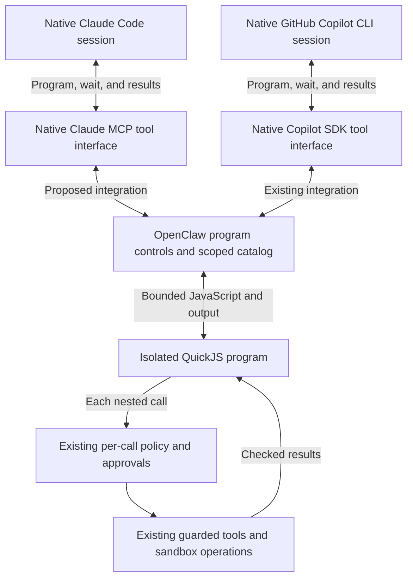

# Programmatic tool calls through OpenClaw

Status: Proposed; both native harnesses required, Claude integration gap identified
Issue: [#304](https://github.com/coletaylor788/puddles/issues/304)
Last updated: 2026-10-15

## Human section

### Design

Let agents compose several authorized tool calls in a short program, then return
the useful results. This can reduce model round trips and the amount of tool
data placed in conversation. Keep OpenClaw responsible for tool configuration,
caller identity, permissions, approvals, content guards, and delivery.

This must work through both native Claude Code and native GitHub Copilot CLI.
Keep their model loops, authentication, compaction, and session ownership in
their existing OpenClaw integrations. Prefer capabilities those harnesses already
provide. Do not migrate either to OpenClaw's generic agent loop to obtain PTC.

The proposed default uses each harness's native tool interface with OpenClaw's
existing isolated Code Mode executor. Copilot already has this integration in
the pinned source. Claude Code has the scoped MCP interface but needs the Code
Mode surface connected to it. MCPorter is a client alternative, not a required
execution engine. Neither native tool search nor a programmatic CLI invocation
alone is equivalent to a program calling several tools.

#### What changes for the agent

For a task such as finding matching records and grouping their results, the
agent can discover a tool, inspect its schema, make bounded parallel reads,
and return a compact table. Dependent calls wait for their inputs. The agent
must inspect unknown result shapes before writing transforms that assume fields.

Sensitive actions remain separate tool invocations. A program that prepares an
email and then sends it still reaches the existing approval for that email's
exact arguments. Neither starting the program nor approving an earlier action
authorizes later actions. A successful approval cannot override a content guard.

The feature changes how the agent composes tools. It does not add service
accounts, grant new tools, change recipient rules, or move reading duties out of
the existing Reader role. Lower model latency and token use are goals to measure,
not promised results.

#### Compare the approaches

| Concern | Native OpenClaw Code Mode | MCPorter through OpenClaw MCP |
|---|---|---|
| Programs | Plain JavaScript cells with loops, transforms, and async calls | JavaScript/TypeScript programs using a client library, or CLI calls |
| Discovery | Run-scoped catalog, callable search results, and schema descriptions | MCP discovery, generated types, and callable server proxies |
| Tool configuration | Uses the effective OpenClaw tool catalog | Can use OpenClaw as its sole MCP server, retaining OpenClaw's catalog |
| Approvals and guards | Nested calls use the normal OpenClaw tool path | The native MCP endpoint runs hooks and existing tools; full caller context must be supplied by the host |
| Program isolation | Bundled QuickJS guest has no ambient host access | MCPorter is a client, not a sandbox; execution and connection isolation need a supported integration |
| Libraries and portability | Restricted guest API; no arbitrary npm imports or standalone CLI generation | Node/TypeScript ecosystem, typed clients, and generated standalone CLIs |
| Waiting and limits | Built-in cell suspension, output limits, call limits, and cancellation | Client timeouts and lifecycle must fit OpenClaw's approval waits and run cancellation |
| Harness reach | Copilot SDK integration exists; Claude needs the shared controls exposed through its native MCP interface | Both harnesses can use MCP, but scripts still need an isolated MCPorter connection |
| Images and rich results | Some tools remain direct because their results cannot cross the JSON guest bridge | MCP result helpers exist; equivalent model delivery still requires verification |
| Added moving parts | Existing runtime feature and bundled executor | Additional dependency plus a qualified script-to-host connection |

Both approaches can provide the core goal: composing authorized calls and
reducing intermediate output. There is no established installed parity across
the two required harnesses. MCPorter has a real advantage for portable programs
and external libraries, but those are not required by the initial use case.

| Required harness | Verified native integration | PTC work still required |
|---|---|---|
| GitHub Copilot CLI | OpenClaw's Copilot plugin registers SDK tools and already builds the shared Code Mode surface | Verify the exact installed plugin, QuickJS selection, tool policy, and ordinary/resumed turns |
| Claude Code | OpenClaw generates a strict MCP overlay with run-bound authority; Claude owns the agent loop and MCP client | Expose the shared program controls through that overlay and bind their catalog and continuation lifetime to the admitted run |

These are native extensibility interfaces. The proposed JavaScript engine is
OpenClaw's QuickJS, not a claimed built-in PTC engine in either CLI. First-party
Claude documentation establishes MCP tool search, and GitHub documentation
establishes MCP and programmatic CLI use. The inspected material does not prove
that both CLIs expose their registered tools as functions inside an isolated
native scripting runtime. Do not assume that capability or confuse this with
Codex Code Mode. If the installed versions provide such a surface, prefer it
only after it passes the same tool, isolation, and lifecycle checks.

#### Preferred path: native harness interfaces, shared execution

Select the bundled QuickJS executor explicitly. OpenClaw's default Node executor
uses `node:vm` with gateway privileges and is not a security boundary. It is not
an acceptable replacement for guest isolation here. QuickJS evaluates the
program; any permitted shell or file tool continues to use its existing
OpenClaw sandbox. These are separate boundaries.

Use the existing catalog after normal agent, sender, channel, and tool policy
resolution. Keep required direct tools available for image and other structured
results. Do not wrap a guarded plugin's underlying MCP service separately, and
do not introduce another tool registry or approval store.

Initial qualification targets the main interactive agent with its existing
delegation tools. Reader, active-memory recall, household agents, background
work, and model/provider routing remain unchanged. Validate their denials and
result boundaries as regression cases without enabling Code Mode for them.
Use explicit per-agent activation rather than broad automatic activation.

For Copilot, retain the existing SDK registration and shared tool-surface helper.
The Copilot CLI still decides which programs to run. OpenClaw executes their
nested tools through its current wrapped implementations. Do not enable the
CLI's host shell or replace its permission policy to get a script runner.

For Claude, extend the host-owned MCP projection to expose the same program
controls and required direct-only tools. Reuse the shared tool-surface helper
after the effective catalog has been narrowed by policy and prompt hooks. The
MCP controls receive programs; credentials and tool callbacks stay in OpenClaw.
No MCPorter package or network client runs inside the QuickJS guest.

Bind this surface to the actual admitted run and active attempt, not just a
session name or the short-lived schema cache. Retire it on cancellation,
revocation, completion, or harness replacement. A warm Claude process must get
the next turn's authority without retaining the previous catalog. Apply policy
to the underlying tools before projection; allowing a program-control tool must
never become permission for every hidden tool. Avoid wrapping a nested tool's
approval hook twice or placing a program behind a scheduler lock that its own
nested call needs.

This Claude integration is a proposed maintained OpenClaw patch, not a verified
configuration switch. It must preserve direct rich-output tools, approval
forwarding, native tool restrictions, and per-call activity. Keep other MCP
clients and agents on their existing surface unless explicitly enabled.
If the shared helper cannot satisfy these contracts without a larger runtime
or security redesign, revise the proposal before implementing that expansion.

#### Alternative: MCPorter as a client of OpenClaw

Configure exactly one host-selected OpenClaw connection. Do not import MCPorter
connections from editors, user configuration, or arbitrary URLs. Do not expose
raw Gmail, calendar, browser, or other service connections to the script.
Existing guarded plugins remain the service clients and keep their credentials.

Use the native MCP grant for the admitted run. This is host-issued authority
that binds the client to the caller, session, allowed tools, and active attempt.
It is more specific than a gateway login or a session name in a request.
The grant and its active-attempt identifier must expire with the run. A program
must not choose its identity, upgrade to owner, or resolve its own approvals.

The endpoint exists, but a configuration-only sandbox connection is not yet
proven. It listens on host loopback, which is not the same as a container's
loopback. Also, the security architecture keeps gateway credentials outside
agent sandboxes. An implementation must reuse an existing supported host
transport that keeps credentials outside model-authored code. Mounting a
gateway token, enabling host networking, or running arbitrary scripts on the
trusted host would change the boundary and is not part of this proposal.

If no existing transport satisfies this requirement, stop this alternative at
design qualification. Bring back the smallest concrete adapter design and its
boundary for review. Do not create a proxy service, new grant system, or broad
host executor as an incidental implementation detail.

#### Approval, failure, and result behavior

Keep the existing owner approval channel, allow-once semantics, frozen
arguments, and post-approval content checks. Validate actual requester identity
on nested calls, not just the presence of an approval hook. Retain individual
tool audit events so one outer program does not hide its actions.

Programs may parallelize independent reads within native limits. Preserve tool
ordering rules and serialize dependent actions. Denied calls cannot be retried
through another transport or elevated scope. Catching a tool error changes
program control flow, not authorization.

An interrupted program is not a transaction. Earlier calls may have completed.
Keep existing uncertain-write handling and never replay the whole program after
a timeout, disconnect, or restart. Native Code Mode continuations are transient
and do not survive gateway restart. Report interrupted work through existing
conversation behavior and reconcile completed effects before continuing.

Content guards run before results reach the program. Transforming results does
not make untrusted data trusted or remove Reader/source restrictions. Output
limits must retain a usable indication of truncation or a scoped result
reference. Program source, results, and logs must not contain credentials.

#### Decision and qualification

Recommend the existing Copilot SDK path plus a narrow Claude MCP integration
of the same QuickJS executor. This uses both harnesses' native tool interfaces
and keeps one OpenClaw tool catalog and approval path. A native harness PTC
facility is preferable if verified to satisfy the complete contract without
extra host authority. MCPorter remains an alternative for a demonstrated gap
or a later need for portable scripts. Do not install competing paths by default.

The decision to implement remains separate from this comparison. Approval of
this design would cover the shared surface and narrow Claude integration for
the main interactive agent on both native harnesses. It would not cover a
harness migration, broader host execution, or a separate MCPorter service.
One working harness is not completion: both must pass before activation is
presented as satisfying this proposal.

### Status

**Approval:** Proposed. **Approval reference:** On 2026-10-15 the requester asked
to author this proposal, then asked for a comparison, required native Claude
Code and GitHub Copilot CLI compatibility, and preferred their native
capabilities. This authorizes design and publication. It does not approve
implementation, runtime configuration, or deployment.

The pinned Copilot integration already uses the shared Code Mode surface.
Claude has native scoped MCP access but lacks verified program-control wiring.
The proposal reuses native interfaces and extends that missing connection.
Installed parity and measured benefit remain unverified. No runtime or tool
configuration has changed.

## Agent section

### State

Design-only change on `codex/programmatic-tools-proposal`, based on public
revision `54eec5a72203188d69493e63c32d8fd0dc69113c`. No application build,
dependency installation, DEV deployment, or production probe belongs to this
documentation change.

Both native harnesses are required. Copilot's pinned `tool-bridge.ts` constructs
`createAgentHarnessToolSurfaceRuntime`, compacts effective tools, binds new
controls, and exports cleanup and `codeModeEngaged`. Claude's inspected
`cli-runner/prepare.ts` resolves and filters MCP tools but does not establish
equivalent program-control projection. This is a specific integration gap,
not evidence that the CLI must be replaced.

Concurrent harness work owns its native-tool restrictions and session routing.
Recheck its landed configuration and installed evidence before implementation.
Do not weaken those restrictions to enable PTC. Its approvals do not approve
this feature, and its source and processes remain outside this task's ownership.

### Scope and acceptance criteria

- A selected agent can discover, describe, compose, and filter only its existing
  authorized tools. An empty tool allowance stays empty.
- Both native Claude Code and native GitHub Copilot CLI execute the same
  representative program workflows without changing their model loops or auth.
- Nested calls preserve agent, session, sender, channel, run, cancellation,
  sandbox, approval, content-guard, and audit behavior.
- Existing owner-only sends and scoped agent communication retain their exact
  authorization checks. A script cannot approve an action itself.
- Model-authored programs have no ambient host access or service/gateway
  credentials. Missing executor or authority fails closed.
- No tool permission, model, harness, Reader instruction, or service credential
  changes as a side effect of activation.
- Structured/image tools retain equivalent usable output through their supported
  direct path where needed. Existing ordinary tool tasks still work.
- Interrupted work does not replay completed or uncertain writes.
- Representative multi-call tasks show correct results and useful measured
  reduction in round trips or model input, without material quality regression.

### Architecture and decisions

Source baseline: OpenClaw `eb377ac59e6c9fd6c7705028034812becf00271b`, the revision
in `packages/e2e/openclaw-patch-suite.json`. MCPorter research snapshot:
`5bcf9e178cd8c0a91888bf82a460c1a291aecced`. The latter is a source reference,
not a selected dependency version or release qualification.

| Evidence | What it establishes |
|---|---|
| [Code Mode overview][code-mode] | Generic runtime surface, catalog composition, and direct-only tools |
| [Executor documentation][executors] | Explicit QuickJS isolation; Node VM is trusted host execution |
| [Configuration][configuration] | Activation precedence, limits, and paused approval budgets |
| [Code Mode internals][internals] | Nested context, ordering, telemetry, and transient continuations |
| [MCP resolver][mcp-runtime] | Effective tools plus the grant's exact allowlist |
| [MCP handler][mcp-handler] | Before-call hooks, authority recheck, wrapper execution, and completion hooks |
| [MCP authentication][mcp-request] and [grant store][mcp-grants] | Host loopback, bearer/capture pairing, immutable caller context, and revocation |
| [MCPorter runtime][mcporter] | Discovery, client proxies, and connection lifecycle |
| [Copilot tool bridge][copilot-bridge] and [harness guide][copilot-guide] | Shared Code Mode helper already exposed through native Copilot SDK tools |
| [Claude preparation][claude-prepare] and [CLI backend guide][cli-guide] | Scoped MCP overlay, native-tool restrictions, and current projection seam |
| [Claude MCP documentation][claude-mcp] and [Copilot CLI documentation][copilot-cli] | Native MCP and discovery capabilities; not proof of a common isolated PTC API |

The native endpoint under consideration is the loopback `/mcp` runtime used by
host-managed clients. `openclaw mcp serve` is a separate channel-conversation
bridge, not this full tool-catalog interface. A generic `/tools/invoke` HTTP
login is not a substitute for run-bound delegated authority.

Relevant local contracts: [security architecture](../openclaw-setup/security-architecture.md),
[guarded Gmail](../../openclaw-plugins/secure-gmail/README.md),
[household approvals](household-native-approvals.md), and
[plugin conventions](../../openclaw-plugins/README.md). Current plugin source
governs concrete behavior; historical plan status is not live deployment proof.

Native documentation differs on the default activation state in its summary
tables. Do not rely on an omitted setting. Verify installed schema and effective
configuration and author explicit per-agent activation and executor selection.

### Implementation

After approval of a selected path:

1. Inspect the installed OpenClaw artifact, Copilot plugin and CLI, Claude Code
   executable, effective harness routing, and native PTC capabilities without
   exposing secrets. Reconcile the concurrent harness work before touching its
   integration points. Record source, installed, and configuration separately.
2. Qualify Copilot's existing shared surface with explicit QuickJS selection.
   Check SDK tool replacement, sequential scheduling, policy narrowing, native
   tool denial, catalog cleanup, and accurate `codeModeEngaged` reporting.
3. For Claude, reuse `createAgentHarnessToolSurfaceRuntime` from
   `openclaw/plugin-sdk/agent-harness-tool-runtime` to prepare the effective
   MCP program surface after tool restrictions. Extend the host grant/call
   lifecycle to retain that exact surface through waits and retire it with the
   attempt. Keep underlying allowlists distinct from advertised controls.
   Register only the resulting controls and required direct tools in the strict
   overlay. Resolve control/shell name collisions through the existing helper.
4. Cover each actual nested call with one existing policy/approval path, its
   real caller identity, cancellation, result guards, and audit activity.
   Preserve rich result transport and prohibit recursive program-control
   discovery. Do not create a second scheduler, approval store, or grant issuer.
5. Maintain the narrow upstream change as a public patch with registered
   regressions. Keep environment activation in a separately isolated companion
   worktree. Enable only the approved agent, explicitly, on both routes. Do not
   change models, credentials, fallback policy, or other agents' settings.
6. If a verified native harness PTC facility can satisfy the same design with
   less integration, document that equivalent implementation choice. If neither
   the shared helper nor native facilities can meet the contract, report the
   concrete blocker before proposing MCPorter transport or broader execution.

### Validation

For this proposal, inspect formatting, links, publication boundaries, and the
complete documentation diff. Do not run application tests for prose changes.
The source documentation and implementations above were read; no mcporter or
Code Mode execution has been tested in the installed environment.

Implementation qualification runs independently on both real native harnesses
and their installed tools, with synthetic data and recording adapters for all
delivery and mutations:

| Case | Required observation |
|---|---|
| Baseline versus program | Same authorized tools and answers; report latency, model round trips, and token usage where available |
| Denied/owner-only tool | Absent or denied for the same caller; guessed names and forged identity cannot widen access |
| Approved send | Recorded owner decision gates exact final arguments; content block still prevents dispatch |
| Denial and timeout | Zero recorded dispatch; approval wait exceeds ordinary cell time budget without bypass |
| Cancellation/revocation | Pending or queued work stops; stale run/session handles cannot resume it |
| Partial completion/restart | Earlier recorded write is not repeated; uncertain outcome remains uncertain |
| Guarded content | Injection, secret, error, and attachment fixtures retain their existing protections |
| Reader and household | Existing delegation, source labeling, resource scope, and answer approvals still hold |
| Parallelism and limits | Independent reads overlap; sequential tools retain ordering; over-limit work fails visibly |
| Guest boundary | No host filesystem, network, process, module import, credentials, or self-approval path |
| Rich output and large results | Direct-only tools remain usable; bounded output does not silently corrupt results |
| Fresh/resumed/fallback runs | Active runtime is identified; unsupported harness does not claim activation or change routes |
| Cross-harness continuation | A new attempt gets its own catalog; stale handles cannot cross harnesses and completed effects are not replayed |
| Claude MCP projection | Final restrictions apply to hidden tools; outer controls cannot widen the grant or approve themselves |
| Copilot SDK controls | Code Mode remains inside the native CLI loop; no duplicated hooks or scheduler deadlock |

Run focused package and upstream regressions in local development, then the same
installed behavior checks in DEV and TEST. Register any maintained upstream
tests in the cumulative patch suite. A passing isolated executor test is not
proof that the configured model uses it correctly. Include bounded real-model
tasks with recorded external effects before claiming benefit or readiness.

### Rollout and rollback

Only an approved implementation enters the application release lifecycle.
Follow [deployment coordination](../../packages/e2e/DEPLOYMENT_COORDINATION.md)
and the [application runner](../../packages/e2e/README.md). The manager promotes
one frozen output through the full application gate, TEST, backup, PROD,
read-only acceptance, and source merge. Do not reserve that lane for this plan.

Production acceptance reads effective configuration, executor readiness, and
bounded health evidence. It never delivers an approval message or service write.
Physical approval acceptance remains a separately reported result.

For feature rollback, return the selected agent to its prior explicit tool
surface through the managed configuration path. Cancel and retire affected
continuations rather than replaying them. If runtime restoration is required,
use the release controller's coherent artifact/configuration/state recovery.
Never restore over accepted new writes. Finalize owned generated resources after
source publication and after recovery/consumer checks.

### Review log

Author review checked the native MCP path, Code Mode, and the Copilot SDK bridge.
Copilot already projects the shared controls in source. Claude needs that
connection implemented and verified. Neither installed parity nor an isolated
MCPorter connection is represented as proven. Independent behavior review
belongs to implementation; this proposal has not received an independent
architecture review.

### Checklist

- [x] Compare MCPorter with native Code Mode at the pinned OpenClaw revision.
- [x] Preserve the current security and approval responsibilities in the design.
- [x] Separate source capabilities from installed parity and measured benefit.
- [x] Publish the proposal and link its tracking issue.
- [ ] Obtain approval of the selected approach and agent scope.
- [ ] Qualify both native harnesses, isolated execution, and tool parity.
- [ ] Implement and independently review any approved configuration or code.
- [ ] Complete DEV, cumulative application checks, TEST, and PROD acceptance.
- [ ] Merge tested source and finalize owned resources.

[code-mode]: https://github.com/openclaw/openclaw/blob/eb377ac59e6c9fd6c7705028034812becf00271b/docs/tools/code-mode.md
[executors]: https://github.com/openclaw/openclaw/blob/eb377ac59e6c9fd6c7705028034812becf00271b/docs/tools/code-mode/executors.md
[configuration]: https://github.com/openclaw/openclaw/blob/eb377ac59e6c9fd6c7705028034812becf00271b/docs/tools/code-mode/configuration.md
[internals]: https://github.com/openclaw/openclaw/blob/eb377ac59e6c9fd6c7705028034812becf00271b/docs/tools/code-mode/internals.md
[mcp-runtime]: https://github.com/openclaw/openclaw/blob/eb377ac59e6c9fd6c7705028034812becf00271b/src/gateway/mcp-http.runtime.ts
[mcp-handler]: https://github.com/openclaw/openclaw/blob/eb377ac59e6c9fd6c7705028034812becf00271b/src/gateway/mcp-http.handlers.ts
[mcp-request]: https://github.com/openclaw/openclaw/blob/eb377ac59e6c9fd6c7705028034812becf00271b/src/gateway/mcp-http.request.ts
[mcp-grants]: https://github.com/openclaw/openclaw/blob/eb377ac59e6c9fd6c7705028034812becf00271b/src/gateway/mcp-grant-store.ts
[mcporter]: https://github.com/openclaw/mcporter/blob/5bcf9e178cd8c0a91888bf82a460c1a291aecced/docs/mcp.md
[copilot-bridge]: https://github.com/openclaw/openclaw/blob/eb377ac59e6c9fd6c7705028034812becf00271b/extensions/copilot/src/tool-bridge.ts
[copilot-guide]: https://github.com/openclaw/openclaw/blob/eb377ac59e6c9fd6c7705028034812becf00271b/docs/plugins/copilot.md
[claude-prepare]: https://github.com/openclaw/openclaw/blob/eb377ac59e6c9fd6c7705028034812becf00271b/src/agents/cli-runner/prepare.ts
[cli-guide]: https://github.com/openclaw/openclaw/blob/eb377ac59e6c9fd6c7705028034812becf00271b/docs/gateway/cli-backends.md
[claude-mcp]: https://code.claude.com/docs/en/mcp
[copilot-cli]: https://docs.github.com/en/copilot/concepts/agents/copilot-cli/about-copilot-cli
