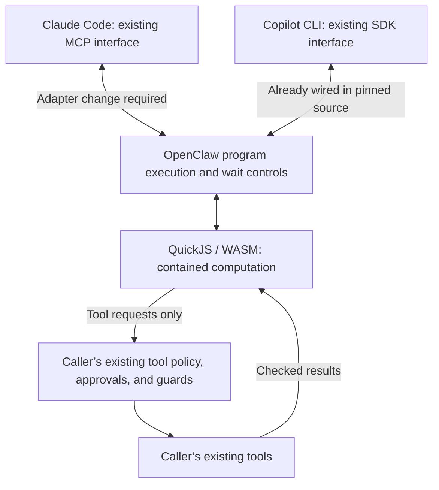

# Programmatic tool calls through OpenClaw

Status: Proposed
Issue: [#304](https://github.com/coletaylor788/puddles/issues/304)
Last updated: 2026-10-15

## Human section

### Design

Let every agent compose its existing tools in a contained JavaScript program.
The program can loop, transform results, and make dependent or parallel calls,
then return useful output. This may reduce model round trips and context usage.
There is no separate list of tools approved for scripting. Each agent retains
its existing catalog, identity, permissions, approvals, and content guards.

Support native Claude Code and GitHub Copilot CLI. Keep their own model loops,
authentication, compaction, and sessions. Prefer native capabilities when they
meet this contract. The verified integration points are their native tool
interfaces; a common built-in scripting engine has not been established.

#### Script boundary

Use OpenClaw’s QuickJS executor explicitly. It evaluates JavaScript inside a
WebAssembly guest in a host worker. The guest is the security boundary; the
worker thread is not. Running the interpreter on the host does not itself give
the script host privileges. OS isolation of the interpreter is not required.

The script may compute in its own memory, produce bounded output, and invoke
the agent’s existing tools. It must have no independent filesystem, shell,
network, environment, credential, or administration access. External effects
must go through existing authorized tools and their checks. Managed execution
state and continuations must remain scoped to the caller.

Audit the whole bridge, including helpers for skills, delegation, saved results,
and node access. Helpers must not grant capabilities beyond the existing tool
catalog. Route such operations through existing tools or disable the helper.
Never use or fall back to the default Node `vm` executor, which is explicitly
not a security boundary.

Source review has not demonstrated a host RCE vulnerability. It is also not
proof against runtime or bridge vulnerabilities. Approvals mediate tool calls;
they cannot contain a runtime escape. Qualify the actual QuickJS runtime and
bridge before activation, separately from downstream shell-tool sandboxing.

#### What Claude needs

In the pinned OpenClaw version, the built-in Claude Code adapter exposes
ordinary OpenClaw tools through a scoped MCP connection. It does not wire up
the shared Code Mode interface. Copilot’s adapter already does through its SDK.
This is an OpenClaw adapter integration gap, not a missing MCP capability in
Claude Code, and not a verified configuration-only change.

Extend the Claude adapter to expose the shared execution and wait controls
through its existing MCP connection. Bind their underlying catalog to the
current caller and run. Preserve that context during waits, refresh it for a
new turn, and retire it on completion, cancellation, or revocation. Reuse
OpenClaw’s executor and approval path; do not build another agent loop or give
Claude’s native shell extra authority. Preserve direct tools where rich output
cannot pass through a program.

#### Scope and behavior

Target all agents, including readers, delegated agents, household agents, and
background agents. Each keeps its own restrictions. Tool-less runs gain no
tools. Roles, models, credentials, and routing stay unchanged.

Each nested call gets the same identity checks, approvals, guards, ordering,
and audit events as a direct call. Approval of a program or earlier call does
not approve later actions. Parallelize independent work within limits.
Cancellation must stop pending work. Programs are not transactions: interrupted
runs must not replay completed or uncertain writes. Continuations do not
survive a Gateway restart. Both native harnesses must qualify before claiming
support for the proposal.

### Status

**Approval: Proposed.** The requester authorized design and publication, required
both native harnesses and all-agent scope, and specified contained scripts with
no independent external effects. OS isolation is not required. Implementation,
configuration changes, and deployment remain unapproved.

Copilot’s shared controls exist in pinned source. Claude needs adapter wiring.
Runtime containment, installed parity, and measured benefit remain unverified.
No runtime or tool configuration has changed.

## Agent section

### State

Documentation only. The design covers all agents and both native harnesses.
Keep the implementation separate from concurrent harness work; reuse its landed
restrictions and routing without modifying another owner’s source or processes.

### Scope and acceptance criteria

- All agents can compose their existing tools without a second tool allowlist.
- Programs have no independent host capabilities; auxiliary APIs add none.
- Nested calls preserve caller context, permissions, approvals, content guards,
  cancellation, ordering, sandbox behavior, and audit events.
- Both native harnesses retain their own loops and support fresh/resumed runs.
- Direct rich output remains usable; uncertain writes are never replayed.
- Representative tasks retain quality and demonstrate measured benefit.

### Architecture and decisions

Baseline: OpenClaw `eb377ac59e6c9fd6c7705028034812becf00271b`, pinned in
`packages/e2e/openclaw-patch-suite.json`. Source support is not installed proof.

| Source | Finding |
|---|---|
| [Executor guide][executors] and [QuickJS worker][worker] | WASM guest in a host worker; Node VM is not a security boundary |
| [Copilot bridge][copilot] | Uses `createAgentHarnessToolSurfaceRuntime` to expose shared controls |
| [Claude preparation][claude] | Projects scoped MCP tools; equivalent Code Mode wiring is missing |
| [Runtime internals][internals] | Nested context, ordering, and transient continuations |

Use the existing run-scoped MCP connection, not an operator token or a second
tool registry. Apply underlying tool policy before exposing program controls.
Allowing a control must never authorize otherwise hidden tools. Preserve the
[security architecture](../openclaw-setup/security-architecture.md) and existing
plugin guards. Explicitly select QuickJS across agents; missing or unavailable
execution must fail closed.

### Implementation

After design approval:

1. Verify installed versions and configuration. Inspect QuickJS/WASM imports,
   host callbacks, auxiliary APIs, and dependency versions against the contract.
2. Qualify Copilot’s existing integration. Extend Claude’s MCP projection with
   the shared controls and run-bound catalog/continuation lifecycle. Avoid
   duplicate approval hooks and scheduler locks that block nested calls.
3. Maintain required upstream changes as patches with registered regressions.
   Configure all agents through an isolated companion worktree. Preserve each
   agent’s tools and restrictions; do not enable native host execution.

### Validation

For this document, review accuracy, links, and the complete diff. No application
build or runtime tests are needed for prose changes.

Implementation must test both installed harnesses with synthetic data and
recording adapters for external effects. Cover direct/program permission parity,
approval and guard failures, guest/bridge capability denial, cross-agent and
stale-handle isolation, cancellation, interrupted writes, resource limits,
rich output, and fresh/resumed/fallback runs. Safe capability probes do not prove
absence of escape vulnerabilities. Include real-model tasks to measure quality,
round trips, latency, and context usage.

### Rollout and rollback

After approval, follow the normal [application lifecycle](../../packages/e2e/README.md)
and [release coordination](../../packages/e2e/DEPLOYMENT_COORDINATION.md): DEV,
independent behavior review, full application gate, TEST, and managed production
promotion. Production checks remain read-only. No rollout is authorized by this
proposal’s publication.

Rollback restores affected agents’ prior tool surface and retires continuations
without replay. Use managed runtime/configuration/state recovery when needed;
never restore over new live writes. Finalize owned resources after publication
and recovery checks.

### Review log

Author reviewed the pinned executor, worker, Copilot bridge, Claude preparation,
and runtime documentation. No independent behavior review or installed execution
qualification has occurred. Those belong to implementation.

### Checklist

- [x] Publish the all-agent design and explain the Claude adapter gap.
- [x] Define contained computation with effects only through existing tools.
- [ ] Obtain implementation approval.
- [ ] Qualify QuickJS and the complete bridge; implement Claude integration.
- [ ] Verify both native harnesses and all agent roles.
- [ ] Complete review, release gates, source merge, and cleanup.

[executors]: https://github.com/openclaw/openclaw/blob/eb377ac59e6c9fd6c7705028034812becf00271b/docs/tools/code-mode/executors.md
[worker]: https://github.com/openclaw/openclaw/blob/eb377ac59e6c9fd6c7705028034812becf00271b/extensions/code-mode-quickjs/src/code-mode.worker.ts
[copilot]: https://github.com/openclaw/openclaw/blob/eb377ac59e6c9fd6c7705028034812becf00271b/extensions/copilot/src/tool-bridge.ts
[claude]: https://github.com/openclaw/openclaw/blob/eb377ac59e6c9fd6c7705028034812becf00271b/src/agents/cli-runner/prepare.ts
[internals]: https://github.com/openclaw/openclaw/blob/eb377ac59e6c9fd6c7705028034812becf00271b/docs/tools/code-mode/internals.md
