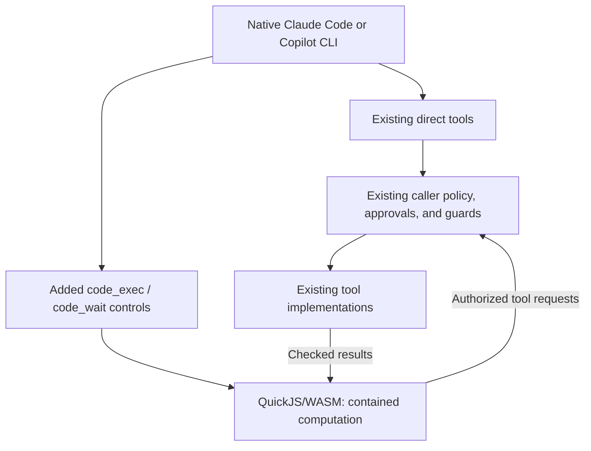

# Programmatic tool calls through OpenClaw

Status: Proposed; source audit complete
Issue: [#304](https://github.com/coletaylor788/puddles/issues/304)
Last updated: 2026-10-15

## Human section

### Design

Give every tool-enabled agent an optional contained script runner alongside its
existing direct tools. A script can transform data and compose dependent or
parallel calls. Each agent keeps its existing catalog, identity, permissions,
approvals, and guards. There is no separate tool allowlist for scripting.

Keep native Claude Code and GitHub Copilot CLI, including their model loops,
authentication, compaction, and sessions. Use their existing MCP and SDK tool
interfaces with OpenClaw's QuickJS executor.

#### Keep direct calls

Upstream Code Mode normally hides tools behind its `exec` and `wait` controls.
That does not meet this request. Add an additive surface that retains existing
direct tools and introduces `code_exec` and `code_wait`. Keep shell `exec`
unchanged. Scripts cannot call their own controls recursively.

Use one catalog and the same authorized implementations for both paths.
Preserve direct rich output and existing discovery behavior. Keeping direct
tools means we do not claim savings from hiding their schemas; measure savings
from fewer round trips and returning compact results.

#### Contain scripts

QuickJS runs inside WebAssembly in a host worker. The WASM guest provides
isolation; the worker thread does not. The audited runtime has no guest access
to host modules, files, processes, networking, or environment. OS isolation of
the interpreter is not required. Use the bundled QuickJS executor explicitly,
and reject Node VM execution in the additive surface.

The bridge needs two changes to satisfy “effects only through existing tools”:

- Remove skill convenience APIs and reject their bridge requests. Their reader
  can access host files outside normal tool dispatch. Agents can still use
  their existing authorized reading tools.
- Remove swarm convenience APIs and reject their bridge requests. Although
  spawning uses a tool, waiting and progress events use separate host paths.
  Existing delegation tools remain available directly and inside scripts.

Keep catalog calls, MCP/node wrappers that dispatch through that catalog,
bounded output, timers, and caller-scoped in-memory results. Deny the WASI
runtime's raw stdout/stderr writes; script output uses the bounded controller.
Do not add module loaders, filesystem mounts, network imports, or credentials.

The source audit and isolated probes found no demonstrated host-code escape.
They establish the intended capability boundary, not a guarantee against all
engine vulnerabilities. Approvals protect tool calls, not a runtime escape.

#### Connect Claude

The pinned built-in Claude adapter exposes ordinary OpenClaw tools over MCP,
but does not connect the shared Code Mode controls. Copilot already connects
them through its SDK. Both need the additive surface; Claude additionally needs
that missing adapter wiring.

Expose the controls through Claude's existing MCP connection. Keep the original
tool allowlist separate from the added control names. Bind the catalog, results,
and paused programs to the admitted run and grant generation. Reuse the MCP
call checks for every nested invocation. Dispose that state when authority is
replaced, revoked, or completed, including warm-process turn changes.

#### Preserve behavior

Apply this to all agents and their existing restrictions. Tool-less runs gain
no tools. Roles, models, credentials, routing, and native host-tool restrictions
stay unchanged. Every nested action retains its own approval, content checks,
ordering, cancellation, and audit event. Starting a script approves no action.

Programs are not transactions. Never replay completed or uncertain writes after
interruption. Continuations remain transient and cannot survive Gateway restart.

### Status

**Approval: Proposed.** The requester authorized the audit, design, and publication;
required all agents, both native harnesses, and retained direct calls; and chose
contained scripting without OS isolation. Implementation and deployment remain
unapproved.

The source audit is complete and the required changes are specified below.
Installed integration tests and benefit measurements are implementation gates.
No runtime or tool configuration has changed.

## Agent section

### State

Documentation only. The proposal now specifies implementation rather than
leaving bridge policy or adapter design to a later investigation. Coordinate
with the existing harness work through its landed source and restrictions.

### Scope and acceptance criteria

- Preserve every existing direct tool and its behavior; add optional scripting.
- Give scripts exactly the caller's existing tool authority and no independent
  host capabilities. Controls cannot appear in their own catalog.
- Support all tool-enabled agent roles and both native harnesses.
- Preserve per-call approvals, guards, sandboxing, audit, and cancellation.
- Preserve rich results and prohibit replay of uncertain writes.
- Demonstrate correct multi-call tasks and measure round trips, latency, and tokens.

### Architecture and decisions

Audited OpenClaw revision: `eb377ac59e6c9fd6c7705028034812becf00271b`, pinned in
`packages/e2e/openclaw-patch-suite.json`. Audited its exact `quickjs-wasi@3.6.0`
package, including the WASM imports, JS embedder, and encoding extension.

| Audited path | Finding and decision |
|---|---|
| [Worker][worker], [executor][executor], [QuickJS package][quickjs] | No module loader; encoding is the only loaded extension. WASI imports supply time, randomness, output, and descriptor stubs, not file opening, sockets, or processes. Keep this runtime; override `fd_write` to deny raw host output on creation and restore. |
| [Bridge][bridge], [skill reader][skills], [swarm handlers][swarm] | Reject `skillsList`, `skillsRead`, `agentSpawn`, `agentWait`, and `swarmNote` in the additive surface, and omit their guest globals/docs. Enforcement belongs on the host as well as in the guest. |
| [Namespaces][namespaces], [results][results] | MCP and node effects use catalog dispatch; API descriptions are virtual data. Saved results are bounded memory scoped to agent/run/session/catalog. Retain these paths. |
| [Catalog projection][projection], [harness surface][surface] | Current projection hides direct tools and names controls `exec`/`wait`. Add a separate additive projection over the same catalog. |
| [Claude preparation][claude], [MCP dispatcher][dispatcher], [grant store][grants] | Claude lacks the shared controls. MCP dispatch owns hooks and authorization; grant replacement already emits invalidation. Extend those seams. |
| [Copilot bridge][copilot] | Reuse its admitted wrappers, nested executor, and cleanup. Switch to additive projection without duplicating hooks. |

Preserve the [security architecture](../openclaw-setup/security-architecture.md).
These are capability restrictions within the requested runtime boundary, not an
OS-isolation change or a replacement approval system.

### Implementation

After approval, deliver two maintained upstream patches and companion activation:

1. **Shared additive surface.** Add `tools.codeMode.surface: "additive"` with
   existing compact behavior as the upstream default. Register the caller's
   filtered tools in the existing catalog while retaining the direct surface.
   Add `code_exec`/`code_wait`; fail on name collisions. Update control identity,
   descriptions, prompt-policy handling, and wrapper metadata so controls are
   recognized by their role, not confused with shell `exec`. Keep discovery
   controls direct but exclude orchestration controls from script recursion.
   Use the same projection in core and native harness paths. Require bundled
   QuickJS, reject Node selection, disable the five bridge methods above, and
   deny raw WASI output. Apply restrictions on fresh and resumed cells.
2. **Claude MCP integration.** Keep `toolsAllow` as the underlying authority;
   advertise controls separately after prompt-policy filtering. Retain one shared
   tool-surface runtime per active admitted grant generation, outside the short
   schema cache. Extract the dispatcher's prepare/hook/authorize/execute/result
   sequence into a shared invocation helper used by direct and nested calls.
   Return guarded raw results to Code Mode before MCP serialization. Recheck
   current grant authority on every call, including after approval. Connect
   grant replacement/revocation and run cleanup to catalog disposal and abort.
   Reuse catalog scheduling without locking the outer control against its own
   nested calls. Refresh prompt/schema and grant context for warm Claude turns.
3. **Activation.** In an isolated companion worktree, explicitly enable the
   additive QuickJS surface for all tool-enabled agents. Preserve existing
   restrictions and routing. Do not alter another owner's harness worktree.

### Validation

Audit evidence: verified npm tarball integrity; enumerated actual engine and
encoding WASM imports; read all 15 bridge handlers and their downstream paths.
Isolated probes used Node 24.2.0 and the exact published QuickJS package. Twelve
ambient host APIs were absent, constructor-created functions stayed in the
guest, Node imports failed, and local computation worked. The original guest
controller, with recording callbacks only, hid host callbacks, rejected virtual
API path traversal, retained console output locally, and emitted helper requests
without executing real tools. No application build or live service call ran.

Implementation regressions must cover retained direct calls, control-name
collisions, allowed/denied nested calls, exact approval arguments, post-approval
guards, rejected helper requests, missing QuickJS, fresh/resumed restrictions,
cross-agent/result-handle isolation, warm grant replacement, cancellation,
resource limits, rich output, and interrupted writes. Run both real native
harnesses with synthetic data and recording adapters. These verify the delivered
implementation; they are not unresolved design questions or proof against every
possible runtime vulnerability.

### Rollout and rollback

Follow the [application lifecycle](../../packages/e2e/README.md) and
[release coordination](../../packages/e2e/DEPLOYMENT_COORDINATION.md) after approval:
DEV, independent review, full application gate, TEST, and managed production
promotion. Production checks remain read-only.

Rollback disables the added controls, restores prior configuration, and retires
continuations without replay. Use managed recovery when needed; never restore
over new live writes. Finalize owned resources after publication and recovery checks.

### Review log

Completed source and dependency audit plus isolated engine/controller probes.
Found concrete mismatches in compact-only projection and auxiliary bridge
capabilities. The design addresses them. No production qualification or
independent implementation review is claimed.

### Checklist

- [x] Complete source/dependency audit and bounded capability probes.
- [x] Specify additive projection, bridge restrictions, and Claude integration.
- [ ] Obtain implementation approval.
- [ ] Implement both patches and activation; add durable regressions.
- [ ] Verify both native harnesses and all agent roles.
- [ ] Complete review, release gates, source merge, and cleanup.

[worker]: https://github.com/openclaw/openclaw/blob/eb377ac59e6c9fd6c7705028034812becf00271b/extensions/code-mode-quickjs/src/code-mode.worker.ts
[executor]: https://github.com/openclaw/openclaw/blob/eb377ac59e6c9fd6c7705028034812becf00271b/extensions/code-mode-quickjs/src/executor.ts
[quickjs]: https://www.npmjs.com/package/quickjs-wasi/v/3.6.0
[bridge]: https://github.com/openclaw/openclaw/blob/eb377ac59e6c9fd6c7705028034812becf00271b/src/agents/code-mode-bridge.ts
[skills]: https://github.com/openclaw/openclaw/blob/eb377ac59e6c9fd6c7705028034812becf00271b/src/agents/code-mode-skills.ts
[swarm]: https://github.com/openclaw/openclaw/blob/eb377ac59e6c9fd6c7705028034812becf00271b/src/agents/code-mode-swarm.runtime.ts
[namespaces]: https://github.com/openclaw/openclaw/blob/eb377ac59e6c9fd6c7705028034812becf00271b/src/agents/code-mode-namespaces.ts
[results]: https://github.com/openclaw/openclaw/blob/eb377ac59e6c9fd6c7705028034812becf00271b/src/agents/code-mode-results.ts
[projection]: https://github.com/openclaw/openclaw/blob/eb377ac59e6c9fd6c7705028034812becf00271b/src/agents/code-mode.ts
[surface]: https://github.com/openclaw/openclaw/blob/eb377ac59e6c9fd6c7705028034812becf00271b/src/agents/harness/tool-surface-bridge.ts
[claude]: https://github.com/openclaw/openclaw/blob/eb377ac59e6c9fd6c7705028034812becf00271b/src/agents/cli-runner/prepare.ts
[dispatcher]: https://github.com/openclaw/openclaw/blob/eb377ac59e6c9fd6c7705028034812becf00271b/src/gateway/mcp-http.handlers.ts
[grants]: https://github.com/openclaw/openclaw/blob/eb377ac59e6c9fd6c7705028034812becf00271b/src/gateway/mcp-grant-store.ts
[copilot]: https://github.com/openclaw/openclaw/blob/eb377ac59e6c9fd6c7705028034812becf00271b/extensions/copilot/src/tool-bridge.ts
