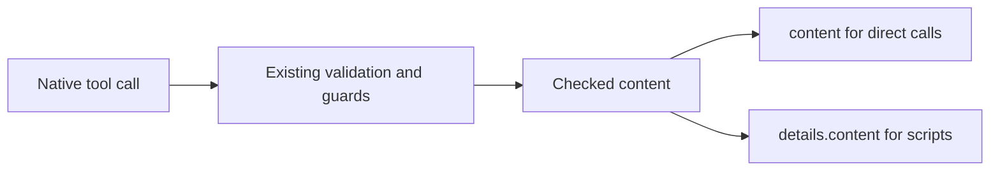

# Script-compatible tool results

Status: Implemented, deployment qualification pending
Issue: https://github.com/coletaylor788/puddles/issues/336
Last updated: 2026-10-26
Owner: PTC tool repair

## Human section

### Design

OpenClaw Code Mode returns a native tool's `details` value to JavaScript. Gmail,
Rocket Money and Apple PIM currently put their useful response only in `content`.
A script therefore receives metadata even when the underlying call succeeded.

Keep the existing plugins and native Code Mode contract. Return the checked
content blocks in `details.content` as well as `content`, preserving existing
metadata. Error and blocked responses follow the same rule. Secure Apple Calendar
has the same mismatch; its modified response must also stop retaining the raw
MCP envelope in `details.original`. Do not expose raw `structuredContent` or
transport metadata.

Apple PIM is a separately installed npm plugin. Pin its existing version 3.7.22
and carry the small result-helper correction with pnpm's dependency patch support.
Correct both published source and compiled entry. Use the host OpenClaw SDK as a
peer and select the compiled runtime entry. The companion build packages this
plugin and selects it through normal configuration, ahead of the older global
install. Tool names, schemas, handlers and data markings remain unchanged.
The application packager resolves dependencies from the real pnpm package
location, including sibling virtual-store dependencies. It still excludes the
root plugin’s host SDK peer. This does not patch OpenClaw core or add another
runtime adapter.

### Status

Approval: Production approved. The requester said, "Okay approved to fix the
tools so they’re compatible." This approves the result compatibility repair
previously proposed for Gmail, Rocket Money and Apple PIM, with existing guards
and direct-call behavior preserved. The calendar adapter's identical defect is
included. The unrelated old artifact retention repair remains parked.

The requester directed delivery through `build`, `ci-dev` and `ci-prod`, with
CI owning deployment, tests, merge, rollback and cleanup. Yield after dispatch
and resume on the durable lifecycle event. Implementation and local packaged
qualification pass. DEV passed; production admission required a refresh after
main advanced. The refreshed candidate must pass DEV again.

## Agent section

### State

Public branch `codex/ptc-tool-results` rebased from main
`31a98d689f4b335e922a64fb93569be78b0c27d2`.
Paired private state records companion paths and base. Existing work was preserved.

### Scope and acceptance criteria

- Scripted success, redacted, blocked and error responses contain usable output.
- Direct content and existing result metadata remain available.
- Raw provider envelopes cannot bypass redaction through details.
- Gmail unknown-send and Rocket Money unknown-write guidance survive projection.
- Apple PIM retains all five tool factories and existing data markings.
- No live external writes in tests, no guard or approval bypass.

### Architecture and decisions

Native Code Mode intentionally projects `AgentToolResult.details` in
`src/agents/code-mode-bridge.ts` at the pinned OpenClaw revision. Keep this
contract. Scripts consume `result.content` after awaiting a tool.

Only data already selected for the model belongs in details. Do not promote
backend structuredContent, original results or private metadata. Apple PIM's
single helper receives its existing marked output and safe local errors.

### Implementation

Modify Gmail, secure calendar and Rocket Money result builders. Include Gmail's
send receipt builder so uncertain outcomes retain their explanation. Pin Apple
PIM and repair its published helper in the dependency patch. Package and select
it through the companion application with explicit recording CLI paths in DEV
and TEST. Preserve the existing global installation for recovery.

### Validation

Focused plugin suites: 173 tests passed. Added regressions cover script-visible
content, backend errors, redaction, guard blocks and uncertain writes.
Native QuickJS regression passed against the composed pinned runtime. Companion
configuration and CI-control suites passed 39 tests. The compiled four-plugin
scenario passed with local fixtures and no external writes. Both new regressions
are registered in the maintained application test inventories. Four package
selection tests pass, including a pnpm sibling-dependency regression. Retained review
identified and resolved the missing registrations; retained review is clear. CI owns installed DEV and production qualification.

### Rollout and rollback

Refresh both main bases before submission. Commit and review paired heads,
register the incremental application with the installed `build` entry point, dispatch
`ci-dev`, and yield. On its terminal receipt, dispatch the same frozen candidate
through `ci-prod` after required checks and freshness validation. Leave submitted
output unchanged until its source submission has `queueClosedAt`. Changed inputs
require a new build and DEV run. CI owns recovery and cleanup.

### Review log

Retained reviewer found missing cumulative test registrations in both repositories.
Both are fixed and independently verified. Final result: CLEAR. The complete packaged four-tool QuickJS scenario passed.
DEV passed on the prior candidate. The refreshed paired composition requires
new installed DEV and production qualification. The first build exposed the
packager’s direct-child-only dependency lookup; root lookup now matches the
existing transitive lookup. Retained review independently passed all four package tests and cleared the repair.

### Checklist

- [x] Human approval recorded.
- [x] Existing candidate preserved and current main fetched.
- [x] Focused adapter regressions pass.
- [x] Native script and compiled-plugin regressions pass.
- [x] Retained review resolved.
- [ ] Current paired heads frozen and DEV passes.
- [ ] Production receipt, exact merge and cleanup verified.
