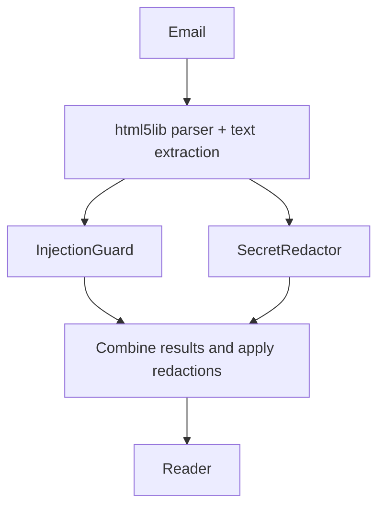

# Readable HTML email

Status: Reviewed and DEV validated; release validation pending
Issue: https://github.com/coletaylor788/puddles/issues/295
Last updated: 2026-10-14

## Human section

### Design

HTML-only emails can return an empty plain-text body. Large HTML responses can also exceed tool limits and leave the reader with an inaccessible file reference.

Convert HTML into plain text before either security guard or the reader receives it:

Use Python's [html5lib](https://html5lib.readthedocs.io/en/latest/) with its standard ElementTree tree builder to parse supplied email bytes into a document tree. It is an HTML parser, not a browser or JavaScript engine. Pin the reviewed dependency version during implementation.

A small extraction function walks only allowlisted body elements and emits their text plus paragraph/list/table separators. Preserve prices and dates. Skip entire script/style subtrees, comments, embedded objects and unsupported subtrees; copy no attributes. The parser itself does not remove scripts: our extraction policy does. Never load external resources.

Construct a fresh text-only response. Raw HTML must not appear in results, details, errors or fallback paths. Reject reader requests for raw HTML. Run conversion with enforced network, filesystem and resource restrictions.

Keep the injection guard and reader prompt: malicious instructions can still appear in ordinary text. Scan the complete extracted text once per guard and return one response. No chunking, pagination or new size-preflight checks. Let existing provider and harness limits fail through their normal handling. Do not retry with raw HTML or treat an overflow response as a successful full read. Existing guard failures remain fail-closed.

### Status

**Approval:** Production approved. **Approval reference:** The requester said “approved, ship it” on 2026-10-14, after agreeing to this design. Scope includes implementation, validation, release, merge and cleanup. No chunking or paging, and no real email examples.

Implementation, focused offline tests and independent review pass. The installed DEV checks pass for readable email and reader guidance across ordinary, spawned and resumed sessions. The release manager owns the remaining full suite, TEST, production validation and source merge.

## Agent section

### State

Feature branch `codex/readable-email`, PR #296. Reviewed behavior is public `173e0356` on base `e3180599`. Companion changes are tracked separately. All fixtures are synthetic; production is unchanged. The front-of-queue rebase must include subsequent changes to main.

### Scope and acceptance criteria

Readable HTML email without exposing scripts or raw HTML to either guard or the reader.

### Architecture and decisions

Extract text in the email integration. Run both guards in parallel on the same complete result and apply redactions before returning it. Reuse existing guard and harness failure handling. Keep parser resource containment separate from model/tool size handling; no new email size-routing mechanism is needed.

### Implementation

`servers/gmail-mcp/src/gmail_mcp/{html_text,html_worker,readable}.py` implement extraction and containment. `server.py` selects readable MIME content. `openclaw-plugins/secure-gmail/src/readable-email.ts` validates and rebuilds the envelope before existing parallel hooks.

macOS uses Seatbelt after trusted imports; Linux requires bubblewrap with read-only runtime mounts and no network namespace access. The worker has CPU and wall deadlines, no inherited credentials or extra descriptors, no core dumps or file writes, and a Linux address-space limit. macOS does not support that address-space limit.

Reader guidance reports failed or incomplete reads without raw retries. The dependency lock adds only html5lib and its two dependencies.

### Validation

Focused results: 260 Python tests, 91 secure-gmail tests, and five companion guidance tests pass. The legacy live-account test module is retired and direct invocation collects no executable tests. The broad suite skips that module. Packaged encoding regressions pass with the actual parser, MCP server, plugin and both guards using recording adapters. Hosted repository and code analysis checks pass. Installed DEV acceptance passed: the packaged email route, complete authored configuration and native reader guidance scope/restart checks. Both the application output and installed DEV tree have digest `5ec736e12c8ce22d3ed1a59d3bfa826d3811ef6eedf350c2f031cf84fcc30c29`. Recording acceptance reports zero external writes.

Require thorough parser unit tests and guarded-route tests covering:

- Complex nested layouts, tables, footnotes and mixed MIME parts.
- Scripts, attributes, embedded content, malformed tags and encodings.
- Empty bodies, Unicode, large inputs and existing provider/harness overflow handling.
- Guard blocks, redaction expansion and failures; no early release, silent truncation or raw fallback.
- Combined hostile cases, generated variations and retained regressions.
- Failures and every output channel, including details and errors.

Assert both that excluded payloads never reach either guard or the reader, and that legitimate text survives accurately. Verify guard routing with recording adapters. The installed scenario exercises the packaged parser, MCP server, real plugin and both guards with a fake Gmail service and model. Separately qualify reader guidance in the application suite.

### Rollout and rollback

Follow the normal release process. Never fall back to raw HTML on failure.

### Review log

Prior review found two MIME defects: filename-only attachments disrupted downloads, and early HTML decoding lost encoding information. Both are corrected with offline and contained-worker regressions. The prior reviewer could not be resumed after chat recovery. Replacement `email_review_recovery` completed the full public and companion diff plus deployment callback review with no material findings. It independently passed 60 focused Python tests, including real macOS containment and encodings, and five guidance lifecycle tests.

### Checklist

- [x] Design agreed and test expectations recorded.
- [x] Implementation, focused validation, independent review and installed DEV acceptance.
- [ ] Full application suite, TEST, production acceptance, merge and cleanup.
