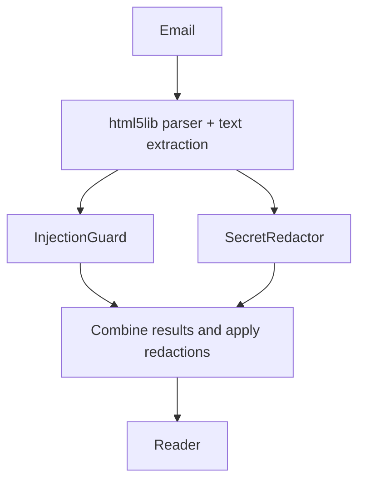

# Readable HTML email

Status: Released to production; final cleanup in progress
Issue: https://github.com/coletaylor788/puddles/issues/295
Last updated: 2026-10-15

## Human section

### Design

HTML-only emails can return an empty plain-text body. Large HTML responses can also exceed tool limits and leave the reader with an inaccessible file reference.

Convert HTML into plain text before either security guard or the reader receives it:

Use Python's [html5lib](https://html5lib.readthedocs.io/en/latest/) with its standard ElementTree tree builder to parse supplied email bytes into a document tree. It is an HTML parser, not a browser or JavaScript engine. Pin the reviewed dependency version during implementation.

A small extraction function walks only allowlisted body elements and emits their text plus paragraph/list/table separators. Preserve prices and dates. Skip entire script/style subtrees, comments, embedded objects and unsupported subtrees; copy no attributes. The parser itself does not remove scripts: our extraction policy does. Never load external resources.

Construct a fresh text-only response. Raw HTML must not appear in results, details, errors or fallback paths. Reject reader requests for raw HTML. Run conversion with enforced network, filesystem and resource restrictions.

Keep the injection guard and reader prompt: malicious instructions can still appear in ordinary text. Scan the complete extracted text once per guard and return one response. No chunking, pagination or new size-preflight checks. Let existing provider and harness limits fail through their normal handling. Do not retry with raw HTML or treat an overflow response as a successful full read. Existing guard failures remain fail-closed.

### Status

**Approval:** Production approved. **Approval reference:** The requester said “approved, ship it” on 2026-10-14, after agreeing to this design. Scope includes implementation, validation, release, merge and cleanup. No chunking or paging, and no real email examples.

Released through the native controller on 2026-10-15. Fresh full application CI, installed DEV and TEST acceptance, backup, bounded read-only production acceptance, paired source merge and intake resumption all passed on the same artifact. Public PR #296 is merged. Real mailbox acceptance remains for the requester. Final cleanup follows this documentation closeout.

## Agent section

### State

Release `readable-email-20261014-r4` installed artifact `a9b2093099a718df7c1f8c98b61df02ad0be444eb5485d2319cc310fd2221170`. Public merge `350f58aa5c378cb4bd330055de0147ed47af7940` has exactly the reviewed source tree. Paired companion source is merged. Hosted checks passed. The retained reviewer cleared the complete behavior diff and final callback mapping. All acceptance email fixtures are synthetic.

### Scope and acceptance criteria

Readable HTML email without exposing scripts or raw HTML to either guard or the reader.

### Architecture and decisions

Extract text in the email integration. Run both guards in parallel on the same complete result and apply redactions before returning it. Reuse existing guard and harness failure handling. Keep parser resource containment separate from model/tool size handling; no new email size-routing mechanism is needed.

### Implementation

`servers/gmail-mcp/src/gmail_mcp/{html_text,html_worker,readable}.py` implement extraction and containment. `server.py` selects readable MIME content. `openclaw-plugins/secure-gmail/src/readable-email.ts` validates and rebuilds the envelope before existing parallel hooks.

The child interpreter disables bytecode generation so trusted imports leave packaged libraries unchanged. macOS uses Seatbelt after trusted imports; Linux requires bubblewrap with read-only runtime mounts and no network namespace access. The worker has CPU and wall deadlines, no inherited credentials or extra descriptors, no core dumps or file writes, and a Linux address-space limit. macOS does not support that address-space limit.

Reader guidance reports failed or incomplete reads without raw retries. The dependency lock adds only html5lib and its two dependencies.

### Validation

Focused results: 261 offline Python tests, 91 secure-gmail tests, and five companion guidance tests pass. The legacy live-account test module is retired and direct invocation collects no executable tests. Packaged encoding regressions pass with the actual parser, MCP server, plugin and both guards using recording adapters.

The final native DEV run passed the full installed suite in 246.639 seconds. The release then passed fresh full application CI in 751.304 seconds (28 projects, 199 registered tests), TEST acceptance in 247.657 seconds and production acceptance in 7.297 seconds. Candidate and installed files matched before and after acceptance. Recording checks reported zero external writes. Production intake resumed and its health check passed after both source merges.

Earlier attempts caught parser import-time bytecode writes, an absent TEST reader directory and a release callback that omitted the host HOME variable. The child now uses `-B`; preparation validates the reader directory before creating an allowed DEV/TEST leaf; and the full installed callback preserves the normal host environment with explicit test bindings. DEV runs the same full installed suite as TEST. Nineteen callback regressions pass, including child environment and directory cases. The exact historical difference between the first two candidate digests remains unproven; neither reached production. Failed attempts are preserved until normal feature finalization.

Require thorough parser unit tests and guarded-route tests covering:

- Complex nested layouts, tables, footnotes and mixed MIME parts.
- Scripts, attributes, embedded content, malformed tags and encodings.
- Empty bodies, Unicode, large inputs and existing provider/harness overflow handling.
- Guard blocks, redaction expansion and failures; no early release, silent truncation or raw fallback.
- Combined hostile cases, generated variations and retained regressions.
- Failures and every output channel, including details and errors.

Assert both that excluded payloads never reach either guard or the reader, and that legitimate text survives accurately. Verify guard routing with recording adapters. The installed scenario exercises the packaged parser, MCP server, real plugin and both guards with a fake Gmail service and model. Separately qualify reader guidance in the application suite.

### Rollout and rollback

Follow the normal release process. Never fall back to raw HTML on failure.

### Review log

Prior review found two MIME defects: filename-only attachments disrupted downloads, and early HTML decoding lost encoding information. Both are corrected with offline and contained-worker regressions. The prior reviewer could not be resumed after chat recovery. Replacement `email_review_recovery` completed the full public and companion diff plus deployment callback review with no material findings. It independently passed 60 focused Python tests, including real macOS containment and encodings, and five guidance lifecycle tests. After the bytecode fix it rechecked the complete paired diff, found no material issues, and independently passed all 61 focused Python tests.

### Checklist

- [x] Design agreed and test expectations recorded.
- [x] Implementation, focused validation and independent review.
- [x] Fresh packaged build and installed DEV integrity acceptance.
- [x] Full application suite, TEST, production acceptance, merge and resumed intake.
- [ ] Finalize owned feature workspaces after documentation publication.
- [ ] Requester validation with real mail, if desired.
