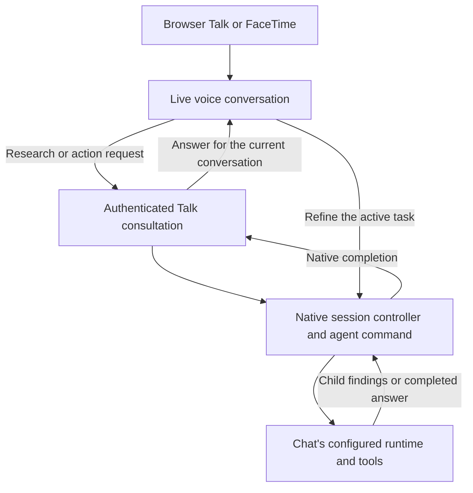
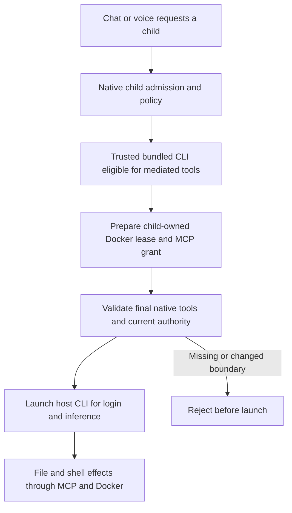

# Realtime delegation through the configured agent runtime

Status: Production approved; combined candidate qualification in progress
Issue: https://github.com/coletaylor788/puddles/issues/377
Last updated: 2026-11-24

## Human section

### Design

Voice should use the same configured agent runtime as text. A user should be
able to delegate research, keep talking, refine that research, and hear the
finished answer without asking for it again. The conversation stays responsive
throughout. Browser Talk and FaceTime must both support this sequence.

The remaining upstream bug is where Talk starts agent work. It calls the
embedded API runner directly, bypassing the normal command that selects the
chat's runtime. A subscription-backed CLI chat can therefore work in text while
voice asks for an API key. Configuration alone does not repair that call path.

Propose using the upstream session controller and a bounded adaptation of
[OpenClaw PR #199379](https://github.com/openclaw/openclaw/pull/199379). The
controller is OpenClaw's owner of running work, queued input and Stop. Talk
should hand work to that owner and consume its result, while retaining the
caller's permissions and the voice connection's delivery checks.

#### Upgrade and repair in one release

Phase 1 landed OpenClaw 2026.11.4. The latest stable checked on November 18 is
2026.11.5. It contains the session-controller API used by this PR; that API is
absent from 11.4. It also brings relevant busy-session handling, delivery of
failed child results after a parent ends, Talk startup cleanup, and CLI transport
recovery. These are upstream capabilities, not promises that the whole voice
scenario already works.

**One Phase 2 candidate combines the 11.5 upgrade, proven patch removals and the
narrow voice-routing repair.** First test native 11.5 behavior in isolation to
identify redundant patches and separate upgrade failures from repair failures.
Then qualify and release the complete candidate together. The update must
preserve existing behavior and use native replacements wherever they are proved
equivalent. This avoids backporting a second session controller into 11.4. The
11.5 source still calls the embedded runner from Talk, so the update alone does
not complete this proposal.

#### Route voice through the normal agent command

**Start from the existing implementation in upstream
[PR #199379](https://github.com/openclaw/openclaw/pull/199379).** Port it to 11.5
and our retained patches as `talk-native-agent-command.patch`; do not
reimplement its routing, steering or completion machinery. It will:

- Start voice work through the normal authenticated agent command, retaining
  the chat's configured runtime, caller permissions, workspace and sandbox.
- Send refinements through the native controller for the same logical task.
  Do not cancel and restart work to imitate steering.
- Return the command's settled answer through Talk's existing completion owner,
  including native yield/resume and session changes during compaction. Preserve
  internal reply metadata; reject partial failures and stale calls.
- Use the existing realtime integration for request classification and dispatch.
  No custom follow-up classifier, queue, replay mechanism or delivery service.

FaceTime will attach to the configured main session using existing native
interfaces and must pass the same acceptance scenario. Its adaptation stays
inside the FaceTime extension; it adds no Gateway or SDK entrypoint. Necessary
shared-helper changes must preserve ordinary text behavior, stored preferences
and the serialized reply format. Talk's machine-selected thinking preference
may normalize to a supported value without relaxing explicit text validation.

Keep the PR's already completed fixes for CLI steering, result ownership across
compaction, relay registration after a session change, and rejection of partial
failed completions. Its latest review reports no remaining actionable code
finding. The open items are acceptance evidence, plus our integration work:

| Work remaining | Specific requirement |
| --- | --- |
| **Open upstream: end-to-end proof** | Demonstrate a fresh installation and an upgrade from stable with real CLI tools and finalized speech. The author's saved-audio proof does not cover this matrix. |
| **Open upstream: existing-data compatibility** | Preserve stored session identity, model/runtime selection, fallback settings, native locks where applicable, thinking preferences and history. Validate Doctor and startup. |
| **Additional here: 11.5 and patch integration** | Port the PR's pinned implementation to the exact 11.5 tree, apply the patch table, and preserve the existing permissions and sandbox. No blanket adoption of the held local PR #347. |
| **Additional here: FaceTime** | Exercise the retained carrier integration through the same command and completion path. Upstream Gateway relay evidence does not establish our FaceTime behavior. |
| **Additional here: complete asynchronous scenario** | Prove same-task refinement and proactive reader-result delivery with a busy or yielded parent, actual compaction, and concurrent conversation. Include failure, Stop and reconnect; no duplicate work or stale speech. |

These are explicit implementation and qualification tasks, not authorization
for another delivery or authority patch. A new defect outside the proposed
scope returns to design review.

#### Existing patches: proposed disposition

These decisions come from inspecting the current patch bodies and their touched
upstream files at 11.4 and 11.5. **Keep** means preserve the behavior while porting
it to native 11.5 interfaces. **Remove** means delete the whole patch.
Tests qualify the resulting candidate without silently expanding its scope.

| Patch | Proposed treatment | Reason |
| --- | --- | --- |
| `shared-conversation-context` | **Remove** | Its remaining production change only exports `readSessionConversationContext`. No runtime caller remains in the composed source or either repository. Native CLI history already supplies conversation updates. Delete the unused helper and its patch registration; preserve native cross-mode history tests. The neighboring patch document describes an older caller that is no longer present. |
| `talk-request-recovery` | **Remove** | Use native realtime request classification, dispatch, acknowledgment and follow-up handling. Drop the entire patch, including custom status patterns, “also” classification, displaced-input messages and unaccepted-input handling. 11.5 fixes the misleading acknowledgment; the other removals deliberately choose stock behavior rather than claiming upstream equivalence. |
| `talk-overlap-recovery` | **Remove** | Use native steering success and failure handling. The supported CLI path must pass qualification; actual failures should surface normally. Remove the special nonfatal fallback for unsupported steering. |
| `talk-conversation-progress` | **Remove** | Its custom conversation policy and silent progress callbacks are not required for CLI routing, native steering or proactive final answers. Use native Talk behavior and supported instructions instead. Remove the entire patch, including its added hangup/steering guards; qualify those races against native behavior without carrying the hunks forward. |
| `facetime-talk-client` | **Change** | Replace the existing patch with changes confined to the FaceTime extension. Attach calls to the configured main session through existing native interfaces. Remove the added Gateway carrier API, SDK, plugin-loader and shared Talk runtime hunks. Preserve authenticated call admission and native task ownership; do not recreate steering or result delivery in the extension. |
| `facetime-native/call-lifecycle` | **Keep** | This patches the separately pinned native helper, not OpenClaw. Updating OpenClaw does not replace its verified-muted answer acknowledgment or all-alias closure checks. Keep its separate source pin and compiled regressions. |

Add only `talk-native-agent-command.patch` for the repair described
above. Do not revive the held implementation in PR #347, the removed
`talk-agent-parity` patch, or test-only overlays retired in Phase 1. Companion
provider and delivery-policy patches have a separate private table, with the
same explicit keep/remove decisions. Only realtime patches belong in this proposal. Other patch categories remain
unchanged apart from required compatibility with the upgraded baseline.

#### Acceptance

One continuous Browser Talk and FaceTime conversation must delegate research,
remain responsive, accept a same-task refinement, and deliver the corrected
answer proactively. Custom silent progress updates are not an acceptance requirement. Cover a busy parent, native yield/resume, compaction,
completion racing steering, failure, Stop and hangup/reconnect. Keep current
permissions, sandboxing, stored sessions and ordinary text behavior intact.
Use deterministic recordings plus real subscription CLI and voice qualification;
report physical device acceptance separately.

#### Approved extension: sandboxed delegated CLI admission

**Approval: Production approved.** On 2026-11-20 the requester approved adding the three Claude-specific guard exceptions to the existing patch and rolling it out: “Okay approved to add these guard exceptions into the patch and roll it out.” This extends the existing
[CLI sandbox handoff](../openclaw-setup/patches/cli-sandbox-handoff.md).

Earlier installed voice qualification completed the steered foreground command,
then rejected its research child at native sandboxed CLI admission. That guard
also applied to ordinary text chat and existed in the inspected 11.4, 11.5 and
11.6 source. The approved exceptions now admit the selected Claude child path.
The original handoff patch preserved it. Updating to 11.6 or changing
the fixture cannot establish the requested delegated CLI behavior.

Admit only the trusted bundled Claude backend whose file and shell
effects use the existing MCP tools and child-owned Docker sandbox. The CLI stays
on the host for account access and inference, as it does for the supported main
session. Exact tool-selection fields alone are not proof of containment.

At child creation, retain native requester, agent, model, workspace and sandbox
policy checks. The narrow backend eligibility decision must not authorize a
later launch by itself. Immediately before execution, verify that final native
CLI tools cannot perform host file or shell operations and that the current
child owns the required Docker lease and invocation grant. Use the existing
prepared workspace and grant lifecycle, not a parent grant or a generic bypass
flag. Missing Docker, lost authority or unsupported tool settings must fail.

Repeat the admission checks for resumed work, fallback, runtime changes and
configuration changes. Unsupported CLI backends and host fallback remain denied.
Native child coordination, steering, result delivery and Stop remain unchanged.
The proposal applies to child requests from both ordinary chat and voice. Cron
admission and stock Copilot behavior remain unchanged.

Before shipping, prove hidden and visible child creation, resume and fallback,
then refusal for missing Docker, native-tool overrides, revoked grants and any
unmediated CLI file or shell path. Verify workspace confinement, exact tool
selection, child cleanup and ordinary main-session behavior. Finally rerun the
real CLI Talk scenario through reader yield and proactive completion. The
isolated [prototype](claude-child-sandbox-poc.md) proves the selected Docker/Claude
path, including real child delivery and resume. Combined release qualification
and the wider authority-loss matrix remain release gates.

#### Native compatibility gaps found by the complete application suite

The three Claude child exceptions remain unchanged. Two other native 11.5
contracts require compatibility work before this combined upgrade can ship.

The requester approved removing the forwarded-message watcher entirely after
its replacement failed the existing interaction contract. Remove the plugin,
its packaging requirements, dedicated tests and obsolete setup documentation.
Preserve correspondence and user data, the ordinary reader, task reminders,
and all unrelated Cron and heartbeat behavior. Inspect deployed configuration
before retiring any watcher-specific state-side references.

The deployed upgrade already uses native Doctor after installation, with the
frozen predecessor and rehearsed configuration result checked before startup.
The historical July regression still invoked a legacy direct schema adapter
without Doctor's backup and maintenance custody. Update that regression to the
same supported Doctor invocation. Bind the original explicit Cron partition,
complete job fingerprint and selected revision before migration and verify
them afterward. Keep current-schema targeted-writer coverage separate; its
explicit one-job silence operation is not production upgrade behavior.

Current production preservation remains covered by the native candidate
rehearsal and its checks for existing Cron identities, definitions, grants,
receipts, task runs and scratch state. Installed Workshop and heartbeat cases
exercise the maintained migration path. No new OpenClaw patch or release
controller change is needed.

**Approval:** The original upgrade and Claude patch scope remains production
approved. On 2026-11-22 the requester approved watcher removal: “Oh okay that
didn’t work. Just remove it entirely”. The requester also authorized migration
implementation while preserving data and behavior: “For migration, I don’t care
how it’s done, don’t lose any data or behavior like crons of course”.

#### Plugin paths in the migration rehearsal

Native update preparation treats an npm-installed host as a shared code owner.
Our custom plugins live under that host, so their projected paths can point back
to the TEST runtime. Doctor requires those plugin entries inside its private
update copy. The harness therefore copies the exact candidate plugin subtree
inside the rehearsal and redirects its configuration and installation records.
A separate, bounded process uses the source-version native metadata writer and
closes its database owners before the unchanged candidate Doctor runs. The
preparation preserves schema, all application tables, unrelated configuration,
installation provenance, and native code-link receipts. DEV and TEST exercise
this topology with synthetic existing Cron and heartbeat data before the real
copied-production rehearsal. No production state is changed by preparation.

### Status

**Approval: Production approved for the complete scope.** On 2026-11-18 the
requester approved the combined 11.5 upgrade, four removals, upstream-based Talk
repair and extension-only FaceTime attachment through shipping and cleanup.
That approval remains valid. No new FaceTime Gateway entrypoint is allowed.
On 2026-11-20 the requester approved adding the three Claude-specific guard exceptions to the existing patch and rolling it out: “Okay approved to add these guard exceptions into the patch and roll it out.”

R38 passed DEV. Its first production attempt passed installed checks but hit
the source suite's disk-capacity guard; guarded cleanup reclaimed completed
fixture data. The retry passed the complete source lane but failed installed
checks before deployment. Both source transactions are closed, and the release
lane is free.

The child completed successfully, but its result did not reach the parent within
the fixture's observation window. A separate household case stalled before any
model request. R39 moves both complete files before concurrent source tests,
with separate groups sized for their existing case deadlines. Assertions,
per-case limits, tool permissions and cleanup are unchanged. This mitigates
contention and fixes the shared group's insufficient budget; it does not prove
a native delivery or SDK defect is resolved. All thirteen unchanged checks pass serially in 287.831 seconds, and retained
review has no actionable findings.

The heartbeat job-definition mismatch still requires copied-production TEST.
Fresh DEV and the full suite must pass before that rehearsal. No production
activation occurred. Physical voice acceptance remains separate.

## Agent section

### State

Original Phase 2 scope and the three Claude admission exceptions are production
approved. Public base `8394d4392d1aba03e9f85c4a1f6fcca6058e25d4`; approved native
pin 11.5 `e13cf15ece9bbd969b7362927c315362c90c97ff`. This replaces the deferred
outline in [the upgrade plan](voice-consultation-through-agent-turn.md).

R31 candidate `9a3e13857c88f71b47990dd6871428f1aa56860af3647655e136b319f97bd8c8`
passed DEV `gh-45238618009-1` and the full application suite. Production run
`gh-45244709426-1` failed at `test-tests` before backup or activation, with
status failed, phase complete and child null. Source queue and transfer cleanup
closed. R32 changes only private qualification controls; runtime patches and
application output are unchanged. The retained reviewer found no actionable defects in the complete diff. Native 11.7 plugin repair still requires private entry roots, so
it does not remove this npm-host projection problem. No new runtime patch is
proposed. The installed synthetic regression passed in 33.439 seconds; normal CI remains mandatory.
R32 candidate `20f204be69e04d3f29dbc731fa0a1ba75e2e8bf53a7a85294fdf03bcc7f9cb0e`
passed DEV `gh-45265124065-1` and the full suite. Production run
`gh-45270841675-1` failed at `test-tests`, with phase complete and child null.
Source closure and transfer cleanup are verified. No backup or activation ran.
R33 retains exact checks for ordinary jobs and validates generated-heartbeat
conversion using native read-only loading, frozen configuration, completed
cutover receipts and retained authority. The installed regression passed in
37.546 seconds, including persisted enabled and disabled monitors, execution
history, scratch, authority and an unrelated declaration. All 54 focused tests
pass; retained review has no actionable findings. Runtime output is unchanged.
Fresh DEV and copied-production TEST are still required.

R33 candidate `c04a19b19b3995a5ebc520ab7ad41de1d3fe98340bada0c66ad24fafb9077df5`
passed DEV `gh-45288421439-1` and the full application suite. Production run
`gh-45292757500-1` failed in `test-tests`, phase complete, child null. Target
completion is `1795482769173`; source queue closure is `1795482820407` and
transfer cleanup is complete. No backup or production activation occurred.
The preserved job-definition assertion failed after native Doctor. R34 changes
only its diagnostic message to identify added, removed or changed allowlisted
schema fields, with unknown names redacted and all values omitted. Existing
equality criteria remain unchanged. Four new rejection/redaction regressions
bring the focused suite to 58 passing tests. Retained review has no findings.
Read-only normalization and digest comparisons did not establish the cause.
The next copied-production rehearsal must identify it before any exception.

R34 candidate `ab1bd8854dea9ac81db974583bf6a5a81fdbcaaf437f938e70cca811ed88bbaf`
passed DEV `gh-45305203187-1`. PROD workflow `gh-45308413270-1` failed its local
application suite; the production job was skipped and no target receipt exists.
Source closure is `1795488970131`, with transfer already clean. The memory
positive control received HTTP 400 while native agent database preparation was
pending; iMessage subscription alone did not prove readiness. R35 waits for
native `/readyz` after each restart, sharing the original absolute 91-second
startup deadline. Only readiness transport failures retry. Tool assertions,
model errors and child-exit failures are unchanged. Five focused regressions
pass, retained review has no findings, and final-helper installed validation
passed in 183.913 seconds. The initial readiness correction passed the complete keyword-memory
case in 184.887 seconds. Unchanged Talk rerun passed in 51.508 seconds. Both
main references remain at the bases above.

R35 candidate `adfd5021a77efb251d681298e19ec47cc599ea5b78a28f2d1efc3e67a0cda3a1`
passed DEV `gh-45318096597-1`, complete/child-null at `1795491545547`;
source closed at `1795491596240`, transfer cleaned. PROD workflow
`gh-45321193921-1` failed the local installed suite; its production job was
skipped and no target receipt exists. Source closed at `1795495744542`, transfer
already clean. Keyword memory passed in 198.409 seconds and warmed local memory
in 100.737 seconds. Talk dependency capture was still copying files near the
120-second startup limit while source tests ran concurrently. The separate
household failure reproduced when a delayed model response kept MCP alive long
enough for a native ping, which the synthetic provider rejected.

R36 returns an empty MCP ping result without consuming a model turn or exposing
tools. Unknown operations still fail. The delayed native case confirms a real
ping and passes all cross-tier denials in 96.765 seconds. Thirteen synthetic
provider tests, six inventory tests and seventeen public suite tests pass.
Talk moves to the existing preflight lane; preflight and remaining inventory
entries partition the original set, with standalone callers running all checks.
Every phase retains cleanup and output-integrity checks. Talk deadlines and
assertions are unchanged. Retained review is clear; actual Talk preflight passed in 56.031 seconds,
including cleanup and unchanged output verification.

R36 candidate `4a44875fef939efc064c422e869470f612c9289e50dab39ed81203b959b75bf4`
passed DEV `gh-45331451762-1`, complete/child-null at `1795498491247`, with
source closure at `1795498554344` and cleaned transfer. PROD workflow
`gh-45335110408-1` failed before transfer; production was skipped and no target
receipt exists. Source closed at `1795502930714`, transfer already clean.
The Talk mailbox test observed no start within its default polling interval;
R37 waits on its existing start promise, then retains the same order assertion,
release and cleanup. The maintained Talk patch changes only this test and its
private hash binding. All 55 affected Gateway tests pass in 27.14 seconds.

The installed orphan-removal Doctor case exited 141 near its 60-second command
limit. The prior fixture discarded process error metadata, so timeout is not
proven. All five standalone Doctor cases pass in 243.679 seconds, including
orphan removal in 34.064 seconds. R37 retains status, signal, error code and
elapsed time and moves the entire offline Doctor file to existing preflight.
All cases, deadlines, output checks and cleanup remain. Six phase-partition
regressions pass, and retained review has no findings. Fresh DEV and the full
suite remain required; the scheduling change is a mitigation to qualify.

R37 failed before transfer with a stale diagnostic inventory expectation,
a 60-second reader Doctor timeout, and an initial direct-tool turn timeout.
R38 covers diagnostic retention for all, preflight and remaining phases. The
complete reader group moves to preflight with its existing 315-second allowance;
all per-case and Doctor limits remain. Unchanged standalone reader tests pass in
148.310 seconds, with history, selection and rollback assertions intact.

The shared native fixture waits on `/startupz` after every fresh subscription,
including restart. Native startup waits for pending sibling database inspection;
`/readyz` excludes isolatable siblings. The existing bounded probe helper moves
to the public fixture package, while memory checks keep their `/readyz` behavior.
Each startup retains one absolute deadline spanning spawn, subscription and
probe. Non-200 responses, child exit and provider errors cannot release ingress.
Startup settlement does not certify every agent or deferred maintenance task.
The database custody warning's full cause remains unproven. The unchanged
programmatic test passes in 30.901 seconds; with the startup gate it passes in
29.725 seconds. Eight public probe tests, fifteen private inventory/readiness/
diagnostic tests and public fixture type checking pass. Retained review has no
findings. The first R38 full installed lane subsequently passed.

R38 passed DEV. The first production application run passed the entire installed
lane, then failed the source canonical-workspace test at the existing free-space
guard. Guarded retirement reclaimed 3.33 GB from completed task fixtures while
preserving diagnostics and all referenced output. The unchanged selected source
case passed in 12.344 seconds. The retry passed the entire source lane, but the
installed group failed on parent delivery and household startup, then reached
its shared 900-second deadline. Production was skipped; cleanup is closed.

The child terminal record is successful and contains its synthetic report.
Native announce began, but no resumed inference reached the provider during the
20-second observation window. The household failure recorded only session
startup and shutdown, with no model request. The unchanged selected household
case passed alone in 23.398 seconds. These traces support scheduling mitigation,
not a proven native runtime fix.

R39 moves the complete boundary and household-return files into existing serial
preflight. Their separate group deadlines are 735 and 855 seconds, derived from
the unchanged four 180-second and seven 120-second cases plus exit margin. The
remaining twelve-file group retains 900 seconds. All cases, assertions, fixture
inputs and cleanup remain. Ten inventory and diagnostic regressions pass,
including exact phase partition and the aggregate timeout covering every group.
The aggregate allowance remains below the runner's six-hour check limit.
All thirteen unchanged checks pass serially against the exact artifact in
287.831 seconds, including both Claude wrapping modes, native parent
continuation and all seven household permission cases. Retained review has no
actionable findings. Fresh DEV and full CI remain required.

Earlier evidence follows.

DEV `gh-44801823538-1` is terminal failed with `phase=complete`, `child=null`,
source queue closure and transfer cleanup. Installed checks and real subscription/
sandbox qualification pass. Talk admits the reader, yields and receives its
result; the resumed parent produces the exact final. The voice append times out
because the Talk command adapter rejects yielded settlement and revokes its
promoted requester-final attachment. Correct that adapter within the approved
Talk patch, preserve the three sandbox exceptions and build a new sealed candidate.

R13 DEV `gh-44842964047-1`, candidate `4f37330968773ad96ebd764db2d6f93c79f00797dc4c435e29c947668ff4bbd6`,
is terminal failed with cleanup closed. The installed and sandbox checks pass.
The Talk assertion detects the original answer alongside the steered answer,
before reader yield starts. Native CLI records retain the original as interim
history; Talk joined both payloads despite the final-answer metadata selecting
only the corrected answer. Use that existing metadata for speech, with the
payload projection retained only for runtimes lacking a terminal snapshot.
Silent or empty snapshots must not revive earlier answers. No browser/runtime
configuration or sandbox admission change is part of this correction.

R15 DEV `gh-44923882182-1` passed the complete installed Talk scenario, with
terminal `phase=complete`, `child=null`, and source cleanup closed. Production
workflow `gh-44925645068-1` stopped in the development-host full suite; it created
no target transaction. Its source queue closed at `1795279410705` and transfer
cleanup reported `already-clean`.

The public compaction mappings were correct. The companion repeated two targets
under `agents-support` instead of native `infra`, causing collection failure.
The installed `direct-silent-continuation` reproduction completed the authored
silent turn, then waited for an obsolete automatic retry. Pinned 11.5
`reply-completion.ts`, `required-reply.cases.ts` and embedded `payloads.ts` accept
ordinary direct-chat `NO_REPLY`; only result-required completion demands content.
Keep empty-output/error handling intact and test authored silence followed by a
visible answer to a new user request. No OpenClaw source or runtime patch changes
for these full-suite corrections. Evidence is retained under
`/private/tmp/phase2-full-suite-repair-20261121`.

R16 candidate `784ebad8ebed55919d5b951eb8e688f5da5f7192a5f2a0e15ee7adcaf71b2a00`
passed DEV `gh-44927925297-1` at `1795281979418`; source closure completed at
`1795282027647`. Production `gh-44946216181-1` failed its local application suite
before target deployment; source queue closed at `1795293114592`, transfer
`already-clean`.

R17 qualification repair preserves caller TMPDIR/TMP/TEMP for native tests while
Python retains its owned scratch. The long-path native lifecycle test reproduces
EINVAL before repair (13 passed, one failed) and passes all 14 afterward. Both
new environment cases fail before repair; the complete Python harness file passes
all nine tests afterward. The synthetic model-error scenario expected obsolete
copy. Public native output is `LLM request rejected: Synthetic model failure`;
the companion emits `No answer was returned. Ask again if you still need one.`
Both are supported by unchanged pinned native error/terminal-reply code and tests.
Exact alternatives preserve one request, one delivery and consumed-script checks.
Both provider fixtures pass with one request, one send and zero tool calls.
Retained review has no findings. Evidence: `/private/tmp/phase2-suite-paths-20261121`.
No runtime source or patch changed. All 15 installed scenarios pass, including
companion restart and quiet completion; process cleanup and unchanged artifact
integrity checks pass. Fresh DEV and full-suite CI remain required.

R17 DEV `gh-44948343029-1` passed. Production `gh-44950240113-1`
failed the source full suite before transfer; no target receipt exists.
The source queue closed at `1795297766159`, with transfer cleanup `already-clean`.
R18 fixes snapshot admission inside the retained compaction patch; its native
admission regression reproduces the failure before repair. Five affected native
test files pass all 201 cases. Talk tests use native completion barriers, the
runtime-event fixture initializes its configuration, and snapshot enumeration
excludes only the persistent reclaim guard file.

Installed filesystem isolation passes with native Docker identity queries and
existing container pins. Reader guidance, model-selection preservation, fallback
restoration/exhaustion, and owner-relay recovery checks pass. Memory restart
fixtures now permit the existing native local worker broker while retaining
external-network blocks. Historical Doctor fixtures use supported singleton keys
and compare against the installed schema declaration. Remaining checks continue
against the rebuilt candidate; historical fixture success does not independently
prove the release migration sequence. The retained reviewer reports no findings
in the current behavior diff. Evidence: `/private/tmp/phase2-suite-paths-20261121`.

The broader source run exposed additional test-only drift. Darwin port fixtures
now describe both native sysctl ranges and retain refusal on an unreadable range;
all 20 focused cases and 117 unit-project cases pass. Talk history and client
fixtures now supply matching native terminal-reply metadata instead of relying
on payload-only mocks. The history file passes 19 cases with three existing
upstream skips. A stale supervisor fixture hunk is removed entirely, restoring
the upstream test rather than recreating an unused mock. The retained reviewer
reports no findings. The three client files pass all 34 cases in 111.11 seconds;
the restored supervisor file passes all 52 cases in 97.15 seconds.
Native core types, 101 helper tests, six manifest tests, and all 20 original
installed failure cases pass their focused rechecks, including warm memory
restart. The complete 25-patch composition reproduces all 413 changed files exactly;
all 307 mapped targets across 34 native projects have completed. The three
failed groups have passing focused repair checks (history 19, client 34 and
supervisor 52); this is not an all-green unmodified run. The final child-wakeup
and tool-hook integration group passes all 61 cases. CI must rerun the entire
suite against the frozen candidate. Source disk reserve blocked a repository rehearsal check; only closed,
owner-verified generated artifacts are being retired before retrying it.

R18 candidate `77a6156826b54766782d1c530f6cc36af1d104eb13a3fa3a08fc65662ebe7b84`
failed DEV `gh-44959167291-1` at `dev-tests`, after all twelve installed checks
and real subscription/boundary qualification passed. The target is failed,
complete and child-null; source queue closed at `1795302944851` and transfer
cleanup is `cleaned`. The Talk error does not distinguish initial creation from
reopen. R19 changes only qualification diagnostics: bounded provider registration
mode, broker presence, session/observation counts and voice stage, preserving the
original exception and native cleanup. Ten fixture unit checks pass. Local
ordinary and full-config reopen checks pass; real CLI loopback Talk produces
exactly one answer from one primary request and then reopens (44.8 seconds).
These are diagnostic observations, not a proven fix for the DEV failure.

R19 production workflow `gh-44964068110-1` failed before target transfer.
The complete installed application lane passed. Source queue closed at
`1795308363915`; transfer cleanup reports `already-clean`. Source failures
include retired heartbeat configuration/runtime, the moved Workshop drafts
inbox, a new runtime-script build check, and a historical default-partition
query. Workshop/build corrections pass three focused tests. Native sender
memory/confinement validation passes, and communication unit/helper suites pass
58 and 12 tests respectively.

The one-way watcher prototype was withdrawn. The requester subsequently
approved complete removal of the forwarded-message watcher. Its public plugin,
packaging hooks and dedicated fixtures are removed from the working tree;
private packaging and deployed-reference retirement are being reconciled.
Generic reminders, Cron jobs, the ordinary reader and correspondence remain
outside that removal.

The historical native Doctor prototype preserved its explicit partition, full
job fingerprint, reviewed revision, concurrent changes and SecretRefs. Retained
review corrected the earlier ordering concern: native-activation is legacy
recovery tooling, not this rollout's installed path. The maintained application
post-install controls already invoke native Doctor with exact frozen config
checks. The July fixture now follows that path; focused qualification and full
candidate CI remain required. Migration implementation is explicitly approved
with preservation of all data and unrelated behavior.

Focused removal validation: 24 application packaging/suite tests, six candidate
migration cases (68 seconds), and all 45 retained native pipeline cases pass
(the corrected artifact-index case was rerun after the other 44 passed). The
e2e type check passes. The existing handoff patch bytes and three exceptions
remain unchanged. Packaging has changed, so installed release evidence must be
renewed on the next frozen candidate.

### Scope and acceptance criteria

The Human section is the complete patch decision. Preserve subscription CLI
access and containment. Backup routing stays separately owned.

### Architecture and decisions

Inspected current production patch hunks and their 11.4-to-11.5 counterparts:

- [Delegation controller](https://github.com/openclaw/openclaw/blob/v2026.11.5/extensions/openai/realtime-quicksilver-delegation-controller.ts): native acknowledgment, steering error handling and pending-input behavior; use these directly.
- [Control classifier](https://github.com/openclaw/openclaw/blob/v2026.11.5/src/talk/agent-run-control-shared.ts), [instructions](https://github.com/openclaw/openclaw/blob/v2026.11.5/extensions/openai/realtime-quicksilver-instructions.ts) and [consult runner](https://github.com/openclaw/openclaw/blob/v2026.11.5/src/talk/agent-consult-runtime.ts): custom policy/progress additions being removed in favor of native behavior.
- [FaceTime driver](https://github.com/openclaw/openclaw/blob/v2026.11.5/extensions/facetime/src/talk-driver.ts) and [separate native helper contract](../openclaw-setup/patches/facetime-native/README.md).
- [Native CLI history](https://github.com/openclaw/openclaw/blob/v2026.11.5/docs/gateway/cli-backends.md): conversation updates on native CLI resume.

Runtime searches found only the removed helper's definition, no caller. The
private companion records provider-specific evidence without publishing it here.

### Implementation

Start from PR #199379 head `6f7f68c4092718ceec5ff99a0694cc20b6291e02`,
not held PR #347. Resolve the open evidence gaps and additional integration
items listed above. Port retained behavior to native interfaces;
retain meaningful regressions independently of deleted patch registrations.

The Talk command adapter now recognizes an authoritative successful yield as
settlement of its acknowledgement. This releases only the provisional binding;
the existing promoted native attachment owns later child-result speech. Terminal
write draining, abort/error checks, receipt identity and current-voice checks
remain. No new delivery mechanism or sandbox change accompanies this repair.

#### Upgrade compatibility

Native 11.5 Cron replaces the retired heartbeat tool path. Remove the now-unused
`native-heartbeat-response` patch and qualify quiet completion, one alert,
isolated history and main-session continuation through native Cron. Existing
schedule conversion stays owned by native Doctor. The Workshop patch also
shrinks to removing an obsolete diagnostic because native tool construction now
supports the configured sandboxed grant. Neither change adds custom routing.

### Validation

The full-suite corrections reproduce both failures before repair. Corrected
discovery collects all 307 mapped targets across 34 native projects. Both
compaction files pass, 24 tests in 45.79 seconds. The installed direct-chat
scenario passes on the unchanged application with exactly two model requests,
one send and no tools: authored silence first, then a new user's visible reply.
Retained review has no findings. These focused results do not replace the next
full-suite CI run, TEST or PROD acceptance.

The terminal-answer regression first fails all three added cases on the previous
source. The correction passes 51 focused tests across Talk projection, the real
Gateway command path and Quicksilver delegation (98.92 seconds across three
shards, plus 44.67 seconds of compiler preparation). Core types pass. The complete
25-patch composition applies to pinned 11.5 and exactly reproduces the changed
source and tests. Retained review has no findings. Installed voice acceptance
still requires a new DEV run.

R12 DEV passes all twelve installed checks and real Claude subscription and
boundary qualification. Native transcripts prove foreground steering, accepted
reader execution, yield, successful child completion and the resumed parent
answer. The remaining failure is the voice callback after yield. A regression
without an embedded run reproduces that failure on the old adapter. The repair
passes all eighteen focused requester-final and Gateway CLI-routing checks, plus
core types. The changed requester-final file takes 8.93 seconds wall time; the
Gateway file takes 37.88 seconds because it exercises the real Gateway command
composition. Installed voice acceptance remains pending.

The 11.5 and 11.6 `subagent-spawn-child-plan.ts` files share exact Git blob
`48dc48175daaea6d6561646ea1f6f87264055d4f`; review confirms the same refusal in
11.4. The newer release does not provide the proposed path. Keep the approved
11.5 pin. The isolated expansion passes 106 focused tests, six manifest checks,
and real Gateway/MCP/Docker containment checks. Real Claude proves hidden and
visible child tools, resume and parent-visible delivery; all three runs settle
and clean up before shutdown. The maintained patch reproduces the tested source
exactly. See the [prototype evidence](claude-child-sandbox-poc.md) for limitations.
The combined installed release suite and complete Talk scenario still must pass.

### Rollout and rollback

One candidate, installed `build`, `ci-dev`, `ci-prod`, independent review and
normal CI gates. Yield after dispatch. CI owns deployment, recovery, exact merge
and eligible cleanup. No manual production changes or older-harness rollback.

### Review log

2026-11-20: Retained independent reviewer found no findings in the narrow
expansion or final delivery proof. Requester approved production rollout. Only
three provider conditions change runtime admission; other CLI providers and
cron keep their guards. Updated regression expectations and manifest entries
accompany the same patch. Retained review confirms exact integration of all
four source/test files and preservation of the composed baseline. Combined
candidate qualification is pending. R12 subsequently exposed the CLI-yield
completion claim defect; retained review cleared its correction within the
existing Talk adapter. Red-to-green proof covers the non-embedded current owner
and preserves stale-owner refusal. The isolated sandbox expansion is unchanged.

2026-11-19: The parent and retained reviewer reviewed the additional admission
boundary as a proposal. Final tool confinement and child-owned Docker/grant
custody are required; exact selection fields alone are insufficient. Runtime
implementation remains unapproved. Current plan structure and local links were
reviewed directly; no documentation-wording tests or runtime gates were run.

2026-11-18: Source audit completed; requester selected native dispatch and native steering failures. Propose full
removal of request recovery, overlap recovery and conversation progress.
The FaceTime integration is now Change with an extension-only boundary; the
separate native helper remains Keep.
Local links, structure and whitespace checked. Runtime acceptance remains open.

### Checklist

- [x] Inspect stable delta and choose patch dispositions.
- [x] Record production approval and the extension-only FaceTime boundary.
- [x] Obtain separate production approval for the three Claude admission exceptions.
- [x] Integrate the tested expansion into the existing handoff patch.
- [ ] Qualify the combined candidate through DEV, TEST and PROD.
- [ ] Record physical FaceTime and audible-delivery acceptance.
