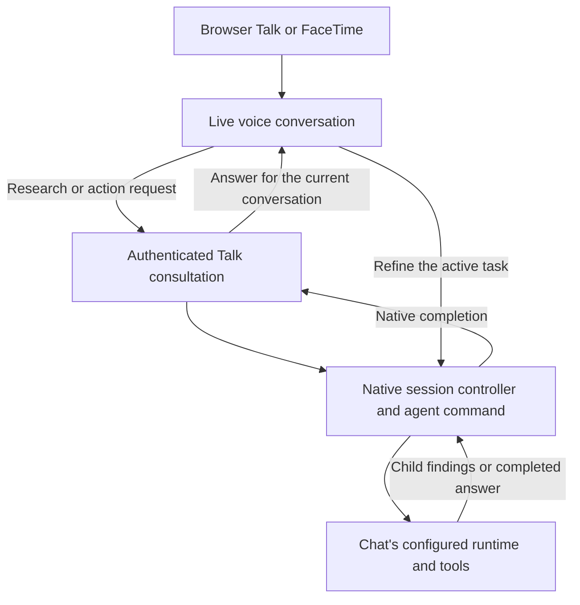

# Realtime delegation through the configured agent runtime

## Human section

### Design

Voice should use the same configured agent runtime as text. A user should be
able to delegate research, keep talking, refine that research, and hear the
finished answer without asking for it again. The conversation stays responsive
throughout. Browser Talk and FaceTime must both support this sequence.

The remaining upstream bug is where Talk starts agent work. It calls the
embedded API runner directly, bypassing the normal command that selects the
chat's runtime. A subscription-backed CLI chat can therefore work in text while
voice asks for an API key. Configuration alone does not repair that call path.

Propose using the upstream session controller and a bounded adaptation of
[OpenClaw PR #199379](https://github.com/openclaw/openclaw/pull/199379). The
controller is OpenClaw's owner of running work, queued input and Stop. Talk
should hand work to that owner and consume its result, while retaining the
caller's permissions and the voice connection's delivery checks.

#### Upgrade and repair in one release

Phase 1 landed OpenClaw 2026.11.4. The latest stable checked on November 18 is
2026.11.5. It contains the session-controller API used by this PR; that API is
absent from 11.4. It also brings relevant busy-session handling, delivery of
failed child results after a parent ends, Talk startup cleanup, and CLI transport
recovery. These are upstream capabilities, not promises that the whole voice
scenario already works.

**One Phase 2 candidate combines the 11.5 upgrade, proven patch removals and the
narrow voice-routing repair.** First test native 11.5 behavior in isolation to
identify redundant patches and separate upgrade failures from repair failures.
Then qualify and release the complete candidate together. The update must
preserve existing behavior and use native replacements wherever they are proved
equivalent. This avoids backporting a second session controller into 11.4. The
11.5 source still calls the embedded runner from Talk, so the update alone does
not complete this proposal.

#### Route voice through the normal agent command

One proposed patch, `talk-native-agent-runtime-consult.patch`, connects Gateway
Talk consultations to the authenticated agent-command entrypoint. That command
selects the session's configured runtime and its existing tools. Voice supplies
the request, caller identity, session and cancellation signal. It does not
choose a different model, create an API credential requirement, or grant extra
tool access.

The patch covers routing, use of native steering, and consuming the command's
settled result as one coherent Talk repair. It includes the necessary propagation
of permissions, workspace/session bindings, and internal reply metadata. Any
shared helper changes must preserve ordinary text behavior and the serialized
reply format. Talk's configured thinking preference may normalize to a supported
value without rewriting the chat preference or relaxing explicit text-command
validation. This is not a promise that every changed file is voice-only.

FaceTime already calls the shared Gateway Talk consultation runner through its
carrier integration. Preserve that route and its authenticated call ownership.
Do not broaden generic plugin voice bridges to obtain access to the agent.

#### Keep conversation, steering and completion native

Conversation and status questions remain available while tools run. A refinement
such as “only compare the two cheaper options” goes to OpenClaw's active-task
control path. It must reach that logical task once, with its current permissions.
Cancellation followed by a fresh request is not an acceptable imitation of
steering. If the task finishes during the refinement, use the native outcome
and explain accurately whether the input was accepted.

Child research results return through OpenClaw's normal parent continuation.
Talk consumes the final visible answer belonging to the current consultation
and presents it once, without another user prompt. OpenClaw retains ownership
of transcripts, queues, cancellation and result delivery. No new polling loop,
replay queue, transcript conversion or custom completion injection is proposed.

“Same task” does not mean “one subprocess forever.” Native CLI yield can end a
subprocess and resume the saved CLI session for a child-completion turn. Native
compaction can also advance session identity. The voice result must follow that
authorized continuation, while rejecting stale results from replaced calls.

Explicit task cancellation prevents further task effects and speech. A normal
hangup preserves the existing accepted-work policy: audio stops, accepted work
may finish in the canonical conversation, and a later call must not inherit
stale audio delivery rights. Partial output from a failed run is not presented
as successful completion. Failures must leave the call able to accept new work.

#### Review existing realtime patches together

The review includes every public and companion realtime patch, grouped by
behavior. Applying cleanly is not a reason to keep one. Record a remove, shrink
or retain decision per behavior against the exact 11.5 source. Preserve existing
coverage when a native implementation replaces a patch.

| Behavior and current public patches | Proposed treatment |
| --- | --- |
| Conversation and progress: `talk-conversation-progress` | Preserve live discussion and user-facing progress. Remove duplicate transport or ownership handling when native Talk passes the same tests. |
| Busy requests and failure recovery: `talk-overlap-recovery`, `talk-request-recovery` | Test native controller handling first. Remove obsolete refusal/recovery branches; retain truthful unsupported-runtime responses where still needed. Do not retain a competing steering path. |
| FaceTime: `facetime-talk-client` | Keep required call admission and audio transport. Reuse shared Talk controls and completion. Remove only behavior now supplied by native carrier support. |
| Cross-mode history: `shared-conversation-context` | Compare native CLI history updates with each consumer. Remove proven duplication; do not extend the backup harness to achieve voice parity. |
| Tool lifetime and result trust: `harness-tool-work-owner`, `untrusted-agent-results` | Check their interaction with native command execution. Preserve permission and untrusted-result boundaries. No new callback authority or plugin-scope bypass is part of this design. |
| Companion voice integration | Review provider transport, retirement, channel-delivery policy and request-context handling in the private repository. Keep account configuration and operational details private. |

These are audit directions, not claims that all listed patches are removable.
The approved CLI tool/sandbox behavior remains a requirement. Unrelated memory,
deployment and model-routing redesigns remain separate. The backup CLI keeps
its supported capabilities; this proposal adds no backup-specific steering fix.

#### Prove the complete user experience

The main acceptance scenario is one continuous conversation: request research,
keep discussing something else, refine the research, then receive the corrected
answer proactively. Run it with the configured subscription CLI and real tools
under the existing sandbox and workspace restrictions. Test both a busy parent
and a parent that yielded while its reader worked.

| Qualification | Required outcome |
| --- | --- |
| Browser Talk and FaceTime | Correct answer arrives without a follow-up prompt; ordinary conversation continues during research. |
| Active refinement | The same logical task receives the revision once. No cancellation/restart or duplicated external action. |
| Child completion and compaction | Findings reach the right parent and the answer reaches the current call once, including a native session continuation. |
| Races and failures | Completion racing steering, tool failure, CLI failure, startup refusal, Stop, hangup and reconnect leave truthful state and no stale speech. |
| Permissions and tools | Current caller policy, approvals, workspace restrictions and shell sandbox hold for initial work, steering and resumed work. |
| Existing data and text chat | Stored sessions, runtime selection, preferences and history survive the update. Ordinary chat, tool use and child completion keep working. |

Recorded fixtures provide deterministic timing and external-write checks.
Real subscription and voice-model qualification is also required. Synthetic
audio or a saved speech file does not establish physical microphone, device or
FaceTime acceptance; report that evidence separately.

### Status

**Approval:** Proposed. **Approval reference:** The requester asked for a
specific Phase 2 proposal for review, after requesting a pause following Phase 1.
The requester agreed to bundle the upgrade, patch removals and narrow patch in
one proposal and plan. That scope is reflected here as one release candidate.
Implementation approval for the completed design remains pending review.

Source and upstream review research are complete enough to propose the design.
No Phase 2 runtime has been changed or tested. PR #199379 is a draft, not an
accepted upstream fix. Its latest review still requires fresh-install and
existing-state acceptance. Patch removal decisions and end-to-end steering,
child completion and physical voice acceptance remain unproved locally.

## Agent section

### State

Documentation-only proposal, based on public main
`0e6b86208098fccf00d735161963c8deec6b8862`. The Phase 1 runtime baseline is
OpenClaw 2026.11.4, commit `d843d6af39a42cd3c30084edbeabeece732fd93a`.
This plan supersedes the deferred Phase 2 outline in
[the upgrade plan](voice-consultation-through-agent-turn.md). It does not
supersede Phase 1 release evidence or authorize reopening its retained output.

### Scope and acceptance criteria

Implement the Human section only after explicit approval. The production
acceptance target is the configured subscription CLI. Do not replace it with an
API-authenticated runner to pass tests. Preserve stock backup-runtime behavior
and coordinate, without overlapping, the separate fallback-routing owner.

Coverage must include active CLI steering and the native yield/resume path as
separate cases. If native child continuation cannot satisfy proactive delivery,
report that specific gap and revise the design before adding another patch.
No new delivery service, queue, scope restoration or authority workaround is
authorized by the proposed Talk patch.

### Architecture and decisions

Evidence checked on 2026-11-18:

- [11.5 release notes](https://github.com/openclaw/openclaw/releases/tag/v2026.11.5)
  identify relevant busy-session, Talk startup, child-result and CLI recovery
  changes. They also announce a breaking session-control contract for harnesses
  and plugin RPC handlers. Qualify affected integrations, not just compilation.
- [11.5 Talk runtime source](https://github.com/openclaw/openclaw/blob/v2026.11.5/src/gateway/talk/client-agent-runtime.ts)
  still calls `runEmbeddedAgent`. The same bypass exists in the prepared 11.4
  source. [Issue #161885](https://github.com/openclaw/openclaw/issues/161885)
  contains an independent 11.5 reproduction; that report is not local proof.
- [Native session admission](https://github.com/openclaw/openclaw/blob/v2026.11.5/src/sessions/session-controller.admission.ts)
  exists in 11.5 and is absent at that path in 11.4. Prefer the stable update to
  backporting the controller infrastructure used by the proposed Talk repair.
- [Official CLI documentation at 11.5](https://github.com/openclaw/openclaw/blob/v2026.11.5/docs/gateway/cli-backends.md)
  documents per-model runtime selection, Gateway tools over MCP, conversation
  updates and `sessions_yield` resumption. A resumed subprocess is not failure
  or a reason to switch providers.
- [PR #199379](https://github.com/openclaw/openclaw/pull/199379), reviewed head
  `6f7f68c4092718ceec5ff99a0694cc20b6291e02`, is open and draft. Its implementation
  uses `agentCommandFromGatewayIngress`, controller steering and the command's
  settled result. It changes shared helpers as well as Talk, so ordinary-turn
  regressions are mandatory. Pin the source used; do not follow a moving head.
- [Earlier local PR #347](https://github.com/coletaylor788/puddles/pull/347)
  remains held. It identified the command boundary but predates this controller
  design and mixes runtime and test-infrastructure changes. Do not resume or
  cherry-pick it wholesale. Compare useful regressions with the new design.

The local FaceTime `src/gateway/talk/carrier-session.ts` calls
`createTalkClientAgentConsultRunner`; this establishes a shared source path, not
proof that the upstream Gateway-only patch already passes carrier acceptance.
The private audit remains in its repository. No private operational material is
copied into this public plan.

### Implementation

After approval, use a fresh paired feature workspace from current mains. First
qualify 11.5 and record every patch's native equivalent or continuing need.
Preserve behavior during mechanical compatibility changes. Any new behavior
outside the named patch scope requires a revised decision before implementation.

For the combined candidate, derive `talk-native-agent-runtime-consult.patch`
from the pinned upstream proposal against 11.5. Preserve these bounds:

1. Reuse authenticated Gateway command admission. Carry the original input and
   caller authority once, with immediate revocation on abort.
2. Resolve follow-up readiness from the exact native controller operation and
   use its steering interface, not embedded-run registration or raw CLI stdin.
3. Use command-owned workspace preparation, configured runtime selection and
   per-run supported thinking preferences. Do not mutate stored preferences.
4. Consume settled visible completion, preserving private reply metadata and
   native session succession. Reject failed, aborted or replaced owners.
5. Keep exact source and current-call checks through the relay's speech claim.
   Preserve canonical transcript completion after normal transport detach.

Keep the patch in the public repository, without account-specific routing.
Companion changes are limited to necessary compatibility, qualification and
approved realtime retirement decisions. Register retained and new regressions
in the cumulative suite even when a patch is removed.

### Validation

Before removing each patch, run its meaningful regressions against the native
replacement on the complete composed runtime. A mock returning success does
not establish CLI steering or proactive voice delivery.

Address every substantive finding in the upstream review:

| Finding or evidence limit | Local qualification |
| --- | --- |
| Earlier CLI follow-ups required embedded registration | Real admitted CLI operation accepts a refinement and retains caller/tool policy. |
| Compaction changed the result's session owner | Exercise actual compaction and the composed Talk relay; require the authorized successor's answer once. Simulated callbacks alone are insufficient. |
| Relay retained the old session registration | Include a native session transition through the real registration and speech claim. |
| Incomplete CLI settlement could contain visible text | Failed and partial outcomes never claim successful final speech; the next request still works. |
| Fresh-install and stored-state proof remains open upstream | Test clean state and supported existing state, including model/runtime bindings, preferences, history, Doctor and startup. |
| Saved audio is not physical client proof | Separate real provider/tool evidence from browser microphone and FaceTime call acceptance. |

The upstream review currently reports no remaining actionable code finding,
but its acceptance gaps remain. Its reported CLI and locked-native speech proofs
are supporting evidence only. Locked-native compatibility is relevant shared
regression coverage, not a new local product or backup-parity commitment.

### Rollout and rollback

One combined candidate: 11.5, proven patch removals and the Talk repair. Use the
installed `build`, `ci-dev` and `ci-prod` entrypoints, fresh paired mains,
independent review, required source checks, full application suite, installed
TEST and bounded read-only PROD checks. Yield after dispatch and resume from
CI completion events. Verify exact terminal deployment receipts, source merge,
queue closure and eligible cleanup. CI owns deployment and recovery.

Native-baseline comparisons are local qualification stages, not an intermediate
production release. Preserve the subscription CLI and the Phase 1 containment contract.
No manual production restart, rollback, credential change or artifact copy is
part of this proposal. For a failed candidate, CI recovers to its accepted
baseline; it does not revert the architecture to an older harness.

### Review log

2026-11-18: Proposal authored after reading the pinned 11.4 source, relevant
11.5 source and documentation, current public/private realtime patch documents,
the held local patch summary, and PR #199379's latest review and changes.
No local Phase 2 implementation, runtime qualification or independent candidate
review is claimed. The document's local link, required section structure and
whitespace have been checked. The cited upstream source, release and review
pages were inspected. No runtime tests or CI dispatch apply to this docs-only change.

### Checklist

- [x] Record the user experience, native ownership and patch boundary.
- [x] Check latest stable and upstream feedback.
- [ ] Obtain approval for this specific design and patch scope.
- [ ] Qualify native 11.5 behavior and identify redundant patches locally.
- [ ] Complete realtime patch decisions and implement the bounded Talk fix.
- [ ] Pass deterministic, real CLI, child-continuation and voice qualification.
- [ ] Complete CI-owned production acceptance, exact merge and eligible cleanup.
- [ ] Record physical Browser Talk and FaceTime acceptance separately.
