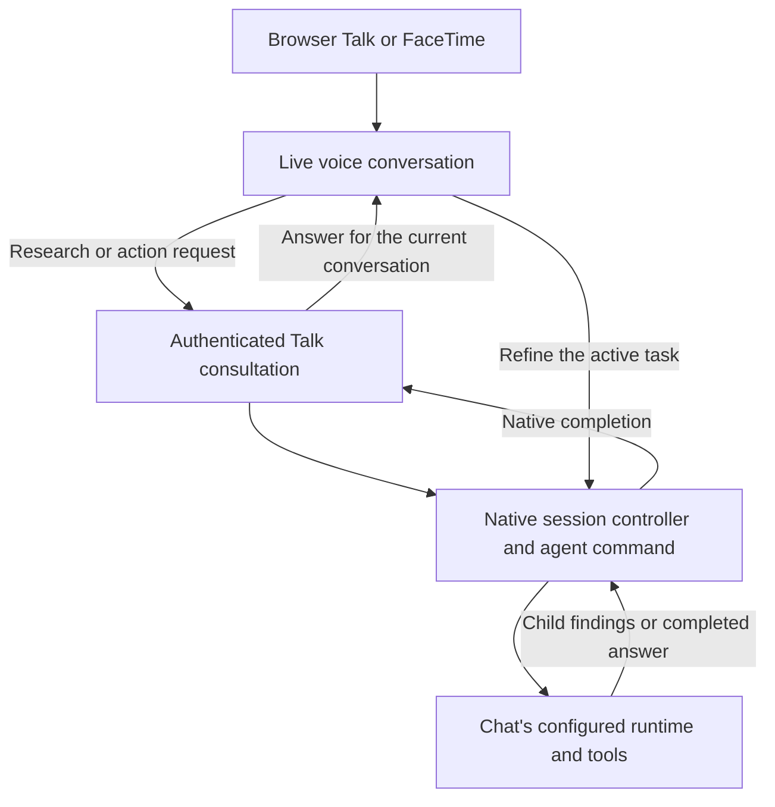

# Realtime delegation through the configured agent runtime

## Human section

### Design

Voice should use the same configured agent runtime as text. A user should be
able to delegate research, keep talking, refine that research, and hear the
finished answer without asking for it again. The conversation stays responsive
throughout. Browser Talk and FaceTime must both support this sequence.

The remaining upstream bug is where Talk starts agent work. It calls the
embedded API runner directly, bypassing the normal command that selects the
chat's runtime. A subscription-backed CLI chat can therefore work in text while
voice asks for an API key. Configuration alone does not repair that call path.

Propose using the upstream session controller and a bounded adaptation of
[OpenClaw PR #199379](https://github.com/openclaw/openclaw/pull/199379). The
controller is OpenClaw's owner of running work, queued input and Stop. Talk
should hand work to that owner and consume its result, while retaining the
caller's permissions and the voice connection's delivery checks.

#### Upgrade and repair in one release

Phase 1 landed OpenClaw 2026.11.4. The latest stable checked on November 18 is
2026.11.5. It contains the session-controller API used by this PR; that API is
absent from 11.4. It also brings relevant busy-session handling, delivery of
failed child results after a parent ends, Talk startup cleanup, and CLI transport
recovery. These are upstream capabilities, not promises that the whole voice
scenario already works.

**One Phase 2 candidate combines the 11.5 upgrade, proven patch removals and the
narrow voice-routing repair.** First test native 11.5 behavior in isolation to
identify redundant patches and separate upgrade failures from repair failures.
Then qualify and release the complete candidate together. The update must
preserve existing behavior and use native replacements wherever they are proved
equivalent. This avoids backporting a second session controller into 11.4. The
11.5 source still calls the embedded runner from Talk, so the update alone does
not complete this proposal.

#### Route voice through the normal agent command

**Start from the existing implementation in upstream
[PR #199379](https://github.com/openclaw/openclaw/pull/199379).** Port it to 11.5
and our retained patches as `talk-native-agent-runtime-consult.patch`; do not
reimplement its routing, steering or completion machinery. It will:

- Start voice work through the normal authenticated agent command, retaining
  the chat's configured runtime, caller permissions, workspace and sandbox.
- Send refinements through the native controller for the same logical task.
  Do not cancel and restart work to imitate steering.
- Return the command's settled answer through Talk's existing completion owner,
  including native yield/resume and session changes during compaction. Preserve
  internal reply metadata; reject partial failures and stale calls.
- Use the existing realtime integration for request classification and dispatch.
  No custom follow-up classifier, queue, replay mechanism or delivery service.

FaceTime already uses our shared Gateway Talk runner and must pass the same
acceptance scenario. Generic plugin voice bridges remain unchanged. Necessary
shared-helper changes must preserve ordinary text behavior, stored preferences
and the serialized reply format. Talk's machine-selected thinking preference
may normalize to a supported value without relaxing explicit text validation.

Keep the PR's already completed fixes for CLI steering, result ownership across
compaction, relay registration after a session change, and rejection of partial
failed completions. Its latest review reports no remaining actionable code
finding. The open items are acceptance evidence, plus our integration work:

| Work remaining | Specific requirement |
| --- | --- |
| **Open upstream: end-to-end proof** | Demonstrate a fresh installation and an upgrade from stable with real CLI tools and finalized speech. The author's saved-audio proof does not cover this matrix. |
| **Open upstream: existing-data compatibility** | Preserve stored session identity, model/runtime selection, fallback settings, native locks where applicable, thinking preferences and history. Validate Doctor and startup. |
| **Additional here: 11.5 and patch integration** | Port the PR's pinned implementation to the exact 11.5 tree, apply the patch table, and preserve the existing permissions and sandbox. No blanket adoption of the held local PR #347. |
| **Additional here: FaceTime** | Exercise the retained carrier integration through the same command and completion path. Upstream Gateway relay evidence does not establish our FaceTime behavior. |
| **Additional here: complete asynchronous scenario** | Prove same-task refinement and proactive reader-result delivery with a busy or yielded parent, actual compaction, and concurrent conversation. Include failure, Stop and reconnect; no duplicate work or stale speech. |

These are explicit implementation and qualification tasks, not authorization
for another delivery or authority patch. A new defect outside the proposed
scope returns to design review.

#### Existing patches: proposed disposition

These decisions come from inspecting the current patch bodies and their touched
upstream files at 11.4 and 11.5. **Keep** means preserve the behavior while porting
it to native 11.5 interfaces. **Remove** means delete the whole patch.
Tests qualify the resulting candidate without silently expanding its scope.

| Patch | Proposed treatment | Reason |
| --- | --- | --- |
| `shared-conversation-context` | **Remove** | Its remaining production change only exports `readSessionConversationContext`. No runtime caller remains in the composed source or either repository. Native CLI history already supplies conversation updates. Delete the unused helper and its patch registration; preserve native cross-mode history tests. The neighboring patch document describes an older caller that is no longer present. |
| `talk-request-recovery` | **Remove** | Use native realtime request classification, dispatch, acknowledgment and follow-up handling. Drop the entire patch, including custom status patterns, “also” classification, displaced-input messages and unaccepted-input handling. 11.5 fixes the misleading acknowledgment; the other removals deliberately choose stock behavior rather than claiming upstream equivalence. |
| `talk-overlap-recovery` | **Keep** | 11.5 still revokes the original answer and fails the voice connection when steering throws. Keep the narrow nonfatal treatment of confirmed unsupported steering. This protects the running task and call, including an unsupported backup runtime; it does not add steering capability to that runtime. |
| `talk-conversation-progress` | **Keep** | Native instructions still delegate reasoning and broad follow-ups, and the runner lacks the progress callback. Preserve conversational reasoning during research, silent user-facing progress, and the existing guards against progress/steering after transport retirement. This is separate from the new runtime-selection fix. |
| `facetime-talk-client` | **Keep** | 11.5's FaceTime changes do not add shared Talk mode, the carrier session API, shared result/steering ownership, or our helper packaging. Preserve those integrations, inbound-call restriction, audio startup and accepted-work lifetime. Port to the changed native call APIs; do not restore obsolete upstream types or duplicate the new native greeting logic. |
| `facetime-native/call-lifecycle` | **Keep** | This patches the separately pinned native helper, not OpenClaw. Updating OpenClaw does not replace its verified-muted answer acknowledgment or all-alias closure checks. Keep its separate source pin and compiled regressions. |
| `harness-tool-work-owner` | **Keep; shared dependency** | Native 11.5 still executes bound callbacks without capturing their current async work owner. Keep attempt ownership for reused transports and prepared tools. This affects regular turns too; do not expand it into a voice-specific authority mechanism. |
| `untrusted-agent-results` | **Keep; shared dependency** | Native completion metadata is not the configured source-agent trust policy. 11.5 still lacks `tools.agentToAgent.untrustedAgents` and its history/send/list projections. Keep the existing boundary for reader findings; do not redesign it as part of steering. |

Add only `talk-native-agent-runtime-consult.patch` for the repair described
above. Do not revive the held implementation in PR #347, the removed
`talk-agent-parity` patch, or test-only overlays retired in Phase 1. Companion
provider and delivery-policy patches have a separate private table, with the
same explicit keep/remove decisions. Other patch categories are not redesigned
in this realtime proposal.

#### Acceptance

One continuous Browser Talk and FaceTime conversation must delegate research,
remain conversational, accept a same-task refinement, and deliver the corrected
answer proactively. Cover a busy parent, native yield/resume, compaction,
completion racing steering, failure, Stop and hangup/reconnect. Keep current
permissions, sandboxing, stored sessions and ordinary text behavior intact.
Use deterministic recordings plus real subscription CLI and voice qualification;
report physical device acceptance separately.

### Status

**Approval:** Proposed. **Approval reference:** The requester approved bundling
11.5, patch removals and the narrow repair in one proposal, and requested this
explicit patch disposition before implementation. This is that review plan;
implementation remains paused pending approval of the completed scope.

Code inspection is complete for the listed realtime patches and their shared
dependencies. The recommendations are specific; no removal, port, runtime test
or deployment has been performed. Runtime qualification may expose a new gap,
which must be reported rather than silently enlarging the patch.

## Agent section

### State

Proposal only. Public base `fc295c9e8a0c2545181c62809783534c8f68a4e4`.
Compared OpenClaw 11.4 `d843d6af39a42cd3c30084edbeabeece732fd93a` with 11.5
`e13cf15ece9bbd969b7362927c315362c90c97ff`. Replaces the deferred Phase 2 outline
in [the upgrade plan](voice-consultation-through-agent-turn.md).

### Scope and acceptance criteria

The Human section is the complete patch decision. Preserve subscription CLI
access and containment. Backup routing stays separately owned.

### Architecture and decisions

Inspected current production patch hunks and their 11.4-to-11.5 counterparts:

- [Delegation controller](https://github.com/openclaw/openclaw/blob/v2026.11.5/extensions/openai/realtime-quicksilver-delegation-controller.ts): native acknowledgment, steering error handling and pending-input behavior.
- [Control classifier](https://github.com/openclaw/openclaw/blob/v2026.11.5/src/talk/agent-run-control-shared.ts), [instructions](https://github.com/openclaw/openclaw/blob/v2026.11.5/extensions/openai/realtime-quicksilver-instructions.ts) and [consult runner](https://github.com/openclaw/openclaw/blob/v2026.11.5/src/talk/agent-consult-runtime.ts): retained policy/progress gaps.
- [FaceTime driver](https://github.com/openclaw/openclaw/blob/v2026.11.5/extensions/facetime/src/talk-driver.ts) and [separate native helper contract](../openclaw-setup/patches/facetime-native/README.md).
- [Bound tools](https://github.com/openclaw/openclaw/blob/v2026.11.5/src/agents/harness/host-bound-tool.ts), [host capabilities](https://github.com/openclaw/openclaw/blob/v2026.11.5/src/agents/harness/host-capability.ts) and [native CLI history](https://github.com/openclaw/openclaw/blob/v2026.11.5/docs/gateway/cli-backends.md).

Runtime searches found only the removed helper's definition, no caller. The
private companion records provider-specific evidence without publishing it here.

### Implementation

After approval, start from PR #199379 head `6f7f68c4092718ceec5ff99a0694cc20b6291e02`,
not held PR #347. Resolve the open evidence gaps and additional integration
items listed above. Port retained behavior to native interfaces;
retain meaningful regressions independently of deleted patch registrations.

### Validation

No runtime tests for this documentation change. Qualify the combined candidate,
including real CLI/voice, existing state and Doctor, ordinary chat, and the
upstream review's steering, compaction/relay and partial-settlement findings.

### Rollout and rollback

One candidate, installed `build`, `ci-dev`, `ci-prod`, independent review and
normal CI gates. Yield after dispatch. CI owns deployment, recovery, exact merge
and eligible cleanup. No manual production changes or older-harness rollback.

### Review log

2026-11-18: Source audit completed; requester selected native dispatch and full removal of
`talk-request-recovery`. Decisions and document simplified for review.
Local links, structure and whitespace checked. Runtime acceptance remains open.

### Checklist

- [x] Inspect stable delta and choose patch dispositions.
- [ ] Obtain approval, implement and qualify the combined candidate through CI.
