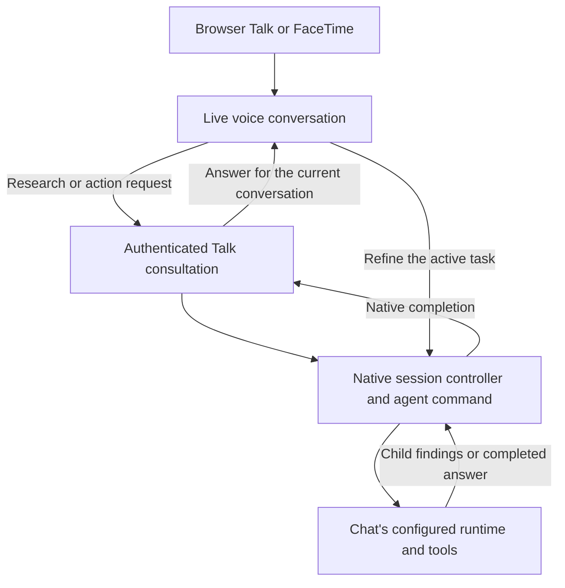
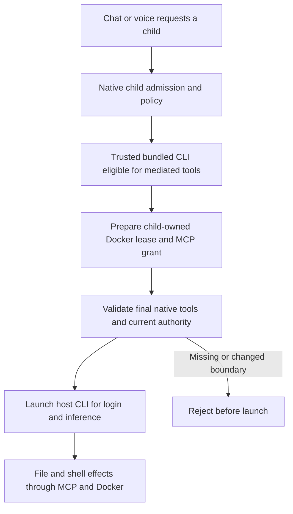

# Realtime delegation through the configured agent runtime

Status: Production approved; combined candidate qualification in progress
Issue: https://github.com/coletaylor788/puddles/issues/377
Last updated: 2026-11-21

## Human section

### Design

Voice should use the same configured agent runtime as text. A user should be
able to delegate research, keep talking, refine that research, and hear the
finished answer without asking for it again. The conversation stays responsive
throughout. Browser Talk and FaceTime must both support this sequence.

The remaining upstream bug is where Talk starts agent work. It calls the
embedded API runner directly, bypassing the normal command that selects the
chat's runtime. A subscription-backed CLI chat can therefore work in text while
voice asks for an API key. Configuration alone does not repair that call path.

Propose using the upstream session controller and a bounded adaptation of
[OpenClaw PR #199379](https://github.com/openclaw/openclaw/pull/199379). The
controller is OpenClaw's owner of running work, queued input and Stop. Talk
should hand work to that owner and consume its result, while retaining the
caller's permissions and the voice connection's delivery checks.

#### Upgrade and repair in one release

Phase 1 landed OpenClaw 2026.11.4. The latest stable checked on November 18 is
2026.11.5. It contains the session-controller API used by this PR; that API is
absent from 11.4. It also brings relevant busy-session handling, delivery of
failed child results after a parent ends, Talk startup cleanup, and CLI transport
recovery. These are upstream capabilities, not promises that the whole voice
scenario already works.

**One Phase 2 candidate combines the 11.5 upgrade, proven patch removals and the
narrow voice-routing repair.** First test native 11.5 behavior in isolation to
identify redundant patches and separate upgrade failures from repair failures.
Then qualify and release the complete candidate together. The update must
preserve existing behavior and use native replacements wherever they are proved
equivalent. This avoids backporting a second session controller into 11.4. The
11.5 source still calls the embedded runner from Talk, so the update alone does
not complete this proposal.

#### Route voice through the normal agent command

**Start from the existing implementation in upstream
[PR #199379](https://github.com/openclaw/openclaw/pull/199379).** Port it to 11.5
and our retained patches as `talk-native-agent-command.patch`; do not
reimplement its routing, steering or completion machinery. It will:

- Start voice work through the normal authenticated agent command, retaining
  the chat's configured runtime, caller permissions, workspace and sandbox.
- Send refinements through the native controller for the same logical task.
  Do not cancel and restart work to imitate steering.
- Return the command's settled answer through Talk's existing completion owner,
  including native yield/resume and session changes during compaction. Preserve
  internal reply metadata; reject partial failures and stale calls.
- Use the existing realtime integration for request classification and dispatch.
  No custom follow-up classifier, queue, replay mechanism or delivery service.

FaceTime will attach to the configured main session using existing native
interfaces and must pass the same acceptance scenario. Its adaptation stays
inside the FaceTime extension; it adds no Gateway or SDK entrypoint. Necessary
shared-helper changes must preserve ordinary text behavior, stored preferences
and the serialized reply format. Talk's machine-selected thinking preference
may normalize to a supported value without relaxing explicit text validation.

Keep the PR's already completed fixes for CLI steering, result ownership across
compaction, relay registration after a session change, and rejection of partial
failed completions. Its latest review reports no remaining actionable code
finding. The open items are acceptance evidence, plus our integration work:

| Work remaining | Specific requirement |
| --- | --- |
| **Open upstream: end-to-end proof** | Demonstrate a fresh installation and an upgrade from stable with real CLI tools and finalized speech. The author's saved-audio proof does not cover this matrix. |
| **Open upstream: existing-data compatibility** | Preserve stored session identity, model/runtime selection, fallback settings, native locks where applicable, thinking preferences and history. Validate Doctor and startup. |
| **Additional here: 11.5 and patch integration** | Port the PR's pinned implementation to the exact 11.5 tree, apply the patch table, and preserve the existing permissions and sandbox. No blanket adoption of the held local PR #347. |
| **Additional here: FaceTime** | Exercise the retained carrier integration through the same command and completion path. Upstream Gateway relay evidence does not establish our FaceTime behavior. |
| **Additional here: complete asynchronous scenario** | Prove same-task refinement and proactive reader-result delivery with a busy or yielded parent, actual compaction, and concurrent conversation. Include failure, Stop and reconnect; no duplicate work or stale speech. |

These are explicit implementation and qualification tasks, not authorization
for another delivery or authority patch. A new defect outside the proposed
scope returns to design review.

#### Existing patches: proposed disposition

These decisions come from inspecting the current patch bodies and their touched
upstream files at 11.4 and 11.5. **Keep** means preserve the behavior while porting
it to native 11.5 interfaces. **Remove** means delete the whole patch.
Tests qualify the resulting candidate without silently expanding its scope.

| Patch | Proposed treatment | Reason |
| --- | --- | --- |
| `shared-conversation-context` | **Remove** | Its remaining production change only exports `readSessionConversationContext`. No runtime caller remains in the composed source or either repository. Native CLI history already supplies conversation updates. Delete the unused helper and its patch registration; preserve native cross-mode history tests. The neighboring patch document describes an older caller that is no longer present. |
| `talk-request-recovery` | **Remove** | Use native realtime request classification, dispatch, acknowledgment and follow-up handling. Drop the entire patch, including custom status patterns, “also” classification, displaced-input messages and unaccepted-input handling. 11.5 fixes the misleading acknowledgment; the other removals deliberately choose stock behavior rather than claiming upstream equivalence. |
| `talk-overlap-recovery` | **Remove** | Use native steering success and failure handling. The supported CLI path must pass qualification; actual failures should surface normally. Remove the special nonfatal fallback for unsupported steering. |
| `talk-conversation-progress` | **Remove** | Its custom conversation policy and silent progress callbacks are not required for CLI routing, native steering or proactive final answers. Use native Talk behavior and supported instructions instead. Remove the entire patch, including its added hangup/steering guards; qualify those races against native behavior without carrying the hunks forward. |
| `facetime-talk-client` | **Change** | Replace the existing patch with changes confined to the FaceTime extension. Attach calls to the configured main session through existing native interfaces. Remove the added Gateway carrier API, SDK, plugin-loader and shared Talk runtime hunks. Preserve authenticated call admission and native task ownership; do not recreate steering or result delivery in the extension. |
| `facetime-native/call-lifecycle` | **Keep** | This patches the separately pinned native helper, not OpenClaw. Updating OpenClaw does not replace its verified-muted answer acknowledgment or all-alias closure checks. Keep its separate source pin and compiled regressions. |

Add only `talk-native-agent-command.patch` for the repair described
above. Do not revive the held implementation in PR #347, the removed
`talk-agent-parity` patch, or test-only overlays retired in Phase 1. Companion
provider and delivery-policy patches have a separate private table, with the
same explicit keep/remove decisions. Only realtime patches belong in this proposal. Other patch categories remain
unchanged apart from required compatibility with the upgraded baseline.

#### Acceptance

One continuous Browser Talk and FaceTime conversation must delegate research,
remain responsive, accept a same-task refinement, and deliver the corrected
answer proactively. Custom silent progress updates are not an acceptance requirement. Cover a busy parent, native yield/resume, compaction,
completion racing steering, failure, Stop and hangup/reconnect. Keep current
permissions, sandboxing, stored sessions and ordinary text behavior intact.
Use deterministic recordings plus real subscription CLI and voice qualification;
report physical device acceptance separately.

#### Approved extension: sandboxed delegated CLI admission

**Approval: Production approved.** On 2026-11-20 the requester approved adding the three Claude-specific guard exceptions to the existing patch and rolling it out: “Okay approved to add these guard exceptions into the patch and roll it out.” This extends the existing
[CLI sandbox handoff](../openclaw-setup/patches/cli-sandbox-handoff.md).

Earlier installed voice qualification completed the steered foreground command,
then rejected its research child at native sandboxed CLI admission. That guard
also applied to ordinary text chat and existed in the inspected 11.4, 11.5 and
11.6 source. The approved exceptions now admit the selected Claude child path.
The original handoff patch preserved it. Updating to 11.6 or changing
the fixture cannot establish the requested delegated CLI behavior.

Admit only the trusted bundled Claude backend whose file and shell
effects use the existing MCP tools and child-owned Docker sandbox. The CLI stays
on the host for account access and inference, as it does for the supported main
session. Exact tool-selection fields alone are not proof of containment.

At child creation, retain native requester, agent, model, workspace and sandbox
policy checks. The narrow backend eligibility decision must not authorize a
later launch by itself. Immediately before execution, verify that final native
CLI tools cannot perform host file or shell operations and that the current
child owns the required Docker lease and invocation grant. Use the existing
prepared workspace and grant lifecycle, not a parent grant or a generic bypass
flag. Missing Docker, lost authority or unsupported tool settings must fail.

Repeat the admission checks for resumed work, fallback, runtime changes and
configuration changes. Unsupported CLI backends and host fallback remain denied.
Native child coordination, steering, result delivery and Stop remain unchanged.
The proposal applies to child requests from both ordinary chat and voice. Cron
admission and stock Copilot behavior remain unchanged.

Before shipping, prove hidden and visible child creation, resume and fallback,
then refusal for missing Docker, native-tool overrides, revoked grants and any
unmediated CLI file or shell path. Verify workspace confinement, exact tool
selection, child cleanup and ordinary main-session behavior. Finally rerun the
real CLI Talk scenario through reader yield and proactive completion. The
isolated [prototype](claude-child-sandbox-poc.md) proves the selected Docker/Claude
path, including real child delivery and resume. Combined release qualification
and the wider authority-loss matrix remain release gates.

### Status

**Approval: Production approved for the complete scope.** On 2026-11-18 the
requester approved the combined 11.5 upgrade, four removals, upstream-based Talk
repair and extension-only FaceTime attachment through shipping and cleanup.
That approval remains valid. No new FaceTime Gateway entrypoint is allowed.
On 2026-11-20 the requester approved adding the three Claude-specific guard exceptions to the existing patch and rolling it out: “Okay approved to add these guard exceptions into the patch and roll it out.”

The child expansion is reviewed and passes installed execution, including child
completion and the resumed parent answer. The existing Talk patch now corrects
yield settlement and selects the command's final answer instead of combining
it with earlier CLI answers. The latest DEV run exposed that second defect when
an answer arrived before Claude consumed a refinement. Both repairs retain native
completion ownership. Complete Talk, TEST and PROD qualification and physical-call
acceptance remain open.

## Agent section

### State

Original Phase 2 scope and the three Claude admission exceptions are production
approved. Public base `fc295c9e8a0c2545181c62809783534c8f68a4e4`; approved native
pin 11.5 `e13cf15ece9bbd969b7362927c315362c90c97ff`. This replaces the deferred
outline in [the upgrade plan](voice-consultation-through-agent-turn.md).

DEV `gh-44801823538-1` is terminal failed with `phase=complete`, `child=null`,
source queue closure and transfer cleanup. Installed checks and real subscription/
sandbox qualification pass. Talk admits the reader, yields and receives its
result; the resumed parent produces the exact final. The voice append times out
because the Talk command adapter rejects yielded settlement and revokes its
promoted requester-final attachment. Correct that adapter within the approved
Talk patch, preserve the three sandbox exceptions and build a new sealed candidate.

R13 DEV `gh-44842964047-1`, candidate `4f37330968773ad96ebd764db2d6f93c79f00797dc4c435e29c947668ff4bbd6`,
is terminal failed with cleanup closed. The installed and sandbox checks pass.
The Talk assertion detects the original answer alongside the steered answer,
before reader yield starts. Native CLI records retain the original as interim
history; Talk joined both payloads despite the final-answer metadata selecting
only the corrected answer. Use that existing metadata for speech, with the
payload projection retained only for runtimes lacking a terminal snapshot.
Silent or empty snapshots must not revive earlier answers. No browser/runtime
configuration or sandbox admission change is part of this correction.

### Scope and acceptance criteria

The Human section is the complete patch decision. Preserve subscription CLI
access and containment. Backup routing stays separately owned.

### Architecture and decisions

Inspected current production patch hunks and their 11.4-to-11.5 counterparts:

- [Delegation controller](https://github.com/openclaw/openclaw/blob/v2026.11.5/extensions/openai/realtime-quicksilver-delegation-controller.ts): native acknowledgment, steering error handling and pending-input behavior; use these directly.
- [Control classifier](https://github.com/openclaw/openclaw/blob/v2026.11.5/src/talk/agent-run-control-shared.ts), [instructions](https://github.com/openclaw/openclaw/blob/v2026.11.5/extensions/openai/realtime-quicksilver-instructions.ts) and [consult runner](https://github.com/openclaw/openclaw/blob/v2026.11.5/src/talk/agent-consult-runtime.ts): custom policy/progress additions being removed in favor of native behavior.
- [FaceTime driver](https://github.com/openclaw/openclaw/blob/v2026.11.5/extensions/facetime/src/talk-driver.ts) and [separate native helper contract](../openclaw-setup/patches/facetime-native/README.md).
- [Native CLI history](https://github.com/openclaw/openclaw/blob/v2026.11.5/docs/gateway/cli-backends.md): conversation updates on native CLI resume.

Runtime searches found only the removed helper's definition, no caller. The
private companion records provider-specific evidence without publishing it here.

### Implementation

Start from PR #199379 head `6f7f68c4092718ceec5ff99a0694cc20b6291e02`,
not held PR #347. Resolve the open evidence gaps and additional integration
items listed above. Port retained behavior to native interfaces;
retain meaningful regressions independently of deleted patch registrations.

The Talk command adapter now recognizes an authoritative successful yield as
settlement of its acknowledgement. This releases only the provisional binding;
the existing promoted native attachment owns later child-result speech. Terminal
write draining, abort/error checks, receipt identity and current-voice checks
remain. No new delivery mechanism or sandbox change accompanies this repair.

#### Upgrade compatibility

Native 11.5 Cron replaces the retired heartbeat tool path. Remove the now-unused
`native-heartbeat-response` patch and qualify quiet completion, one alert,
isolated history and main-session continuation through native Cron. Existing
schedule conversion stays owned by native Doctor. The Workshop patch also
shrinks to removing an obsolete diagnostic because native tool construction now
supports the configured sandboxed grant. Neither change adds custom routing.

### Validation

The terminal-answer regression first fails all three added cases on the previous
source. The correction passes 51 focused tests across Talk projection, the real
Gateway command path and Quicksilver delegation (98.92 seconds across three
shards, plus 44.67 seconds of compiler preparation). Core types pass. The complete
25-patch composition applies to pinned 11.5 and exactly reproduces the changed
source and tests. Retained review has no findings. Installed voice acceptance
still requires a new DEV run.

R12 DEV passes all twelve installed checks and real Claude subscription and
boundary qualification. Native transcripts prove foreground steering, accepted
reader execution, yield, successful child completion and the resumed parent
answer. The remaining failure is the voice callback after yield. A regression
without an embedded run reproduces that failure on the old adapter. The repair
passes all eighteen focused requester-final and Gateway CLI-routing checks, plus
core types. The changed requester-final file takes 8.93 seconds wall time; the
Gateway file takes 37.88 seconds because it exercises the real Gateway command
composition. Installed voice acceptance remains pending.

The 11.5 and 11.6 `subagent-spawn-child-plan.ts` files share exact Git blob
`48dc48175daaea6d6561646ea1f6f87264055d4f`; review confirms the same refusal in
11.4. The newer release does not provide the proposed path. Keep the approved
11.5 pin. The isolated expansion passes 106 focused tests, six manifest checks,
and real Gateway/MCP/Docker containment checks. Real Claude proves hidden and
visible child tools, resume and parent-visible delivery; all three runs settle
and clean up before shutdown. The maintained patch reproduces the tested source
exactly. See the [prototype evidence](claude-child-sandbox-poc.md) for limitations.
The combined installed release suite and complete Talk scenario still must pass.

### Rollout and rollback

One candidate, installed `build`, `ci-dev`, `ci-prod`, independent review and
normal CI gates. Yield after dispatch. CI owns deployment, recovery, exact merge
and eligible cleanup. No manual production changes or older-harness rollback.

### Review log

2026-11-20: Retained independent reviewer found no findings in the narrow
expansion or final delivery proof. Requester approved production rollout. Only
three provider conditions change runtime admission; other CLI providers and
cron keep their guards. Updated regression expectations and manifest entries
accompany the same patch. Retained review confirms exact integration of all
four source/test files and preservation of the composed baseline. Combined
candidate qualification is pending. R12 subsequently exposed the CLI-yield
completion claim defect; retained review cleared its correction within the
existing Talk adapter. Red-to-green proof covers the non-embedded current owner
and preserves stale-owner refusal. The isolated sandbox expansion is unchanged.

2026-11-19: The parent and retained reviewer reviewed the additional admission
boundary as a proposal. Final tool confinement and child-owned Docker/grant
custody are required; exact selection fields alone are insufficient. Runtime
implementation remains unapproved. Current plan structure and local links were
reviewed directly; no documentation-wording tests or runtime gates were run.

2026-11-18: Source audit completed; requester selected native dispatch and native steering failures. Propose full
removal of request recovery, overlap recovery and conversation progress.
The FaceTime integration is now Change with an extension-only boundary; the
separate native helper remains Keep.
Local links, structure and whitespace checked. Runtime acceptance remains open.

### Checklist

- [x] Inspect stable delta and choose patch dispositions.
- [x] Record production approval and the extension-only FaceTime boundary.
- [x] Obtain separate production approval for the three Claude admission exceptions.
- [x] Integrate the tested expansion into the existing handoff patch.
- [ ] Qualify the combined candidate through DEV, TEST and PROD.
- [ ] Record physical FaceTime and audible-delivery acceptance.
