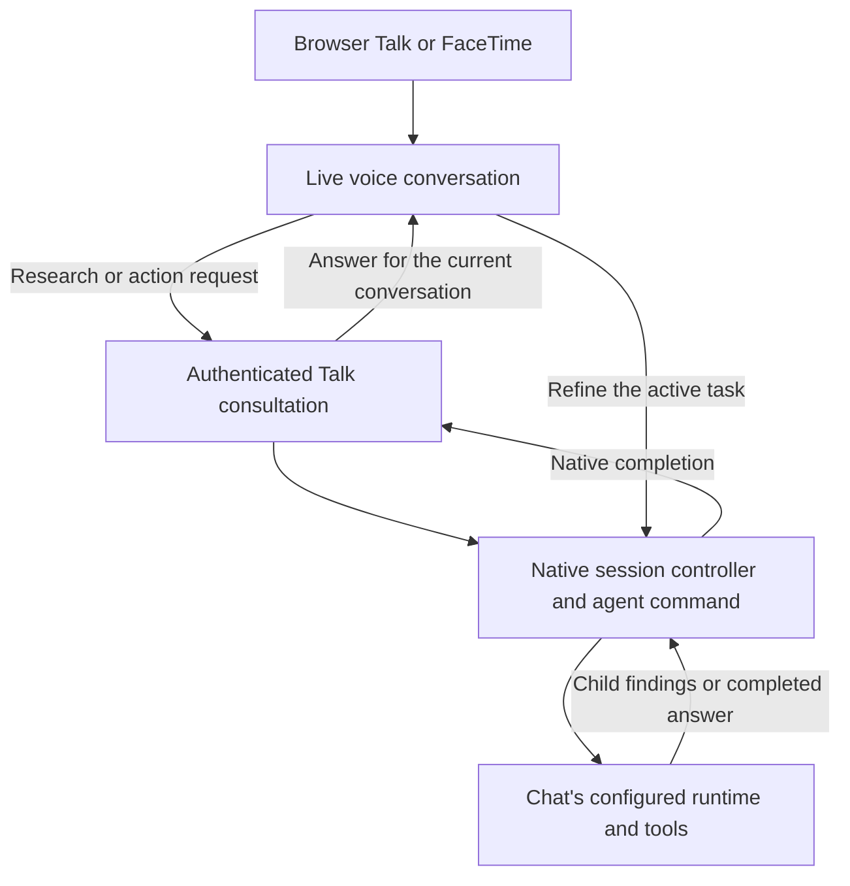

# Realtime delegation through the configured agent runtime

## Human section

### Design

Voice should use the same configured agent runtime as text. A user should be
able to delegate research, keep talking, refine that research, and hear the
finished answer without asking for it again. The conversation stays responsive
throughout. Browser Talk and FaceTime must both support this sequence.

The remaining upstream bug is where Talk starts agent work. It calls the
embedded API runner directly, bypassing the normal command that selects the
chat's runtime. A subscription-backed CLI chat can therefore work in text while
voice asks for an API key. Configuration alone does not repair that call path.

Propose using the upstream session controller and a bounded adaptation of
[OpenClaw PR #199379](https://github.com/openclaw/openclaw/pull/199379). The
controller is OpenClaw's owner of running work, queued input and Stop. Talk
should hand work to that owner and consume its result, while retaining the
caller's permissions and the voice connection's delivery checks.

#### Upgrade and repair in one release

Phase 1 landed OpenClaw 2026.11.4. The latest stable checked on November 18 is
2026.11.5. It contains the session-controller API used by this PR; that API is
absent from 11.4. It also brings relevant busy-session handling, delivery of
failed child results after a parent ends, Talk startup cleanup, and CLI transport
recovery. These are upstream capabilities, not promises that the whole voice
scenario already works.

**One Phase 2 candidate combines the 11.5 upgrade, proven patch removals and the
narrow voice-routing repair.** First test native 11.5 behavior in isolation to
identify redundant patches and separate upgrade failures from repair failures.
Then qualify and release the complete candidate together. The update must
preserve existing behavior and use native replacements wherever they are proved
equivalent. This avoids backporting a second session controller into 11.4. The
11.5 source still calls the embedded runner from Talk, so the update alone does
not complete this proposal.

#### Route voice through the normal agent command

**Start from the existing implementation in upstream
[PR #199379](https://github.com/openclaw/openclaw/pull/199379).** Port it to 11.5
and our retained patches as `talk-native-agent-command.patch`; do not
reimplement its routing, steering or completion machinery. It will:

- Start voice work through the normal authenticated agent command, retaining
  the chat's configured runtime, caller permissions, workspace and sandbox.
- Send refinements through the native controller for the same logical task.
  Do not cancel and restart work to imitate steering.
- Return the command's settled answer through Talk's existing completion owner,
  including native yield/resume and session changes during compaction. Preserve
  internal reply metadata; reject partial failures and stale calls.
- Use the existing realtime integration for request classification and dispatch.
  No custom follow-up classifier, queue, replay mechanism or delivery service.

FaceTime will attach to the configured main session using existing native
interfaces and must pass the same acceptance scenario. Its adaptation stays
inside the FaceTime extension; it adds no Gateway or SDK entrypoint. Necessary
shared-helper changes must preserve ordinary text behavior, stored preferences
and the serialized reply format. Talk's machine-selected thinking preference
may normalize to a supported value without relaxing explicit text validation.

Keep the PR's already completed fixes for CLI steering, result ownership across
compaction, relay registration after a session change, and rejection of partial
failed completions. Its latest review reports no remaining actionable code
finding. The open items are acceptance evidence, plus our integration work:

| Work remaining | Specific requirement |
| --- | --- |
| **Open upstream: end-to-end proof** | Demonstrate a fresh installation and an upgrade from stable with real CLI tools and finalized speech. The author's saved-audio proof does not cover this matrix. |
| **Open upstream: existing-data compatibility** | Preserve stored session identity, model/runtime selection, fallback settings, native locks where applicable, thinking preferences and history. Validate Doctor and startup. |
| **Additional here: 11.5 and patch integration** | Port the PR's pinned implementation to the exact 11.5 tree, apply the patch table, and preserve the existing permissions and sandbox. No blanket adoption of the held local PR #347. |
| **Additional here: FaceTime** | Exercise the retained carrier integration through the same command and completion path. Upstream Gateway relay evidence does not establish our FaceTime behavior. |
| **Additional here: complete asynchronous scenario** | Prove same-task refinement and proactive reader-result delivery with a busy or yielded parent, actual compaction, and concurrent conversation. Include failure, Stop and reconnect; no duplicate work or stale speech. |

These are explicit implementation and qualification tasks, not authorization
for another delivery or authority patch. A new defect outside the proposed
scope returns to design review.

#### Existing patches: proposed disposition

These decisions come from inspecting the current patch bodies and their touched
upstream files at 11.4 and 11.5. **Keep** means preserve the behavior while porting
it to native 11.5 interfaces. **Remove** means delete the whole patch.
Tests qualify the resulting candidate without silently expanding its scope.

| Patch | Proposed treatment | Reason |
| --- | --- | --- |
| `shared-conversation-context` | **Remove** | Its remaining production change only exports `readSessionConversationContext`. No runtime caller remains in the composed source or either repository. Native CLI history already supplies conversation updates. Delete the unused helper and its patch registration; preserve native cross-mode history tests. The neighboring patch document describes an older caller that is no longer present. |
| `talk-request-recovery` | **Remove** | Use native realtime request classification, dispatch, acknowledgment and follow-up handling. Drop the entire patch, including custom status patterns, “also” classification, displaced-input messages and unaccepted-input handling. 11.5 fixes the misleading acknowledgment; the other removals deliberately choose stock behavior rather than claiming upstream equivalence. |
| `talk-overlap-recovery` | **Remove** | Use native steering success and failure handling. The supported CLI path must pass qualification; actual failures should surface normally. Remove the special nonfatal fallback for unsupported steering. |
| `talk-conversation-progress` | **Remove** | Its custom conversation policy and silent progress callbacks are not required for CLI routing, native steering or proactive final answers. Use native Talk behavior and supported instructions instead. Remove the entire patch, including its added hangup/steering guards; qualify those races against native behavior without carrying the hunks forward. |
| `facetime-talk-client` | **Change** | Replace the existing patch with changes confined to the FaceTime extension. Attach calls to the configured main session through existing native interfaces. Remove the added Gateway carrier API, SDK, plugin-loader and shared Talk runtime hunks. Preserve authenticated call admission and native task ownership; do not recreate steering or result delivery in the extension. |
| `facetime-native/call-lifecycle` | **Keep** | This patches the separately pinned native helper, not OpenClaw. Updating OpenClaw does not replace its verified-muted answer acknowledgment or all-alias closure checks. Keep its separate source pin and compiled regressions. |

Add only `talk-native-agent-command.patch` for the repair described
above. Do not revive the held implementation in PR #347, the removed
`talk-agent-parity` patch, or test-only overlays retired in Phase 1. Companion
provider and delivery-policy patches have a separate private table, with the
same explicit keep/remove decisions. Only realtime patches belong in this proposal. Other patch categories remain
unchanged apart from required compatibility with the upgraded baseline.

#### Acceptance

One continuous Browser Talk and FaceTime conversation must delegate research,
remain responsive, accept a same-task refinement, and deliver the corrected
answer proactively. Custom silent progress updates are not an acceptance requirement. Cover a busy parent, native yield/resume, compaction,
completion racing steering, failure, Stop and hangup/reconnect. Keep current
permissions, sandboxing, stored sessions and ordinary text behavior intact.
Use deterministic recordings plus real subscription CLI and voice qualification;
report physical device acceptance separately.

### Status

**Approval:** Production approved. **Approval reference:** On 2026-11-18 the
requester said: “mark it change and adapt it to be a facetime extension change
only that has it attach to main session. Then design is approved to push
implement and ship.” This approves the combined 11.5 upgrade, four removals,
upstream-based Talk repair and extension-only FaceTime adaptation through CI,
source merge and eligible cleanup. No new FaceTime Gateway entrypoint is allowed.

The extension-only FaceTime client is implemented and source-reviewed. Focused
attachment and shutdown regressions, composition, and core and extension type
checks pass. Two DEV attempts failed during startup; both transactions and their
cleanup have closed. The recording fixture now permits the native broker's
startup sequence. Full local startup then exposed a lost ownership result in
the retained local-service lifecycle patch's 11.5 port. Restore that existing
contract, review and test it, and require full local readiness before another
DEV submission. Production remains on Phase 1. Live subscription, realtime and
production acceptance for Phase 2 are still pending.

## Agent section

### State

Production-approved implementation. Public base `fc295c9e8a0c2545181c62809783534c8f68a4e4`.
Compared OpenClaw 11.4 `d843d6af39a42cd3c30084edbeabeece732fd93a` with 11.5
`e13cf15ece9bbd969b7362927c315362c90c97ff`. Replaces the deferred Phase 2 outline
in [the upgrade plan](voice-consultation-through-agent-turn.md).

### DEV startup repair checkpoint

DEV runs `gh-44479246590-1` and `gh-44483099167-1` failed before installed
acceptance. Both target receipts are terminal with `phase=complete` and no child;
the corresponding source queues and cleanup are closed. Do not retry their
unchanged candidates.

The native resource broker retries a missing socket while its listener starts.
The recording fixture must allow that attempt beneath the validated owned
broker directory, rather than throw synchronously. Existing invalid socket
leaves and unrelated network access remain denied. Focused fixture checks pass.

Full local startup with the declared model assets then reaches memory warmup,
where the retained service lease lacks its ownership result. Correct that
existing lifecycle patch without replacing native startup or credential checks.
Review and run its registered regressions, rebuild, and require local readiness
and process closure before submitting the successor. This local proof does not
replace DEV, subscription, realtime, TEST or PROD acceptance.

### Scope and acceptance criteria

The Human section is the complete patch decision. Preserve subscription CLI
access and containment. Backup routing stays separately owned.

### Architecture and decisions

Inspected current production patch hunks and their 11.4-to-11.5 counterparts:

- [Delegation controller](https://github.com/openclaw/openclaw/blob/v2026.11.5/extensions/openai/realtime-quicksilver-delegation-controller.ts): native acknowledgment, steering error handling and pending-input behavior; use these directly.
- [Control classifier](https://github.com/openclaw/openclaw/blob/v2026.11.5/src/talk/agent-run-control-shared.ts), [instructions](https://github.com/openclaw/openclaw/blob/v2026.11.5/extensions/openai/realtime-quicksilver-instructions.ts) and [consult runner](https://github.com/openclaw/openclaw/blob/v2026.11.5/src/talk/agent-consult-runtime.ts): custom policy/progress additions being removed in favor of native behavior.
- [FaceTime driver](https://github.com/openclaw/openclaw/blob/v2026.11.5/extensions/facetime/src/talk-driver.ts) and [separate native helper contract](../openclaw-setup/patches/facetime-native/README.md).
- [Native CLI history](https://github.com/openclaw/openclaw/blob/v2026.11.5/docs/gateway/cli-backends.md): conversation updates on native CLI resume.

Runtime searches found only the removed helper's definition, no caller. The
private companion records provider-specific evidence without publishing it here.

### Implementation

Start from PR #199379 head `6f7f68c4092718ceec5ff99a0694cc20b6291e02`,
not held PR #347. Resolve the open evidence gaps and additional integration
items listed above. Port retained behavior to native interfaces;
retain meaningful regressions independently of deleted patch registrations.

### Upgrade compatibility

Native 11.5 Cron replaces the retired heartbeat tool path. Remove the now-unused
`native-heartbeat-response` patch and qualify quiet completion, one alert,
isolated history and main-session continuation through native Cron. Existing
schedule conversion stays owned by native Doctor. The Workshop patch also
shrinks to removing an obsolete diagnostic because native tool construction now
supports the configured sandboxed grant. Neither change adds custom routing.

### Validation

Focused FaceTime attachment tests, combined core and extension typechecks, and
63 fixture and manifest tests pass. The complete patch stack applies in order
from the pinned upstream tree and has independent source review. Final native
runtime and installed acceptance gates remain pending. Qualify the combined candidate,
including real CLI/voice, existing state and Doctor, ordinary chat, and the
upstream review's steering, compaction/relay and partial-settlement findings.

### Rollout and rollback

One candidate, installed `build`, `ci-dev`, `ci-prod`, independent review and
normal CI gates. Yield after dispatch. CI owns deployment, recovery, exact merge
and eligible cleanup. No manual production changes or older-harness rollback.

### Review log

2026-11-18: Source audit completed; requester selected native dispatch and native steering failures. Propose full
removal of request recovery, overlap recovery and conversation progress.
The FaceTime integration is now Change with an extension-only boundary; the
separate native helper remains Keep.
Local links, structure and whitespace checked. Runtime acceptance remains open.

### Checklist

- [x] Inspect stable delta and choose patch dispositions.
- [x] Record production approval and the extension-only FaceTime boundary.
- [ ] Implement and qualify the combined candidate through CI.
