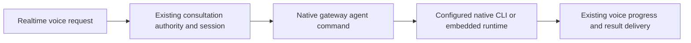

# Realtime consultation through the configured agent runtime

Status: Production approved
Issue: https://github.com/coletaylor788/puddles/issues/346
Last updated: 2026-11-10
Owner: Realtime consultation repair owner

## Human section

### Design

#### Problem and outcome

Realtime voice consultations call the embedded agent runner directly. When the selected model uses a native CLI runtime, that entrypoint can request API authentication instead of starting the configured CLI. Ordinary text messages use a dispatcher that selects the native runtime first. Voice requests fail before the configured agent starts.

#### Execution flow

Use the existing authenticated gateway agent command for realtime consultations so text and voice honor the same model runtime and fallback selection. Preserve the existing voice session, authenticated caller, cancellation, progress, and spoken result ownership.

#### Runtime selection

Honor the configured model and native authentication through the existing dispatcher. Do not add a direct provider client, copy credentials, or change the configured primary runtime. Model fallback follows the existing agent policy.

#### Session and lifecycle

Keep the current session and native bindings. Carry caller authority, tool policy, cancellation, and request ownership through the dispatch boundary. Return public progress and one final result through the existing voice bridge. A closed or superseded request cannot speak a late result. Existing steering and delegated completion contracts remain supported.

#### Validation and delivery

Add a regression that reaches runtime selection with a native model and no API credential. Cover fallback, cancellation, and result ownership at the changed boundary. Exercise the installed candidate in DEV before production CI. CI retains deployment, backup, recovery, merge, and cleanup ownership.

### Status

**Approval:** Production approved.

**Approval reference:** Requester approved the proposed normal-agent routing repair on 2026-11-10: “Sounds good, let's make this repair. Keep current state as baseline ... work on rolling out a fix on top.”

**Scope and limits:** Repair realtime delegation on top of the current native CLI deployment. Preserve existing state and new work. Temporary realtime unavailability is acceptable. Do not restore a runtime from before native CLI adoption. Calendar filtering, email runtime bindings, and native call helper permissions are separate work.

**Progress:** The native gateway command repair is implemented and exported. All 226 focused checks and 19 patch-manifest checks pass. The retained reviewer is checking the final paired export. No deployment submitted.

## Agent section

### State

Implementation is complete on `codex/realtime-cli-consult-repair`; final review and installed qualification remain. No deployment has been submitted.

### Scope and acceptance criteria

Realtime consultations must honor the configured native runtime without requiring API credentials. Preserve session continuity, caller authority, tool policy, cancellation, progress, fallback and exactly one owned final result. Synthetic tests must not deliver messages or mutate external accounts.

### Architecture and decisions

Use the existing `agentCommandFromGatewayIngress` within the Talk consultation lifecycle. Its trusted options already carry authenticated owner status, tool restrictions, operator authority, cancellation, operational run identity and the hidden user turn recorder. It selects the configured native runtime and returns original yield metadata. Preserve exact session continuity and Talk completion ownership. Reuse run-scoped progress events and preserve session tool overrides in native execution.

### Implementation

Prepared source entrypoints are `src/gateway/talk/client-agent-consult.ts`, `src/agents/agent-command.ts`, and `src/agents/command/attempt-execution.ts`. Promote the complete source change into a maintained patch and register regressions in the cumulative patch suite. Preserve existing Talk progress, authority, overlap recovery and requester-result patches.

### Validation

The native revision passed 226 checks across six focused test files in 53.48 seconds and 19 public patch-manifest checks. The composed regression reaches the production runtime selector for both the configured model and an explicit model without a session runtime override. Embedded API execution is a failing double, and the CLI call must receive the session tool overrides. DEV must exercise installed native CLI consultation, including tool use and session continuity. The accumulated application suite runs through production CI.

### Rollout and rollback

Refresh both mains and freeze the current production baseline. Use installed `build`, `ci-dev`, and `ci-prod`; record IDs and yield after dispatch. CI owns deployment, tests, recovery, merge and cleanup. Recovery captures the current native CLI deployment and state. A pre-adoption backup is not an allowed repair baseline.

### Review log

Independent review found the existing authenticated gateway command is a smaller suitable seam. The draft custom owner-authority handoff is unnecessary and will not be added. Remove draft reply-dispatch ownership/continuation hooks. Preserve native caller restrictions, session tool overrides, progress, cancellation and result ownership. Complete revised-diff review remains required.

### Checklist

- [x] Record production approval and current-baseline constraint.
- [x] Implement and register durable regressions.
- [ ] Complete focused checks and independent review.
- [ ] Pass installed DEV consultation.
- [ ] Confirm production terminal receipt, source merge and cleanup.
