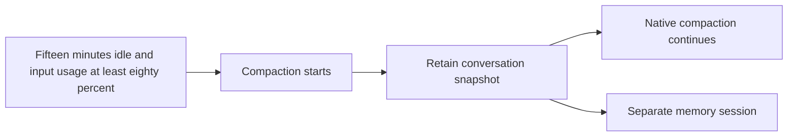

# Response latency and native maintenance

Status: Production approved, CI preparation
Issue: To be linked
Last updated: 2026-10-26
Owner: Latency feature owner

## Human section

### Design

Compaction and durable memory saving can delay a reply when they run in the foreground. Custom delegation handoffs also duplicate behavior now provided by native parent continuation.

The public implementation contains Claude Code integration and shared OpenClaw support. Provider-specific integrations and deployment configuration belong in their companion repositories.

#### Save durable memories when compaction starts

Retain a bounded snapshot before acknowledging compaction. A separate session saves durable facts through existing memory tools and source permissions. Claude's native PreCompact callback captures the active native parent chain, including tool results. Manual and idle compaction use the same callback. Token thresholds, transcript size and reply completion do not independently initiate another save for an opted-in harness. Deduplication and recovery use the captured history; new foreground activity does not cancel an admitted saver.

#### Compact Claude sessions while idle

Schedule native Claude compaction after fifteen minutes without activity and at least eighty percent of the effective input budget. Recheck queued work, delegated work, pending delivery and session identity at expiry. Waiting holds no writer or command budget. Native automatic compaction remains the fallback. Real native cancellation, resume and foreground admission remain acceptance requirements.

#### Use native delegation

Retire blocking-gather and durable-handoff customizations together. Native parent continuation already provides the original parent-final and stale-child delivery repairs. Preserve untrusted-source wrapping and persisted completion recovery. Reconcile outstanding custom records before switching behavior, with restart coverage and no replay of consumed results.

### Status

**Approval:** Production approved. **Approval reference:** The requester approved implementation and shipping on October 18, approved shared code and Claude publication, then resumed work on October 24 using build, ci-dev and ci-prod. Public changes exclude other provider integrations.

The latest DEV run confirms native Claude compaction captures a snapshot and starts its independent saver. Saving still failed. A local regression reproduces that runner entering the API path. The snapshot saver now selects the native CLI runner with the same mediated memory tools and retained history. All 136 memory-runner tests pass; retained review is clear. Installed acceptance remains required. No deployed latency improvement is claimed.

## Agent section

### State

Refreshed public base: `31a98d689f4b335e922a64fb93569be78b0c27d2`. Preserved pre-rebase candidate: `db06e3f3930f8fd28fe7c2b900df469f34960b19`. Pinned OpenClaw: `eb377ac59e6c9fd6c7705028034812becf00271b` (2026.9.6). Publish from a clean feature branch based on the public base. Earlier unpublished investigation commits are retained outside the public branch. Public tests use a synthetic harness identity and Claude Code. Companion patches supply other native adapters and their specific regression bindings. Public CI requires no companion repository or deployment configuration.

### Scope and acceptance criteria

Retain complete native tool history, preserve source permissions, admit one detached save per captured history, and recover without replaying uncertain writes. Idle compaction requires fifteen quiet minutes and eighty percent of the effective input budget. Native delegation must deliver one correctly framed result after parent continuation.

### Architecture and decisions

Use the maintained native callbacks and session-maintenance scheduler. The idle trigger and manual compaction use the same snapshot hook. Do not weaken native cancellation or input ownership guards.

### Implementation

Explicit CLI snapshot saving now calls the existing CLI runner, carrying the internal session manager, prepared admission, source policy identity, append target, effective context budget and independent diagnostic owner. It does not reuse a source CLI session. API fallback and retries remain disabled for snapshot writes. The regression asserts actual CLI dispatch, rejects embedded dispatch, and verifies the live checkpoint is unchanged.

Use existing compaction notifications, internal snapshot preparation and the memory runner. Detached gateway work admission gives the saver its own asynchronous work scope. A regression through real admission reproduces `Async work scope is closed` with the previous independent-root API after the triggering scope drains; it passes with detached admission. Retain source authorization, incognito checks, ownership, cancellation and persistence. Native PreCompact retains the selected active transcript chain before callback acknowledgment; detached saving does not block on inference. A bounded reverse reader stops at the current root, so obsolete branches do not consume the snapshot budget. Repeated notifications reuse the retained job; uncertain writes require reconciliation.

Claude manual and idle operations select the SDK transport, which owns PreCompact, on a host-admitted, resume-only control path. The prompt is sent once through the protocol. The prior process transport performed native compaction but could not invoke that callback. Native completion acknowledgement remains required. Safe mode retains built-in `/compact` while disabling customizations. Empty tools, strict empty MCP configuration and a denying permission callback prevent tools from running during compaction. Ordinary turns retain `--disable-slash-commands`; a foreground prompt cannot select the control path.

Code Mode selects the borrowed source policy separately from the session that owns execution. Its replay, wait ownership and lifecycle events retain that execution identity. Shared hooks and the idle scheduler use existing session-maintenance ownership and persistence.

Native Claude completion carries a CLI session binding rather than the embedded harness completion fields. Both command and reply maintenance now capture that binding after a successful native completion. Delayed admission rechecks the full binding and effective runtime, together with the existing session, queue, delivery and writer guards. Native login does not require an invented embedded-auth callback. The existing embedded scheduling path remains intact. Four registered regression files cover the two entry points, native binding validation and the actual delayed scheduler. The historical focused checks passed. The rebased integration and new CI controls require retained review and installed acceptance.

Native yielded-parent ownership and terminal delivery guards are present in the pinned upstream base. Remove both gather patches and adapt dependent untrusted-result presentation hunks. The delegation canary expects a native `yielded` acknowledgment followed by one `subagent_settle` continuation. It checks wrapping enabled and disabled and direct, delayed, spawn and yield paths.

### Validation

The transport and asynchronous ownership repairs pass 127 tests across the CLI execution, plugin boundary and compaction-memory files (17.01 seconds). The new ownership regression failed on the prior API with `Async work scope is closed`. Native installed acceptance remains pending.

Focused checks cover final Claude child-process arguments, native hook routing, source policy, snapshot retention, deduplication, append-only writes, restart recovery and idle admission. Installed synthetic Claude delegation passes with wrapping on and off. These checks use native processes with scripted inference and do not establish real-provider or deployed acceptance.

Before release, qualify actual native compaction and independent memory saving with synthetic conversations, then confirm recall after restart. Separately exercise the real fifteen-minute idle trigger at the configured input ratio and native cancellation/resume. Do not substitute shortened timers or edited usage for that acceptance. Preserve exact source, artifact and process-closure evidence.

### Rollout and rollback

Use the installed build entrypoint and submit its frozen candidate through ci-dev. Record the submission and workflow IDs, then yield to CI events. Inspect the exact terminal receipt after notification. After current review, all required feature acceptance and repository checks pass, refresh main and submit ci-prod. CI owns the full suite, TEST, backup, PROD, exact merge, rollback and cleanup. Changed inputs require a new build and affected DEV checks. Preserve historical artifacts until their consumers and recovery references close.

### Review log

The retained reviewer previously cleared snapshot ownership, native callback routing, idle admission, optional-policy serialization and native parent continuation. The previous CI integration and diagnostic repair are clear. The current rebase preserves all maintained patches; refreshed controls retain the same reviewer.

### Checklist

- [x] Implement approved shared support and Claude integration.
- [x] Complete focused checks and installed synthetic delegation.
- [ ] Review the clean publication diff and companion composition.
- [ ] Qualify actual native compaction, memory saving, idle trigger and cancellation/resume.
- [ ] Pass full application suite and TEST.
- [ ] Deploy, verify PROD and merge through CI.
- [ ] Finalize owned inputs and retained evidence.
