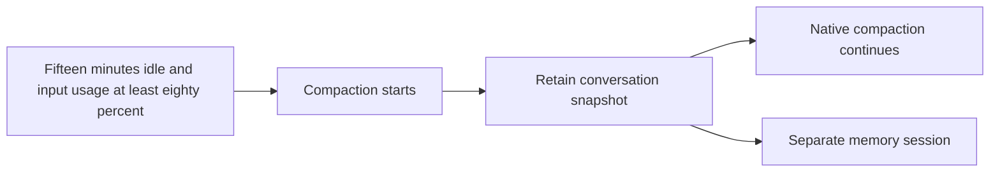

# Response latency and native maintenance

## Human section

### Problem

Compaction and durable memory saving can delay a reply when they run in the foreground. Custom delegation handoffs also duplicate behavior now provided by native parent continuation.

### Design

The public implementation contains Claude Code integration and shared OpenClaw support. Provider-specific integrations and deployment configuration belong in their companion repositories.

#### Save durable memories when compaction starts

Retain a bounded snapshot before acknowledging compaction. A separate session saves durable facts through existing memory tools and source permissions. Claude's native PreCompact callback captures the active native parent chain, including tool results. Manual and idle compaction use the same callback. Token thresholds, transcript size and reply completion do not independently initiate another save for an opted-in harness. Deduplication and recovery use the captured history; new foreground activity does not cancel an admitted saver.

#### Compact Claude sessions while idle

Schedule native Claude compaction after fifteen minutes without activity and at least eighty percent of the effective input budget. Recheck queued work, delegated work, pending delivery and session identity at expiry. Waiting holds no writer or command budget. Native automatic compaction remains the fallback. Real native cancellation, resume and foreground admission remain acceptance requirements.

#### Use native delegation

Retire blocking-gather and durable-handoff customizations together. Native parent continuation already provides the original parent-final and stale-child delivery repairs. Preserve untrusted-source wrapping and persisted completion recovery. Reconcile outstanding custom records before switching behavior, with restart coverage and no replay of consumed results.

### Status

Implementation and release are approved. Local source checks and installed synthetic Claude delegation checks have passed. Real-provider qualification is approved and awaiting the release manager's allocation. Full DEV, TEST and production acceptance remain open. No deployed latency improvement is claimed.

## Agent section

### Source and publication boundary

Public base: `c2293925046120f612da362d18b7e0e125753b2e`. Pinned OpenClaw: `eb377ac59e6c9fd6c7705028034812becf00271b` (2026.9.6). Publish from a clean feature branch based on the public base. Earlier unpublished investigation commits are retained outside the public branch. Public tests use a synthetic harness identity and Claude Code. Companion patches supply other native adapters and their specific regression bindings. Public CI requires no companion repository or deployment configuration.

### Implementation

Use existing compaction notifications, internal snapshot preparation and the memory runner. Retain source authorization, incognito checks, ownership, cancellation and persistence. Native PreCompact retains the selected active transcript chain before callback acknowledgment; detached saving does not block on inference. A bounded reverse reader stops at the current root, so obsolete branches do not consume the snapshot budget. Repeated notifications reuse the retained job; uncertain writes require reconciliation.

Claude manual and idle operations use a host-admitted, resume-only control path. Safe mode retains built-in `/compact` while disabling customizations. Empty tools, strict empty MCP configuration and a denying permission callback prevent tools from running during compaction. Ordinary turns retain `--disable-slash-commands`; a foreground prompt cannot select the control path.

Code Mode selects the borrowed source policy separately from the session that owns execution. Its replay, wait ownership and lifecycle events retain that execution identity. Shared hooks and the idle scheduler use existing session-maintenance ownership and persistence.

Native yielded-parent ownership and terminal delivery guards are present in the pinned upstream base. Remove both gather patches and adapt dependent untrusted-result presentation hunks. The delegation canary expects a native `yielded` acknowledgment followed by one `subagent_settle` continuation. It checks wrapping enabled and disabled and direct, delayed, spawn and yield paths.

### Validation and remaining acceptance

Focused checks cover final Claude child-process arguments, native hook routing, source policy, snapshot retention, deduplication, append-only writes, restart recovery and idle admission. Installed synthetic Claude delegation passes with wrapping on and off. These checks use native processes with scripted inference and do not establish real-provider or deployed acceptance.

Before release, qualify actual native compaction and independent memory saving with synthetic conversations, then confirm recall after restart. Separately exercise the real fifteen-minute idle trigger at the configured input ratio and native cancellation/resume. Do not substitute shortened timers or edited usage for that acceptance. Preserve exact source, artifact and process-closure evidence.

### Rollout and rollback

Use the existing release manager and installed controller. Rebase paired sources at the FIFO front, build changed inputs, then promote one frozen output through the full application suite, installed TEST, verified backup and read-only PROD checks. Merge the tested source heads. Recover through the controller and preserve live state. Finalize only after publication and all consumers release their inputs.

### Checklist

- [x] Implement approved shared support and Claude integration.
- [x] Complete focused checks and installed synthetic delegation.
- [ ] Review the clean publication diff and companion composition.
- [ ] Qualify actual native compaction, memory saving, idle trigger and cancellation/resume.
- [ ] Pass full application suite and TEST.
- [ ] Deploy, verify PROD and merge through the release manager.
- [ ] Finalize owned inputs and retained evidence.
